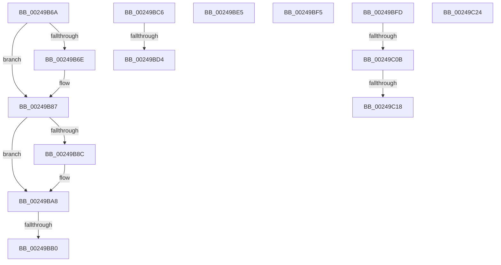

# sub_00249B6A

- RVA: `0x00249B6A`–`0x00249C2E` (길이 `196` bytes)
- VA: `0x0000000140249B6A`
- 실행 섹션: `.text`
- PDB 이름 있음: `아니요`; PDB Function 태그: `아니요`
- unwind 정보 RVA: `0x00062938`
- 디코드: `48`개 명령, `196/196` bytes 표시
- 미해석 바이트: `0` (있으면 어셈블리에 `.byte`로 보존)

> 이 문서는 커널 이미지의 기계어와 PDB 기호를 분석해 생성했습니다. 4번과 5번은 함수 원형과 자료형을 바이너리 사용 방식에서 추정한 C 해석이며 원본 소스 복구 결과는 아닙니다.

## 1. Dependencies

- 직접 호출 지점: **5**; 고유 호출 대상: **5**
- 직접 호출자로 확인된 함수: **0**
- RIP 상대 이미지 참조: **3**

### Outgoing calls
- `0x00249B9D` → [memset](../6C/memset_function_006C6C40.md) (function, `0x006C6C40`)
- `0x00249BDB` → [ExpAcquireSpinLockExclusiveAtDpcLevelInstrumented](../32/ExpAcquireSpinLockExclusiveAtDpcLevelInstrumented_function_00323A70.md) (function, `0x00323A70`)
- `0x00249BEB` → [KiRaiseIrqlProcessIrqlFlags](../4F/KiRaiseIrqlProcessIrqlFlags_function_004F56FC.md) (function, `0x004F56FC`)
- `0x00249C0B` → [KiCheckVpBackingLongSpinWaitHypercall](../30/KiCheckVpBackingLongSpinWaitHypercall_function_0030F490.md) (function, `0x0030F490`)
- `0x00249C1A` → [HvlNotifyLongSpinWait](../30/HvlNotifyLongSpinWait_function_0030F460.md) (function, `0x0030F460`)

### Direct callers
- 이 함수 시작 RVA로 연결되는 직접 call은 확인되지 않았습니다. 간접 호출은 완전히 역산할 수 없습니다.

### Static image references
- `0x00249B73` → RVA `0x00000000` (`image boundary/outside`; read)
- `0x00249BC6` → RVA `0x00F0DE58` (`.data`; read)
- `0x00249BFD` → RVA `0x00FC6AB8` (`ALMOSTRO`; read)

## 2. Other-region calls and transfers

- 다른 실행 섹션으로 향하는 call: **0**
- call이 아닌 외부 분기/꼬리 이동: **10**
  - `0x00249BAA` → [sub_00249850 + 0x204](Unknown_function_00249850.md) (`tail-transfer`)
  - `0x00249BC1` → [sub_00249850 + 0x202](Unknown_function_00249850.md) (`tail-transfer`)
  - `0x00249BCE` → [sub_00249850 + 0x170](Unknown_function_00249850.md) (`tail-transfer`)
  - `0x00249BE0` → [sub_00249850 + 0x1CB](Unknown_function_00249850.md) (`tail-transfer`)
  - `0x00249BF0` → [sub_00249850 + 0x163](Unknown_function_00249850.md) (`tail-transfer`)
  - `0x00249BF8` → [sub_00249850 + 0x145](Unknown_function_00249850.md) (`tail-transfer`)
  - `0x00249C05` → [sub_00249850 + 0x1B8](Unknown_function_00249850.md) (`tail-transfer`)
  - `0x00249C12` → [sub_00249850 + 0x1B8](Unknown_function_00249850.md) (`tail-transfer`)
  - `0x00249C1F` → [sub_00249850 + 0x1BA](Unknown_function_00249850.md) (`tail-transfer`)
  - `0x00249C29` → [sub_00249850 + 0x123](Unknown_function_00249850.md) (`tail-transfer`)

## 3. Assembly (complete function range)

```asm
00249B6A  85 C9                           test ecx, ecx
00249B6C  74 19                           je 0x140249b87
00249B6E  8B C1                           mov eax, ecx
00249B70  8D 6A F8                        lea ebp, [rdx - 8]
00249B73  48 8D 0D 86 64 DB FF            lea rcx, [rip - 0x249b7a]
00249B7A  0F B6 84 08 20 2D 01 00         movzx eax, byte ptr [rax + rcx + 0x12d20]
00249B82  08 07                           or byte ptr [rdi], al
00249B84  48 FF C7                        inc rdi
00249B87  83 FD 08                        cmp ebp, 8
00249B8A  76 1C                           jbe 0x140249ba8
00249B8C  8B DD                           mov ebx, ebp
00249B8E  BA FF 00 00 00                  mov edx, 0xff
00249B93  48 C1 EB 03                     shr rbx, 3
00249B97  48 8B CF                        mov rcx, rdi
00249B9A  4C 8B C3                        mov r8, rbx
00249B9D  E8 9E D0 47 00                  call 0x1406c6c40
00249BA2  48 03 FB                        add rdi, rbx
00249BA5  83 E5 07                        and ebp, 7
00249BA8  85 ED                           test ebp, ebp
00249BAA  0F 84 A4 FE FF FF               je 0x140249a54
00249BB0  8B C5                           mov eax, ebp
00249BB2  48 8D 0D 47 64 DB FF            lea rcx, [rip - 0x249bb9]
00249BB9  0F B6 84 08 90 C8 02 00         movzx eax, byte ptr [rax + rcx + 0x2c890]
00249BC1  E9 8C FE FF FF                  jmp 0x140249a52
00249BC6  8B 05 8C 42 CC 00               mov eax, dword ptr [rip + 0xcc428c]
00249BCC  85 C0                           test eax, eax
00249BCE  0F 85 EC FD FF FF               jne 0x1402499c0
00249BD4  40 0F B6 D6                     movzx edx, sil
00249BD8  49 8B CC                        mov rcx, r12
00249BDB  E8 90 9E 0D 00                  call 0x140323a70
00249BE0  E9 36 FE FF FF                  jmp 0x140249a1b
00249BE5  B2 02                           mov dl, 2
00249BE7  40 0F B6 CE                     movzx ecx, sil
00249BEB  E8 0C BB 2A 00                  call 0x1404f56fc
00249BF0  E9 BE FD FF FF                  jmp 0x1402499b3
00249BF5  45 8B FA                        mov r15d, r10d
00249BF8  E9 98 FD FF FF                  jmp 0x140249995
00249BFD  8B 05 B5 CE D7 00               mov eax, dword ptr [rip + 0xd7ceb5]
00249C03  A8 40                           test al, 0x40
00249C05  0F 84 FD FD FF FF               je 0x140249a08
00249C0B  E8 80 58 0C 00                  call 0x14030f490
00249C10  84 C0                           test al, al
00249C12  0F 84 F0 FD FF FF               je 0x140249a08
00249C18  8B CB                           mov ecx, ebx
00249C1A  E8 41 58 0C 00                  call 0x14030f460
00249C1F  E9 E6 FD FF FF                  jmp 0x140249a0a
00249C24  B9 20 00 00 00                  mov ecx, 0x20
00249C29  E9 45 FD FF FF                  jmp 0x140249973
```

## 4. C-style interpretation (structured pseudocode)

```c
__int64 __fastcall sub_00249B6A(int a1, __int64 a2)
{
    __int64 result;
    __int64 v_rbp;
    __int64 v_rbx;
    __int64 v_rdi;

    if (a1 != 0) {
        result = a1;
        v_rbp = a2 - 8;
        a1 = v_rip - 2399098;
        result = *(unsigned __int8 *)(result + a1 * 1 + 77088);
        v_rdi = (v_rdi) + 1;
    }
    if (((unsigned int)(v_rbp)) >= = 8) {
        v_rbx = (unsigned int)(v_rbp);
        a2 = 255;
        v_rbx = (v_rbx) >> (3);
        a1 = v_rdi;
        a3 = v_rbx;
        result = memset(a1, a2, a3, a4);
        v_rdi = (v_rdi) + (v_rbx);
        v_rbp = (unsigned int)((v_rbp) & (7));
    }
}
```

## 5. (Beta) C Style

```c
int64_t sub_00249B6A(int32_t Arg1, void *Arg2)
{
    uint8_t *arg2 = (uint8_t *)Arg2;

    int64_t result;
    int64_t local_rbp;
    int64_t local_rbx;
    int64_t local_rdi;

    if (Arg1 != 0) {
        result = Arg1;
        local_rbp = Arg2 - 8;
        Arg1 = v_rip - 2399098;
        result = *(uint8_t *)(result + Arg1 * 1 + 0x12D20);
        local_rdi = (local_rdi) + 1;
    }
    if (((uint32_t)(local_rbp)) >= = 8) {
        local_rbx = (uint32_t)(local_rbp);
        Arg2 = 255;
        local_rbx = (local_rbx) >> (3);
        Arg1 = local_rdi;
        a3 = local_rbx;
        result = memset(Arg1, Arg2, a3, a4);
        local_rdi = (local_rdi) + (local_rbx);
        local_rbp = (uint32_t)((local_rbp) & (7));
    }
}
```

### 관측된 메모리 오프셋

구조체 형식이 확인되지 않은 접근은 인자 기준의 오프셋으로만 기록했습니다.

| 기준 인자 | 오프셋 표현 | 폭 (bit) | 접근 |
|---|---:|---:|---|
| `Arg2` | `- 0x8` | `32` | `R` |

## 6. Execution-region graph

[열기: 2D/3D 그래프와 함수 탐색 컨트롤 패널](../../../control-panel.html?section=text&rva=0x00249B6A&view=graph)

- 2D 그래프는 위에서 아래로 흐르고, 3D 그래프는 빈 공간을 드래그해 회전합니다. Shift+드래그는 이동, 휠은 확대·축소, 함수 노드 선택은 대상 보고서 이동입니다.

### Static fallback


