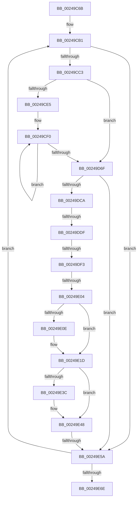

# sub_00249C6B

- RVA: `0x00249C6B`–`0x00249EA6` (길이 `571` bytes)
- VA: `0x0000000140249C6B`
- 실행 섹션: `.text`
- PDB 이름 있음: `아니요`; PDB Function 태그: `아니요`
- unwind 정보 RVA: `0x00062978`
- 디코드: `124`개 명령, `571/571` bytes 표시
- 미해석 바이트: `0` (있으면 어셈블리에 `.byte`로 보존)

> 이 문서는 커널 이미지의 기계어와 PDB 기호를 분석해 생성했습니다. 4번과 5번은 함수 원형과 자료형을 바이너리 사용 방식에서 추정한 C 해석이며 원본 소스 복구 결과는 아닙니다.

## 1. Dependencies

- 직접 호출 지점: **8**; 고유 호출 대상: **7**
- 직접 호출자로 확인된 함수: **0**
- RIP 상대 이미지 참조: **4**

### Outgoing calls
- `0x00249CC8` → [KeQueryPerformanceCounter](../37/KeQueryPerformanceCounter_function_0037E7E0.md) (function, `0x0037E7E0`)
- `0x00249CD8` → [KeQueryActiveProcessorCountEx](KeQueryActiveProcessorCountEx_function_00249EF0.md) (function, `0x00249EF0`)
- `0x00249D71` → [KeQueryPerformanceCounter](../37/KeQueryPerformanceCounter_function_0037E7E0.md) (function, `0x0037E7E0`)
- `0x00249DE3` → [ExAcquireSpinLockExclusiveAtDpcLevel](ExAcquireSpinLockExclusiveAtDpcLevel_function_00248E80.md) (function, `0x00248E80`)
- `0x00249E25` → [KiSetProcessConcurrencyCount](KiSetProcessConcurrencyCount_function_00249F2C.md) (function, `0x00249F2C`)
- `0x00249E2E` → [ExReleaseSpinLockExclusiveFromDpcLevel](ExReleaseSpinLockExclusiveFromDpcLevel_function_002497E0.md) (function, `0x002497E0`)
- `0x00249E43` → [KiLowerIrqlProcessIrqlFlags](../4F/KiLowerIrqlProcessIrqlFlags_function_004F5698.md) (function, `0x004F5698`)
- `0x00249E5D` → [PsGetNextProcess](../../page/91/PsGetNextProcess_function_0091C900.md) (function, `0x0091C900`)

### Direct callers
- 이 함수 시작 RVA로 연결되는 직접 call은 확인되지 않았습니다. 간접 호출은 완전히 역산할 수 없습니다.

### Static image references
- `0x00249C83` → RVA `0x00FC8C40` (`ALMOSTRO`; read)
- `0x00249CFB` → RVA `0x00EFA278` (`.data`; read)
- `0x00249DD2` → RVA `0x00FC6D20` (`ALMOSTRO`; read)
- `0x00249DF5` → RVA `0x00FC6AE8` (`ALMOSTRO`; read)

## 2. Other-region calls and transfers

- 다른 실행 섹션으로 향하는 call: **1**
  - `0x00249E5D` → [PsGetNextProcess](../../page/91/PsGetNextProcess_function_0091C900.md) (`.text` → `PAGE`)
- call이 아닌 외부 분기/꼬리 이동: **4**
  - `0x00249DD9` → [sub_00249EBD](Unknown_function_00249EBD.md) (`tail-transfer`)
  - `0x00249DED` → [sub_00249EBD + 0x11](Unknown_function_00249EBD.md) (`tail-transfer`)
  - `0x00249DFE` → [sub_00249EBD + 0x21](Unknown_function_00249EBD.md) (`tail-transfer`)
  - `0x00249E54` → [sub_006D8170](../6D/Unknown_function_006D8170.md) (`tail-transfer`)

## 3. Assembly (complete function range)

```asm
00249C6B  48 89 AC 24 B8 00 00 00         mov qword ptr [rsp + 0xb8], rbp
00249C73  48 89 B4 24 C0 00 00 00         mov qword ptr [rsp + 0xc0], rsi
00249C7B  4C 89 A4 24 98 00 00 00         mov qword ptr [rsp + 0x98], r12
00249C83  4C 8D 25 B6 EF D7 00            lea r12, [rip + 0xd7efb6]
00249C8A  4C 89 AC 24 90 00 00 00         mov qword ptr [rsp + 0x90], r13
00249C92  4C 89 BC 24 80 00 00 00         mov qword ptr [rsp + 0x80], r15
00249C9A  45 33 FF                        xor r15d, r15d
00249C9D  48 89 9C 24 B0 00 00 00         mov qword ptr [rsp + 0xb0], rbx
00249CA5  4C 89 B4 24 88 00 00 00         mov qword ptr [rsp + 0x88], r14
00249CAD  45 8D 6F 02                     lea r13d, [r15 + 2]
00249CB1  4C 89 7C 24 38                  mov qword ptr [rsp + 0x38], r15
00249CB6  4C 39 BF 90 01 00 00            cmp qword ptr [rdi + 0x190], r15
00249CBD  0F 84 97 01 00 00               je 0x140249e5a
00249CC3  48 8D 4C 24 38                  lea rcx, [rsp + 0x38]
00249CC8  E8 13 4B 13 00                  call 0x14037e7e0
00249CCD  B9 FF FF 00 00                  mov ecx, 0xffff
00249CD2  48 8B D8                        mov rbx, rax
00249CD5  49 8B F7                        mov rsi, r15
00249CD8  E8 13 02 00 00                  call 0x140249ef0
00249CDD  85 C0                           test eax, eax
00249CDF  0F 84 8A 00 00 00               je 0x140249d6f
00249CE5  4D 8B DF                        mov r11, r15
00249CE8  8B E8                           mov ebp, eax
00249CEA  66 0F 1F 44 00 00               nop word ptr [rax + rax]
00249CF0  44 8B 97 90 01 00 00            mov r10d, dword ptr [rdi + 0x190]
00249CF7  4D 8D 5B 08                     lea r11, [r11 + 8]
00249CFB  48 8B 05 76 05 CB 00            mov rax, qword ptr [rip + 0xcb0576]
00249D02  45 8B CA                        mov r9d, r10d
00249D05  49 C1 EA 04                     shr r10, 4
00249D09  BA 01 00 00 00                  mov edx, 1
00249D0E  41 81 E2 FF 01 00 00            and r10d, 0x1ff
00249D15  41 C1 E9 0D                     shr r9d, 0xd
00249D19  41 81 E1 FF FF 03 00            and r9d, 0x3ffff
00249D20  4D 8B 44 03 F8                  mov r8, qword ptr [r11 + rax - 8]
00249D25  41 0F BD C9                     bsr ecx, r9d
00249D29  D3 E2                           shl edx, cl
00249D2B  83 C1 FE                        add ecx, -2
00249D2E  41 33 D1                        xor edx, r9d
00249D31  49 8B 0C C8                     mov rcx, qword ptr [r8 + rcx*8]
00249D35  48 8B 54 D1 08                  mov rdx, qword ptr [rcx + rdx*8 + 8]
00249D3A  4A 8B 0C D2                     mov rcx, qword ptr [rdx + r10*8]
00249D3E  4A 8B 44 D2 08                  mov rax, qword ptr [rdx + r10*8 + 8]
00249D43  4A 89 4C D2 08                  mov qword ptr [rdx + r10*8 + 8], rcx
00249D48  48 2B C8                        sub rcx, rax
00249D4B  48 69 C1 80 96 98 00            imul rax, rcx, 0x989680
00249D52  4B 8B 4C 23 F8                  mov rcx, qword ptr [r11 + r12 - 8]
00249D57  8B 51 44                        mov edx, dword ptr [rcx + 0x44]
00249D5A  48 69 CA 40 42 0F 00            imul rcx, rdx, 0xf4240
00249D61  33 D2                           xor edx, edx
00249D63  48 F7 F1                        div rcx
00249D66  48 03 F0                        add rsi, rax
00249D69  48 83 ED 01                     sub rbp, 1
00249D6D  75 81                           jne 0x140249cf0
00249D6F  33 C9                           xor ecx, ecx
00249D71  E8 6A 4A 13 00                  call 0x14037e7e0
00249D76  48 2B C3                        sub rax, rbx
00249D79  44 88 7C 24 30                  mov byte ptr [rsp + 0x30], r15b
00249D7E  48 99                           cqo
00249D80  48 2B C2                        sub rax, rdx
00249D83  33 D2                           xor edx, edx
00249D85  48 D1 F8                        sar rax, 1
00249D88  48 03 C3                        add rax, rbx
00249D8B  48 8B C8                        mov rcx, rax
00249D8E  48 2B 8F 88 01 00 00            sub rcx, qword ptr [rdi + 0x188]
00249D95  48 89 87 88 01 00 00            mov qword ptr [rdi + 0x188], rax
00249D9C  48 69 C1 80 96 98 00            imul rax, rcx, 0x989680
00249DA3  48 F7 74 24 38                  div qword ptr [rsp + 0x38]
00249DA8  33 D2                           xor edx, edx
00249DAA  48 8D 48 01                     lea rcx, [rax + 1]
00249DAE  48 8B C6                        mov rax, rsi
00249DB1  48 8B B7 B8 00 00 00            mov rsi, qword ptr [rdi + 0xb8]
00249DB8  48 F7 F1                        div rcx
00249DBB  8B 4E 0C                        mov ecx, dword ptr [rsi + 0xc]
00249DBE  4C 8B F0                        mov r14, rax
00249DC1  F6 C1 01                        test cl, 1
00249DC4  0F 85 90 00 00 00               jne 0x140249e5a
00249DCA  44 0F 20 C3                     mov rbx, cr8
00249DCE  45 0F 22 C5                     mov cr8, r13
00249DD2  44 39 3D 47 CF D7 00            cmp dword ptr [rip + 0xd7cf47], r15d
00249DD9  0F 85 DE 00 00 00               jne 0x140249ebd
00249DDF  48 8D 4F 40                     lea rcx, [rdi + 0x40]
00249DE3  E8 98 F0 FF FF                  call 0x140248e80
00249DE8  8B 46 0C                        mov eax, dword ptr [rsi + 0xc]
00249DEB  A8 01                           test al, 1
00249DED  0F 85 DB 00 00 00               jne 0x140249ece
00249DF3  8B 06                           mov eax, dword ptr [rsi]
00249DF5  8B 15 ED CC D7 00               mov edx, dword ptr [rip + 0xd7cced]
00249DFB  44 3B F2                        cmp r14d, edx
00249DFE  0F 87 DA 00 00 00               ja 0x140249ede
00249E04  41 8B D6                        mov edx, r14d
00249E07  C1 E2 12                        shl edx, 0x12
00249E0A  3B D0                           cmp edx, eax
00249E0C  73 0F                           jae 0x140249e1d
00249E0E  44 8B C0                        mov r8d, eax
00249E11  44 2B C2                        sub r8d, edx
00249E14  8B D0                           mov edx, eax
00249E16  41 C1 E8 04                     shr r8d, 4
00249E1A  41 2B D0                        sub edx, r8d
00249E1D  4C 8D 44 24 30                  lea r8, [rsp + 0x30]
00249E22  48 8B CF                        mov rcx, rdi
00249E25  E8 02 01 00 00                  call 0x140249f2c
00249E2A  48 8D 4F 40                     lea rcx, [rdi + 0x40]
00249E2E  E8 AD F9 FF FF                  call 0x1402497e0
00249E33  44 39 3D E6 CE D7 00            cmp dword ptr [rip + 0xd7cee6], r15d
00249E3A  74 0C                           je 0x140249e48
00249E3C  44 0F 20 C1                     mov rcx, cr8
00249E40  0F B6 D3                        movzx edx, bl
00249E43  E8 50 B8 2A 00                  call 0x1404f5698
00249E48  0F B6 C3                        movzx eax, bl
00249E4B  44 0F 22 C0                     mov cr8, rax
00249E4F  44 38 7C 24 30                  cmp byte ptr [rsp + 0x30], r15b
00249E54  0F 85 16 E3 48 00               jne 0x1406d8170
00249E5A  48 8B CF                        mov rcx, rdi
00249E5D  E8 9E 2A 6D 00                  call 0x14091c900
00249E62  48 8B F8                        mov rdi, rax
00249E65  48 85 C0                        test rax, rax
00249E68  0F 85 43 FE FF FF               jne 0x140249cb1
00249E6E  4C 8B BC 24 80 00 00 00         mov r15, qword ptr [rsp + 0x80]
00249E76  4C 8B B4 24 88 00 00 00         mov r14, qword ptr [rsp + 0x88]
00249E7E  4C 8B AC 24 90 00 00 00         mov r13, qword ptr [rsp + 0x90]
00249E86  4C 8B A4 24 98 00 00 00         mov r12, qword ptr [rsp + 0x98]
00249E8E  48 8B B4 24 C0 00 00 00         mov rsi, qword ptr [rsp + 0xc0]
00249E96  48 8B AC 24 B8 00 00 00         mov rbp, qword ptr [rsp + 0xb8]
00249E9E  48 8B 9C 24 B0 00 00 00         mov rbx, qword ptr [rsp + 0xb0]
```

## 4. C-style interpretation (structured pseudocode)

```c
__int64 __fastcall sub_00249C6B(__int64 a1, __int64 a2, __int64 a3, __int64 a4, __int64 a5, unsigned __int8 a6, __int64 a7, __int64 a8, __int64 a9, __int64 a10, __int64 a11, __int64 a12, __int64 a13, __int64 a14, __int64 a15, __int64 a16, __int64 a17, __int64 a18, __int64 a19, __int64 a20, __int64 a21, __int64 a22, __int64 a23, __int64 a24)
{
    __int64 result;
    __int64 v_r10;
    __int64 v_r15;
    __int64 v_rbp;
    __int64 v_rsi;
    unsigned __int8 v_stack_p30;
    unsigned __int64 v_stack_p38;
    unsigned __int64 v_stack_p80;
    unsigned __int64 v_stack_p88;
    unsigned __int64 v_stack_p90;
    unsigned __int64 v_stack_p98;
    unsigned __int64 v_stack_pB0;
    unsigned __int64 v_stack_pB8;
    unsigned __int64 v_stack_pC0;

    v_stack_pB8 = v_rbp;
    v_stack_pC0 = v_rsi;
    v_stack_p98 = v_r12;
    v_stack_p90 = v_r13;
    v_stack_p80 = v_r15;
    v_r15 = 0;
    v_stack_pB0 = v_rbx;
    v_stack_p88 = v_r14;
loc_00249CB1:
    v_stack_p38 = 0;
    if ((*(unsigned __int64 *)(v_rdi + 400)) == 0) goto loc_00249E5A;
    result = KeQueryPerformanceCounter(a7, a2, a3, a4);
    result = KeQueryActiveProcessorCountEx((unsigned int)(0xFFFFULL), a2, a3, a4);
    if ((unsigned int)(result) == 0) goto loc_00249D6F;
loc_00249CF0:
    v_r10 = ((unsigned int)(*(unsigned int *)(v_rdi + 400))) >> (4);
    v_r10 = (unsigned int)((v_r10) & (511));
    a4 = (unsigned int)(((unsigned int)((unsigned int)((unsigned int)(*(unsigned int *)(v_rdi + 400))))) >> (13));
    a4 = (unsigned int)((a4) & (0x3FFFFULL));
    a2 = (unsigned int)((1) << ((unsigned __int8)((unsigned int)(0xFFFFULL))));
    a1 = (unsigned int)(((unsigned int)(0xFFFFULL)) + (-2));
    a2 = (unsigned int)((a2) ^ ((unsigned int)(a4)));
    *(unsigned __int64 *)(*(unsigned __int64 *)(*(unsigned __int64 *)(*(unsigned __int64 *)(0 + 8 + *(unsigned __int64 *)(v_rip + 13305206) * 1 - 8) + a1 * 8) + a2 * 8 + 8) + v_r10 * 8 + 8) = *(unsigned __int64 *)(*(unsigned __int64 *)(*(unsigned __int64 *)(*(unsigned __int64 *)(0 + 8 + *(unsigned __int64 *)(v_rip + 13305206) * 1 - 8) + a1 * 8) + a2 * 8 + 8) + v_r10 * 8);
    a1 = (*(unsigned __int64 *)(*(unsigned __int64 *)(*(unsigned __int64 *)(*(unsigned __int64 *)(0 + 8 + *(unsigned __int64 *)(v_rip + 13305206) * 1 - 8) + a1 * 8) + a2 * 8 + 8) + v_r10 * 8)) - (*(unsigned __int64 *)(*(unsigned __int64 *)(*(unsigned __int64 *)(*(unsigned __int64 *)(0 + 8 + *(unsigned __int64 *)(v_rip + 13305206) * 1 - 8) + a1 * 8) + a2 * 8 + 8) + v_r10 * 8 + 8));
    result = (*(unsigned __int64 *)(*(unsigned __int64 *)(*(unsigned __int64 *)(*(unsigned __int64 *)(0 + 8 + *(unsigned __int64 *)(v_rip + 13305206) * 1 - 8) + a1 * 8) + a2 * 8 + 8) + v_r10 * 8 + 8)) * (a1);
    a1 = (*(unsigned __int64 *)(0 + 8 + v_rip + 14151606 * 1 - 8)) * ((unsigned int)(*(unsigned int *)(*(unsigned __int64 *)(0 + 8 + v_rip + 14151606 * 1 - 8) + 68)));
    a2 = 0;
    v_rsi = (0) + (result);
    v_rbp = ((unsigned int)((unsigned int)(result))) - (1);
    if (condition_is_not_equal) goto loc_00249CF0;
loc_00249D6F:
    a1 = 0;
    result = KeQueryPerformanceCounter(a1, a2, *(unsigned __int64 *)(0 + 8 + *(unsigned __int64 *)(v_rip + 13305206) * 1 - 8), a4);
    result = (result) - (result);
    v_stack_p30 = 0;
    result = (result) - (0);
    a2 = 0;
    result = (result) >> (1);
    result = (result) + (result);
    a1 = (result) - (*(unsigned __int64 *)(v_rdi + 392));
    *(unsigned __int64 *)(v_rdi + 392) = result;
    result = (result) * (a1);
    a2 = 0;
    if ((((unsigned __int8)((unsigned int)(*(unsigned int *)(*(unsigned __int64 *)(v_rdi + 184) + 12)))) & (1)) != 0) goto loc_00249E5A;
    result = ExAcquireSpinLockExclusiveAtDpcLevel(v_rdi + 64, a2, *(unsigned __int64 *)(0 + 8 + *(unsigned __int64 *)(v_rip + 13305206) * 1 - 8), a4);
    a2 = (unsigned int)(((unsigned int)((unsigned int)(v_rsi))) << (18));
    if (((unsigned int)(a2)) < ((unsigned int)((unsigned int)(*(unsigned int *)(*(unsigned __int64 *)(v_rdi + 184)))))) {
        a3 = (unsigned int)((unsigned int)(*(unsigned int *)(*(unsigned __int64 *)(v_rdi + 184))));
        a3 = (unsigned int)((a3) - ((unsigned int)(a2)));
        a2 = (unsigned int)((unsigned int)(*(unsigned int *)(*(unsigned __int64 *)(v_rdi + 184))));
        a3 = (unsigned int)((a3) >> (4));
        a2 = (unsigned int)((a2) - ((unsigned int)(a3)));
    }
    result = KiSetProcessConcurrencyCount(v_rdi, a2, a6, a4);
    result = ExReleaseSpinLockExclusiveFromDpcLevel(v_rdi + 64, a2, a6, a4);
    if ((*(unsigned int *)(v_rip + 14143206)) != 0) {
        a1 = v_r15 + 2;
        a2 = (unsigned __int8)(v_cr8);
        result = KiLowerIrqlProcessIrqlFlags(a1, a2, a6, a4);
    }
loc_00249E5A:
    result = PsGetNextProcess(v_rdi, a2, a6, a4);
    if (result != 0) goto loc_00249CB1;
    return result;
}
```

## 5. (Beta) C Style

```c
int64_t sub_00249C6B(int64_t Arg1, int64_t Arg2, int64_t Arg3, int64_t Arg4, uint64_t Arg5, uint8_t Arg6, int64_t Arg7, uint64_t Arg8, uint64_t Arg9, uint64_t Arg10, uint64_t Arg11, uint64_t Arg12, uint64_t Arg13, uint64_t Arg14, uint64_t Arg15, int64_t Arg16, int64_t Arg17, int64_t Arg18, int64_t Arg19, uint64_t Arg20, uint64_t Arg21, int64_t Arg22, int64_t Arg23, int64_t Arg24)
{
    int64_t result;
    int64_t local_r10;
    int64_t local_r15;
    int64_t local_rbp;
    int64_t local_rsi;
    uint8_t v_stack_p30;
    uint64_t v_stack_p38;
    uint64_t v_stack_p80;
    uint64_t v_stack_p88;
    uint64_t v_stack_p90;
    uint64_t v_stack_p98;
    uint64_t v_stack_pB0;
    uint64_t v_stack_pB8;
    uint64_t v_stack_pC0;

    v_stack_pB8 = local_rbp;
    v_stack_pC0 = local_rsi;
    v_stack_p98 = local_r12;
    v_stack_p90 = local_r13;
    v_stack_p80 = local_r15;
    local_r15 = 0;
    v_stack_pB0 = local_rbx;
    v_stack_p88 = local_r14;
loc_00249CB1:
    v_stack_p38 = 0;
    if ((*(uint64_t *)(local_rdi + 0x190)) == 0) goto loc_00249E5A;
    result = KeQueryPerformanceCounter(Arg7, Arg2, Arg3, Arg4);
    result = KeQueryActiveProcessorCountEx((uint32_t)(0xFFFFULL), Arg2, Arg3, Arg4);
    if ((uint32_t)(result) == 0) goto loc_00249D6F;
loc_00249CF0:
    local_r10 = ((uint32_t)(*(uint32_t *)(local_rdi + 0x190))) >> (4);
    local_r10 = (uint32_t)((local_r10) & (511));
    Arg4 = (uint32_t)(((uint32_t)((uint32_t)((uint32_t)(*(uint32_t *)(local_rdi + 0x190))))) >> (13));
    Arg4 = (uint32_t)((Arg4) & (0x3FFFFULL));
    Arg2 = (uint32_t)((1) << ((uint8_t)((uint32_t)(0xFFFFULL))));
    Arg1 = (uint32_t)(((uint32_t)(0xFFFFULL)) + (-2));
    Arg2 = (uint32_t)((Arg2) ^ ((uint32_t)(Arg4)));
    *(uint64_t *)(*(uint64_t *)(*(uint64_t *)(*(uint64_t *)(0 + 0x8 + *(uint64_t *)(v_rip + 0xCB0576) * 1 - 0x8) + Arg1 * 8) + Arg2 * 8 + 0x8) + local_r10 * 8 + 0x8) = *(uint64_t *)(*(uint64_t *)(*(uint64_t *)(*(uint64_t *)(0 + 0x8 + *(uint64_t *)(v_rip + 0xCB0576) * 1 - 0x8) + Arg1 * 8) + Arg2 * 8 + 0x8) + local_r10 * 8);
    Arg1 = (*(uint64_t *)(*(uint64_t *)(*(uint64_t *)(*(uint64_t *)(0 + 0x8 + *(uint64_t *)(v_rip + 0xCB0576) * 1 - 0x8) + Arg1 * 8) + Arg2 * 8 + 0x8) + local_r10 * 8)) - (*(uint64_t *)(*(uint64_t *)(*(uint64_t *)(*(uint64_t *)(0 + 0x8 + *(uint64_t *)(v_rip + 0xCB0576) * 1 - 0x8) + Arg1 * 8) + Arg2 * 8 + 0x8) + local_r10 * 8 + 0x8));
    result = (*(uint64_t *)(*(uint64_t *)(*(uint64_t *)(*(uint64_t *)(0 + 0x8 + *(uint64_t *)(v_rip + 0xCB0576) * 1 - 0x8) + Arg1 * 8) + Arg2 * 8 + 0x8) + local_r10 * 8 + 0x8)) * (Arg1);
    Arg1 = (*(uint64_t *)(0 + 0x8 + v_rip + 0xD7EFB6 * 1 - 0x8)) * ((uint32_t)(*(uint32_t *)(*(uint64_t *)(0 + 0x8 + v_rip + 0xD7EFB6 * 1 - 0x8) + 0x44)));
    Arg2 = 0;
    local_rsi = (0) + (result);
    local_rbp = ((uint32_t)((uint32_t)(result))) - (1);
    if (condition_is_not_equal) goto loc_00249CF0;
loc_00249D6F:
    Arg1 = 0;
    result = KeQueryPerformanceCounter(Arg1, Arg2, *(uint64_t *)(0 + 0x8 + *(uint64_t *)(v_rip + 0xCB0576) * 1 - 0x8), Arg4);
    result = (result) - (result);
    v_stack_p30 = 0;
    result = (result) - (0);
    Arg2 = 0;
    result = (result) >> (1);
    result = (result) + (result);
    Arg1 = (result) - (*(uint64_t *)(local_rdi + 0x188));
    *(uint64_t *)(local_rdi + 0x188) = result;
    result = (result) * (Arg1);
    Arg2 = 0;
    if ((((uint8_t)((uint32_t)(*(uint32_t *)(*(uint64_t *)(local_rdi + 0xB8) + 0xC)))) & (1)) != 0) goto loc_00249E5A;
    result = ExAcquireSpinLockExclusiveAtDpcLevel(local_rdi + 64, Arg2, *(uint64_t *)(0 + 0x8 + *(uint64_t *)(v_rip + 0xCB0576) * 1 - 0x8), Arg4);
    Arg2 = (uint32_t)(((uint32_t)((uint32_t)(local_rsi))) << (18));
    if (((uint32_t)(Arg2)) < ((uint32_t)((uint32_t)(*(uint32_t *)(*(uint64_t *)(local_rdi + 0xB8)))))) {
        Arg3 = (uint32_t)((uint32_t)(*(uint32_t *)(*(uint64_t *)(local_rdi + 0xB8))));
        Arg3 = (uint32_t)((Arg3) - ((uint32_t)(Arg2)));
        Arg2 = (uint32_t)((uint32_t)(*(uint32_t *)(*(uint64_t *)(local_rdi + 0xB8))));
        Arg3 = (uint32_t)((Arg3) >> (4));
        Arg2 = (uint32_t)((Arg2) - ((uint32_t)(Arg3)));
    }
    result = KiSetProcessConcurrencyCount(local_rdi, Arg2, Arg6, Arg4);
    result = ExReleaseSpinLockExclusiveFromDpcLevel(local_rdi + 64, Arg2, Arg6, Arg4);
    if ((*(uint32_t *)(v_rip + 0xD7CEE6)) != 0) {
        Arg1 = local_r15 + 2;
        Arg2 = (uint8_t)(v_cr8);
        result = KiLowerIrqlProcessIrqlFlags(Arg1, Arg2, Arg6, Arg4);
    }
loc_00249E5A:
    result = PsGetNextProcess(local_rdi, Arg2, Arg6, Arg4);
    if (result != 0) goto loc_00249CB1;
    return result;
}
```

## 6. Execution-region graph

[열기: 2D/3D 그래프와 함수 탐색 컨트롤 패널](../../../control-panel.html?section=text&rva=0x00249C6B&view=graph)

- 2D 그래프는 위에서 아래로 흐르고, 3D 그래프는 빈 공간을 드래그해 회전합니다. Shift+드래그는 이동, 휠은 확대·축소, 함수 노드 선택은 대상 보고서 이동입니다.

### Static fallback


