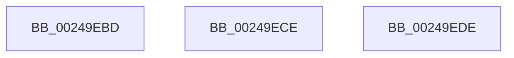

# sub_00249EBD

- RVA: `0x00249EBD`–`0x00249EE8` (길이 `43` bytes)
- VA: `0x0000000140249EBD`
- 실행 섹션: `.text`
- PDB 이름 있음: `아니요`; PDB Function 태그: `아니요`
- unwind 정보 RVA: `0x000629B8`
- 디코드: `11`개 명령, `43/43` bytes 표시
- 미해석 바이트: `0` (있으면 어셈블리에 `.byte`로 보존)

> 이 문서는 커널 이미지의 기계어와 PDB 기호를 분석해 생성했습니다. 4번과 5번은 함수 원형과 자료형을 바이너리 사용 방식에서 추정한 C 해석이며 원본 소스 복구 결과는 아닙니다.

## 1. Dependencies

- 직접 호출 지점: **2**; 고유 호출 대상: **2**
- 직접 호출자로 확인된 함수: **0**
- RIP 상대 이미지 참조: **0**

### Outgoing calls
- `0x00249EC4` → [KiRaiseIrqlProcessIrqlFlags](../4F/KiRaiseIrqlProcessIrqlFlags_function_004F56FC.md) (function, `0x004F56FC`)
- `0x00249ED4` → [KiReleaseProcessLockExclusive](../3C/KiReleaseProcessLockExclusive_function_003C2660.md) (function, `0x003C2660`)

### Direct callers
- 이 함수 시작 RVA로 연결되는 직접 call은 확인되지 않았습니다. 간접 호출은 완전히 역산할 수 없습니다.

### Static image references
- 디코드된 RIP-relative 메모리 참조가 없습니다.

## 2. Other-region calls and transfers

- 다른 실행 섹션으로 향하는 call: **0**
- call이 아닌 외부 분기/꼬리 이동: **3**
  - `0x00249EC9` → [sub_00249C6B + 0x174](Unknown_function_00249C6B.md) (`tail-transfer`)
  - `0x00249ED9` → [sub_00249C6B + 0x1EF](Unknown_function_00249C6B.md) (`tail-transfer`)
  - `0x00249EE3` → [sub_00249C6B + 0x19F](Unknown_function_00249C6B.md) (`tail-transfer`)

## 3. Assembly (complete function range)

```asm
00249EBD  41 0F B6 D5                     movzx edx, r13b
00249EC1  0F B6 CB                        movzx ecx, bl
00249EC4  E8 33 B8 2A 00                  call 0x1404f56fc
00249EC9  E9 11 FF FF FF                  jmp 0x140249ddf
00249ECE  0F B6 D3                        movzx edx, bl
00249ED1  48 8B CF                        mov rcx, rdi
00249ED4  E8 87 87 17 00                  call 0x1403c2660
00249ED9  E9 7C FF FF FF                  jmp 0x140249e5a
00249EDE  C1 E2 12                        shl edx, 0x12
00249EE1  FF CA                           dec edx
00249EE3  E9 22 FF FF FF                  jmp 0x140249e0a
```

## 4. C-style interpretation (structured pseudocode)

```c
__int64 __fastcall sub_00249EBD(void)
{
    __int64 result;

    result = KiRaiseIrqlProcessIrqlFlags((unsigned __int8)(v_rbx), (unsigned __int8)(v_r13), a3, a4);
}
```

## 5. (Beta) C Style

```c
void sub_00249EBD(void)
{
    int64_t result;

    result = KiRaiseIrqlProcessIrqlFlags((uint8_t)(local_rbx), (uint8_t)(local_r13), a3, a4);
}
```

## 6. Execution-region graph

[열기: 2D/3D 그래프와 함수 탐색 컨트롤 패널](../../../control-panel.html?section=text&rva=0x00249EBD&view=graph)

- 2D 그래프는 위에서 아래로 흐르고, 3D 그래프는 빈 공간을 드래그해 회전합니다. Shift+드래그는 이동, 휠은 확대·축소, 함수 노드 선택은 대상 보고서 이동입니다.

### Static fallback


