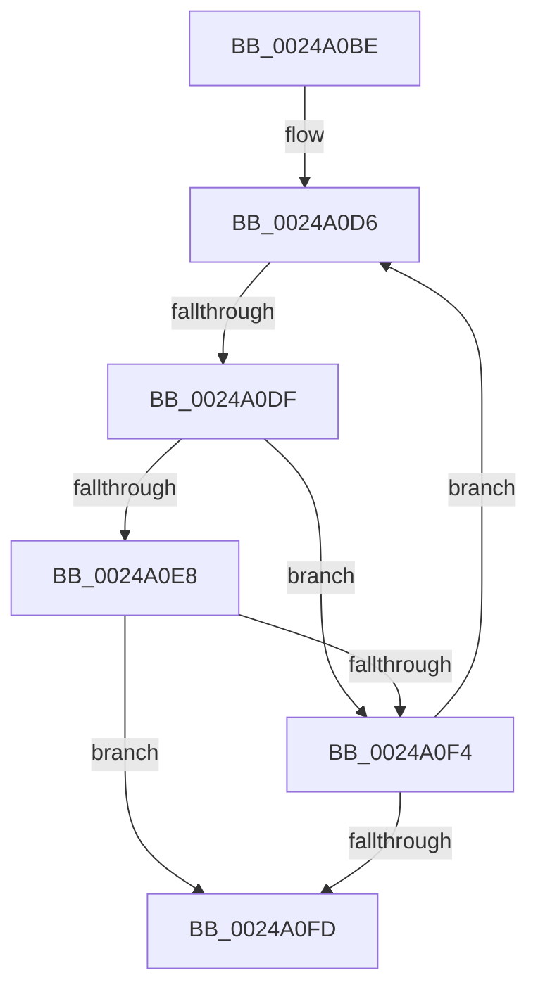

# sub_0024A0BE

- RVA: `0x0024A0BE`–`0x0024A111` (길이 `83` bytes)
- VA: `0x000000014024A0BE`
- 실행 섹션: `.text`
- PDB 이름 있음: `아니요`; PDB Function 태그: `아니요`
- unwind 정보 RVA: `0x00062A58`
- 디코드: `22`개 명령, `83/83` bytes 표시
- 미해석 바이트: `0` (있으면 어셈블리에 `.byte`로 보존)

> 이 문서는 커널 이미지의 기계어와 PDB 기호를 분석해 생성했습니다. 4번과 5번은 함수 원형과 자료형을 바이너리 사용 방식에서 추정한 C 해석이며 원본 소스 복구 결과는 아닙니다.

## 1. Dependencies

- 직접 호출 지점: **0**; 고유 호출 대상: **0**
- 직접 호출자로 확인된 함수: **0**
- RIP 상대 이미지 참조: **0**

### Outgoing calls
- 직접 디코드된 call 명령이 없습니다.

### Direct callers
- 이 함수 시작 RVA로 연결되는 직접 call은 확인되지 않았습니다. 간접 호출은 완전히 역산할 수 없습니다.

### Static image references
- 디코드된 RIP-relative 메모리 참조가 없습니다.

## 2. Other-region calls and transfers

- 다른 실행 섹션으로 향하는 call: **0**
- call이 아닌 외부 분기/꼬리 이동: **1**
  - `0x0024A0DD` → [sub_0024A15A](Unknown_function_0024A15A.md) (`tail-transfer`)

## 3. Assembly (complete function range)

```asm
0024A0BE  4C 89 64 24 50                  mov qword ptr [rsp + 0x50], r12
0024A0C3  45 8D 60 02                     lea r12d, [r8 + 2]
0024A0C7  48 89 7C 24 48                  mov qword ptr [rsp + 0x48], rdi
0024A0CC  4C 89 74 24 58                  mov qword ptr [rsp + 0x58], r14
0024A0D1  4C 89 7C 24 20                  mov qword ptr [rsp + 0x20], r15
0024A0D6  8B 43 20                        mov eax, dword ptr [rbx + 0x20]
0024A0D9  0F BA E0 11                     bt eax, 0x11
0024A0DD  72 7B                           jb 0x14024a15a
0024A0DF  4C 8B 43 08                     mov r8, qword ptr [rbx + 8]
0024A0E3  49 3B F0                        cmp rsi, r8
0024A0E6  72 0C                           jb 0x14024a0f4
0024A0E8  8B 43 2C                        mov eax, dword ptr [rbx + 0x2c]
0024A0EB  49 8D 0C C0                     lea rcx, [r8 + rax*8]
0024A0EF  48 3B F1                        cmp rsi, rcx
0024A0F2  72 09                           jb 0x14024a0fd
0024A0F4  48 8B 5B 10                     mov rbx, qword ptr [rbx + 0x10]
0024A0F8  48 85 DB                        test rbx, rbx
0024A0FB  75 D9                           jne 0x14024a0d6
0024A0FD  4C 8B 74 24 58                  mov r14, qword ptr [rsp + 0x58]
0024A102  48 8B 7C 24 48                  mov rdi, qword ptr [rsp + 0x48]
0024A107  4C 8B 7C 24 20                  mov r15, qword ptr [rsp + 0x20]
0024A10C  4C 8B 64 24 50                  mov r12, qword ptr [rsp + 0x50]
```

## 4. C-style interpretation (structured pseudocode)

```c
__int64 __fastcall sub_0024A0BE(__int64 a1, __int64 a2, __int64 a3, __int64 a4, __int64 a5, __int64 a6, __int64 a7, __int64 a8, __int64 a9, __int64 a10, __int64 a11)
{
    unsigned __int64 v_stack_p20;
    unsigned __int64 v_stack_p48;
    unsigned __int64 v_stack_p50;
    unsigned __int64 v_stack_p58;

    v_stack_p50 = v_r12;
    v_stack_p48 = v_rdi;
    v_stack_p58 = v_r14;
    v_stack_p20 = v_r15;
loc_0024A0D6:
    if (v_rsi < (*(unsigned __int64 *)(v_rbx + 8))) goto loc_0024A0F4;
    if (v_rsi < (*(unsigned __int64 *)(v_rbx + 8) + (unsigned int)(*(unsigned int *)(v_rbx + 44)) * 8)) goto loc_0024A0FD;
loc_0024A0F4:
    if (*(unsigned __int64 *)(v_rbx + 16) != 0) goto loc_0024A0D6;
loc_0024A0FD:
    return (unsigned int)(*(unsigned int *)(v_rbx + 44));
}
```

## 5. (Beta) C Style

```c
int64_t sub_0024A0BE(int64_t Arg1, int64_t Arg2, void *Arg3, int64_t Arg4, uint64_t Arg5, uint64_t Arg6, uint64_t Arg7, uint64_t Arg8, int64_t Arg9, int64_t Arg10, int64_t Arg11)
{
    uint8_t *arg3 = (uint8_t *)Arg3;

    uint64_t v_stack_p20;
    uint64_t v_stack_p48;
    uint64_t v_stack_p50;
    uint64_t v_stack_p58;

    v_stack_p50 = local_r12;
    v_stack_p48 = local_rdi;
    v_stack_p58 = local_r14;
    v_stack_p20 = local_r15;
loc_0024A0D6:
    if (local_rsi < (*(uint64_t *)(local_rbx + 0x8))) goto loc_0024A0F4;
    if (local_rsi < (*(uint64_t *)(local_rbx + 0x8) + (uint32_t)(*(uint32_t *)(local_rbx + 0x2C)) * 8)) goto loc_0024A0FD;
loc_0024A0F4:
    if (*(uint64_t *)(local_rbx + 0x10) != 0) goto loc_0024A0D6;
loc_0024A0FD:
    return (uint32_t)(*(uint32_t *)(local_rbx + 0x2C));
}
```

### 관측된 메모리 오프셋

구조체 형식이 확인되지 않은 접근은 인자 기준의 오프셋으로만 기록했습니다.

| 기준 인자 | 오프셋 표현 | 폭 (bit) | 접근 |
|---|---:|---:|---|
| `Arg3` | `+ 0x2` | `32` | `R` |

## 6. Execution-region graph

[열기: 2D/3D 그래프와 함수 탐색 컨트롤 패널](../../../control-panel.html?section=text&rva=0x0024A0BE&view=graph)

- 2D 그래프는 위에서 아래로 흐르고, 3D 그래프는 빈 공간을 드래그해 회전합니다. Shift+드래그는 이동, 휠은 확대·축소, 함수 노드 선택은 대상 보고서 이동입니다.

### Static fallback


