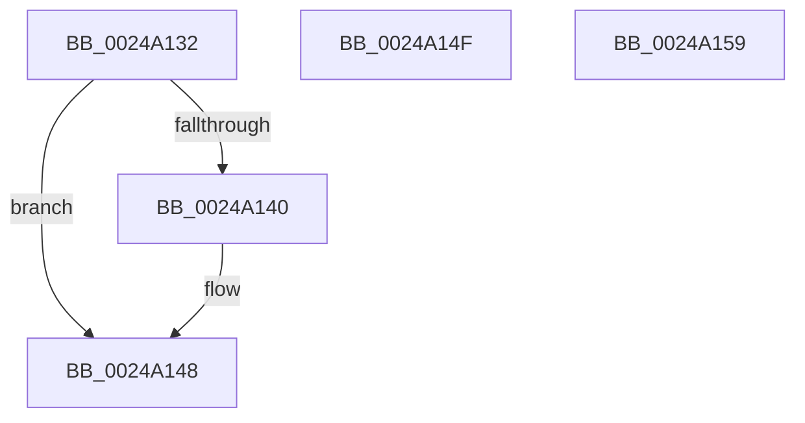

# sub_0024A132

- RVA: `0x0024A132`–`0x0024A15A` (길이 `40` bytes)
- VA: `0x000000014024A132`
- 실행 섹션: `.text`
- PDB 이름 있음: `아니요`; PDB Function 태그: `아니요`
- unwind 정보 RVA: `0x00062A88`
- 디코드: `19`개 명령, `40/40` bytes 표시
- 미해석 바이트: `0` (있으면 어셈블리에 `.byte`로 보존)

> 이 문서는 커널 이미지의 기계어와 PDB 기호를 분석해 생성했습니다. 4번과 5번은 함수 원형과 자료형을 바이너리 사용 방식에서 추정한 C 해석이며 원본 소스 복구 결과는 아닙니다.

## 1. Dependencies

- 직접 호출 지점: **0**; 고유 호출 대상: **0**
- 직접 호출자로 확인된 함수: **0**
- RIP 상대 이미지 참조: **0**

### Outgoing calls
- 직접 디코드된 call 명령이 없습니다.

### Direct callers
- 이 함수 시작 RVA로 연결되는 직접 call은 확인되지 않았습니다. 간접 호출은 완전히 역산할 수 없습니다.

### Static image references
- 디코드된 RIP-relative 메모리 참조가 없습니다.

## 2. Other-region calls and transfers

- 다른 실행 섹션으로 향하는 call: **0**
- 별도 외부 분기/꼬리 이동을 확인하지 못했습니다.

## 3. Assembly (complete function range)

```asm
0024A132  8B 45 30                        mov eax, dword ptr [rbp + 0x30]
0024A135  C1 E8 07                        shr eax, 7
0024A138  83 E0 1F                        and eax, 0x1f
0024A13B  83 F8 07                        cmp eax, 7
0024A13E  75 08                           jne 0x14024a148
0024A140  8B 43 20                        mov eax, dword ptr [rbx + 0x20]
0024A143  D1 E8                           shr eax, 1
0024A145  83 E0 1F                        and eax, 0x1f
0024A148  48 83 C4 28                     add rsp, 0x28
0024A14C  5D                              pop rbp
0024A14D  5B                              pop rbx
0024A14E  C3                              ret
0024A14F  CC                              int3
0024A150  33 C0                           xor eax, eax
0024A152  48 83 C4 28                     add rsp, 0x28
0024A156  5D                              pop rbp
0024A157  5B                              pop rbx
0024A158  C3                              ret
0024A159  CC                              int3
```

## 4. C-style interpretation (structured pseudocode)

```c
__int64 __fastcall sub_0024A132(void)
{
    __int64 result;
    __int64 v_rsp;

    result = (unsigned int)(((unsigned int)(*(unsigned int *)(v_rbp + 48))) >> (7));
    result = (unsigned int)((result) & (31));
    if (((unsigned int)(result)) == 7) {
        result = *(unsigned int *)(v_rbx + 32);
        result = (unsigned int)((result) >> (1));
        result = (unsigned int)((result) & (31));
    }
    v_rsp = (v_rsp) + (40);
    return result;
}
```

## 5. (Beta) C Style

```c
void sub_0024A132(void)
{
    int64_t result;
    int64_t local_rsp;

    result = (uint32_t)(((uint32_t)(*(uint32_t *)(local_rbp + 0x30))) >> (7));
    result = (uint32_t)((result) & (31));
    if (((uint32_t)(result)) == 7) {
        result = *(uint32_t *)(local_rbx + 0x20);
        result = (uint32_t)((result) >> (1));
        result = (uint32_t)((result) & (31));
    }
    local_rsp = (local_rsp) + (40);
    return result;
}
```

## 6. Execution-region graph

[열기: 2D/3D 그래프와 함수 탐색 컨트롤 패널](../../../control-panel.html?section=text&rva=0x0024A132&view=graph)

- 2D 그래프는 위에서 아래로 흐르고, 3D 그래프는 빈 공간을 드래그해 회전합니다. Shift+드래그는 이동, 휠은 확대·축소, 함수 노드 선택은 대상 보고서 이동입니다.

### Static fallback


