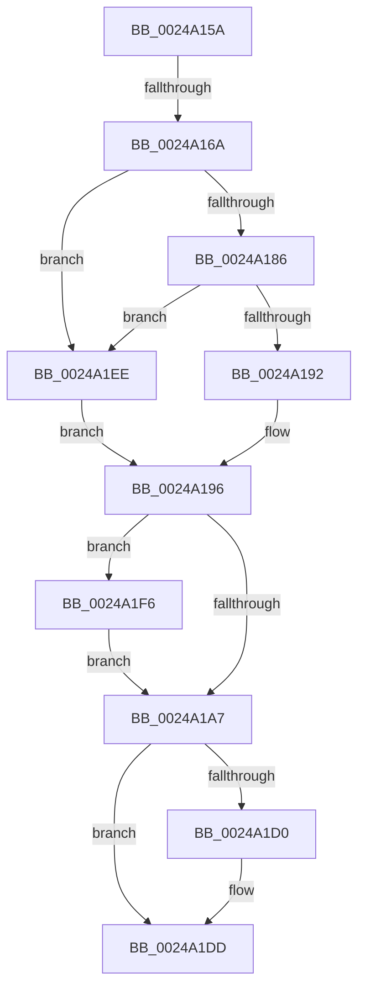

# sub_0024A15A

- RVA: `0x0024A15A`–`0x0024A205` (길이 `171` bytes)
- VA: `0x000000014024A15A`
- 실행 섹션: `.text`
- PDB 이름 있음: `아니요`; PDB Function 태그: `아니요`
- unwind 정보 RVA: `0x00062AA0`
- 디코드: `38`개 명령, `171/171` bytes 표시
- 미해석 바이트: `0` (있으면 어셈블리에 `.byte`로 보존)

> 이 문서는 커널 이미지의 기계어와 PDB 기호를 분석해 생성했습니다. 4번과 5번은 함수 원형과 자료형을 바이너리 사용 방식에서 추정한 C 해석이며 원본 소스 복구 결과는 아닙니다.

## 1. Dependencies

- 직접 호출 지점: **5**; 고유 호출 대상: **5**
- 직접 호출자로 확인된 함수: **0**
- RIP 상대 이미지 참조: **1**

### Outgoing calls
- `0x0024A1AB` → [ExAcquireSpinLockSharedAtDpcLevel](ExAcquireSpinLockSharedAtDpcLevel_function_00248E30.md) (function, `0x00248E30`)
- `0x0024A1B6` → [MiLocateSessionProtosInSubsection](MiLocateSessionProtosInSubsection_function_0024A5D0.md) (function, `0x0024A5D0`)
- `0x0024A1C2` → [ExReleaseSpinLockSharedFromDpcLevel](ExReleaseSpinLockSharedFromDpcLevel_function_0024A590.md) (function, `0x0024A590`)
- `0x0024A1D8` → [KiLowerIrqlProcessIrqlFlags](../4F/KiLowerIrqlProcessIrqlFlags_function_004F5698.md) (function, `0x004F5698`)
- `0x0024A1FE` → [KiRaiseIrqlProcessIrqlFlags](../4F/KiRaiseIrqlProcessIrqlFlags_function_004F56FC.md) (function, `0x004F56FC`)

### Direct callers
- 이 함수 시작 RVA로 연결되는 직접 call은 확인되지 않았습니다. 간접 호출은 완전히 역산할 수 없습니다.

### Static image references
- `0x0024A19E` → RVA `0x00FC6D20` (`ALMOSTRO`; read)

## 2. Other-region calls and transfers

- 다른 실행 섹션으로 향하는 call: **0**
- call이 아닌 외부 분기/꼬리 이동: **2**
  - `0x0024A164` → [sub_0024A0BE + 0x21](Unknown_function_0024A0BE.md) (`tail-transfer`)
  - `0x0024A1E9` → [sub_0024A0BE + 0x25](Unknown_function_0024A0BE.md) (`tail-transfer`)

## 3. Assembly (complete function range)

```asm
0024A15A  48 8B 3B                        mov rdi, qword ptr [rbx]
0024A15D  F7 47 38 00 00 00 08            test dword ptr [rdi + 0x38], 0x8000000
0024A164  0F 84 75 FF FF FF               je 0x14024a0df
0024A16A  65 48 8B 04 25 88 01 00 00      mov rax, qword ptr gs:[0x188]
0024A173  48 8B 80 B8 00 00 00            mov rax, qword ptr [rax + 0xb8]
0024A17A  48 8B 88 E8 02 00 00            mov rcx, qword ptr [rax + 0x2e8]
0024A181  48 85 C9                        test rcx, rcx
0024A184  74 68                           je 0x14024a1ee
0024A186  F7 80 FC 05 00 00 00 10 00 00   test dword ptr [rax + 0x5fc], 0x1000
0024A190  75 5C                           jne 0x14024a1ee
0024A192  44 8B 79 08                     mov r15d, dword ptr [rcx + 8]
0024A196  45 0F 20 C6                     mov r14, cr8
0024A19A  45 0F 22 C4                     mov cr8, r12
0024A19E  83 3D 7B CB D7 00 00            cmp dword ptr [rip + 0xd7cb7b], 0
0024A1A5  75 4F                           jne 0x14024a1f6
0024A1A7  48 8D 4F 48                     lea rcx, [rdi + 0x48]
0024A1AB  E8 80 EC FF FF                  call 0x140248e30
0024A1B0  41 8B D7                        mov edx, r15d
0024A1B3  48 8B CB                        mov rcx, rbx
0024A1B6  E8 15 04 00 00                  call 0x14024a5d0
0024A1BB  48 8D 4F 48                     lea rcx, [rdi + 0x48]
0024A1BF  4C 8B F8                        mov r15, rax
0024A1C2  E8 C9 03 00 00                  call 0x14024a590
0024A1C7  83 3D 52 CB D7 00 00            cmp dword ptr [rip + 0xd7cb52], 0
0024A1CE  74 0D                           je 0x14024a1dd
0024A1D0  44 0F 20 C1                     mov rcx, cr8
0024A1D4  41 0F B6 D6                     movzx edx, r14b
0024A1D8  E8 BB B4 2A 00                  call 0x1404f5698
0024A1DD  41 0F B6 C6                     movzx eax, r14b
0024A1E1  44 0F 22 C0                     mov cr8, rax
0024A1E5  4D 8B 47 48                     mov r8, qword ptr [r15 + 0x48]
0024A1E9  E9 F5 FE FF FF                  jmp 0x14024a0e3
0024A1EE  41 BF FF FF FF FF               mov r15d, 0xffffffff
0024A1F4  EB A0                           jmp 0x14024a196
0024A1F6  41 0F B6 D4                     movzx edx, r12b
0024A1FA  41 0F B6 CE                     movzx ecx, r14b
0024A1FE  E8 F9 B4 2A 00                  call 0x1404f56fc
0024A203  EB A2                           jmp 0x14024a1a7
```

## 4. C-style interpretation (structured pseudocode)

```c
__int64 __fastcall sub_0024A15A(void)
{
    __int64 result;

    if (*(unsigned __int64 *)(*(unsigned __int64 *)(*(unsigned __int64 *)(gs_base + (0 + 392)) + 184) + 744) == 0) goto loc_0024A1EE;
    if (((*(unsigned int *)(*(unsigned __int64 *)(*(unsigned __int64 *)(gs_base + (0 + 392)) + 184) + 1532)) & (0x1000ULL)) != 0) goto loc_0024A1EE;
loc_0024A196:
    if ((*(unsigned int *)(v_rip + 14142331)) != 0) goto loc_0024A1F6;
loc_0024A1A7:
    result = ExAcquireSpinLockSharedAtDpcLevel(*(unsigned __int64 *)(v_rbx) + 72, a2, a3, a4);
    result = MiLocateSessionProtosInSubsection(v_rbx, (unsigned int)((unsigned int)((unsigned int)(*(unsigned int *)(*(unsigned __int64 *)(*(unsigned __int64 *)(*(unsigned __int64 *)(gs_base + (0 + 392)) + 184) + 744) + 8)))), a3, a4);
    result = ExReleaseSpinLockSharedFromDpcLevel(*(unsigned __int64 *)(v_rbx) + 72, (unsigned int)((unsigned int)((unsigned int)(*(unsigned int *)(*(unsigned __int64 *)(*(unsigned __int64 *)(*(unsigned __int64 *)(gs_base + (0 + 392)) + 184) + 744) + 8)))), a3, a4);
    if ((*(unsigned int *)(v_rip + 14142290)) != 0) {
        a1 = v_r12;
        a2 = (unsigned __int8)(v_cr8);
        result = KiLowerIrqlProcessIrqlFlags(a1, a2, a3, a4);
    }
loc_0024A1EE:
    goto loc_0024A196;
loc_0024A1F6:
    result = KiRaiseIrqlProcessIrqlFlags((unsigned __int8)(v_cr8), (unsigned __int8)(v_r12), *(unsigned __int64 *)(result + 72), a4);
    goto loc_0024A1A7;
}
```

## 5. (Beta) C Style

```c
void sub_0024A15A(void)
{
    int64_t result;

    if (*(uint64_t *)(*(uint64_t *)(*(uint64_t *)(gs_base + (0 + 0x188)) + 0xB8) + 0x2E8) == 0) goto loc_0024A1EE;
    if (((*(uint32_t *)(*(uint64_t *)(*(uint64_t *)(gs_base + (0 + 0x188)) + 0xB8) + 0x5FC)) & (0x1000ULL)) != 0) goto loc_0024A1EE;
loc_0024A196:
    if ((*(uint32_t *)(v_rip + 0xD7CB7B)) != 0) goto loc_0024A1F6;
loc_0024A1A7:
    result = ExAcquireSpinLockSharedAtDpcLevel(*(uint64_t *)(local_rbx) + 72, a2, a3, a4);
    result = MiLocateSessionProtosInSubsection(local_rbx, (uint32_t)((uint32_t)((uint32_t)(*(uint32_t *)(*(uint64_t *)(*(uint64_t *)(*(uint64_t *)(gs_base + (0 + 0x188)) + 0xB8) + 0x2E8) + 0x8)))), a3, a4);
    result = ExReleaseSpinLockSharedFromDpcLevel(*(uint64_t *)(local_rbx) + 72, (uint32_t)((uint32_t)((uint32_t)(*(uint32_t *)(*(uint64_t *)(*(uint64_t *)(*(uint64_t *)(gs_base + (0 + 0x188)) + 0xB8) + 0x2E8) + 0x8)))), a3, a4);
    if ((*(uint32_t *)(v_rip + 0xD7CB52)) != 0) {
        a1 = local_r12;
        a2 = (uint8_t)(v_cr8);
        result = KiLowerIrqlProcessIrqlFlags(a1, a2, a3, a4);
    }
loc_0024A1EE:
    goto loc_0024A196;
loc_0024A1F6:
    result = KiRaiseIrqlProcessIrqlFlags((uint8_t)(v_cr8), (uint8_t)(local_r12), *(uint64_t *)(result + 0x48), a4);
    goto loc_0024A1A7;
}
```

## 6. Execution-region graph

[열기: 2D/3D 그래프와 함수 탐색 컨트롤 패널](../../../control-panel.html?section=text&rva=0x0024A15A&view=graph)

- 2D 그래프는 위에서 아래로 흐르고, 3D 그래프는 빈 공간을 드래그해 회전합니다. Shift+드래그는 이동, 휠은 확대·축소, 함수 노드 선택은 대상 보고서 이동입니다.

### Static fallback


