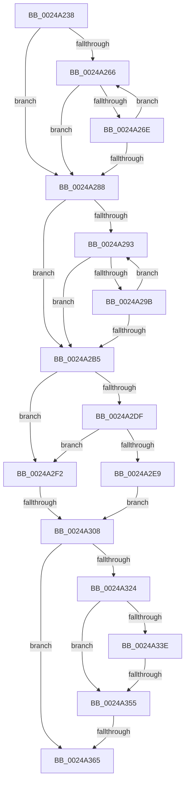

# sub_0024A238

- RVA: `0x0024A238`–`0x0024A3A0` (길이 `360` bytes)
- VA: `0x000000014024A238`
- 실행 섹션: `.text`
- PDB 이름 있음: `아니요`; PDB Function 태그: `아니요`
- unwind 정보 RVA: `0x00062AD4`
- 디코드: `86`개 명령, `360/360` bytes 표시
- 미해석 바이트: `0` (있으면 어셈블리에 `.byte`로 보존)

> 이 문서는 커널 이미지의 기계어와 PDB 기호를 분석해 생성했습니다. 4번과 5번은 함수 원형과 자료형을 바이너리 사용 방식에서 추정한 C 해석이며 원본 소스 복구 결과는 아닙니다.

## 1. Dependencies

- 직접 호출 지점: **2**; 고유 호출 대상: **2**
- 직접 호출자로 확인된 함수: **0**
- RIP 상대 이미지 참조: **2**

### Outgoing calls
- `0x0024A2EB` → [ExpAcquireSpinLockSharedAtDpcLevelInstrumented](../27/ExpAcquireSpinLockSharedAtDpcLevelInstrumented_function_0027CD20.md) (function, `0x0027CD20`)
- `0x0024A383` → [ExReleaseSpinLockSharedFromDpcLevel](ExReleaseSpinLockSharedFromDpcLevel_function_0024A590.md) (function, `0x0024A590`)

### Direct callers
- 이 함수 시작 RVA로 연결되는 직접 call은 확인되지 않았습니다. 간접 호출은 완전히 역산할 수 없습니다.

### Static image references
- `0x0024A2D6` → RVA `0x00FC6B06` (`ALMOSTRO`; read)
- `0x0024A2DF` → RVA `0x00F0DE58` (`.data`; read)

## 2. Other-region calls and transfers

- 다른 실행 섹션으로 향하는 call: **0**
- call이 아닌 외부 분기/꼬리 이동: **4**
  - `0x0024A302` → [sub_0024A490 + 0xD9](Unknown_function_0024A490.md) (`tail-transfer`)
  - `0x0024A34F` → [sub_0024A490](Unknown_function_0024A490.md) (`tail-transfer`)
  - `0x0024A35F` → [sub_0024A490 + 0x90](Unknown_function_0024A490.md) (`tail-transfer`)
  - `0x0024A39A` → [sub_0024A3A0 + 0xE4](Unknown_function_0024A3A0.md) (`tail-transfer`)

## 3. Assembly (complete function range)

```asm
0024A238  48 89 5C 24 50                  mov qword ptr [rsp + 0x50], rbx
0024A23D  48 89 74 24 58                  mov qword ptr [rsp + 0x58], rsi
0024A242  48 8B F2                        mov rsi, rdx
0024A245  4C 89 64 24 60                  mov qword ptr [rsp + 0x60], r12
0024A24A  48 B9 00 00 00 00 80 F6 FF FF   movabs rcx, 0xfffff68000000000
0024A254  48 8B C1                        mov rax, rcx
0024A257  49 BD FF FF FF FF FF F6 FF FF   movabs r13, 0xfffff6ffffffffff
0024A261  48 3B D0                        cmp rdx, rax
0024A264  72 22                           jb 0x14024a288
0024A266  49 8B C5                        mov rax, r13
0024A269  48 3B F0                        cmp rsi, rax
0024A26C  77 1A                           ja 0x14024a288
0024A26E  48 C1 E6 19                     shl rsi, 0x19
0024A272  48 8B C1                        mov rax, rcx
0024A275  48 C1 E0 19                     shl rax, 0x19
0024A279  48 2B F0                        sub rsi, rax
0024A27C  48 C1 FE 10                     sar rsi, 0x10
0024A280  48 8B C1                        mov rax, rcx
0024A283  48 3B F0                        cmp rsi, rax
0024A286  73 DE                           jae 0x14024a266
0024A288  48 8B FD                        mov rdi, rbp
0024A28B  48 8B C1                        mov rax, rcx
0024A28E  48 3B E8                        cmp rbp, rax
0024A291  72 22                           jb 0x14024a2b5
0024A293  49 8B C5                        mov rax, r13
0024A296  48 3B F8                        cmp rdi, rax
0024A299  77 1A                           ja 0x14024a2b5
0024A29B  48 C1 E7 19                     shl rdi, 0x19
0024A29F  48 8B C1                        mov rax, rcx
0024A2A2  48 C1 E0 19                     shl rax, 0x19
0024A2A6  48 2B F8                        sub rdi, rax
0024A2A9  48 C1 FF 10                     sar rdi, 0x10
0024A2AD  48 8B C1                        mov rax, rcx
0024A2B0  48 3B F8                        cmp rdi, rax
0024A2B3  73 DE                           jae 0x14024a293
0024A2B5  65 48 8B 04 25 88 01 00 00      mov rax, qword ptr gs:[0x188]
0024A2BE  45 33 E4                        xor r12d, r12d
0024A2C1  48 8B 88 B8 00 00 00            mov rcx, qword ptr [rax + 0xb8]
0024A2C8  48 8B 89 10 04 00 00            mov rcx, qword ptr [rcx + 0x410]
0024A2CF  48 81 C1 EC 03 00 00            add rcx, 0x3ec
0024A2D6  F6 05 29 C8 D7 00 21            test byte ptr [rip + 0xd7c829], 0x21
0024A2DD  74 13                           je 0x14024a2f2
0024A2DF  8B 05 73 3B CC 00               mov eax, dword ptr [rip + 0xcc3b73]
0024A2E5  85 C0                           test eax, eax
0024A2E7  75 09                           jne 0x14024a2f2
0024A2E9  B2 FF                           mov dl, 0xff
0024A2EB  E8 30 2A 03 00                  call 0x14027cd20
0024A2F0  EB 16                           jmp 0x14024a308
0024A2F2  0F 0D 09                        prefetchw byte ptr [rcx]
0024A2F5  8B 01                           mov eax, dword ptr [rcx]
0024A2F7  0F BA F0 1F                     btr eax, 0x1f
0024A2FB  8D 50 01                        lea edx, [rax + 1]
0024A2FE  F0 0F B1 11                     lock cmpxchg dword ptr [rcx], edx
0024A302  0F 85 61 02 00 00               jne 0x14024a569
0024A308  65 48 8B 04 25 88 01 00 00      mov rax, qword ptr gs:[0x188]
0024A311  4C 8B 80 B8 00 00 00            mov r8, qword ptr [rax + 0xb8]
0024A318  49 8B 98 60 05 00 00            mov rbx, qword ptr [r8 + 0x560]
0024A31F  48 85 DB                        test rbx, rbx
0024A322  74 41                           je 0x14024a365
0024A324  0F B6 4B 20                     movzx ecx, byte ptr [rbx + 0x20]
0024A328  48 8B D7                        mov rdx, rdi
0024A32B  8B 43 18                        mov eax, dword ptr [rbx + 0x18]
0024A32E  48 C1 E1 20                     shl rcx, 0x20
0024A332  48 0B C8                        or rcx, rax
0024A335  48 C1 EA 0C                     shr rdx, 0xc
0024A339  48 3B D1                        cmp rdx, rcx
0024A33C  72 17                           jb 0x14024a355
0024A33E  0F B6 4B 21                     movzx ecx, byte ptr [rbx + 0x21]
0024A342  8B 43 1C                        mov eax, dword ptr [rbx + 0x1c]
0024A345  48 C1 E1 20                     shl rcx, 0x20
0024A349  48 0B C8                        or rcx, rax
0024A34C  48 3B D1                        cmp rdx, rcx
0024A34F  0F 86 3B 01 00 00               jbe 0x14024a490
0024A355  49 8B 98 58 05 00 00            mov rbx, qword ptr [r8 + 0x558]
0024A35C  48 85 DB                        test rbx, rbx
0024A35F  0F 85 BB 01 00 00               jne 0x14024a520
0024A365  65 48 8B 04 25 88 01 00 00      mov rax, qword ptr gs:[0x188]
0024A36E  48 8B 88 B8 00 00 00            mov rcx, qword ptr [rax + 0xb8]
0024A375  48 8B 89 10 04 00 00            mov rcx, qword ptr [rcx + 0x410]
0024A37C  48 81 C1 EC 03 00 00            add rcx, 0x3ec
0024A383  E8 08 02 00 00                  call 0x14024a590
0024A388  4C 8B 64 24 60                  mov r12, qword ptr [rsp + 0x60]
0024A38D  48 3B F7                        cmp rsi, rdi
0024A390  48 8B 74 24 58                  mov rsi, qword ptr [rsp + 0x58]
0024A395  48 8B 5C 24 50                  mov rbx, qword ptr [rsp + 0x50]
0024A39A  0F 84 E4 00 00 00               je 0x14024a484
```

## 4. C-style interpretation (structured pseudocode)

```c
__int64 __fastcall sub_0024A238(__int64 a1, __int64 a2, __int64 a3, __int64 a4, __int64 a5, __int64 a6, __int64 a7, __int64 a8, __int64 a9, __int64 a10, __int64 a11, __int64 a12)
{
    __int64 result;
    __int64 v_r12;
    __int64 v_rdi;
    __int64 v_rsi;
    unsigned __int64 v_stack_p50;
    unsigned __int64 v_stack_p58;
    unsigned __int64 v_stack_p60;

    v_stack_p50 = v_rbx;
    v_stack_p58 = v_rsi;
    v_stack_p60 = v_r12;
    if (a2 < a1) goto loc_0024A288;
loc_0024A266:
    if (a2 > v_r13) goto loc_0024A288;
    v_rsi = (a2) << (25);
    result = (a1) << (25);
    v_rsi = (v_rsi) - (result);
    v_rsi = (v_rsi) >> (16);
    if (v_rsi >= a1) goto loc_0024A266;
loc_0024A288:
    if (v_rbp < a1) goto loc_0024A2B5;
loc_0024A293:
    if (v_rbp > v_r13) goto loc_0024A2B5;
    v_rdi = (v_rbp) << (25);
    result = (a1) << (25);
    v_rdi = (v_rdi) - (result);
    v_rdi = (v_rdi) >> (16);
    if (v_rdi >= a1) goto loc_0024A293;
loc_0024A2B5:
    v_r12 = 0;
    a1 = (*(unsigned __int64 *)(*(unsigned __int64 *)(*(unsigned __int64 *)(gs_base + (0 + 392)) + 184) + 1040)) + (0x3ECULL);
    if (((*(unsigned __int8 *)(v_rip + 14141481)) & (33)) == 0) goto loc_0024A2F2;
    if ((unsigned int)((unsigned int)(*(unsigned int *)(v_rip + 13384563))) != 0) goto loc_0024A2F2;
    result = ExpAcquireSpinLockSharedAtDpcLevelInstrumented(a1, 255, a3, a4);
    goto loc_0024A308;
loc_0024A2F2:
loc_0024A308:
    if (*(unsigned __int64 *)(*(unsigned __int64 *)(*(unsigned __int64 *)(gs_base + (0 + 392)) + 184) + 1376) == 0) goto loc_0024A365;
    a1 = (*(unsigned __int8 *)(*(unsigned __int64 *)(*(unsigned __int64 *)(*(unsigned __int64 *)(gs_base + (0 + 392)) + 184) + 1376) + 32)) << (32);
    a1 = (a1) | ((unsigned int)(*(unsigned int *)(*(unsigned __int64 *)(*(unsigned __int64 *)(*(unsigned __int64 *)(gs_base + (0 + 392)) + 184) + 1376) + 24)));
    a2 = (v_rdi) >> (12);
    if (a2 < a1) goto loc_0024A355;
    a1 = (*(unsigned __int8 *)(*(unsigned __int64 *)(*(unsigned __int64 *)(*(unsigned __int64 *)(gs_base + (0 + 392)) + 184) + 1376) + 33)) << (32);
    a1 = (a1) | ((unsigned int)(*(unsigned int *)(*(unsigned __int64 *)(*(unsigned __int64 *)(*(unsigned __int64 *)(gs_base + (0 + 392)) + 184) + 1376) + 28)));
loc_0024A355:
loc_0024A365:
    a1 = (*(unsigned __int64 *)(*(unsigned __int64 *)(*(unsigned __int64 *)(gs_base + (0 + 392)) + 184) + 1040)) + (0x3ECULL);
    result = ExReleaseSpinLockSharedFromDpcLevel(a1, a2, *(unsigned __int64 *)(*(unsigned __int64 *)(gs_base + (0 + 392)) + 184), a4);
}
```

## 5. (Beta) C Style

```c
int64_t sub_0024A238(int64_t Arg1, int64_t Arg2, int64_t Arg3, int64_t Arg4, uint64_t Arg5, uint64_t Arg6, uint64_t Arg7, uint64_t Arg8, uint64_t Arg9, int64_t Arg10, int64_t Arg11, int64_t Arg12)
{
    int64_t result;
    int64_t local_r12;
    int64_t local_rdi;
    int64_t local_rsi;
    uint64_t v_stack_p50;
    uint64_t v_stack_p58;
    uint64_t v_stack_p60;

    v_stack_p50 = local_rbx;
    v_stack_p58 = local_rsi;
    v_stack_p60 = local_r12;
    if (Arg2 < Arg1) goto loc_0024A288;
loc_0024A266:
    if (Arg2 > local_r13) goto loc_0024A288;
    local_rsi = (Arg2) << (25);
    result = (Arg1) << (25);
    local_rsi = (local_rsi) - (result);
    local_rsi = (local_rsi) >> (16);
    if (local_rsi >= Arg1) goto loc_0024A266;
loc_0024A288:
    if (local_rbp < Arg1) goto loc_0024A2B5;
loc_0024A293:
    if (local_rbp > local_r13) goto loc_0024A2B5;
    local_rdi = (local_rbp) << (25);
    result = (Arg1) << (25);
    local_rdi = (local_rdi) - (result);
    local_rdi = (local_rdi) >> (16);
    if (local_rdi >= Arg1) goto loc_0024A293;
loc_0024A2B5:
    local_r12 = 0;
    Arg1 = (*(uint64_t *)(*(uint64_t *)(*(uint64_t *)(gs_base + (0 + 0x188)) + 0xB8) + 0x410)) + (0x3ECULL);
    if (((*(uint8_t *)(v_rip + 0xD7C829)) & (33)) == 0) goto loc_0024A2F2;
    if ((uint32_t)((uint32_t)(*(uint32_t *)(v_rip + 0xCC3B73))) != 0) goto loc_0024A2F2;
    result = ExpAcquireSpinLockSharedAtDpcLevelInstrumented(Arg1, 255, Arg3, Arg4);
    goto loc_0024A308;
loc_0024A2F2:
loc_0024A308:
    if (*(uint64_t *)(*(uint64_t *)(*(uint64_t *)(gs_base + (0 + 0x188)) + 0xB8) + 0x560) == 0) goto loc_0024A365;
    Arg1 = (*(uint8_t *)(*(uint64_t *)(*(uint64_t *)(*(uint64_t *)(gs_base + (0 + 0x188)) + 0xB8) + 0x560) + 0x20)) << (32);
    Arg1 = (Arg1) | ((uint32_t)(*(uint32_t *)(*(uint64_t *)(*(uint64_t *)(*(uint64_t *)(gs_base + (0 + 0x188)) + 0xB8) + 0x560) + 0x18)));
    Arg2 = (local_rdi) >> (12);
    if (Arg2 < Arg1) goto loc_0024A355;
    Arg1 = (*(uint8_t *)(*(uint64_t *)(*(uint64_t *)(*(uint64_t *)(gs_base + (0 + 0x188)) + 0xB8) + 0x560) + 0x21)) << (32);
    Arg1 = (Arg1) | ((uint32_t)(*(uint32_t *)(*(uint64_t *)(*(uint64_t *)(*(uint64_t *)(gs_base + (0 + 0x188)) + 0xB8) + 0x560) + 0x1C)));
loc_0024A355:
loc_0024A365:
    Arg1 = (*(uint64_t *)(*(uint64_t *)(*(uint64_t *)(gs_base + (0 + 0x188)) + 0xB8) + 0x410)) + (0x3ECULL);
    result = ExReleaseSpinLockSharedFromDpcLevel(Arg1, Arg2, *(uint64_t *)(*(uint64_t *)(gs_base + (0 + 0x188)) + 0xB8), Arg4);
}
```

## 6. Execution-region graph

[열기: 2D/3D 그래프와 함수 탐색 컨트롤 패널](../../../control-panel.html?section=text&rva=0x0024A238&view=graph)

- 2D 그래프는 위에서 아래로 흐르고, 3D 그래프는 빈 공간을 드래그해 회전합니다. Shift+드래그는 이동, 휠은 확대·축소, 함수 노드 선택은 대상 보고서 이동입니다.

### Static fallback


