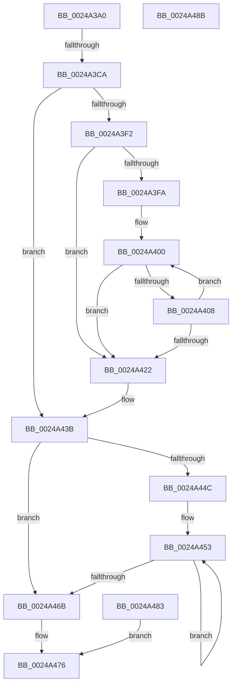

# sub_0024A3A0

- RVA: `0x0024A3A0`–`0x0024A490` (길이 `240` bytes)
- VA: `0x000000014024A3A0`
- 실행 섹션: `.text`
- PDB 이름 있음: `아니요`; PDB Function 태그: `아니요`
- unwind 정보 RVA: `0x00062AF0`
- 디코드: `65`개 명령, `240/240` bytes 표시
- 미해석 바이트: `0` (있으면 어셈블리에 `.byte`로 보존)

> 이 문서는 커널 이미지의 기계어와 PDB 기호를 분석해 생성했습니다. 4번과 5번은 함수 원형과 자료형을 바이너리 사용 방식에서 추정한 C 해석이며 원본 소스 복구 결과는 아닙니다.

## 1. Dependencies

- 직접 호출 지점: **0**; 고유 호출 대상: **0**
- 직접 호출자로 확인된 함수: **0**
- RIP 상대 이미지 참조: **0**

### Outgoing calls
- 직접 디코드된 call 명령이 없습니다.

### Direct callers
- 이 함수 시작 RVA로 연결되는 직접 call은 확인되지 않았습니다. 간접 호출은 완전히 역산할 수 없습니다.

### Static image references
- 디코드된 RIP-relative 메모리 참조가 없습니다.

## 2. Other-region calls and transfers

- 다른 실행 섹션으로 향하는 call: **0**
- call이 아닌 외부 분기/꼬리 이동: **1**
  - `0x0024A3C4` → [sub_0024A57D](Unknown_function_0024A57D.md) (`tail-transfer`)

## 3. Assembly (complete function range)

```asm
0024A3A0  48 C1 EF 09                     shr rdi, 9
0024A3A4  48 BA F8 FF FF FF 7F 00 00 00   movabs rdx, 0x7ffffffff8
0024A3AE  48 23 FA                        and rdi, rdx
0024A3B1  49 B9 00 00 00 00 80 F6 FF FF   movabs r9, 0xfffff68000000000
0024A3BB  49 8B C1                        mov rax, r9
0024A3BE  48 03 F8                        add rdi, rax
0024A3C1  45 85 FF                        test r15d, r15d
0024A3C4  0F 8F B3 01 00 00               jg 0x14024a57d
0024A3CA  48 8D 4F 08                     lea rcx, [rdi + 8]
0024A3CE  48 BA 00 F0 FF FF FF FF 00 00   movabs rdx, 0xfffffffff000
0024A3D8  4B 39 8C FE 80 00 00 00         cmp qword ptr [r14 + r15*8 + 0x80], rcx
0024A3E0  49 8B C7                        mov rax, r15
0024A3E3  45 1B C0                        sbb r8d, r8d
0024A3E6  48 33 FD                        xor rdi, rbp
0024A3E9  41 83 E0 04                     and r8d, 4
0024A3ED  48 85 FA                        test rdx, rdi
0024A3F0  74 49                           je 0x14024a43b
0024A3F2  49 8B C1                        mov rax, r9
0024A3F5  48 3B C8                        cmp rcx, rax
0024A3F8  72 28                           jb 0x14024a422
0024A3FA  66 0F 1F 44 00 00               nop word ptr [rax + rax]
0024A400  49 8B C5                        mov rax, r13
0024A403  48 3B C8                        cmp rcx, rax
0024A406  77 1A                           ja 0x14024a422
0024A408  48 C1 E1 19                     shl rcx, 0x19
0024A40C  49 8B C1                        mov rax, r9
0024A40F  48 C1 E0 19                     shl rax, 0x19
0024A413  48 2B C8                        sub rcx, rax
0024A416  48 C1 F9 10                     sar rcx, 0x10
0024A41A  49 8B C1                        mov rax, r9
0024A41D  48 3B C8                        cmp rcx, rax
0024A420  73 DE                           jae 0x14024a400
0024A422  49 89 4E 50                     mov qword ptr [r14 + 0x50], rcx
0024A426  49 8B C7                        mov rax, r15
0024A429  48 8B CD                        mov rcx, rbp
0024A42C  48 83 E1 F8                     and rcx, 0xfffffffffffffff8
0024A430  48 81 C9 F8 0F 00 00            or rcx, 0xff8
0024A437  48 83 C1 08                     add rcx, 8
0024A43B  49 8D 56 60                     lea rdx, [r14 + 0x60]
0024A43F  48 89 0C C2                     mov qword ptr [rdx + rax*8], rcx
0024A443  48 8D 14 C2                     lea rdx, [rdx + rax*8]
0024A447  48 85 C0                        test rax, rax
0024A44A  74 1F                           je 0x14024a46b
0024A44C  4D 8B C9                        mov r9, r9
0024A44F  49 C1 E1 19                     shl r9, 0x19
0024A453  48 C1 E1 19                     shl rcx, 0x19
0024A457  48 8D 52 F8                     lea rdx, [rdx - 8]
0024A45B  49 2B C9                        sub rcx, r9
0024A45E  48 C1 F9 10                     sar rcx, 0x10
0024A462  48 89 0A                        mov qword ptr [rdx], rcx
0024A465  48 83 E8 01                     sub rax, 1
0024A469  75 E8                           jne 0x14024a453
0024A46B  41 C7 46 0C 00 00 00 00         mov dword ptr [r14 + 0xc], 0
0024A473  41 8B C0                        mov eax, r8d
0024A476  48 83 C4 20                     add rsp, 0x20
0024A47A  41 5F                           pop r15
0024A47C  41 5E                           pop r14
0024A47E  41 5D                           pop r13
0024A480  5F                              pop rdi
0024A481  5D                              pop rbp
0024A482  C3                              ret
0024A483  CC                              int3
0024A484  B8 02 00 00 00                  mov eax, 2
0024A489  EB EB                           jmp 0x14024a476
0024A48B  0F 1F 44 00 00                  nop dword ptr [rax + rax]
```

## 4. C-style interpretation (structured pseudocode)

```c
__int64 __fastcall sub_0024A3A0(__int64 a1, __int64 a2, int a3)
{
    __int64 result;
    __int64 v_rdi;
    __int64 v_rsp;

    v_rdi = (v_rdi) >> (9);
    v_rdi = (v_rdi) & (a2);
    v_rdi = (v_rdi) + (a4);
    v_rdi = (v_rdi) ^ (v_rbp);
    a3 = (unsigned int)((a3) & (4));
    if (((a2) & (v_rdi)) == 0) goto loc_0024A43B;
    if ((v_rdi + 8) < a4) goto loc_0024A422;
loc_0024A400:
    if ((v_rdi + 8) > v_r13) goto loc_0024A422;
    a1 = (v_rdi + 8) << (25);
    result = (a4) << (25);
    a1 = (a1) - (result);
    a1 = (a1) >> (16);
    if (a1 >= a4) goto loc_0024A400;
loc_0024A422:
    *(unsigned __int64 *)(v_r14 + 80) = a1;
    a1 = (v_rbp) & (-8);
    a1 = (a1) | (0xFF8ULL);
    a1 = (a1) + (8);
loc_0024A43B:
    *(unsigned __int64 *)(v_r14 + 96 + v_r15 * 8) = a1;
    if (v_r15 == 0) goto loc_0024A46B;
    a4 = (a4) << (25);
loc_0024A453:
    a1 = (a1) << (25);
    a1 = (a1) - (a4);
    a1 = (a1) >> (16);
    *(unsigned __int64 *)(v_r14 + 96 + v_r15 * 8 - 8) = a1;
    result = (v_r15) - (1);
    if (condition_is_not_equal) goto loc_0024A453;
loc_0024A46B:
    *(unsigned int *)(v_r14 + 12) = 0;
loc_0024A476:
    v_rsp = (v_rsp) + (32);
    return (unsigned int)(a3);
}
```

## 5. (Beta) C Style

```c
int64_t sub_0024A3A0(int64_t Arg1, int64_t Arg2, int32_t Arg3)
{
    int64_t result;
    int64_t local_rdi;
    int64_t local_rsp;

    local_rdi = (local_rdi) >> (9);
    local_rdi = (local_rdi) & (Arg2);
    local_rdi = (local_rdi) + (a4);
    local_rdi = (local_rdi) ^ (local_rbp);
    Arg3 = (uint32_t)((Arg3) & (4));
    if (((Arg2) & (local_rdi)) == 0) goto loc_0024A43B;
    if ((local_rdi + 8) < a4) goto loc_0024A422;
loc_0024A400:
    if ((local_rdi + 8) > local_r13) goto loc_0024A422;
    Arg1 = (local_rdi + 8) << (25);
    result = (a4) << (25);
    Arg1 = (Arg1) - (result);
    Arg1 = (Arg1) >> (16);
    if (Arg1 >= a4) goto loc_0024A400;
loc_0024A422:
    *(uint64_t *)(local_r14 + 0x50) = Arg1;
    Arg1 = (local_rbp) & (-8);
    Arg1 = (Arg1) | (0xFF8ULL);
    Arg1 = (Arg1) + (8);
loc_0024A43B:
    *(uint64_t *)(local_r14 + 0x60 + local_r15 * 8) = Arg1;
    if (local_r15 == 0) goto loc_0024A46B;
    a4 = (a4) << (25);
loc_0024A453:
    Arg1 = (Arg1) << (25);
    Arg1 = (Arg1) - (a4);
    Arg1 = (Arg1) >> (16);
    *(uint64_t *)(local_r14 + 0x60 + local_r15 * 8 - 0x8) = Arg1;
    result = (local_r15) - (1);
    if (condition_is_not_equal) goto loc_0024A453;
loc_0024A46B:
    *(uint32_t *)(local_r14 + 0xC) = 0;
loc_0024A476:
    local_rsp = (local_rsp) + (32);
    return (uint32_t)(Arg3);
}
```

## 6. Execution-region graph

[열기: 2D/3D 그래프와 함수 탐색 컨트롤 패널](../../../control-panel.html?section=text&rva=0x0024A3A0&view=graph)

- 2D 그래프는 위에서 아래로 흐르고, 3D 그래프는 빈 공간을 드래그해 회전합니다. Shift+드래그는 이동, 휠은 확대·축소, 함수 노드 선택은 대상 보고서 이동입니다.

### Static fallback


