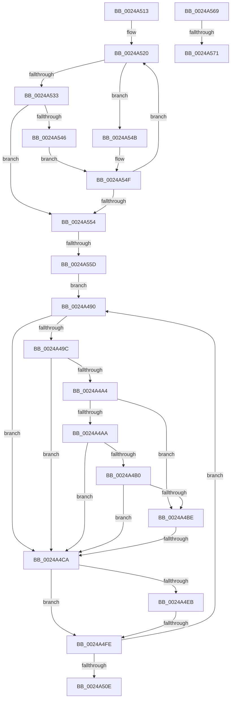

# sub_0024A490

- RVA: `0x0024A490`–`0x0024A57D` (길이 `237` bytes)
- VA: `0x000000014024A490`
- 실행 섹션: `.text`
- PDB 이름 있음: `아니요`; PDB Function 태그: `아니요`
- unwind 정보 RVA: `0x00062B04`
- 디코드: `68`개 명령, `237/237` bytes 표시
- 미해석 바이트: `0` (있으면 어셈블리에 `.byte`로 보존)

> 이 문서는 커널 이미지의 기계어와 PDB 기호를 분석해 생성했습니다. 4번과 5번은 함수 원형과 자료형을 바이너리 사용 방식에서 추정한 C 해석이며 원본 소스 복구 결과는 아닙니다.

## 1. Dependencies

- 직접 호출 지점: **3**; 고유 호출 대상: **3**
- 직접 호출자로 확인된 함수: **0**
- RIP 상대 이미지 참조: **0**

### Outgoing calls
- `0x0024A4F1` → [MiPeriodicGoodCitizen](../27/MiPeriodicGoodCitizen_function_00279250.md) (function, `0x00279250`)
- `0x0024A501` → [MiGetNextVad](../29/MiGetNextVad_function_00297224.md) (function, `0x00297224`)
- `0x0024A573` → [ExpWaitForSpinLockSharedAndAcquire](../36/ExpWaitForSpinLockSharedAndAcquire_function_00362380.md) (function, `0x00362380`)

### Direct callers
- 이 함수 시작 RVA로 연결되는 직접 call은 확인되지 않았습니다. 간접 호출은 완전히 역산할 수 없습니다.

### Static image references
- 디코드된 RIP-relative 메모리 참조가 없습니다.

## 2. Other-region calls and transfers

- 다른 실행 섹션으로 향하는 call: **0**
- call이 아닌 외부 분기/꼬리 이동: **6**
  - `0x0024A4C4` → [sub_0024A238 + 0x12D](Unknown_function_0024A238.md) (`tail-transfer`)
  - `0x0024A4F8` → [sub_0024A238 + 0x12D](Unknown_function_0024A238.md) (`tail-transfer`)
  - `0x0024A50E` → [sub_0024A238 + 0x12D](Unknown_function_0024A238.md) (`tail-transfer`)
  - `0x0024A557` → [sub_0024A238 + 0x12D](Unknown_function_0024A238.md) (`tail-transfer`)
  - `0x0024A56B` → [sub_0024A238 + 0xC3](Unknown_function_0024A238.md) (`tail-transfer`)
  - `0x0024A578` → [sub_0024A238 + 0xD0](Unknown_function_0024A238.md) (`tail-transfer`)

## 3. Assembly (complete function range)

```asm
0024A490  8B 4B 30                        mov ecx, dword ptr [rbx + 0x30]
0024A493  8B C1                           mov eax, ecx
0024A495  83 E0 70                        and eax, 0x70
0024A498  3C 30                           cmp al, 0x30
0024A49A  74 2E                           je 0x14024a4ca
0024A49C  8B C1                           mov eax, ecx
0024A49E  24 70                           and al, 0x70
0024A4A0  3C 10                           cmp al, 0x10
0024A4A2  74 26                           je 0x14024a4ca
0024A4A4  0F BA E1 15                     bt ecx, 0x15
0024A4A8  73 14                           jae 0x14024a4be
0024A4AA  0F BA E1 17                     bt ecx, 0x17
0024A4AE  72 1A                           jb 0x14024a4ca
0024A4B0  8B C1                           mov eax, ecx
0024A4B2  25 00 00 18 00                  and eax, 0x180000
0024A4B7  3D 00 00 10 00                  cmp eax, 0x100000
0024A4BC  73 0C                           jae 0x14024a4ca
0024A4BE  83 E1 70                        and ecx, 0x70
0024A4C1  80 F9 50                        cmp cl, 0x50
0024A4C4  0F 85 9B FE FF FF               jne 0x14024a365
0024A4CA  0F B6 7B 21                     movzx edi, byte ptr [rbx + 0x21]
0024A4CE  41 FF C4                        inc r12d
0024A4D1  8B 43 1C                        mov eax, dword ptr [rbx + 0x1c]
0024A4D4  48 C1 E7 20                     shl rdi, 0x20
0024A4D8  48 0B F8                        or rdi, rax
0024A4DB  48 C1 E7 0C                     shl rdi, 0xc
0024A4DF  48 81 CF FF 0F 00 00            or rdi, 0xfff
0024A4E6  45 84 E4                        test r12b, r12b
0024A4E9  75 13                           jne 0x14024a4fe
0024A4EB  48 8B D5                        mov rdx, rbp
0024A4EE  49 8B CE                        mov rcx, r14
0024A4F1  E8 5A ED 02 00                  call 0x140279250
0024A4F6  85 C0                           test eax, eax
0024A4F8  0F 85 67 FE FF FF               jne 0x14024a365
0024A4FE  48 8B CB                        mov rcx, rbx
0024A501  E8 1E CD 04 00                  call 0x140297224
0024A506  48 8B D8                        mov rbx, rax
0024A509  48 85 C0                        test rax, rax
0024A50C  75 82                           jne 0x14024a490
0024A50E  E9 52 FE FF FF                  jmp 0x14024a365
0024A513  0F 1F 40 00                     nop dword ptr [rax]
0024A517  66 0F 1F 84 00 00 00 00 00      nop word ptr [rax + rax]
0024A520  0F B6 4B 21                     movzx ecx, byte ptr [rbx + 0x21]
0024A524  8B 43 1C                        mov eax, dword ptr [rbx + 0x1c]
0024A527  48 C1 E1 20                     shl rcx, 0x20
0024A52B  48 0B C8                        or rcx, rax
0024A52E  48 3B D1                        cmp rdx, rcx
0024A531  77 18                           ja 0x14024a54b
0024A533  0F B6 4B 20                     movzx ecx, byte ptr [rbx + 0x20]
0024A537  8B 43 18                        mov eax, dword ptr [rbx + 0x18]
0024A53A  48 C1 E1 20                     shl rcx, 0x20
0024A53E  48 0B C8                        or rcx, rax
0024A541  48 3B D1                        cmp rdx, rcx
0024A544  73 0E                           jae 0x14024a554
0024A546  48 8B 1B                        mov rbx, qword ptr [rbx]
0024A549  EB 04                           jmp 0x14024a54f
0024A54B  48 8B 5B 08                     mov rbx, qword ptr [rbx + 8]
0024A54F  48 85 DB                        test rbx, rbx
0024A552  75 CC                           jne 0x14024a520
0024A554  48 85 DB                        test rbx, rbx
0024A557  0F 84 08 FE FF FF               je 0x14024a365
0024A55D  49 89 98 60 05 00 00            mov qword ptr [r8 + 0x560], rbx
0024A564  E9 27 FF FF FF                  jmp 0x14024a490
0024A569  85 C0                           test eax, eax
0024A56B  0F 89 8A FD FF FF               jns 0x14024a2fb
0024A571  B2 FF                           mov dl, 0xff
0024A573  E8 08 7E 11 00                  call 0x140362380
0024A578  E9 8B FD FF FF                  jmp 0x14024a308
```

## 4. C-style interpretation (structured pseudocode)

```c
__int64 __fastcall sub_0024A490(__int64 a1, __int64 a2, __int64 a3)
{
    __int64 result;
    __int64 v_r12;
    __int64 v_rdi;

    result = (unsigned int)(((unsigned int)((unsigned int)((unsigned int)(*(unsigned int *)(v_rbx + 48))))) & (112));
    if (((unsigned __int8)(result)) == 48) goto loc_0024A4CA;
    result = (unsigned __int8)(((unsigned int)((unsigned int)((unsigned int)(*(unsigned int *)(v_rbx + 48))))) & (112));
    if (((unsigned __int8)(result)) == 16) goto loc_0024A4CA;
    if (((unsigned __int8)(result)) >= 16) goto loc_0024A4BE;
    if (((unsigned __int8)(result)) < 16) goto loc_0024A4CA;
    result = (unsigned int)(((unsigned int)((unsigned int)((unsigned int)(*(unsigned int *)(v_rbx + 48))))) & (0x180000ULL));
    if (((unsigned int)(result)) >= 0x100000ULL) goto loc_0024A4CA;
loc_0024A4BE:
    a1 = (unsigned int)(((unsigned int)(*(unsigned int *)(v_rbx + 48))) & (112));
loc_0024A4CA:
    v_r12 = (unsigned int)((v_r12) + 1);
    v_rdi = (*(unsigned __int8 *)(v_rbx + 33)) << (32);
    v_rdi = (v_rdi) | ((unsigned int)(*(unsigned int *)(v_rbx + 28)));
    v_rdi = (v_rdi) << (12);
    v_rdi = (v_rdi) | (0xFFFULL);
    if ((unsigned __int8)(v_r12) != 0) goto loc_0024A4FE;
    result = MiPeriodicGoodCitizen(v_r14, v_rbp, a3, a4);
loc_0024A4FE:
    result = MiGetNextVad(v_rbx, v_rbp, a3, a4);
    if (result != 0) goto loc_0024A490;
}
```

## 5. (Beta) C Style

```c
int64_t sub_0024A490(int64_t Arg1, int64_t Arg2, int64_t Arg3)
{
    int64_t result;
    int64_t local_r12;
    int64_t local_rdi;

    result = (uint32_t)(((uint32_t)((uint32_t)((uint32_t)(*(uint32_t *)(local_rbx + 0x30))))) & (112));
    if (((uint8_t)(result)) == 48) goto loc_0024A4CA;
    result = (uint8_t)(((uint32_t)((uint32_t)((uint32_t)(*(uint32_t *)(local_rbx + 0x30))))) & (112));
    if (((uint8_t)(result)) == 16) goto loc_0024A4CA;
    if (((uint8_t)(result)) >= 16) goto loc_0024A4BE;
    if (((uint8_t)(result)) < 16) goto loc_0024A4CA;
    result = (uint32_t)(((uint32_t)((uint32_t)((uint32_t)(*(uint32_t *)(local_rbx + 0x30))))) & (0x180000ULL));
    if (((uint32_t)(result)) >= 0x100000ULL) goto loc_0024A4CA;
loc_0024A4BE:
    Arg1 = (uint32_t)(((uint32_t)(*(uint32_t *)(local_rbx + 0x30))) & (112));
loc_0024A4CA:
    local_r12 = (uint32_t)((local_r12) + 1);
    local_rdi = (*(uint8_t *)(local_rbx + 0x21)) << (32);
    local_rdi = (local_rdi) | ((uint32_t)(*(uint32_t *)(local_rbx + 0x1C)));
    local_rdi = (local_rdi) << (12);
    local_rdi = (local_rdi) | (0xFFFULL);
    if ((uint8_t)(local_r12) != 0) goto loc_0024A4FE;
    result = MiPeriodicGoodCitizen(local_r14, local_rbp, Arg3, a4);
loc_0024A4FE:
    result = MiGetNextVad(local_rbx, local_rbp, Arg3, a4);
    if (result != 0) goto loc_0024A490;
}
```

## 6. Execution-region graph

[열기: 2D/3D 그래프와 함수 탐색 컨트롤 패널](../../../control-panel.html?section=text&rva=0x0024A490&view=graph)

- 2D 그래프는 위에서 아래로 흐르고, 3D 그래프는 빈 공간을 드래그해 회전합니다. Shift+드래그는 이동, 휠은 확대·축소, 함수 노드 선택은 대상 보고서 이동입니다.

### Static fallback


