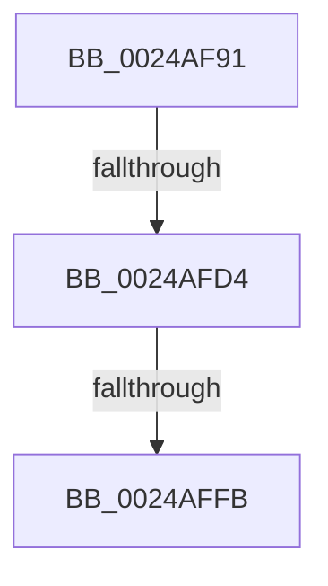

# sub_0024AF91

- RVA: `0x0024AF91`–`0x0024B01B` (길이 `138` bytes)
- VA: `0x000000014024AF91`
- 실행 섹션: `.text`
- PDB 이름 있음: `아니요`; PDB Function 태그: `아니요`
- unwind 정보 RVA: `0x00062BCC`
- 디코드: `30`개 명령, `138/138` bytes 표시
- 미해석 바이트: `0` (있으면 어셈블리에 `.byte`로 보존)

> 이 문서는 커널 이미지의 기계어와 PDB 기호를 분석해 생성했습니다. 4번과 5번은 함수 원형과 자료형을 바이너리 사용 방식에서 추정한 C 해석이며 원본 소스 복구 결과는 아닙니다.

## 1. Dependencies

- 직접 호출 지점: **0**; 고유 호출 대상: **0**
- 직접 호출자로 확인된 함수: **0**
- RIP 상대 이미지 참조: **0**

### Outgoing calls
- 직접 디코드된 call 명령이 없습니다.

### Direct callers
- 이 함수 시작 RVA로 연결되는 직접 call은 확인되지 않았습니다. 간접 호출은 완전히 역산할 수 없습니다.

### Static image references
- 디코드된 RIP-relative 메모리 참조가 없습니다.

## 2. Other-region calls and transfers

- 다른 실행 섹션으로 향하는 call: **0**
- call이 아닌 외부 분기/꼬리 이동: **3**
  - `0x0024AFCE` → [sub_0024B45F](Unknown_function_0024B45F.md) (`tail-transfer`)
  - `0x0024AFF5` → [sub_0024B45F + 0x14](Unknown_function_0024B45F.md) (`tail-transfer`)
  - `0x0024B015` → [sub_0024B335 + 0x118](Unknown_function_0024B335.md) (`tail-transfer`)

## 3. Assembly (complete function range)

```asm
0024AF91  4C 89 A4 24 30 01 00 00         mov qword ptr [rsp + 0x130], r12
0024AF99  4C 8D 34 40                     lea r14, [rax + rax*2]
0024AF9D  49 C1 E6 04                     shl r14, 4
0024AFA1  49 8B C5                        mov rax, r13
0024AFA4  44 8B 57 20                     mov r10d, dword ptr [rdi + 0x20]
0024AFA8  4D 8D 1C 06                     lea r11, [r14 + rax]
0024AFAC  8B 47 20                        mov eax, dword ptr [rdi + 0x20]
0024AFAF  41 B9 05 00 00 00               mov r9d, 5
0024AFB5  C1 E8 18                        shr eax, 0x18
0024AFB8  48 BA AB AA AA AA AA AA AA AA   movabs rdx, 0xaaaaaaaaaaaaaaab
0024AFC2  49 BC 30 00 00 00 00 DE FF FF   movabs r12, 0xffffde0000000030
0024AFCC  A8 08                           test al, 8
0024AFCE  0F 85 8B 04 00 00               jne 0x14024b45f
0024AFD4  41 C1 EA 18                     shr r10d, 0x18
0024AFD8  41 83 E2 07                     and r10d, 7
0024AFDC  41 8B 43 20                     mov eax, dword ptr [r11 + 0x20]
0024AFE0  41 8B 4B 20                     mov ecx, dword ptr [r11 + 0x20]
0024AFE4  44 8B C1                        mov r8d, ecx
0024AFE7  41 C1 E8 10                     shr r8d, 0x10
0024AFEB  C1 E9 18                        shr ecx, 0x18
0024AFEE  41 0F B6 D0                     movzx edx, r8b
0024AFF2  F6 C1 08                        test cl, 8
0024AFF5  0F 85 78 04 00 00               jne 0x14024b473
0024AFFB  44 8B C8                        mov r9d, eax
0024AFFE  44 0F B6 C2                     movzx r8d, dl
0024B002  41 C1 E9 18                     shr r9d, 0x18
0024B006  41 83 E1 07                     and r9d, 7
0024B00A  4C 8B A4 24 30 01 00 00         mov r12, qword ptr [rsp + 0x130]
0024B012  45 3B D1                        cmp r10d, r9d
0024B015  0F 85 32 04 00 00               jne 0x14024b44d
```

## 4. C-style interpretation (structured pseudocode)

```c
__int64 __fastcall sub_0024AF91(__int64 a1, __int64 a2, __int64 a3, __int64 a4, __int64 a5, __int64 a6, __int64 a7, __int64 a8, __int64 a9, __int64 a10, __int64 a11, __int64 a12, __int64 a13, __int64 a14, __int64 a15, __int64 a16, __int64 a17, __int64 a18, __int64 a19, __int64 a20, __int64 a21, __int64 a22, __int64 a23, __int64 a24, __int64 a25, __int64 a26, __int64 a27, __int64 a28, __int64 a29, __int64 a30, __int64 a31, __int64 a32, __int64 a33, __int64 a34, __int64 a35, __int64 a36, __int64 a37, __int64 a38)
{
    __int64 result;
    __int64 v_r10;
    __int64 v_r14;
    unsigned __int64 v_stack_p130;

    v_stack_p130 = v_r12;
    v_r14 = (result + result * 2) << (4);
    result = (unsigned int)(((unsigned int)(*(unsigned int *)(v_rdi + 32))) >> (24));
    v_r10 = (unsigned int)(((unsigned int)(*(unsigned int *)(v_rdi + 32))) >> (24));
    v_r10 = (unsigned int)((v_r10) & (7));
    a3 = (unsigned int)(((unsigned int)((unsigned int)((unsigned int)(*(unsigned int *)(v_r14 + v_r13 * 1 + 32))))) >> (16));
    a1 = (unsigned int)(((unsigned int)(*(unsigned int *)(v_r14 + v_r13 * 1 + 32))) >> (24));
    a4 = (unsigned int)(((unsigned int)((unsigned int)((unsigned int)(*(unsigned int *)(v_r14 + v_r13 * 1 + 32))))) >> (24));
    a4 = (unsigned int)((a4) & (7));
}
```

## 5. (Beta) C Style

```c
int64_t sub_0024AF91(int64_t Arg1, int64_t Arg2, int64_t Arg3, int64_t Arg4, uint64_t Arg5, uint64_t Arg6, uint64_t Arg7, uint64_t Arg8, uint64_t Arg9, uint64_t Arg10, uint64_t Arg11, uint64_t Arg12, uint64_t Arg13, uint64_t Arg14, uint64_t Arg15, uint64_t Arg16, uint64_t Arg17, uint64_t Arg18, uint64_t Arg19, uint64_t Arg20, uint64_t Arg21, uint64_t Arg22, uint64_t Arg23, uint64_t Arg24, uint64_t Arg25, uint64_t Arg26, uint64_t Arg27, uint64_t Arg28, uint64_t Arg29, uint64_t Arg30, uint64_t Arg31, uint64_t Arg32, uint64_t Arg33, uint64_t Arg34, uint64_t Arg35, uint64_t Arg36, uint64_t Arg37, int64_t Arg38)
{
    int64_t result;
    int64_t local_r10;
    int64_t local_r14;
    uint64_t v_stack_p130;

    v_stack_p130 = local_r12;
    local_r14 = (result + result * 2) << (4);
    result = (uint32_t)(((uint32_t)(*(uint32_t *)(local_rdi + 0x20))) >> (24));
    local_r10 = (uint32_t)(((uint32_t)(*(uint32_t *)(local_rdi + 0x20))) >> (24));
    local_r10 = (uint32_t)((local_r10) & (7));
    Arg3 = (uint32_t)(((uint32_t)((uint32_t)((uint32_t)(*(uint32_t *)(local_r14 + local_r13 * 1 + 0x20))))) >> (16));
    Arg1 = (uint32_t)(((uint32_t)(*(uint32_t *)(local_r14 + local_r13 * 1 + 0x20))) >> (24));
    Arg4 = (uint32_t)(((uint32_t)((uint32_t)((uint32_t)(*(uint32_t *)(local_r14 + local_r13 * 1 + 0x20))))) >> (24));
    Arg4 = (uint32_t)((Arg4) & (7));
}
```

## 6. Execution-region graph

[열기: 2D/3D 그래프와 함수 탐색 컨트롤 패널](../../../control-panel.html?section=text&rva=0x0024AF91&view=graph)

- 2D 그래프는 위에서 아래로 흐르고, 3D 그래프는 빈 공간을 드래그해 회전합니다. Shift+드래그는 이동, 휠은 확대·축소, 함수 노드 선택은 대상 보고서 이동입니다.

### Static fallback


