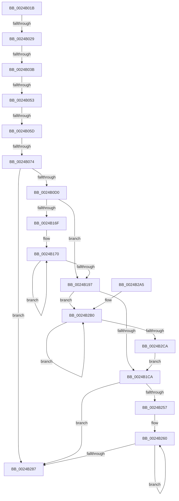

# sub_0024B01B

- RVA: `0x0024B01B`–`0x0024B2CF` (길이 `692` bytes)
- VA: `0x000000014024B01B`
- 실행 섹션: `.text`
- PDB 이름 있음: `아니요`; PDB Function 태그: `아니요`
- unwind 정보 RVA: `0x00062BE0`
- 디코드: `156`개 명령, `692/692` bytes 표시
- 미해석 바이트: `0` (있으면 어셈블리에 `.byte`로 보존)

> 이 문서는 커널 이미지의 기계어와 PDB 기호를 분석해 생성했습니다. 4번과 5번은 함수 원형과 자료형을 바이너리 사용 방식에서 추정한 C 해석이며 원본 소스 복구 결과는 아닙니다.

## 1. Dependencies

- 직접 호출 지점: **0**; 고유 호출 대상: **0**
- 직접 호출자로 확인된 함수: **0**
- RIP 상대 이미지 참조: **0**

### Outgoing calls
- 직접 디코드된 call 명령이 없습니다.

### Direct callers
- 이 함수 시작 RVA로 연결되는 직접 call은 확인되지 않았습니다. 간접 호출은 완전히 역산할 수 없습니다.

### Static image references
- 디코드된 RIP-relative 메모리 참조가 없습니다.

## 2. Other-region calls and transfers

- 다른 실행 섹션으로 향하는 call: **0**
- call이 아닌 외부 분기/꼬리 이동: **5**
  - `0x0024B023` → [sub_0024B335 + 0x118](Unknown_function_0024B335.md) (`tail-transfer`)
  - `0x0024B035` → [sub_0024B335 + 0x118](Unknown_function_0024B335.md) (`tail-transfer`)
  - `0x0024B04D` → [sub_0024B335 + 0x118](Unknown_function_0024B335.md) (`tail-transfer`)
  - `0x0024B057` → [sub_0024B335](Unknown_function_0024B335.md) (`tail-transfer`)
  - `0x0024B06E` → [sub_0024B51A + 0x3C](Unknown_function_0024B51A.md) (`tail-transfer`)

## 3. Assembly (complete function range)

```asm
0024B01B  44 32 47 22                     xor r8b, byte ptr [rdi + 0x22]
0024B01F  41 F6 C0 10                     test r8b, 0x10
0024B023  0F 85 24 04 00 00               jne 0x14024b44d
0024B029  41 8B 4B 10                     mov ecx, dword ptr [r11 + 0x10]
0024B02D  33 4F 10                        xor ecx, dword ptr [rdi + 0x10]
0024B030  48 0F BA E1 0A                  bt rcx, 0xa
0024B035  0F 82 12 04 00 00               jb 0x14024b44d
0024B03B  48 8B 4F 28                     mov rcx, qword ptr [rdi + 0x28]
0024B03F  49 8B 43 28                     mov rax, qword ptr [r11 + 0x28]
0024B043  48 C1 E8 3F                     shr rax, 0x3f
0024B047  48 C1 E9 3F                     shr rcx, 0x3f
0024B04B  3A C8                           cmp cl, al
0024B04D  0F 85 FA 03 00 00               jne 0x14024b44d
0024B053  83 7B 0C 02                     cmp dword ptr [rbx + 0xc], 2
0024B057  0F 84 D8 02 00 00               je 0x14024b335
0024B05D  48 8B 43 10                     mov rax, qword ptr [rbx + 0x10]
0024B061  48 BA FF FF FF FF 3F 00 00 00   movabs rdx, 0x3fffffffff
0024B06B  48 3B C2                        cmp rax, rdx
0024B06E  0F 84 E2 04 00 00               je 0x14024b556
0024B074  4C 8B 53 18                     mov r10, qword ptr [rbx + 0x18]
0024B078  4F 8D 04 52                     lea r8, [r10 + r10*2]
0024B07C  49 C1 E0 04                     shl r8, 4
0024B080  49 8B C5                        mov rax, r13
0024B083  4C 03 C0                        add r8, rax
0024B086  49 BB 00 00 00 00 00 FF FF FF   movabs r11, 0xffffff0000000000
0024B090  48 B9 FF FF FF FF 3F FF FF FF   movabs rcx, 0xffffff3fffffffff
0024B09A  49 8B 00                        mov rax, qword ptr [r8]
0024B09D  48 33 C6                        xor rax, rsi
0024B0A0  49 23 C3                        and rax, r11
0024B0A3  48 33 C6                        xor rax, rsi
0024B0A6  49 89 00                        mov qword ptr [r8], rax
0024B0A9  48 8B 47 18                     mov rax, qword ptr [rdi + 0x18]
0024B0AD  49 33 C2                        xor rax, r10
0024B0B0  49 23 C3                        and rax, r11
0024B0B3  49 33 C2                        xor rax, r10
0024B0B6  48 89 47 18                     mov qword ptr [rdi + 0x18], rax
0024B0BA  48 8B 07                        mov rax, qword ptr [rdi]
0024B0BD  48 23 C1                        and rax, rcx
0024B0C0  48 0B C2                        or rax, rdx
0024B0C3  48 89 07                        mov qword ptr [rdi], rax
0024B0C6  83 7B 0C 02                     cmp dword ptr [rbx + 0xc], 2
0024B0CA  0F 85 B7 01 00 00               jne 0x14024b287
0024B0D0  49 8B 08                        mov rcx, qword ptr [r8]
0024B0D3  0F 57 C0                        xorps xmm0, xmm0
0024B0D6  48 B8 FF FF FF FF FF 00 00 00   movabs rax, 0xffffffffff
0024B0E0  48 C7 44 24 30 00 00 00 00      mov qword ptr [rsp + 0x30], 0
0024B0E9  48 23 C8                        and rcx, rax
0024B0EC  4C 8B CE                        mov r9, rsi
0024B0EF  49 C1 E1 14                     shl r9, 0x14
0024B0F3  48 8B C6                        mov rax, rsi
0024B0F6  48 C1 E0 28                     shl rax, 0x28
0024B0FA  49 BE FF FF FF FF FF FF 7F F0   movabs r14, 0xf07fffffffffffff
0024B104  48 0B C8                        or rcx, rax
0024B107  0F 57 C9                        xorps xmm1, xmm1
0024B10A  41 8B 40 24                     mov eax, dword ptr [r8 + 0x24]
0024B10E  49 89 08                        mov qword ptr [r8], rcx
0024B111  25 FF FF 1F 00                  and eax, 0x1fffff
0024B116  48 8B CE                        mov rcx, rsi
0024B119  48 C1 E9 18                     shr rcx, 0x18
0024B11D  C1 E1 15                        shl ecx, 0x15
0024B120  0B C8                           or ecx, eax
0024B122  41 89 48 24                     mov dword ptr [r8 + 0x24], ecx
0024B126  49 8B 50 28                     mov rdx, qword ptr [r8 + 0x28]
0024B12A  48 8B CA                        mov rcx, rdx
0024B12D  48 89 54 24 58                  mov qword ptr [rsp + 0x58], rdx
0024B132  49 33 C9                        xor rcx, r9
0024B135  48 8B C2                        mov rax, rdx
0024B138  49 23 CE                        and rcx, r14
0024B13B  49 33 C9                        xor rcx, r9
0024B13E  F3 0F 7F 44 24 38               movdqu xmmword ptr [rsp + 0x38], xmm0
0024B144  F3 0F 7F 4C 24 48               movdqu xmmword ptr [rsp + 0x48], xmm1
0024B14A  0F 11 44 24 60                  movups xmmword ptr [rsp + 0x60], xmm0
0024B14F  0F 11 44 24 70                  movups xmmword ptr [rsp + 0x70], xmm0
0024B154  0F 11 84 24 80 00 00 00         movups xmmword ptr [rsp + 0x80], xmm0
0024B15C  F0 49 0F B1 48 28               lock cmpxchg qword ptr [r8 + 0x28], rcx
0024B162  48 89 84 24 88 00 00 00         mov qword ptr [rsp + 0x88], rax
0024B16A  48 3B D0                        cmp rdx, rax
0024B16D  74 28                           je 0x14024b197
0024B16F  90                              nop
0024B170  49 8B C9                        mov rcx, r9
0024B173  48 89 44 24 58                  mov qword ptr [rsp + 0x58], rax
0024B178  48 33 C8                        xor rcx, rax
0024B17B  48 8B D0                        mov rdx, rax
0024B17E  49 23 CE                        and rcx, r14
0024B181  49 33 C9                        xor rcx, r9
0024B184  F0 49 0F B1 48 28               lock cmpxchg qword ptr [r8 + 0x28], rcx
0024B18A  48 89 84 24 88 00 00 00         mov qword ptr [rsp + 0x88], rax
0024B192  48 3B D0                        cmp rdx, rax
0024B195  75 D9                           jne 0x14024b170
0024B197  48 8B 4F 18                     mov rcx, qword ptr [rdi + 0x18]
0024B19B  4D 8B C2                        mov r8, r10
0024B19E  49 C1 E0 28                     shl r8, 0x28
0024B1A2  48 8B D1                        mov rdx, rcx
0024B1A5  49 33 D0                        xor rdx, r8
0024B1A8  49 B9 FF FF FF FF FF 00 00 F8   movabs r9, 0xf80000ffffffffff
0024B1B2  49 23 D1                        and rdx, r9
0024B1B5  48 8B C1                        mov rax, rcx
0024B1B8  49 33 D0                        xor rdx, r8
0024B1BB  F0 48 0F B1 57 18               lock cmpxchg qword ptr [rdi + 0x18], rdx
0024B1C1  48 3B C8                        cmp rcx, rax
0024B1C4  0F 85 E6 00 00 00               jne 0x14024b2b0
0024B1CA  4C 09 1F                        or qword ptr [rdi], r11
0024B1CD  0F 57 C0                        xorps xmm0, xmm0
0024B1D0  49 C1 EA 13                     shr r10, 0x13
0024B1D4  49 B8 FF FF FF FF FF FF FF F3   movabs r8, 0xf3ffffffffffffff
0024B1DE  41 81 CA 00 00 E0 FF            or r10d, 0xffe00000
0024B1E5  48 C7 84 24 90 00 00 00 00 00 00 00  mov qword ptr [rsp + 0x90], 0
0024B1F1  44 89 57 24                     mov dword ptr [rdi + 0x24], r10d
0024B1F5  0F 57 C9                        xorps xmm1, xmm1
0024B1F8  48 8B 57 28                     mov rdx, qword ptr [rdi + 0x28]
0024B1FC  49 B9 00 00 00 00 00 00 80 03   movabs r9, 0x380000000000000
0024B206  48 8B CA                        mov rcx, rdx
0024B209  48 89 94 24 B8 00 00 00         mov qword ptr [rsp + 0xb8], rdx
0024B211  49 23 C8                        and rcx, r8
0024B214  48 8B C2                        mov rax, rdx
0024B217  49 0B C9                        or rcx, r9
0024B21A  F3 0F 7F 84 24 98 00 00 00      movdqu xmmword ptr [rsp + 0x98], xmm0
0024B223  F3 0F 7F 8C 24 A8 00 00 00      movdqu xmmword ptr [rsp + 0xa8], xmm1
0024B22C  0F 11 84 24 C0 00 00 00         movups xmmword ptr [rsp + 0xc0], xmm0
0024B234  0F 11 84 24 D0 00 00 00         movups xmmword ptr [rsp + 0xd0], xmm0
0024B23C  0F 11 84 24 E0 00 00 00         movups xmmword ptr [rsp + 0xe0], xmm0
0024B244  F0 48 0F B1 4F 28               lock cmpxchg qword ptr [rdi + 0x28], rcx
0024B24A  48 89 84 24 E8 00 00 00         mov qword ptr [rsp + 0xe8], rax
0024B252  48 3B D0                        cmp rdx, rax
0024B255  74 30                           je 0x14024b287
0024B257  66 0F 1F 84 00 00 00 00 00      nop word ptr [rax + rax]
0024B260  48 8B C8                        mov rcx, rax
0024B263  48 89 84 24 B8 00 00 00         mov qword ptr [rsp + 0xb8], rax
0024B26B  49 23 C8                        and rcx, r8
0024B26E  48 8B D0                        mov rdx, rax
0024B271  49 0B C9                        or rcx, r9
0024B274  F0 48 0F B1 4F 28               lock cmpxchg qword ptr [rdi + 0x28], rcx
0024B27A  48 89 84 24 E8 00 00 00         mov qword ptr [rsp + 0xe8], rax
0024B282  48 3B D0                        cmp rdx, rax
0024B285  75 D9                           jne 0x14024b260
0024B287  48 89 73 18                     mov qword ptr [rbx + 0x18], rsi
0024B28B  48 FF 03                        inc qword ptr [rbx]
0024B28E  4C 8B B4 24 38 01 00 00         mov r14, qword ptr [rsp + 0x138]
0024B296  48 81 C4 F0 00 00 00            add rsp, 0xf0
0024B29D  41 5F                           pop r15
0024B29F  41 5D                           pop r13
0024B2A1  5F                              pop rdi
0024B2A2  5E                              pop rsi
0024B2A3  5B                              pop rbx
0024B2A4  C3                              ret
0024B2A5  CC                              int3
0024B2A6  66 66 0F 1F 84 00 00 00 00 00   nop word ptr [rax + rax]
0024B2B0  48 8B D0                        mov rdx, rax
0024B2B3  48 8B C8                        mov rcx, rax
0024B2B6  49 33 D0                        xor rdx, r8
0024B2B9  49 23 D1                        and rdx, r9
0024B2BC  49 33 D0                        xor rdx, r8
0024B2BF  F0 48 0F B1 57 18               lock cmpxchg qword ptr [rdi + 0x18], rdx
0024B2C5  48 3B C8                        cmp rcx, rax
0024B2C8  75 E6                           jne 0x14024b2b0
0024B2CA  E9 FB FE FF FF                  jmp 0x14024b1ca
```

## 4. C-style interpretation (structured pseudocode)

```c
__int64 __fastcall sub_0024B01B(__int64 a1, __int64 a2, unsigned __int8 a3, __int64 a4, __int64 a5, __int64 a6, __int64 a7, __int64 a8, __int64 a9, __int64 a10, __int64 a11, __int64 a12, __int64 a13, __int64 a14, __int64 a15, __int64 a16, __int64 a17, __int64 a18, __int64 a19, __int64 a20, __int64 a21, __int64 a22, __int64 a23, __int64 a24, __int64 a25, __int64 a26, __int64 a27, __int64 a28, __int64 a29, __int64 a30, __int64 a31, __int64 a32, __int64 a33, __int64 a34, __int64 a35, __int64 a36, __int64 a37, __int64 a38, __int64 a39)
{
    __int64 result;
    __int64 v_r10;
    __int64 v_rsp;
    unsigned __int64 v_stack_p30;
    unsigned __int64 v_stack_p38;
    unsigned __int64 v_stack_p48;
    unsigned __int64 v_stack_p58;
    unsigned __int64 v_stack_p88;
    unsigned __int64 v_stack_p90;
    unsigned __int64 v_stack_p98;
    unsigned __int64 v_stack_pA8;
    unsigned __int64 v_stack_pB8;
    unsigned __int64 v_stack_pE8;

    a3 = (unsigned __int8)((a3) ^ (*(unsigned __int8 *)(v_rdi + 34)));
    a1 = (unsigned int)(((unsigned int)(*(unsigned int *)(v_r11 + 16))) ^ (*(unsigned int *)(v_rdi + 16)));
    result = (*(unsigned __int64 *)(v_r11 + 40)) >> (63);
    a1 = (*(unsigned __int64 *)(v_rdi + 40)) >> (63);
    a3 = (*(unsigned __int64 *)(v_rbx + 24) + *(unsigned __int64 *)(v_rbx + 24) * 2) << (4);
    a3 = (a3) + (v_r13);
    result = (*(unsigned __int64 *)(a3)) ^ (v_rsi);
    result = (result) & (v_r11);
    result = (result) ^ (v_rsi);
    *(unsigned __int64 *)(a3) = result;
    result = (*(unsigned __int64 *)(v_rdi + 24)) ^ (*(unsigned __int64 *)(v_rbx + 24));
    result = (result) & (v_r11);
    result = (result) ^ (*(unsigned __int64 *)(v_rbx + 24));
    *(unsigned __int64 *)(v_rdi + 24) = result;
    result = (*(unsigned __int64 *)(v_rdi)) & (a1);
    result = (result) | (a2);
    *(unsigned __int64 *)(v_rdi) = result;
    if ((*(unsigned int *)(v_rbx + 12)) != 2) goto loc_0024B287;
    v_stack_p30 = 0;
    a1 = (*(unsigned __int64 *)(a3)) & (result);
    a4 = (v_rsi) << (20);
    result = (v_rsi) << (40);
    a1 = (a1) | (result);
    *(unsigned __int64 *)(a3) = a1;
    result = (unsigned int)(((unsigned int)(*(unsigned int *)(a3 + 36))) & (0x1FFFFFULL));
    a1 = (v_rsi) >> (24);
    a1 = (unsigned int)((a1) << (21));
    a1 = (unsigned int)((a1) | ((unsigned int)(result)));
    *(unsigned int *)(a3 + 36) = (unsigned int)(a1);
    v_stack_p58 = *(unsigned __int64 *)(a3 + 40);
    a1 = (*(unsigned __int64 *)(a3 + 40)) ^ (a4);
    a1 = (a1) & (v_r14);
    a1 = (a1) ^ (a4);
    v_stack_p38 = v_xmm0;
    v_stack_p48 = v_xmm1;
    a12 = v_xmm0;
    a14 = v_xmm0;
    a16 = v_xmm0;
    v_stack_p88 = *(unsigned __int64 *)(a3 + 40);
    if ((*(unsigned __int64 *)(a3 + 40)) == (*(unsigned __int64 *)(a3 + 40))) goto loc_0024B197;
loc_0024B170:
    v_stack_p58 = *(unsigned __int64 *)(a3 + 40);
    a1 = (a4) ^ (*(unsigned __int64 *)(a3 + 40));
    a1 = (a1) & (v_r14);
    a1 = (a1) ^ (a4);
    v_stack_p88 = *(unsigned __int64 *)(a3 + 40);
    if ((*(unsigned __int64 *)(a3 + 40)) != (*(unsigned __int64 *)(a3 + 40))) goto loc_0024B170;
loc_0024B197:
    a3 = (*(unsigned __int64 *)(v_rbx + 24)) << (40);
    a2 = (*(unsigned __int64 *)(v_rdi + 24)) ^ (a3);
    a2 = (a2) & (a4);
    a2 = (a2) ^ (a3);
    if ((*(unsigned __int64 *)(v_rdi + 24)) != (*(unsigned __int64 *)(v_rdi + 24))) goto loc_0024B2B0;
loc_0024B1CA:
    v_r10 = (*(unsigned __int64 *)(v_rbx + 24)) >> (19);
    v_r10 = (unsigned int)((v_r10) | (0xFFE00000ULL));
    v_stack_p90 = 0;
    *(unsigned int *)(v_rdi + 36) = (unsigned int)(v_r10);
    v_stack_pB8 = *(unsigned __int64 *)(v_rdi + 40);
    a1 = (*(unsigned __int64 *)(v_rdi + 40)) & (a3);
    a1 = (a1) | (a4);
    v_stack_p98 = v_xmm0;
    v_stack_pA8 = v_xmm1;
    a24 = v_xmm0;
    a26 = v_xmm0;
    a28 = v_xmm0;
    v_stack_pE8 = *(unsigned __int64 *)(v_rdi + 40);
    if ((*(unsigned __int64 *)(v_rdi + 40)) == (*(unsigned __int64 *)(v_rdi + 40))) goto loc_0024B287;
loc_0024B260:
    v_stack_pB8 = *(unsigned __int64 *)(v_rdi + 40);
    a1 = (*(unsigned __int64 *)(v_rdi + 40)) & (a3);
    a1 = (a1) | (a4);
    v_stack_pE8 = *(unsigned __int64 *)(v_rdi + 40);
    if ((*(unsigned __int64 *)(v_rdi + 40)) != (*(unsigned __int64 *)(v_rdi + 40))) goto loc_0024B260;
loc_0024B287:
    *(unsigned __int64 *)(v_rbx + 24) = v_rsi;
    v_rsp = (v_rsp) + (240);
    return *(unsigned __int64 *)(v_rdi + 40);
loc_0024B2B0:
    a2 = (*(unsigned __int64 *)(v_rdi + 40)) ^ (a3);
    a2 = (a2) & (a4);
    a2 = (a2) ^ (a3);
    if ((*(unsigned __int64 *)(v_rdi + 40)) != (*(unsigned __int64 *)(v_rdi + 40))) goto loc_0024B2B0;
    goto loc_0024B1CA;
}
```

## 5. (Beta) C Style

```c
int64_t sub_0024B01B(int64_t Arg1, int64_t Arg2, uint8_t Arg3, int64_t Arg4, uint64_t Arg5, uint64_t Arg6, uint64_t Arg7, uint64_t Arg8, uint64_t Arg9, uint64_t Arg10, uint64_t Arg11, int64_t Arg12, uint64_t Arg13, int64_t Arg14, uint64_t Arg15, int64_t Arg16, uint64_t Arg17, uint64_t Arg18, uint64_t Arg19, uint64_t Arg20, uint64_t Arg21, uint64_t Arg22, uint64_t Arg23, int64_t Arg24, uint64_t Arg25, int64_t Arg26, uint64_t Arg27, int64_t Arg28, uint64_t Arg29, uint64_t Arg30, uint64_t Arg31, uint64_t Arg32, uint64_t Arg33, uint64_t Arg34, uint64_t Arg35, uint64_t Arg36, uint64_t Arg37, uint64_t Arg38, int64_t Arg39)
{
    int64_t result;
    int64_t local_r10;
    int64_t local_rsp;
    uint64_t v_stack_p30;
    uint64_t v_stack_p38;
    uint64_t v_stack_p48;
    uint64_t v_stack_p58;
    uint64_t v_stack_p88;
    uint64_t v_stack_p90;
    uint64_t v_stack_p98;
    uint64_t v_stack_pA8;
    uint64_t v_stack_pB8;
    uint64_t v_stack_pE8;

    Arg3 = (uint8_t)((Arg3) ^ (*(uint8_t *)(local_rdi + 0x22)));
    Arg1 = (uint32_t)(((uint32_t)(*(uint32_t *)(local_r11 + 0x10))) ^ (*(uint32_t *)(local_rdi + 0x10)));
    result = (*(uint64_t *)(local_r11 + 0x28)) >> (63);
    Arg1 = (*(uint64_t *)(local_rdi + 0x28)) >> (63);
    Arg3 = (*(uint64_t *)(local_rbx + 0x18) + *(uint64_t *)(local_rbx + 0x18) * 2) << (4);
    Arg3 = (Arg3) + (local_r13);
    result = (*(uint64_t *)(Arg3)) ^ (local_rsi);
    result = (result) & (local_r11);
    result = (result) ^ (local_rsi);
    *(uint64_t *)(Arg3) = result;
    result = (*(uint64_t *)(local_rdi + 0x18)) ^ (*(uint64_t *)(local_rbx + 0x18));
    result = (result) & (local_r11);
    result = (result) ^ (*(uint64_t *)(local_rbx + 0x18));
    *(uint64_t *)(local_rdi + 0x18) = result;
    result = (*(uint64_t *)(local_rdi)) & (Arg1);
    result = (result) | (Arg2);
    *(uint64_t *)(local_rdi) = result;
    if ((*(uint32_t *)(local_rbx + 0xC)) != 2) goto loc_0024B287;
    v_stack_p30 = 0;
    Arg1 = (*(uint64_t *)(Arg3)) & (result);
    Arg4 = (local_rsi) << (20);
    result = (local_rsi) << (40);
    Arg1 = (Arg1) | (result);
    *(uint64_t *)(Arg3) = Arg1;
    result = (uint32_t)(((uint32_t)(*(uint32_t *)(Arg3 + 0x24))) & (0x1FFFFFULL));
    Arg1 = (local_rsi) >> (24);
    Arg1 = (uint32_t)((Arg1) << (21));
    Arg1 = (uint32_t)((Arg1) | ((uint32_t)(result)));
    *(uint32_t *)(Arg3 + 0x24) = (uint32_t)(Arg1);
    v_stack_p58 = *(uint64_t *)(Arg3 + 0x28);
    Arg1 = (*(uint64_t *)(Arg3 + 0x28)) ^ (Arg4);
    Arg1 = (Arg1) & (local_r14);
    Arg1 = (Arg1) ^ (Arg4);
    v_stack_p38 = v_xmm0;
    v_stack_p48 = v_xmm1;
    Arg12 = v_xmm0;
    Arg14 = v_xmm0;
    Arg16 = v_xmm0;
    v_stack_p88 = *(uint64_t *)(Arg3 + 0x28);
    if ((*(uint64_t *)(Arg3 + 0x28)) == (*(uint64_t *)(Arg3 + 0x28))) goto loc_0024B197;
loc_0024B170:
    v_stack_p58 = *(uint64_t *)(Arg3 + 0x28);
    Arg1 = (Arg4) ^ (*(uint64_t *)(Arg3 + 0x28));
    Arg1 = (Arg1) & (local_r14);
    Arg1 = (Arg1) ^ (Arg4);
    v_stack_p88 = *(uint64_t *)(Arg3 + 0x28);
    if ((*(uint64_t *)(Arg3 + 0x28)) != (*(uint64_t *)(Arg3 + 0x28))) goto loc_0024B170;
loc_0024B197:
    Arg3 = (*(uint64_t *)(local_rbx + 0x18)) << (40);
    Arg2 = (*(uint64_t *)(local_rdi + 0x18)) ^ (Arg3);
    Arg2 = (Arg2) & (Arg4);
    Arg2 = (Arg2) ^ (Arg3);
    if ((*(uint64_t *)(local_rdi + 0x18)) != (*(uint64_t *)(local_rdi + 0x18))) goto loc_0024B2B0;
loc_0024B1CA:
    local_r10 = (*(uint64_t *)(local_rbx + 0x18)) >> (19);
    local_r10 = (uint32_t)((local_r10) | (0xFFE00000ULL));
    v_stack_p90 = 0;
    *(uint32_t *)(local_rdi + 0x24) = (uint32_t)(local_r10);
    v_stack_pB8 = *(uint64_t *)(local_rdi + 0x28);
    Arg1 = (*(uint64_t *)(local_rdi + 0x28)) & (Arg3);
    Arg1 = (Arg1) | (Arg4);
    v_stack_p98 = v_xmm0;
    v_stack_pA8 = v_xmm1;
    Arg24 = v_xmm0;
    Arg26 = v_xmm0;
    Arg28 = v_xmm0;
    v_stack_pE8 = *(uint64_t *)(local_rdi + 0x28);
    if ((*(uint64_t *)(local_rdi + 0x28)) == (*(uint64_t *)(local_rdi + 0x28))) goto loc_0024B287;
loc_0024B260:
    v_stack_pB8 = *(uint64_t *)(local_rdi + 0x28);
    Arg1 = (*(uint64_t *)(local_rdi + 0x28)) & (Arg3);
    Arg1 = (Arg1) | (Arg4);
    v_stack_pE8 = *(uint64_t *)(local_rdi + 0x28);
    if ((*(uint64_t *)(local_rdi + 0x28)) != (*(uint64_t *)(local_rdi + 0x28))) goto loc_0024B260;
loc_0024B287:
    *(uint64_t *)(local_rbx + 0x18) = local_rsi;
    local_rsp = (local_rsp) + (240);
    return *(uint64_t *)(local_rdi + 0x28);
loc_0024B2B0:
    Arg2 = (*(uint64_t *)(local_rdi + 0x28)) ^ (Arg3);
    Arg2 = (Arg2) & (Arg4);
    Arg2 = (Arg2) ^ (Arg3);
    if ((*(uint64_t *)(local_rdi + 0x28)) != (*(uint64_t *)(local_rdi + 0x28))) goto loc_0024B2B0;
    goto loc_0024B1CA;
}
```

## 6. Execution-region graph

[열기: 2D/3D 그래프와 함수 탐색 컨트롤 패널](../../../control-panel.html?section=text&rva=0x0024B01B&view=graph)

- 2D 그래프는 위에서 아래로 흐르고, 3D 그래프는 빈 공간을 드래그해 회전합니다. Shift+드래그는 이동, 휠은 확대·축소, 함수 노드 선택은 대상 보고서 이동입니다.

### Static fallback


