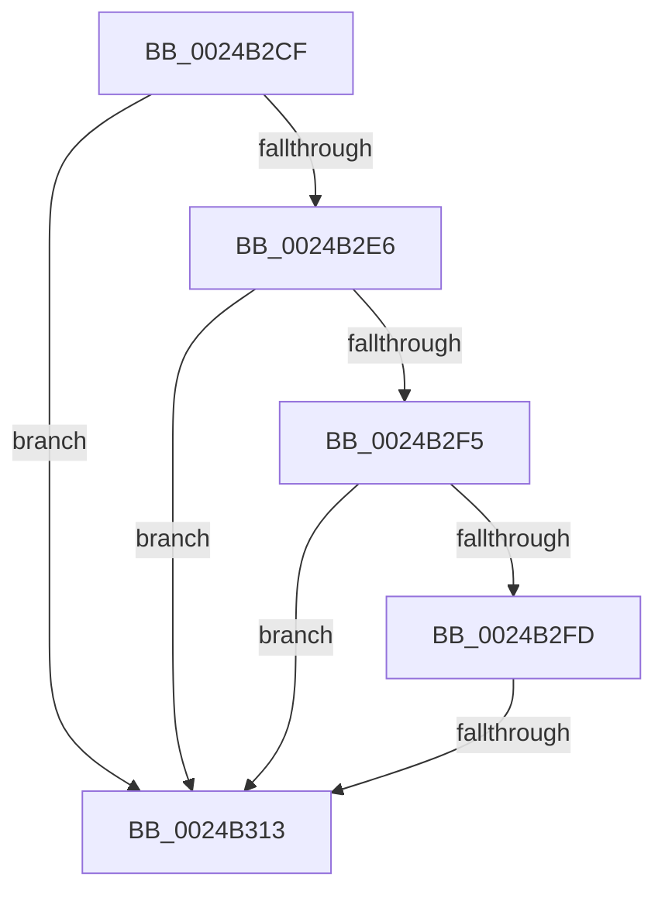

# sub_0024B2CF

- RVA: `0x0024B2CF`–`0x0024B335` (길이 `102` bytes)
- VA: `0x000000014024B2CF`
- 실행 섹션: `.text`
- PDB 이름 있음: `아니요`; PDB Function 태그: `아니요`
- unwind 정보 RVA: `0x00062BF4`
- 디코드: `24`개 명령, `102/102` bytes 표시
- 미해석 바이트: `0` (있으면 어셈블리에 `.byte`로 보존)

> 이 문서는 커널 이미지의 기계어와 PDB 기호를 분석해 생성했습니다. 4번과 5번은 함수 원형과 자료형을 바이너리 사용 방식에서 추정한 C 해석이며 원본 소스 복구 결과는 아닙니다.

## 1. Dependencies

- 직접 호출 지점: **0**; 고유 호출 대상: **0**
- 직접 호출자로 확인된 함수: **0**
- RIP 상대 이미지 참조: **0**

### Outgoing calls
- 직접 디코드된 call 명령이 없습니다.

### Direct callers
- 이 함수 시작 RVA로 연결되는 직접 call은 확인되지 않았습니다. 간접 호출은 완전히 역산할 수 없습니다.

### Static image references
- 디코드된 RIP-relative 메모리 참조가 없습니다.

## 2. Other-region calls and transfers

- 다른 실행 섹션으로 향하는 call: **0**
- call이 아닌 외부 분기/꼬리 이동: **2**
  - `0x0024B30D` → [sub_0024B635](Unknown_function_0024B635.md) (`tail-transfer`)
  - `0x0024B330` → [MiEnqueuePageList + 0x3B](MiEnqueuePageList_function_0024AF40.md) (`tail-transfer`)

## 3. Assembly (complete function range)

```asm
0024B2CF  48 8B 4F 10                     mov rcx, qword ptr [rdi + 0x10]
0024B2D3  4C 8D 4F 10                     lea r9, [rdi + 0x10]
0024B2D7  48 B8 00 D0 BE 7D FB F6 FF FF   movabs rax, 0xfffff6fb7dbed000
0024B2E1  4C 3B C8                        cmp r9, rax
0024B2E4  72 2D                           jb 0x14024b313
0024B2E6  48 B8 F8 D7 BE 7D FB F6 FF FF   movabs rax, 0xfffff6fb7dbed7f8
0024B2F0  4C 3B C8                        cmp r9, rax
0024B2F3  77 1E                           ja 0x14024b313
0024B2F5  48 8B C1                        mov rax, rcx
0024B2F8  F6 C1 01                        test cl, 1
0024B2FB  74 16                           je 0x14024b313
0024B2FD  F6 C1 42                        test cl, 0x42
0024B300  41 0F 95 C0                     setne r8b
0024B304  F6 C1 20                        test cl, 0x20
0024B307  0F 95 C2                        setne dl
0024B30A  44 84 C2                        test dl, r8b
0024B30D  0F 84 22 03 00 00               je 0x14024b635
0024B313  48 0F BA E1 0A                  bt rcx, 0xa
0024B318  48 C7 C0 F7 FF FF FF            mov rax, 0xfffffffffffffff7
0024B31F  48 C7 C2 FF F7 FF FF            mov rdx, 0xfffffffffffff7ff
0024B326  48 0F 42 C2                     cmovb rax, rdx
0024B32A  48 23 C1                        and rax, rcx
0024B32D  49 89 01                        mov qword ptr [r9], rax
0024B330  E9 46 FC FF FF                  jmp 0x14024af7b
```

## 4. C-style interpretation (structured pseudocode)

```c
__int64 __fastcall sub_0024B2CF(void)
{
    __int64 result;

    if ((v_rdi + 16) < result) goto loc_0024B313;
    if ((v_rdi + 16) > result) goto loc_0024B313;
    if ((((unsigned __int8)(*(unsigned __int64 *)(v_rdi + 16))) & (1)) == 0) goto loc_0024B313;
    a3 = ((((unsigned __int8)(*(unsigned __int64 *)(v_rdi + 16))) & (66)) != 0) ? 1 : 0;
    a2 = ((((unsigned __int8)(*(unsigned __int64 *)(v_rdi + 16))) & (32)) != 0) ? 1 : 0;
loc_0024B313:
    result = -9;
    if (condition_is_below) { result = 0xFFFFFFFFFFFFF7FFULL; }
    result = (result) & (*(unsigned __int64 *)(v_rdi + 16));
    *(unsigned __int64 *)(v_rdi + 16) = result;
}
```

## 5. (Beta) C Style

```c
void sub_0024B2CF(void)
{
    int64_t result;

    if ((local_rdi + 16) < result) goto loc_0024B313;
    if ((local_rdi + 16) > result) goto loc_0024B313;
    if ((((uint8_t)(*(uint64_t *)(local_rdi + 0x10))) & (1)) == 0) goto loc_0024B313;
    a3 = ((((uint8_t)(*(uint64_t *)(local_rdi + 0x10))) & (66)) != 0) ? 1 : 0;
    a2 = ((((uint8_t)(*(uint64_t *)(local_rdi + 0x10))) & (32)) != 0) ? 1 : 0;
loc_0024B313:
    result = -9;
    if (condition_is_below) { result = 0xFFFFFFFFFFFFF7FFULL; }
    result = (result) & (*(uint64_t *)(local_rdi + 0x10));
    *(uint64_t *)(local_rdi + 0x10) = result;
}
```

## 6. Execution-region graph

[열기: 2D/3D 그래프와 함수 탐색 컨트롤 패널](../../../control-panel.html?section=text&rva=0x0024B2CF&view=graph)

- 2D 그래프는 위에서 아래로 흐르고, 3D 그래프는 빈 공간을 드래그해 회전합니다. Shift+드래그는 이동, 휠은 확대·축소, 함수 노드 선택은 대상 보고서 이동입니다.

### Static fallback


