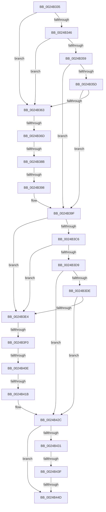

# sub_0024B335

- RVA: `0x0024B335`–`0x0024B45F` (길이 `298` bytes)
- VA: `0x000000014024B335`
- 실행 섹션: `.text`
- PDB 이름 있음: `아니요`; PDB Function 태그: `아니요`
- unwind 정보 RVA: `0x00062C04`
- 디코드: `69`개 명령, `298/298` bytes 표시
- 미해석 바이트: `0` (있으면 어셈블리에 `.byte`로 보존)

> 이 문서는 커널 이미지의 기계어와 PDB 기호를 분석해 생성했습니다. 4번과 5번은 함수 원형과 자료형을 바이너리 사용 방식에서 추정한 C 해석이며 원본 소스 복구 결과는 아닙니다.

## 1. Dependencies

- 직접 호출 지점: **1**; 고유 호출 대상: **1**
- 직접 호출자로 확인된 함수: **0**
- RIP 상대 이미지 참조: **5**

### Outgoing calls
- `0x0024B455` → [MiInsertPagesInList](../33/MiInsertPagesInList_function_0033E270.md) (function, `0x0033E270`)

### Direct callers
- 이 함수 시작 RVA로 연결되는 직접 call은 확인되지 않았습니다. 간접 호출은 완전히 역산할 수 없습니다.

### Static image references
- `0x0024B335` → RVA `0x00E2DBC0` (`.data`; read)
- `0x0024B33C` → RVA `0x00E2DBC4` (`.data`; read)
- `0x0024B34D` → RVA `0x00E2DC20` (`.data`; read)
- `0x0024B398` → RVA `0x00E2DBC0` (`.data`; write)
- `0x0024B431` → RVA `0x00E2DC28` (`.data`; read)

## 2. Other-region calls and transfers

- 다른 실행 섹션으로 향하는 call: **0**
- call이 아닌 외부 분기/꼬리 이동: **9**
  - `0x0024B367` → [sub_0024B51A + 0x1E](Unknown_function_0024B51A.md) (`tail-transfer`)
  - `0x0024B385` → [sub_0024B727 + 0x98](Unknown_function_0024B727.md) (`tail-transfer`)
  - `0x0024B392` → [sub_0024B727](Unknown_function_0024B727.md) (`tail-transfer`)
  - `0x0024B3EA` → [sub_0024B51A](Unknown_function_0024B51A.md) (`tail-transfer`)
  - `0x0024B408` → [sub_0024B727 + 0x74](Unknown_function_0024B727.md) (`tail-transfer`)
  - `0x0024B415` → [sub_0024B727 + 0x13](Unknown_function_0024B727.md) (`tail-transfer`)
  - `0x0024B439` → [sub_0024B727 + 0x45](Unknown_function_0024B727.md) (`tail-transfer`)
  - `0x0024B447` → [sub_0024B01B + 0x42](Unknown_function_0024B01B.md) (`tail-transfer`)
  - `0x0024B45A` → [sub_0024B01B + 0x42](Unknown_function_0024B01B.md) (`tail-transfer`)

## 3. Assembly (complete function range)

```asm
0024B335  48 63 15 84 28 BE 00            movsxd rdx, dword ptr [rip + 0xbe2884]
0024B33C  8B 0D 82 28 BE 00               mov ecx, dword ptr [rip + 0xbe2882]
0024B342  3B D1                           cmp edx, ecx
0024B344  77 1D                           ja 0x14024b363
0024B346  48 8B C2                        mov rax, rdx
0024B349  48 C1 E0 04                     shl rax, 4
0024B34D  48 03 05 CC 28 BE 00            add rax, qword ptr [rip + 0xbe28cc]
0024B354  48 3B 30                        cmp rsi, qword ptr [rax]
0024B357  72 0A                           jb 0x14024b363
0024B359  3B D1                           cmp edx, ecx
0024B35B  74 42                           je 0x14024b39f
0024B35D  48 3B 70 10                     cmp rsi, qword ptr [rax + 0x10]
0024B361  72 3C                           jb 0x14024b39f
0024B363  33 D2                           xor edx, edx
0024B365  3B CA                           cmp ecx, edx
0024B367  0F 8C CB 01 00 00               jl 0x14024b538
0024B36D  44 8D 04 0A                     lea r8d, [rdx + rcx]
0024B371  41 D1 F8                        sar r8d, 1
0024B374  49 63 C0                        movsxd rax, r8d
0024B377  48 C1 E0 04                     shl rax, 4
0024B37B  48 03 05 9E 28 BE 00            add rax, qword ptr [rip + 0xbe289e]
0024B382  48 3B 30                        cmp rsi, qword ptr [rax]
0024B385  0F 82 34 04 00 00               jb 0x14024b7bf
0024B38B  44 3B 05 32 28 BE 00            cmp r8d, dword ptr [rip + 0xbe2832]
0024B392  0F 85 8F 03 00 00               jne 0x14024b727
0024B398  44 89 05 21 28 BE 00            mov dword ptr [rip + 0xbe2821], r8d
0024B39F  4C 63 05 1A 28 BE 00            movsxd r8, dword ptr [rip + 0xbe281a]
0024B3A6  49 B9 AB AA AA AA AA AA AA AA   movabs r9, 0xaaaaaaaaaaaaaaab
0024B3B0  8B 15 0E 28 BE 00               mov edx, dword ptr [rip + 0xbe280e]
0024B3B6  8B 40 08                        mov eax, dword ptr [rax + 8]
0024B3B9  49 C1 FE 04                     sar r14, 4
0024B3BD  4D 0F AF F1                     imul r14, r9
0024B3C1  44 3B C2                        cmp r8d, edx
0024B3C4  77 1E                           ja 0x14024b3e4
0024B3C6  49 8B C8                        mov rcx, r8
0024B3C9  48 C1 E1 04                     shl rcx, 4
0024B3CD  48 03 0D 4C 28 BE 00            add rcx, qword ptr [rip + 0xbe284c]
0024B3D4  4C 3B 31                        cmp r14, qword ptr [rcx]
0024B3D7  72 0B                           jb 0x14024b3e4
0024B3D9  44 3B C2                        cmp r8d, edx
0024B3DC  74 4E                           je 0x14024b42c
0024B3DE  4C 3B 71 10                     cmp r14, qword ptr [rcx + 0x10]
0024B3E2  72 48                           jb 0x14024b42c
0024B3E4  45 33 C0                        xor r8d, r8d
0024B3E7  41 3B D0                        cmp edx, r8d
0024B3EA  0F 8C 2A 01 00 00               jl 0x14024b51a
0024B3F0  45 8D 0C 10                     lea r9d, [r8 + rdx]
0024B3F4  41 D1 F9                        sar r9d, 1
0024B3F7  49 63 C9                        movsxd rcx, r9d
0024B3FA  48 C1 E1 04                     shl rcx, 4
0024B3FE  48 03 0D 1B 28 BE 00            add rcx, qword ptr [rip + 0xbe281b]
0024B405  4C 3B 31                        cmp r14, qword ptr [rcx]
0024B408  0F 82 8D 03 00 00               jb 0x14024b79b
0024B40E  44 3B 0D AF 27 BE 00            cmp r9d, dword ptr [rip + 0xbe27af]
0024B415  0F 85 1F 03 00 00               jne 0x14024b73a
0024B41B  44 89 0D 9E 27 BE 00            mov dword ptr [rip + 0xbe279e], r9d
0024B422  49 B9 AB AA AA AA AA AA AA AA   movabs r9, 0xaaaaaaaaaaaaaaab
0024B42C  3B 41 08                        cmp eax, dword ptr [rcx + 8]
0024B42F  75 1C                           jne 0x14024b44d
0024B431  48 83 3D EF 27 BE 00 00         cmp qword ptr [rip + 0xbe27ef], 0
0024B439  0F 85 2D 03 00 00               jne 0x14024b76c
0024B43F  45 32 FF                        xor r15b, r15b
0024B442  32 C0                           xor al, al
0024B444  44 3A F8                        cmp r15b, al
0024B447  0F 84 10 FC FF FF               je 0x14024b05d
0024B44D  BA 01 00 00 00                  mov edx, 1
0024B452  48 8B CB                        mov rcx, rbx
0024B455  E8 16 2E 0F 00                  call 0x14033e270
0024B45A  E9 FE FB FF FF                  jmp 0x14024b05d
```

## 4. C-style interpretation (structured pseudocode)

```c
__int64 __fastcall sub_0024B335(void)
{
    __int64 result;
    __int64 v_r14;
    __int64 v_r15;

    if (((unsigned int)((int)(*(unsigned int *)(v_rip + 12462212)))) > ((unsigned int)((unsigned int)(*(unsigned int *)(v_rip + 12462210))))) goto loc_0024B363;
    result = ((int)(*(unsigned int *)(v_rip + 12462212))) << (4);
    result = (result) + (*(unsigned __int64 *)(v_rip + 12462284));
    if (v_rsi < (*(unsigned __int64 *)(result))) goto loc_0024B363;
    if (((unsigned int)((int)(*(unsigned int *)(v_rip + 12462212)))) == ((unsigned int)((unsigned int)(*(unsigned int *)(v_rip + 12462210))))) goto loc_0024B39F;
    if (v_rsi < (*(unsigned __int64 *)(result + 16))) goto loc_0024B39F;
loc_0024B363:
    a2 = 0;
    a3 = (unsigned int)((a2 + (unsigned int)(*(unsigned int *)(v_rip + 12462210)) * 1) >> (1));
    result = ((int)((unsigned int)(a3))) << (4);
    result = (result) + (*(unsigned __int64 *)(v_rip + 12462238));
    *(unsigned int *)(v_rip + 12462113) = (unsigned int)(a3);
loc_0024B39F:
    v_r14 = (v_r14) >> (4);
    v_r14 = (v_r14) * (a4);
    if (((unsigned int)((int)(*(unsigned int *)(v_rip + 12462106)))) > ((unsigned int)((unsigned int)(*(unsigned int *)(v_rip + 12462094))))) goto loc_0024B3E4;
    a1 = ((int)(*(unsigned int *)(v_rip + 12462106))) << (4);
    a1 = (a1) + (*(unsigned __int64 *)(v_rip + 12462156));
    if (v_r14 < (*(unsigned __int64 *)(a1))) goto loc_0024B3E4;
    if (((unsigned int)((int)(*(unsigned int *)(v_rip + 12462106)))) == ((unsigned int)((unsigned int)(*(unsigned int *)(v_rip + 12462094))))) goto loc_0024B42C;
    if (v_r14 < (*(unsigned __int64 *)(a1 + 16))) goto loc_0024B42C;
loc_0024B3E4:
    a3 = 0;
    a4 = (unsigned int)((a3 + (unsigned int)(*(unsigned int *)(v_rip + 12462094)) * 1) >> (1));
    a1 = ((int)((unsigned int)(a4))) << (4);
    a1 = (a1) + (*(unsigned __int64 *)(v_rip + 12462107));
    *(unsigned int *)(v_rip + 12461982) = (unsigned int)(a4);
loc_0024B42C:
    if (((unsigned int)((unsigned int)(*(unsigned int *)(result + 8)))) != (*(unsigned int *)(a1 + 8))) goto loc_0024B44D;
    v_r15 = 0;
    result = 0;
loc_0024B44D:
    result = MiInsertPagesInList(v_rbx, 1, a3, a4);
}
```

## 5. (Beta) C Style

```c
void sub_0024B335(void)
{
    int64_t result;
    int64_t local_r14;
    int64_t local_r15;

    if (((uint32_t)((int32_t)(*(uint32_t *)(v_rip + 0xBE2884)))) > ((uint32_t)((uint32_t)(*(uint32_t *)(v_rip + 0xBE2882))))) goto loc_0024B363;
    result = ((int32_t)(*(uint32_t *)(v_rip + 0xBE2884))) << (4);
    result = (result) + (*(uint64_t *)(v_rip + 0xBE28CC));
    if (local_rsi < (*(uint64_t *)(result))) goto loc_0024B363;
    if (((uint32_t)((int32_t)(*(uint32_t *)(v_rip + 0xBE2884)))) == ((uint32_t)((uint32_t)(*(uint32_t *)(v_rip + 0xBE2882))))) goto loc_0024B39F;
    if (local_rsi < (*(uint64_t *)(result + 0x10))) goto loc_0024B39F;
loc_0024B363:
    a2 = 0;
    a3 = (uint32_t)((a2 + (uint32_t)(*(uint32_t *)(v_rip + 0xBE2882)) * 1) >> (1));
    result = ((int32_t)((uint32_t)(a3))) << (4);
    result = (result) + (*(uint64_t *)(v_rip + 0xBE289E));
    *(uint32_t *)(v_rip + 0xBE2821) = (uint32_t)(a3);
loc_0024B39F:
    local_r14 = (local_r14) >> (4);
    local_r14 = (local_r14) * (a4);
    if (((uint32_t)((int32_t)(*(uint32_t *)(v_rip + 0xBE281A)))) > ((uint32_t)((uint32_t)(*(uint32_t *)(v_rip + 0xBE280E))))) goto loc_0024B3E4;
    a1 = ((int32_t)(*(uint32_t *)(v_rip + 0xBE281A))) << (4);
    a1 = (a1) + (*(uint64_t *)(v_rip + 0xBE284C));
    if (local_r14 < (*(uint64_t *)(a1))) goto loc_0024B3E4;
    if (((uint32_t)((int32_t)(*(uint32_t *)(v_rip + 0xBE281A)))) == ((uint32_t)((uint32_t)(*(uint32_t *)(v_rip + 0xBE280E))))) goto loc_0024B42C;
    if (local_r14 < (*(uint64_t *)(a1 + 0x10))) goto loc_0024B42C;
loc_0024B3E4:
    a3 = 0;
    a4 = (uint32_t)((a3 + (uint32_t)(*(uint32_t *)(v_rip + 0xBE280E)) * 1) >> (1));
    a1 = ((int32_t)((uint32_t)(a4))) << (4);
    a1 = (a1) + (*(uint64_t *)(v_rip + 0xBE281B));
    *(uint32_t *)(v_rip + 0xBE279E) = (uint32_t)(a4);
loc_0024B42C:
    if (((uint32_t)((uint32_t)(*(uint32_t *)(result + 0x8)))) != (*(uint32_t *)(a1 + 0x8))) goto loc_0024B44D;
    local_r15 = 0;
    result = 0;
loc_0024B44D:
    result = MiInsertPagesInList(local_rbx, 1, a3, a4);
}
```

## 6. Execution-region graph

[열기: 2D/3D 그래프와 함수 탐색 컨트롤 패널](../../../control-panel.html?section=text&rva=0x0024B335&view=graph)

- 2D 그래프는 위에서 아래로 흐르고, 3D 그래프는 빈 공간을 드래그해 회전합니다. Shift+드래그는 이동, 휠은 확대·축소, 함수 노드 선택은 대상 보고서 이동입니다.

### Static fallback


