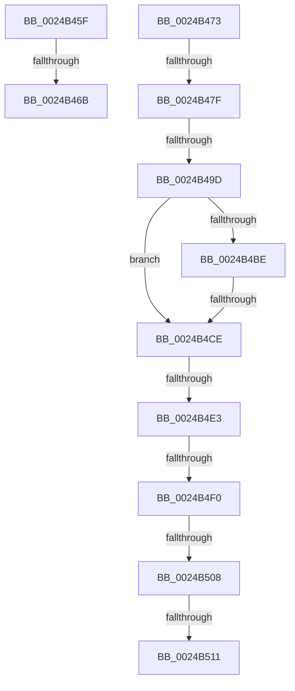

# sub_0024B45F

- RVA: `0x0024B45F`–`0x0024B51A` (길이 `187` bytes)
- VA: `0x000000014024B45F`
- 실행 섹션: `.text`
- PDB 이름 있음: `아니요`; PDB Function 태그: `아니요`
- unwind 정보 RVA: `0x00062C18`
- 디코드: `42`개 명령, `187/187` bytes 표시
- 미해석 바이트: `0` (있으면 어셈블리에 `.byte`로 보존)

> 이 문서는 커널 이미지의 기계어와 PDB 기호를 분석해 생성했습니다. 4번과 5번은 함수 원형과 자료형을 바이너리 사용 방식에서 추정한 C 해석이며 원본 소스 복구 결과는 아닙니다.

## 1. Dependencies

- 직접 호출 지점: **0**; 고유 호출 대상: **0**
- 직접 호출자로 확인된 함수: **0**
- RIP 상대 이미지 참조: **4**

### Outgoing calls
- 직접 디코드된 call 명령이 없습니다.

### Direct callers
- 이 함수 시작 RVA로 연결되는 직접 call은 확인되지 않았습니다. 간접 호출은 완전히 역산할 수 없습니다.

### Static image references
- `0x0024B47F` → RVA `0x00E2DCE0` (`.data`; read)
- `0x0024B4B2` → RVA `0x00E35C00` (`.data`; read)
- `0x0024B4E3` → RVA `0x00E3CBE6` (`.data`; read)
- `0x0024B4F0` → RVA `0x00E3D240` (`.data`; read)

## 2. Other-region calls and transfers

- 다른 실행 섹션으로 향하는 call: **0**
- call이 아닌 외부 분기/꼬리 이동: **10**
  - `0x0024B465` → [sub_0024B6A1](Unknown_function_0024B6A1.md) (`tail-transfer`)
  - `0x0024B46E` → [sub_0024AF91 + 0x4B](Unknown_function_0024AF91.md) (`tail-transfer`)
  - `0x0024B479` → [sub_0024AF91 + 0x79](Unknown_function_0024AF91.md) (`tail-transfer`)
  - `0x0024B497` → [sub_0024AF91 + 0x79](Unknown_function_0024AF91.md) (`tail-transfer`)
  - `0x0024B4C8` → [sub_0024AF91 + 0x79](Unknown_function_0024AF91.md) (`tail-transfer`)
  - `0x0024B4DD` → [sub_0024AF91 + 0x6A](Unknown_function_0024AF91.md) (`tail-transfer`)
  - `0x0024B4EA` → [sub_0024AF91 + 0x79](Unknown_function_0024AF91.md) (`tail-transfer`)
  - `0x0024B502` → [sub_0024AF91 + 0x79](Unknown_function_0024AF91.md) (`tail-transfer`)
  - `0x0024B50B` → [sub_0024AF91 + 0x79](Unknown_function_0024AF91.md) (`tail-transfer`)
  - `0x0024B515` → [sub_0024AF91 + 0x6A](Unknown_function_0024AF91.md) (`tail-transfer`)

## 3. Assembly (complete function range)

```asm
0024B45F  49 8B C5                        mov rax, r13
0024B462  48 3B F8                        cmp rdi, rax
0024B465  0F 83 36 02 00 00               jae 0x14024b6a1
0024B46B  45 8B D1                        mov r10d, r9d
0024B46E  E9 69 FB FF FF                  jmp 0x14024afdc
0024B473  49 8B CD                        mov rcx, r13
0024B476  4C 3B D9                        cmp r11, rcx
0024B479  0F 82 8B FB FF FF               jb 0x14024b00a
0024B47F  48 8B 0D 5A 28 BE 00            mov rcx, qword ptr [rip + 0xbe285a]
0024B486  48 8D 14 49                     lea rdx, [rcx + rcx*2]
0024B48A  48 C1 E2 04                     shl rdx, 4
0024B48E  49 8B CC                        mov rcx, r12
0024B491  48 03 D1                        add rdx, rcx
0024B494  4C 3B DA                        cmp r11, rdx
0024B497  0F 83 6D FB FF FF               jae 0x14024b00a
0024B49D  48 B9 AB AA AA AA AA AA AA AA   movabs rcx, 0xaaaaaaaaaaaaaaab
0024B4A7  4D 8B E6                        mov r12, r14
0024B4AA  49 C1 FC 04                     sar r12, 4
0024B4AE  4C 0F AF E1                     imul r12, rcx
0024B4B2  48 8B 0D 47 A7 BE 00            mov rcx, qword ptr [rip + 0xbea747]
0024B4B9  4C 3B E1                        cmp r12, rcx
0024B4BC  72 10                           jb 0x14024b4ce
0024B4BE  48 81 C1 00 08 00 00            add rcx, 0x800
0024B4C5  4C 3B E1                        cmp r12, rcx
0024B4C8  0F 82 3C FB FF FF               jb 0x14024b00a
0024B4CE  8B C8                           mov ecx, eax
0024B4D0  41 0F B6 D0                     movzx edx, r8b
0024B4D4  C1 E9 10                        shr ecx, 0x10
0024B4D7  80 E1 07                        and cl, 7
0024B4DA  80 F9 06                        cmp cl, 6
0024B4DD  0F 84 18 FB FF FF               je 0x14024affb
0024B4E3  80 3D FC 16 BF 00 00            cmp byte ptr [rip + 0xbf16fc], 0
0024B4EA  0F 84 1A FB FF FF               je 0x14024b00a
0024B4F0  48 8B 0D 49 1D BF 00            mov rcx, qword ptr [rip + 0xbf1d49]
0024B4F7  49 C1 EC 09                     shr r12, 9
0024B4FB  42 0F B6 14 61                  movzx edx, byte ptr [rcx + r12*2]
0024B500  85 D2                           test edx, edx
0024B502  0F 84 02 FB FF FF               je 0x14024b00a
0024B508  83 FA 0A                        cmp edx, 0xa
0024B50B  0F 84 F9 FA FF FF               je 0x14024b00a
0024B511  41 0F B6 D0                     movzx edx, r8b
0024B515  E9 E1 FA FF FF                  jmp 0x14024affb
```

## 4. C-style interpretation (structured pseudocode)

```c
__int64 __fastcall sub_0024B45F(__int64 a1, __int64 a2, unsigned __int8 a3, int a4)
{
}
```

## 5. (Beta) C Style

```c
int64_t sub_0024B45F(int64_t Arg1, int64_t Arg2, uint8_t Arg3, int32_t Arg4)
{
}
```

## 6. Execution-region graph

[열기: 2D/3D 그래프와 함수 탐색 컨트롤 패널](../../../control-panel.html?section=text&rva=0x0024B45F&view=graph)

- 2D 그래프는 위에서 아래로 흐르고, 3D 그래프는 빈 공간을 드래그해 회전합니다. Shift+드래그는 이동, 휠은 확대·축소, 함수 노드 선택은 대상 보고서 이동입니다.

### Static fallback


