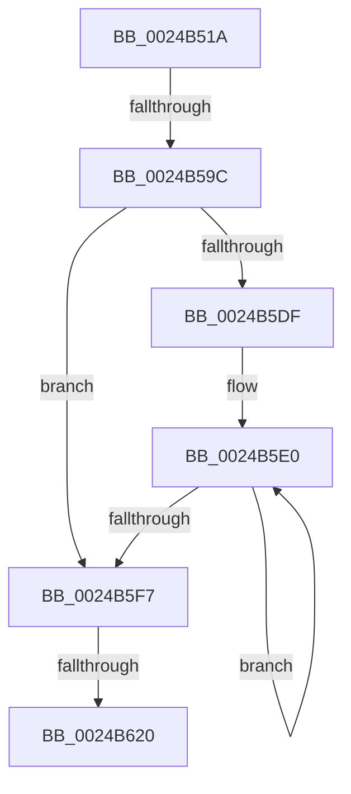

# sub_0024B51A

- RVA: `0x0024B51A`–`0x0024B635` (길이 `283` bytes)
- VA: `0x000000014024B51A`
- 실행 섹션: `.text`
- PDB 이름 있음: `아니요`; PDB Function 태그: `아니요`
- unwind 정보 RVA: `0x00062C30`
- 디코드: `67`개 명령, `283/283` bytes 표시
- 미해석 바이트: `0` (있으면 어셈블리에 `.byte`로 보존)

> 이 문서는 커널 이미지의 기계어와 PDB 기호를 분석해 생성했습니다. 4번과 5번은 함수 원형과 자료형을 바이너리 사용 방식에서 추정한 C 해석이며 원본 소스 복구 결과는 아닙니다.

## 1. Dependencies

- 직접 호출 지점: **2**; 고유 호출 대상: **1**
- 직접 호출자로 확인된 함수: **0**
- RIP 상대 이미지 참조: **0**

### Outgoing calls
- `0x0024B532` → [KeBugCheckEx](../4F/KeBugCheckEx_function_004FD660.md) (function, `0x004FD660`)
- `0x0024B550` → [KeBugCheckEx](../4F/KeBugCheckEx_function_004FD660.md) (function, `0x004FD660`)

### Direct callers
- 이 함수 시작 RVA로 연결되는 직접 call은 확인되지 않았습니다. 간접 호출은 완전히 역산할 수 없습니다.

### Static image references
- 디코드된 RIP-relative 메모리 참조가 없습니다.

## 2. Other-region calls and transfers

- 다른 실행 섹션으로 향하는 call: **0**
- call이 아닌 외부 분기/꼬리 이동: **3**
  - `0x0024B596` → [sub_0024B01B + 0x270](Unknown_function_0024B01B.md) (`tail-transfer`)
  - `0x0024B61A` → [sub_0024B727 + 0x29](Unknown_function_0024B727.md) (`tail-transfer`)
  - `0x0024B630` → [sub_0024B01B + 0x270](Unknown_function_0024B01B.md) (`tail-transfer`)

## 3. Assembly (complete function range)

```asm
0024B51A  45 33 C9                        xor r9d, r9d
0024B51D  48 C7 44 24 20 00 00 00 00      mov qword ptr [rsp + 0x20], 0
0024B526  4D 8B C6                        mov r8, r14
0024B529  BA 80 51 00 00                  mov edx, 0x5180
0024B52E  41 8D 49 1A                     lea ecx, [r9 + 0x1a]
0024B532  E8 29 21 2B 00                  call 0x1404fd660
0024B537  CC                              int3
0024B538  45 33 C9                        xor r9d, r9d
0024B53B  48 C7 44 24 20 00 00 00 00      mov qword ptr [rsp + 0x20], 0
0024B544  4C 8B C6                        mov r8, rsi
0024B547  BA 80 51 00 00                  mov edx, 0x5180
0024B54C  41 8D 49 1A                     lea ecx, [r9 + 0x1a]
0024B550  E8 0B 21 2B 00                  call 0x1404fd660
0024B555  CC                              int3
0024B556  0F B6 47 22                     movzx eax, byte ptr [rdi + 0x22]
0024B55A  48 B9 FF FF FF FF 3F FF FF FF   movabs rcx, 0xffffff3fffffffff
0024B564  83 E0 10                        and eax, 0x10
0024B567  83 C8 20                        or eax, 0x20
0024B56A  C1 E8 04                        shr eax, 4
0024B56D  89 43 0C                        mov dword ptr [rbx + 0xc], eax
0024B570  48 89 73 10                     mov qword ptr [rbx + 0x10], rsi
0024B574  48 89 73 18                     mov qword ptr [rbx + 0x18], rsi
0024B578  48 8B 07                        mov rax, qword ptr [rdi]
0024B57B  48 23 C1                        and rax, rcx
0024B57E  48 0B C2                        or rax, rdx
0024B581  48 89 07                        mov qword ptr [rdi], rax
0024B584  48 8B 47 18                     mov rax, qword ptr [rdi + 0x18]
0024B588  48 23 C1                        and rax, rcx
0024B58B  48 0B C2                        or rax, rdx
0024B58E  48 89 47 18                     mov qword ptr [rdi + 0x18], rax
0024B592  83 7B 0C 02                     cmp dword ptr [rbx + 0xc], 2
0024B596  0F 85 EF FC FF FF               jne 0x14024b28b
0024B59C  81 4F 24 00 00 E0 FF            or dword ptr [rdi + 0x24], 0xffe00000
0024B5A3  49 BB 00 00 00 00 00 FF FF FF   movabs r11, 0xffffff0000000000
0024B5AD  4C 09 1F                        or qword ptr [rdi], r11
0024B5B0  49 B8 FF FF FF FF FF FF FF F3   movabs r8, 0xf3ffffffffffffff
0024B5BA  48 8B 57 28                     mov rdx, qword ptr [rdi + 0x28]
0024B5BE  49 B9 00 00 00 00 00 00 80 03   movabs r9, 0x380000000000000
0024B5C8  48 8B CA                        mov rcx, rdx
0024B5CB  48 8B C2                        mov rax, rdx
0024B5CE  49 23 C8                        and rcx, r8
0024B5D1  49 0B C9                        or rcx, r9
0024B5D4  F0 48 0F B1 4F 28               lock cmpxchg qword ptr [rdi + 0x28], rcx
0024B5DA  48 3B D0                        cmp rdx, rax
0024B5DD  74 18                           je 0x14024b5f7
0024B5DF  90                              nop
0024B5E0  48 8B C8                        mov rcx, rax
0024B5E3  48 8B D0                        mov rdx, rax
0024B5E6  49 23 C8                        and rcx, r8
0024B5E9  49 0B C9                        or rcx, r9
0024B5EC  F0 48 0F B1 4F 28               lock cmpxchg qword ptr [rdi + 0x28], rcx
0024B5F2  48 3B D0                        cmp rdx, rax
0024B5F5  75 E9                           jne 0x14024b5e0
0024B5F7  48 8B 57 18                     mov rdx, qword ptr [rdi + 0x18]
0024B5FB  49 B9 00 00 00 00 00 FF FF 07   movabs r9, 0x7ffff0000000000
0024B605  48 8B CA                        mov rcx, rdx
0024B608  48 8B C2                        mov rax, rdx
0024B60B  49 0B C9                        or rcx, r9
0024B60E  F0 48 0F B1 4F 18               lock cmpxchg qword ptr [rdi + 0x18], rcx
0024B614  4C 8B C0                        mov r8, rax
0024B617  48 3B D0                        cmp rdx, rax
0024B61A  0F 85 30 01 00 00               jne 0x14024b750
0024B620  8B 47 24                        mov eax, dword ptr [rdi + 0x24]
0024B623  25 FF FF E7 FF                  and eax, 0xffe7ffff
0024B628  0D FF FF 07 00                  or eax, 0x7ffff
0024B62D  89 47 24                        mov dword ptr [rdi + 0x24], eax
0024B630  E9 56 FC FF FF                  jmp 0x14024b28b
```

## 4. C-style interpretation (structured pseudocode)

```c
__int64 __fastcall sub_0024B51A(__int64 a1, __int64 a2, __int64 a3, int a4)
{
    __int64 result;
    unsigned __int64 v_stack_p20;

    a4 = 0;
    v_stack_p20 = 0;
    result = KeBugCheckEx(a4 + 26, (unsigned int)(0x5180ULL), v_r14, a4);
    a4 = 0;
    v_stack_p20 = 0;
    result = KeBugCheckEx(a4 + 26, (unsigned int)(0x5180ULL), v_rsi, a4);
    result = (unsigned int)((*(unsigned __int8 *)(v_rdi + 34)) & (16));
    result = (unsigned int)((result) | (32));
    result = (unsigned int)((result) >> (4));
    *(unsigned int *)(v_rbx + 12) = (unsigned int)(result);
    *(unsigned __int64 *)(v_rbx + 16) = v_rsi;
    *(unsigned __int64 *)(v_rbx + 24) = v_rsi;
    result = (*(unsigned __int64 *)(v_rdi)) & (a4 + 26);
    result = (result) | ((unsigned int)(0x5180ULL));
    *(unsigned __int64 *)(v_rdi) = result;
    result = (*(unsigned __int64 *)(v_rdi + 24)) & (a4 + 26);
    result = (result) | ((unsigned int)(0x5180ULL));
    *(unsigned __int64 *)(v_rdi + 24) = result;
    a1 = (*(unsigned __int64 *)(v_rdi + 40)) & (v_rsi);
    a1 = (a1) | (0);
    if ((*(unsigned __int64 *)(v_rdi + 40)) == (*(unsigned __int64 *)(v_rdi + 40))) goto loc_0024B5F7;
loc_0024B5E0:
    a1 = (*(unsigned __int64 *)(v_rdi + 40)) & (v_rsi);
    a1 = (a1) | (0);
    if ((*(unsigned __int64 *)(v_rdi + 40)) != (*(unsigned __int64 *)(v_rdi + 40))) goto loc_0024B5E0;
loc_0024B5F7:
    a1 = (*(unsigned __int64 *)(v_rdi + 24)) | (0);
    result = (unsigned int)(((unsigned int)(*(unsigned int *)(v_rdi + 36))) & (0xFFE7FFFFULL));
    result = (unsigned int)((result) | (0x7FFFFULL));
    *(unsigned int *)(v_rdi + 36) = (unsigned int)(result);
}
```

## 5. (Beta) C Style

```c
int64_t sub_0024B51A(int64_t Arg1, int64_t Arg2, int64_t Arg3, int32_t Arg4)
{
    int64_t result;
    uint64_t v_stack_p20;

    Arg4 = 0;
    v_stack_p20 = 0;
    result = KeBugCheckEx(Arg4 + 26, (uint32_t)(0x5180ULL), local_r14, Arg4);
    Arg4 = 0;
    v_stack_p20 = 0;
    result = KeBugCheckEx(Arg4 + 26, (uint32_t)(0x5180ULL), local_rsi, Arg4);
    result = (uint32_t)((*(uint8_t *)(local_rdi + 0x22)) & (16));
    result = (uint32_t)((result) | (32));
    result = (uint32_t)((result) >> (4));
    *(uint32_t *)(local_rbx + 0xC) = (uint32_t)(result);
    *(uint64_t *)(local_rbx + 0x10) = local_rsi;
    *(uint64_t *)(local_rbx + 0x18) = local_rsi;
    result = (*(uint64_t *)(local_rdi)) & (Arg4 + 26);
    result = (result) | ((uint32_t)(0x5180ULL));
    *(uint64_t *)(local_rdi) = result;
    result = (*(uint64_t *)(local_rdi + 0x18)) & (Arg4 + 26);
    result = (result) | ((uint32_t)(0x5180ULL));
    *(uint64_t *)(local_rdi + 0x18) = result;
    Arg1 = (*(uint64_t *)(local_rdi + 0x28)) & (local_rsi);
    Arg1 = (Arg1) | (0);
    if ((*(uint64_t *)(local_rdi + 0x28)) == (*(uint64_t *)(local_rdi + 0x28))) goto loc_0024B5F7;
loc_0024B5E0:
    Arg1 = (*(uint64_t *)(local_rdi + 0x28)) & (local_rsi);
    Arg1 = (Arg1) | (0);
    if ((*(uint64_t *)(local_rdi + 0x28)) != (*(uint64_t *)(local_rdi + 0x28))) goto loc_0024B5E0;
loc_0024B5F7:
    Arg1 = (*(uint64_t *)(local_rdi + 0x18)) | (0);
    result = (uint32_t)(((uint32_t)(*(uint32_t *)(local_rdi + 0x24))) & (0xFFE7FFFFULL));
    result = (uint32_t)((result) | (0x7FFFFULL));
    *(uint32_t *)(local_rdi + 0x24) = (uint32_t)(result);
}
```

## 6. Execution-region graph

[열기: 2D/3D 그래프와 함수 탐색 컨트롤 패널](../../../control-panel.html?section=text&rva=0x0024B51A&view=graph)

- 2D 그래프는 위에서 아래로 흐르고, 3D 그래프는 빈 공간을 드래그해 회전합니다. Shift+드래그는 이동, 휠은 확대·축소, 함수 노드 선택은 대상 보고서 이동입니다.

### Static fallback


