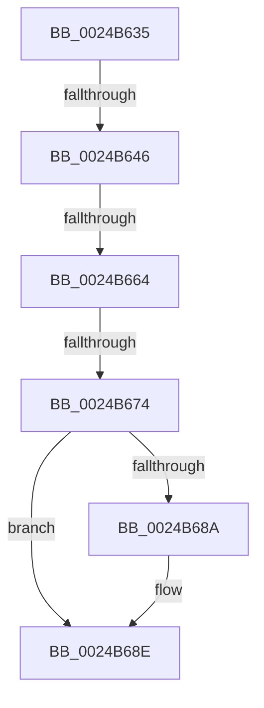

# sub_0024B635

- RVA: `0x0024B635`–`0x0024B6A1` (길이 `108` bytes)
- VA: `0x000000014024B635`
- 실행 섹션: `.text`
- PDB 이름 있음: `아니요`; PDB Function 태그: `아니요`
- unwind 정보 RVA: `0x00062C44`
- 디코드: `21`개 명령, `108/108` bytes 표시
- 미해석 바이트: `0` (있으면 어셈블리에 `.byte`로 보존)

> 이 문서는 커널 이미지의 기계어와 PDB 기호를 분석해 생성했습니다. 4번과 5번은 함수 원형과 자료형을 바이너리 사용 방식에서 추정한 C 해석이며 원본 소스 복구 결과는 아닙니다.

## 1. Dependencies

- 직접 호출 지점: **0**; 고유 호출 대상: **0**
- 직접 호출자로 확인된 함수: **0**
- RIP 상대 이미지 참조: **1**

### Outgoing calls
- 직접 디코드된 call 명령이 없습니다.

### Direct callers
- 이 함수 시작 RVA로 연결되는 직접 call은 확인되지 않았습니다. 간접 호출은 완전히 역산할 수 없습니다.

### Static image references
- `0x0024B635` → RVA `0x00FC6A88` (`ALMOSTRO`; read)

## 2. Other-region calls and transfers

- 다른 실행 섹션으로 향하는 call: **0**
- call이 아닌 외부 분기/꼬리 이동: **4**
  - `0x0024B640` → [sub_0024B2CF + 0x44](Unknown_function_0024B2CF.md) (`tail-transfer`)
  - `0x0024B65E` → [sub_0024B2CF + 0x44](Unknown_function_0024B2CF.md) (`tail-transfer`)
  - `0x0024B66E` → [sub_0024B2CF + 0x44](Unknown_function_0024B2CF.md) (`tail-transfer`)
  - `0x0024B69C` → [sub_0024B2CF + 0x44](Unknown_function_0024B2CF.md) (`tail-transfer`)

## 3. Assembly (complete function range)

```asm
0024B635  48 F7 05 48 B4 D7 00 00 00 60 00  test qword ptr [rip + 0xd7b448], 0x600000
0024B640  0F 84 CD FC FF FF               je 0x14024b313
0024B646  65 48 8B 14 25 88 01 00 00      mov rdx, qword ptr gs:[0x188]
0024B64F  4C 8B 82 B8 00 00 00            mov r8, qword ptr [rdx + 0xb8]
0024B656  41 80 B8 60 01 00 00 01         cmp byte ptr [r8 + 0x160], 1
0024B65E  0F 84 AF FC FF FF               je 0x14024b313
0024B664  4D 8B 90 08 05 00 00            mov r10, qword ptr [r8 + 0x508]
0024B66B  4D 85 D2                        test r10, r10
0024B66E  0F 84 9F FC FF FF               je 0x14024b313
0024B674  49 8B D1                        mov rdx, r9
0024B677  48 C1 EA 03                     shr rdx, 3
0024B67B  81 E2 FF 01 00 00               and edx, 0x1ff
0024B681  49 8B 14 D2                     mov rdx, qword ptr [r10 + rdx*8]
0024B685  F6 C2 20                        test dl, 0x20
0024B688  74 04                           je 0x14024b68e
0024B68A  48 83 C8 20                     or rax, 0x20
0024B68E  48 8B C8                        mov rcx, rax
0024B691  48 83 C9 42                     or rcx, 0x42
0024B695  F6 C2 42                        test dl, 0x42
0024B698  48 0F 44 C8                     cmove rcx, rax
0024B69C  E9 72 FC FF FF                  jmp 0x14024b313
```

## 4. C-style interpretation (structured pseudocode)

```c
__int64 __fastcall sub_0024B635(__int64 a1, __int64 a2, __int64 a3, __int64 a4)
{
    __int64 result;

    a2 = (a4) >> (3);
    a2 = (unsigned int)((a2) & (511));
    if ((((unsigned __int8)(*(unsigned __int64 *)(*(unsigned __int64 *)(*(unsigned __int64 *)(*(unsigned __int64 *)(gs_base + (0 + 392)) + 184) + 1288) + a2 * 8))) & (32)) != 0) {
        result = (result) | (32);
    }
    a1 = (result) | (66);
    if ((((unsigned __int8)(*(unsigned __int64 *)(*(unsigned __int64 *)(*(unsigned __int64 *)(*(unsigned __int64 *)(gs_base + (0 + 392)) + 184) + 1288) + a2 * 8))) & (66)) == 0) { a1 = result; }
}
```

## 5. (Beta) C Style

```c
int64_t sub_0024B635(int64_t Arg1, int64_t Arg2, int64_t Arg3, int64_t Arg4)
{
    int64_t result;

    Arg2 = (Arg4) >> (3);
    Arg2 = (uint32_t)((Arg2) & (511));
    if ((((uint8_t)(*(uint64_t *)(*(uint64_t *)(*(uint64_t *)(*(uint64_t *)(gs_base + (0 + 0x188)) + 0xB8) + 0x508) + Arg2 * 8))) & (32)) != 0) {
        result = (result) | (32);
    }
    Arg1 = (result) | (66);
    if ((((uint8_t)(*(uint64_t *)(*(uint64_t *)(*(uint64_t *)(*(uint64_t *)(gs_base + (0 + 0x188)) + 0xB8) + 0x508) + Arg2 * 8))) & (66)) == 0) { Arg1 = result; }
}
```

## 6. Execution-region graph

[열기: 2D/3D 그래프와 함수 탐색 컨트롤 패널](../../../control-panel.html?section=text&rva=0x0024B635&view=graph)

- 2D 그래프는 위에서 아래로 흐르고, 3D 그래프는 빈 공간을 드래그해 회전합니다. Shift+드래그는 이동, 휠은 확대·축소, 함수 노드 선택은 대상 보고서 이동입니다.

### Static fallback


