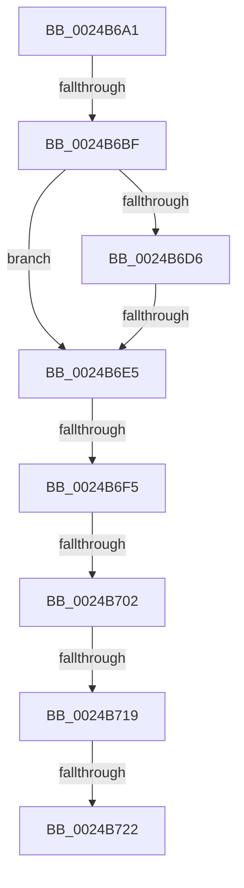

# sub_0024B6A1

- RVA: `0x0024B6A1`–`0x0024B727` (길이 `134` bytes)
- VA: `0x000000014024B6A1`
- 실행 섹션: `.text`
- PDB 이름 있음: `아니요`; PDB Function 태그: `아니요`
- unwind 정보 RVA: `0x00062C54`
- 디코드: `31`개 명령, `134/134` bytes 표시
- 미해석 바이트: `0` (있으면 어셈블리에 `.byte`로 보존)

> 이 문서는 커널 이미지의 기계어와 PDB 기호를 분석해 생성했습니다. 4번과 5번은 함수 원형과 자료형을 바이너리 사용 방식에서 추정한 C 해석이며 원본 소스 복구 결과는 아닙니다.

## 1. Dependencies

- 직접 호출 지점: **0**; 고유 호출 대상: **0**
- 직접 호출자로 확인된 함수: **0**
- RIP 상대 이미지 참조: **4**

### Outgoing calls
- 직접 디코드된 call 명령이 없습니다.

### Direct callers
- 이 함수 시작 RVA로 연결되는 직접 call은 확인되지 않았습니다. 간접 호출은 완전히 역산할 수 없습니다.

### Static image references
- `0x0024B6A1` → RVA `0x00E2DCE0` (`.data`; read)
- `0x0024B6BF` → RVA `0x00E35C00` (`.data`; read)
- `0x0024B6F5` → RVA `0x00E3CBE6` (`.data`; read)
- `0x0024B702` → RVA `0x00E3D240` (`.data`; read)

## 2. Other-region calls and transfers

- 다른 실행 섹션으로 향하는 call: **0**
- call이 아닌 외부 분기/꼬리 이동: **7**
  - `0x0024B6B9` → [sub_0024B45F + 0xC](Unknown_function_0024B45F.md) (`tail-transfer`)
  - `0x0024B6DF` → [sub_0024B45F + 0xC](Unknown_function_0024B45F.md) (`tail-transfer`)
  - `0x0024B6EF` → [sub_0024AF91 + 0x43](Unknown_function_0024AF91.md) (`tail-transfer`)
  - `0x0024B6FC` → [sub_0024B45F + 0xC](Unknown_function_0024B45F.md) (`tail-transfer`)
  - `0x0024B713` → [sub_0024B45F + 0xC](Unknown_function_0024B45F.md) (`tail-transfer`)
  - `0x0024B71C` → [sub_0024AF91 + 0x43](Unknown_function_0024AF91.md) (`tail-transfer`)
  - `0x0024B722` → [sub_0024B45F + 0xC](Unknown_function_0024B45F.md) (`tail-transfer`)

## 3. Assembly (complete function range)

```asm
0024B6A1  48 8B 05 38 26 BE 00            mov rax, qword ptr [rip + 0xbe2638]
0024B6A8  48 8D 0C 40                     lea rcx, [rax + rax*2]
0024B6AC  48 C1 E1 04                     shl rcx, 4
0024B6B0  49 8B C4                        mov rax, r12
0024B6B3  48 03 C8                        add rcx, rax
0024B6B6  48 3B F9                        cmp rdi, rcx
0024B6B9  0F 83 AC FD FF FF               jae 0x14024b46b
0024B6BF  48 8B 05 3A A5 BE 00            mov rax, qword ptr [rip + 0xbea53a]
0024B6C6  49 8B CF                        mov rcx, r15
0024B6C9  48 C1 F9 04                     sar rcx, 4
0024B6CD  48 0F AF CA                     imul rcx, rdx
0024B6D1  48 3B C8                        cmp rcx, rax
0024B6D4  72 0F                           jb 0x14024b6e5
0024B6D6  48 05 00 08 00 00               add rax, 0x800
0024B6DC  48 3B C8                        cmp rcx, rax
0024B6DF  0F 82 86 FD FF FF               jb 0x14024b46b
0024B6E5  41 8B C2                        mov eax, r10d
0024B6E8  C1 E8 10                        shr eax, 0x10
0024B6EB  24 07                           and al, 7
0024B6ED  3C 06                           cmp al, 6
0024B6EF  0F 84 DF F8 FF FF               je 0x14024afd4
0024B6F5  80 3D EA 14 BF 00 00            cmp byte ptr [rip + 0xbf14ea], 0
0024B6FC  0F 84 69 FD FF FF               je 0x14024b46b
0024B702  48 8B 05 37 1B BF 00            mov rax, qword ptr [rip + 0xbf1b37]
0024B709  48 C1 E9 09                     shr rcx, 9
0024B70D  0F B6 14 48                     movzx edx, byte ptr [rax + rcx*2]
0024B711  85 D2                           test edx, edx
0024B713  0F 84 52 FD FF FF               je 0x14024b46b
0024B719  83 FA 0A                        cmp edx, 0xa
0024B71C  0F 85 B2 F8 FF FF               jne 0x14024afd4
0024B722  E9 44 FD FF FF                  jmp 0x14024b46b
```

## 4. C-style interpretation (structured pseudocode)

```c
__int64 __fastcall sub_0024B6A1(__int64 a1, __int64 a2)
{
    __int64 result;

    a1 = (*(unsigned __int64 *)(v_rip + 12461624) + *(unsigned __int64 *)(v_rip + 12461624) * 2) << (4);
    a1 = (a1) + (v_r12);
    a1 = (v_r15) >> (4);
    a1 = (a1) * (a2);
    if (a1 < (*(unsigned __int64 *)(v_rip + 12494138))) goto loc_0024B6E5;
    result = (*(unsigned __int64 *)(v_rip + 12494138)) + (0x800ULL);
loc_0024B6E5:
    result = (unsigned int)(((unsigned int)((unsigned int)(v_r10))) >> (16));
    result = (unsigned __int8)((result) & (7));
    a1 = (a1) >> (9);
}
```

## 5. (Beta) C Style

```c
int64_t sub_0024B6A1(int64_t Arg1, int64_t Arg2)
{
    int64_t result;

    Arg1 = (*(uint64_t *)(v_rip + 0xBE2638) + *(uint64_t *)(v_rip + 0xBE2638) * 2) << (4);
    Arg1 = (Arg1) + (local_r12);
    Arg1 = (local_r15) >> (4);
    Arg1 = (Arg1) * (Arg2);
    if (Arg1 < (*(uint64_t *)(v_rip + 0xBEA53A))) goto loc_0024B6E5;
    result = (*(uint64_t *)(v_rip + 0xBEA53A)) + (0x800ULL);
loc_0024B6E5:
    result = (uint32_t)(((uint32_t)((uint32_t)(local_r10))) >> (16));
    result = (uint8_t)((result) & (7));
    Arg1 = (Arg1) >> (9);
}
```

## 6. Execution-region graph

[열기: 2D/3D 그래프와 함수 탐색 컨트롤 패널](../../../control-panel.html?section=text&rva=0x0024B6A1&view=graph)

- 2D 그래프는 위에서 아래로 흐르고, 3D 그래프는 빈 공간을 드래그해 회전합니다. Shift+드래그는 이동, 휠은 확대·축소, 함수 노드 선택은 대상 보고서 이동입니다.

### Static fallback


