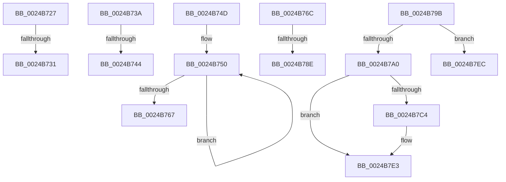

# sub_0024B727

- RVA: `0x0024B727`–`0x0024B7F5` (길이 `206` bytes)
- VA: `0x000000014024B727`
- 실행 섹션: `.text`
- PDB 이름 있음: `아니요`; PDB Function 태그: `아니요`
- unwind 정보 RVA: `0x00062C6C`
- 디코드: `49`개 명령, `206/206` bytes 표시
- 미해석 바이트: `0` (있으면 어셈블리에 `.byte`로 보존)

> 이 문서는 커널 이미지의 기계어와 PDB 기호를 분석해 생성했습니다. 4번과 5번은 함수 원형과 자료형을 바이너리 사용 방식에서 추정한 C 해석이며 원본 소스 복구 결과는 아닙니다.

## 1. Dependencies

- 직접 호출 지점: **4**; 고유 호출 대상: **2**
- 직접 호출자로 확인된 함수: **0**
- RIP 상대 이미지 참조: **1**

### Outgoing calls
- `0x0024B777` → [MiPageToChannel](../2B/MiPageToChannel_function_002B9B48.md) (function, `0x002B9B48`)
- `0x0024B791` → [MiPageToChannel](../2B/MiPageToChannel_function_002B9B48.md) (function, `0x002B9B48`)
- `0x0024B7B9` → [KeBugCheckEx](../4F/KeBugCheckEx_function_004FD660.md) (function, `0x004FD660`)
- `0x0024B7DD` → [KeBugCheckEx](../4F/KeBugCheckEx_function_004FD660.md) (function, `0x004FD660`)

### Direct callers
- 이 함수 시작 RVA로 연결되는 직접 call은 확인되지 않았습니다. 간접 호출은 완전히 역산할 수 없습니다.

### Static image references
- `0x0024B77C` → RVA `0x00E2DC28` (`.data`; read)

## 2. Other-region calls and transfers

- 다른 실행 섹션으로 향하는 call: **0**
- call이 아닌 외부 분기/꼬리 이동: **9**
  - `0x0024B72B` → [sub_0024B335 + 0x63](Unknown_function_0024B335.md) (`tail-transfer`)
  - `0x0024B735` → [sub_0024B335 + 0x30](Unknown_function_0024B335.md) (`tail-transfer`)
  - `0x0024B73E` → [sub_0024B335 + 0xE6](Unknown_function_0024B335.md) (`tail-transfer`)
  - `0x0024B748` → [sub_0024B335 + 0xB2](Unknown_function_0024B335.md) (`tail-transfer`)
  - `0x0024B767` → [sub_0024B51A + 0x106](Unknown_function_0024B51A.md) (`tail-transfer`)
  - `0x0024B788` → [sub_0024B335 + 0x10D](Unknown_function_0024B335.md) (`tail-transfer`)
  - `0x0024B796` → [sub_0024B335 + 0x10F](Unknown_function_0024B335.md) (`tail-transfer`)
  - `0x0024B7E7` → [sub_0024B335 + 0x30](Unknown_function_0024B335.md) (`tail-transfer`)
  - `0x0024B7F0` → [sub_0024B335 + 0xB2](Unknown_function_0024B335.md) (`tail-transfer`)

## 3. Assembly (complete function range)

```asm
0024B727  48 3B 70 10                     cmp rsi, qword ptr [rax + 0x10]
0024B72B  0F 82 67 FC FF FF               jb 0x14024b398
0024B731  41 8D 50 01                     lea edx, [r8 + 1]
0024B735  E9 2B FC FF FF                  jmp 0x14024b365
0024B73A  4C 3B 71 10                     cmp r14, qword ptr [rcx + 0x10]
0024B73E  0F 82 D7 FC FF FF               jb 0x14024b41b
0024B744  45 8D 41 01                     lea r8d, [r9 + 1]
0024B748  E9 9A FC FF FF                  jmp 0x14024b3e7
0024B74D  0F 1F 00                        nop dword ptr [rax]
0024B750  49 8B C8                        mov rcx, r8
0024B753  4D 0B C1                        or r8, r9
0024B756  48 8B C1                        mov rax, rcx
0024B759  F0 4C 0F B1 47 18               lock cmpxchg qword ptr [rdi + 0x18], r8
0024B75F  4C 8B C0                        mov r8, rax
0024B762  48 3B C8                        cmp rcx, rax
0024B765  75 E9                           jne 0x14024b750
0024B767  E9 B4 FE FF FF                  jmp 0x14024b620
0024B76C  49 C1 FF 04                     sar r15, 4
0024B770  4D 0F AF F9                     imul r15, r9
0024B774  49 8B CF                        mov rcx, r15
0024B777  E8 CC E3 06 00                  call 0x1402b9b48
0024B77C  48 83 3D A4 24 BE 00 00         cmp qword ptr [rip + 0xbe24a4], 0
0024B784  44 0F B6 F8                     movzx r15d, al
0024B788  0F 84 B4 FC FF FF               je 0x14024b442
0024B78E  49 8B CE                        mov rcx, r14
0024B791  E8 B2 E3 06 00                  call 0x1402b9b48
0024B796  E9 A9 FC FF FF                  jmp 0x14024b444
0024B79B  45 85 C9                        test r9d, r9d
0024B79E  75 4C                           jne 0x14024b7ec
0024B7A0  4C 8B C9                        mov r9, rcx
0024B7A3  48 C7 44 24 20 00 00 00 00      mov qword ptr [rsp + 0x20], 0
0024B7AC  B9 1A 00 00 00                  mov ecx, 0x1a
0024B7B1  4D 8B C6                        mov r8, r14
0024B7B4  BA 80 51 00 00                  mov edx, 0x5180
0024B7B9  E8 A2 1E 2B 00                  call 0x1404fd660
0024B7BE  CC                              int3
0024B7BF  45 85 C0                        test r8d, r8d
0024B7C2  75 1F                           jne 0x14024b7e3
0024B7C4  4C 8B C8                        mov r9, rax
0024B7C7  48 C7 44 24 20 00 00 00 00      mov qword ptr [rsp + 0x20], 0
0024B7D0  4C 8B C6                        mov r8, rsi
0024B7D3  BA 80 51 00 00                  mov edx, 0x5180
0024B7D8  B9 1A 00 00 00                  mov ecx, 0x1a
0024B7DD  E8 7E 1E 2B 00                  call 0x1404fd660
0024B7E2  CC                              int3
0024B7E3  41 8D 48 FF                     lea ecx, [r8 - 1]
0024B7E7  E9 79 FB FF FF                  jmp 0x14024b365
0024B7EC  41 8D 51 FF                     lea edx, [r9 - 1]
0024B7F0  E9 F2 FB FF FF                  jmp 0x14024b3e7
```

## 4. C-style interpretation (structured pseudocode)

```c
__int64 __fastcall sub_0024B727(__int64 a1, __int64 a2, __int64 a3, __int64 a4)
{
    unsigned __int64 v_stack_p20;
}
```

## 5. (Beta) C Style

```c
int64_t sub_0024B727(int64_t Arg1, int64_t Arg2, void *Arg3, int64_t Arg4)
{
    uint8_t *arg3 = (uint8_t *)Arg3;

    uint64_t v_stack_p20;
}
```

### 관측된 메모리 오프셋

구조체 형식이 확인되지 않은 접근은 인자 기준의 오프셋으로만 기록했습니다.

| 기준 인자 | 오프셋 표현 | 폭 (bit) | 접근 |
|---|---:|---:|---|
| `Arg3` | `+ 0x1` | `32` | `R` |

## 6. Execution-region graph

[열기: 2D/3D 그래프와 함수 탐색 컨트롤 패널](../../../control-panel.html?section=text&rva=0x0024B727&view=graph)

- 2D 그래프는 위에서 아래로 흐르고, 3D 그래프는 빈 공간을 드래그해 회전합니다. Shift+드래그는 이동, 휠은 확대·축소, 함수 노드 선택은 대상 보고서 이동입니다.

### Static fallback


