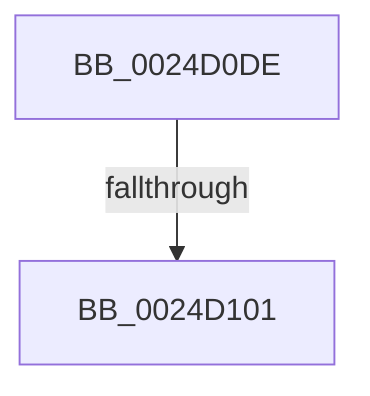

# sub_0024D0DE

- RVA: `0x0024D0DE`–`0x0024D11D` (길이 `63` bytes)
- VA: `0x000000014024D0DE`
- 실행 섹션: `.text`
- PDB 이름 있음: `아니요`; PDB Function 태그: `아니요`
- unwind 정보 RVA: `0x00062CEC`
- 디코드: `14`개 명령, `63/63` bytes 표시
- 미해석 바이트: `0` (있으면 어셈블리에 `.byte`로 보존)

> 이 문서는 커널 이미지의 기계어와 PDB 기호를 분석해 생성했습니다. 4번과 5번은 함수 원형과 자료형을 바이너리 사용 방식에서 추정한 C 해석이며 원본 소스 복구 결과는 아닙니다.

## 1. Dependencies

- 직접 호출 지점: **0**; 고유 호출 대상: **0**
- 직접 호출자로 확인된 함수: **0**
- RIP 상대 이미지 참조: **1**

### Outgoing calls
- 직접 디코드된 call 명령이 없습니다.

### Direct callers
- 이 함수 시작 RVA로 연결되는 직접 call은 확인되지 않았습니다. 간접 호출은 완전히 역산할 수 없습니다.

### Static image references
- `0x0024D116` → RVA `0x00001070` (`.rdata`; read)

## 2. Other-region calls and transfers

- 다른 실행 섹션으로 향하는 call: **0**
- call이 아닌 외부 분기/꼬리 이동: **1**
  - `0x0024D0FB` → [sub_0024D5C7](Unknown_function_0024D5C7.md) (`tail-transfer`)

## 3. Assembly (complete function range)

```asm
0024D0DE  48 89 5C 24 70                  mov qword ptr [rsp + 0x70], rbx
0024D0E3  48 8B EA                        mov rbp, rdx
0024D0E6  4C 89 64 24 48                  mov qword ptr [rsp + 0x48], r12
0024D0EB  4C 8B D9                        mov r11, rcx
0024D0EE  4C 89 6C 24 40                  mov qword ptr [rsp + 0x40], r13
0024D0F3  4C 89 74 24 38                  mov qword ptr [rsp + 0x38], r14
0024D0F8  48 85 D2                        test rdx, rdx
0024D0FB  0F 84 C6 04 00 00               je 0x14024d5c7
0024D101  4C 8B 71 48                     mov r14, qword ptr [rcx + 0x48]
0024D105  48 8D 41 48                     lea rax, [rcx + 0x48]
0024D109  45 33 ED                        xor r13d, r13d
0024D10C  48 89 74 24 58                  mov qword ptr [rsp + 0x58], rsi
0024D111  48 89 7C 24 50                  mov qword ptr [rsp + 0x50], rdi
0024D116  4C 8D 15 53 3F DB FF            lea r10, [rip - 0x24c0ad]
```

## 4. C-style interpretation (structured pseudocode)

```c
__int64 __fastcall sub_0024D0DE(__int64 a1, __int64 a2)
{
    __int64 v_r13;
    unsigned __int64 v_stack_p38;
    unsigned __int64 v_stack_p40;
    unsigned __int64 v_stack_p48;
    unsigned __int64 v_stack_p50;
    unsigned __int64 v_stack_p58;
    unsigned __int64 v_stack_p70;

    v_stack_p70 = v_rbx;
    v_stack_p48 = v_r12;
    v_stack_p40 = v_r13;
    v_stack_p38 = v_r14;
    v_r13 = 0;
    v_stack_p58 = v_rsi;
    v_stack_p50 = v_rdi;
    return a1 + 72;
}
```

## 5. (Beta) C Style

```c
void *sub_0024D0DE(void *Arg1, int64_t Arg2)
{
    uint8_t *arg1 = (uint8_t *)Arg1;

    int64_t local_r13;
    uint64_t v_stack_p38;
    uint64_t v_stack_p40;
    uint64_t v_stack_p48;
    uint64_t v_stack_p50;
    uint64_t v_stack_p58;
    uint64_t v_stack_p70;

    v_stack_p70 = local_rbx;
    v_stack_p48 = local_r12;
    v_stack_p40 = local_r13;
    v_stack_p38 = local_r14;
    local_r13 = 0;
    v_stack_p58 = local_rsi;
    v_stack_p50 = local_rdi;
    return Arg1 + 72;
}
```

### 관측된 메모리 오프셋

구조체 형식이 확인되지 않은 접근은 인자 기준의 오프셋으로만 기록했습니다.

| 기준 인자 | 오프셋 표현 | 폭 (bit) | 접근 |
|---|---:|---:|---|
| `Arg1` | `+ 0x48` | `64` | `R` |

## 6. Execution-region graph

[열기: 2D/3D 그래프와 함수 탐색 컨트롤 패널](../../../control-panel.html?section=text&rva=0x0024D0DE&view=graph)

- 2D 그래프는 위에서 아래로 흐르고, 3D 그래프는 빈 공간을 드래그해 회전합니다. Shift+드래그는 이동, 휠은 확대·축소, 함수 노드 선택은 대상 보고서 이동입니다.

### Static fallback


