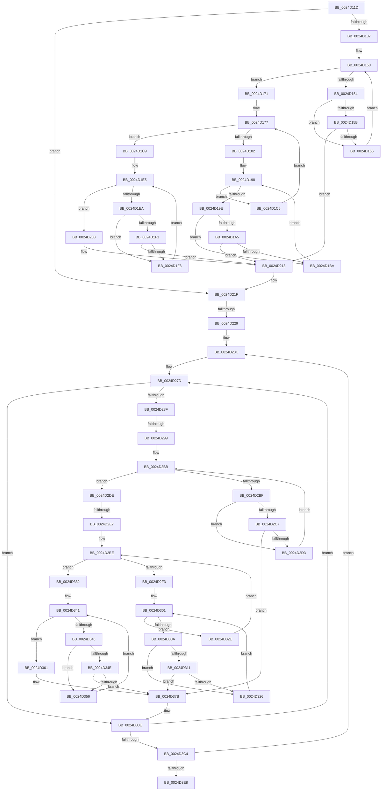

# sub_0024D11D

- RVA: `0x0024D11D`–`0x0024D401` (길이 `740` bytes)
- VA: `0x000000014024D11D`
- 실행 섹션: `.text`
- PDB 이름 있음: `아니요`; PDB Function 태그: `아니요`
- unwind 정보 RVA: `0x00062D14`
- 디코드: `196`개 명령, `740/740` bytes 표시
- 미해석 바이트: `0` (있으면 어셈블리에 `.byte`로 보존)

> 이 문서는 커널 이미지의 기계어와 PDB 기호를 분석해 생성했습니다. 4번과 5번은 함수 원형과 자료형을 바이너리 사용 방식에서 추정한 C 해석이며 원본 소스 복구 결과는 아닙니다.

## 1. Dependencies

- 직접 호출 지점: **0**; 고유 호출 대상: **0**
- 직접 호출자로 확인된 함수: **0**
- RIP 상대 이미지 참조: **7**

### Outgoing calls
- 직접 디코드된 call 명령이 없습니다.

### Direct callers
- 이 함수 시작 RVA로 연결되는 직접 call은 확인되지 않았습니다. 간접 호출은 완전히 역산할 수 없습니다.

### Static image references
- `0x0024D13C` → RVA `0x00001088` (`.rdata`; read)
- `0x0024D177` → RVA `0x00001074` (`.rdata`; read)
- `0x0024D185` → RVA `0x0000108C` (`.rdata`; read)
- `0x0024D1CC` → RVA `0x00001080` (`.rdata`; read)
- `0x0024D1D3` → RVA `0x00001098` (`.rdata`; read)
- `0x0024D218` → RVA `0x00001070` (`.rdata`; read)
- `0x0024D260` → RVA `0x000010C0` (`.rdata`; read)

## 2. Other-region calls and transfers

- 다른 실행 섹션으로 향하는 call: **0**
- call이 아닌 외부 분기/꼬리 이동: **4**
  - `0x0024D223` → [sub_0024D56A](Unknown_function_0024D56A.md) (`tail-transfer`)
  - `0x0024D293` → [sub_0024D56A + 0x3E](Unknown_function_0024D56A.md) (`tail-transfer`)
  - `0x0024D2E1` → [sub_0024D541](Unknown_function_0024D541.md) (`tail-transfer`)
  - `0x0024D3FF` → [sub_0024D401 + 0x13](Unknown_function_0024D401.md) (`tail-transfer`)

## 3. Assembly (complete function range)

```asm
0024D11D  4C 89 7C 24 30                  mov qword ptr [rsp + 0x30], r15
0024D122  41 8B 1E                        mov ebx, dword ptr [r14]
0024D125  48 89 44 24 20                  mov qword ptr [rsp + 0x20], rax
0024D12A  45 8D 65 04                     lea r12d, [r13 + 4]
0024D12E  F6 C3 01                        test bl, 1
0024D131  0F 84 E8 00 00 00               je 0x14024d21f
0024D137  45 0F B6 7E 10                  movzx r15d, byte ptr [r14 + 0x10]
0024D13C  4C 8D 0D 45 3F DB FF            lea r9, [rip - 0x24c0bb]
0024D143  45 84 FF                        test r15b, r15b
0024D146  41 8B D5                        mov edx, r13d
0024D149  4D 0F 44 CA                     cmove r9, r10
0024D14D  4C 8B D0                        mov r10, rax
0024D150  85 D2                           test edx, edx
0024D152  7F 1D                           jg 0x14024d171
0024D154  41 8B 39                        mov edi, dword ptr [r9]
0024D157  85 FF                           test edi, edi
0024D159  74 0B                           je 0x14024d166
0024D15B  49 8B 02                        mov rax, qword ptr [r10]
0024D15E  85 38                           test dword ptr [rax], edi
0024D160  0F 85 B2 00 00 00               jne 0x14024d218
0024D166  FF C2                           inc edx
0024D168  49 83 C2 08                     add r10, 8
0024D16C  4D 03 CC                        add r9, r12
0024D16F  EB DF                           jmp 0x14024d150
0024D171  8B 91 B4 00 00 00               mov edx, dword ptr [rcx + 0xb4]
0024D177  48 8D 05 F6 3E DB FF            lea rax, [rip - 0x24c10a]
0024D17E  85 D2                           test edx, edx
0024D180  75 47                           jne 0x14024d1c9
0024D182  45 84 FF                        test r15b, r15b
0024D185  4C 8D 15 00 3F DB FF            lea r10, [rip - 0x24c100]
0024D18C  BE 01 00 00 00                  mov esi, 1
0024D191  4C 0F 44 D0                     cmove r10, rax
0024D195  44 8B CE                        mov r9d, esi
0024D198  41 83 F9 03                     cmp r9d, 3
0024D19C  7F 27                           jg 0x14024d1c5
0024D19E  41 8B 3A                        mov edi, dword ptr [r10]
0024D1A1  85 FF                           test edi, edi
0024D1A3  74 15                           je 0x14024d1ba
0024D1A5  8B C2                           mov eax, edx
0024D1A7  48 6B C0 1A                     imul rax, rax, 0x1a
0024D1AB  48 03 C6                        add rax, rsi
0024D1AE  48 8B 84 C1 F8 00 00 00         mov rax, qword ptr [rcx + rax*8 + 0xf8]
0024D1B6  85 38                           test dword ptr [rax], edi
0024D1B8  75 5E                           jne 0x14024d218
0024D1BA  41 FF C1                        inc r9d
0024D1BD  48 FF C6                        inc rsi
0024D1C0  4D 03 D4                        add r10, r12
0024D1C3  EB D3                           jmp 0x14024d198
0024D1C5  FF C2                           inc edx
0024D1C7  EB AE                           jmp 0x14024d177
0024D1C9  45 84 FF                        test r15b, r15b
0024D1CC  48 8D 05 AD 3E DB FF            lea rax, [rip - 0x24c153]
0024D1D3  4C 8D 0D BE 3E DB FF            lea r9, [rip - 0x24c142]
0024D1DA  41 8B D4                        mov edx, r12d
0024D1DD  4C 0F 44 C8                     cmove r9, rax
0024D1E1  4C 8D 51 68                     lea r10, [rcx + 0x68]
0024D1E5  83 FA 05                        cmp edx, 5
0024D1E8  7F 19                           jg 0x14024d203
0024D1EA  41 8B 39                        mov edi, dword ptr [r9]
0024D1ED  85 FF                           test edi, edi
0024D1EF  74 07                           je 0x14024d1f8
0024D1F1  49 8B 02                        mov rax, qword ptr [r10]
0024D1F4  85 38                           test dword ptr [rax], edi
0024D1F6  75 20                           jne 0x14024d218
0024D1F8  FF C2                           inc edx
0024D1FA  49 83 C2 08                     add r10, 8
0024D1FE  4D 03 CC                        add r9, r12
0024D201  EB E2                           jmp 0x14024d1e5
0024D203  41 8B 46 04                     mov eax, dword ptr [r14 + 4]
0024D207  83 E3 FE                        and ebx, 0xfffffffe
0024D20A  83 CB 02                        or ebx, 2
0024D20D  41 89 46 08                     mov dword ptr [r14 + 8], eax
0024D211  41 89 1E                        mov dword ptr [r14], ebx
0024D214  F0 FF 41 78                     lock inc dword ptr [rcx + 0x78]
0024D218  4C 8D 15 51 3E DB FF            lea r10, [rip - 0x24c1af]
0024D21F  41 83 F8 02                     cmp r8d, 2
0024D223  0F 85 41 03 00 00               jne 0x14024d56a
0024D229  8B 75 08                        mov esi, dword ptr [rbp + 8]
0024D22C  8B DE                           mov ebx, esi
0024D22E  89 9C 24 80 00 00 00            mov dword ptr [rsp + 0x80], ebx
0024D235  89 B4 24 88 00 00 00            mov dword ptr [rsp + 0x88], esi
0024D23C  B9 40 00 00 00                  mov ecx, 0x40
0024D241  8B C3                           mov eax, ebx
0024D243  48 69 E8 D0 00 00 00            imul rbp, rax, 0xd0
0024D24A  41 B8 88 00 00 00               mov r8d, 0x88
0024D250  48 89 4C 24 08                  mov qword ptr [rsp + 8], rcx
0024D255  48 81 C5 C0 00 00 00            add rbp, 0xc0
0024D25C  4C 89 04 24                     mov qword ptr [rsp], r8
0024D260  48 8D 15 59 3E DB FF            lea rdx, [rip - 0x24c1a7]
0024D267  41 B9 03 00 00 00               mov r9d, 3
0024D26D  49 03 EB                        add rbp, r11
0024D270  48 89 54 24 10                  mov qword ptr [rsp + 0x10], rdx
0024D275  4C 89 4C 24 18                  mov qword ptr [rsp + 0x18], r9
0024D27A  8D 71 C4                        lea esi, [rcx - 0x3c]
0024D27D  4C 8B 24 29                     mov r12, qword ptr [rcx + rbp]
0024D281  45 8B 3C 24                     mov r15d, dword ptr [r12]
0024D285  41 F6 C7 01                     test r15b, 1
0024D289  0F 84 FF 00 00 00               je 0x14024d38e
0024D28F  8B 3A                           mov edi, dword ptr [rdx]
0024D291  85 FF                           test edi, edi
0024D293  0F 84 0F 03 00 00               je 0x14024d5a8
0024D299  45 38 6C 24 10                  cmp byte ptr [r12 + 0x10], r13b
0024D29E  48 8D 05 E3 3D DB FF            lea rax, [rip - 0x24c21d]
0024D2A5  41 8B D5                        mov edx, r13d
0024D2A8  49 0F 44 C2                     cmove rax, r10
0024D2AC  4D 8D 53 48                     lea r10, [r11 + 0x48]
0024D2B0  49 03 C0                        add rax, r8
0024D2B3  48 89 44 24 28                  mov qword ptr [rsp + 0x28], rax
0024D2B8  4C 8B C8                        mov r9, rax
0024D2BB  85 D2                           test edx, edx
0024D2BD  7F 1F                           jg 0x14024d2de
0024D2BF  45 8B 01                        mov r8d, dword ptr [r9]
0024D2C2  45 85 C0                        test r8d, r8d
0024D2C5  74 0C                           je 0x14024d2d3
0024D2C7  49 8B 02                        mov rax, qword ptr [r10]
0024D2CA  44 85 00                        test dword ptr [rax], r8d
0024D2CD  0F 85 A8 00 00 00               jne 0x14024d37b
0024D2D3  FF C2                           inc edx
0024D2D5  49 83 C2 08                     add r10, 8
0024D2D9  4C 03 CE                        add r9, rsi
0024D2DC  EB DD                           jmp 0x14024d2bb
0024D2DE  83 FF 02                        cmp edi, 2
0024D2E1  0F 85 5A 02 00 00               jne 0x14024d541
0024D2E7  44 8B 75 08                     mov r14d, dword ptr [rbp + 8]
0024D2EB  41 8B D6                        mov edx, r14d
0024D2EE  41 3B D6                        cmp edx, r14d
0024D2F1  77 3F                           ja 0x14024d332
0024D2F3  4C 8B 4C 24 28                  mov r9, qword ptr [rsp + 0x28]
0024D2F8  41 B8 01 00 00 00               mov r8d, 1
0024D2FE  45 8B D0                        mov r10d, r8d
0024D301  4C 03 CE                        add r9, rsi
0024D304  41 83 F8 03                     cmp r8d, 3
0024D308  7F 24                           jg 0x14024d32e
0024D30A  41 8B 39                        mov edi, dword ptr [r9]
0024D30D  85 FF                           test edi, edi
0024D30F  74 15                           je 0x14024d326
0024D311  8B C2                           mov eax, edx
0024D313  48 6B C0 1A                     imul rax, rax, 0x1a
0024D317  49 03 C2                        add rax, r10
0024D31A  49 8B 84 C3 F8 00 00 00         mov rax, qword ptr [r11 + rax*8 + 0xf8]
0024D322  85 38                           test dword ptr [rax], edi
0024D324  75 55                           jne 0x14024d37b
0024D326  41 FF C0                        inc r8d
0024D329  49 FF C2                        inc r10
0024D32C  EB D3                           jmp 0x14024d301
0024D32E  FF C2                           inc edx
0024D330  EB BC                           jmp 0x14024d2ee
0024D332  4C 8B 44 24 28                  mov r8, qword ptr [rsp + 0x28]
0024D337  4D 8D 4B 68                     lea r9, [r11 + 0x68]
0024D33B  49 83 C0 10                     add r8, 0x10
0024D33F  8B D6                           mov edx, esi
0024D341  83 FA 05                        cmp edx, 5
0024D344  7F 1B                           jg 0x14024d361
0024D346  45 8B 10                        mov r10d, dword ptr [r8]
0024D349  45 85 D2                        test r10d, r10d
0024D34C  74 08                           je 0x14024d356
0024D34E  49 8B 01                        mov rax, qword ptr [r9]
0024D351  44 85 10                        test dword ptr [rax], r10d
0024D354  75 25                           jne 0x14024d37b
0024D356  FF C2                           inc edx
0024D358  49 83 C1 08                     add r9, 8
0024D35C  4C 03 C6                        add r8, rsi
0024D35F  EB E0                           jmp 0x14024d341
0024D361  41 8B 44 24 04                  mov eax, dword ptr [r12 + 4]
0024D366  41 83 E7 FE                     and r15d, 0xfffffffe
0024D36A  41 83 CF 02                     or r15d, 2
0024D36E  41 89 44 24 08                  mov dword ptr [r12 + 8], eax
0024D373  45 89 3C 24                     mov dword ptr [r12], r15d
0024D377  F0 FF 45 68                     lock inc dword ptr [rbp + 0x68]
0024D37B  4C 8B 4C 24 18                  mov r9, qword ptr [rsp + 0x18]
0024D380  4C 8B 04 24                     mov r8, qword ptr [rsp]
0024D384  48 8B 54 24 10                  mov rdx, qword ptr [rsp + 0x10]
0024D389  48 8B 4C 24 08                  mov rcx, qword ptr [rsp + 8]
0024D38E  49 81 C0 88 00 00 00            add r8, 0x88
0024D395  4C 8D 15 D4 3C DB FF            lea r10, [rip - 0x24c32c]
0024D39C  48 83 C1 08                     add rcx, 8
0024D3A0  4C 89 04 24                     mov qword ptr [rsp], r8
0024D3A4  48 81 C2 88 00 00 00            add rdx, 0x88
0024D3AB  48 89 4C 24 08                  mov qword ptr [rsp + 8], rcx
0024D3B0  49 83 E9 01                     sub r9, 1
0024D3B4  48 89 54 24 10                  mov qword ptr [rsp + 0x10], rdx
0024D3B9  4C 89 4C 24 18                  mov qword ptr [rsp + 0x18], r9
0024D3BE  0F 85 B9 FE FF FF               jne 0x14024d27d
0024D3C4  8B 9C 24 80 00 00 00            mov ebx, dword ptr [rsp + 0x80]
0024D3CB  4C 8D 15 9E 3C DB FF            lea r10, [rip - 0x24c362]
0024D3D2  FF C3                           inc ebx
0024D3D4  89 9C 24 80 00 00 00            mov dword ptr [rsp + 0x80], ebx
0024D3DB  3B 9C 24 88 00 00 00            cmp ebx, dword ptr [rsp + 0x88]
0024D3E2  0F 86 54 FE FF FF               jbe 0x14024d23c
0024D3E8  41 BC 04 00 00 00               mov r12d, 4
0024D3EE  49 8B 4B 68                     mov rcx, qword ptr [r11 + 0x68]
0024D3F2  4D 8D 43 68                     lea r8, [r11 + 0x68]
0024D3F6  4C 8B 7C 24 30                  mov r15, qword ptr [rsp + 0x30]
0024D3FB  8B 01                           mov eax, dword ptr [rcx]
0024D3FD  A8 01                           test al, 1
0024D3FF  74 13                           je 0x14024d414
```

## 4. C-style interpretation (structured pseudocode)

```c
__int64 __fastcall sub_0024D11D(__int64 a1, __int64 a2, int a3, __int64 a4, __int64 a5, __int64 a6, __int64 a7, __int64 a8, __int64 a9, __int64 a10, __int64 a11, __int64 a12, __int64 a13, __int64 a14, __int64 a15, unsigned int a16, unsigned int a17)
{
    __int64 result;
    __int64 v_r10;
    __int64 v_r15;
    __int64 v_rbp;
    __int64 v_rbx;
    __int64 v_rsi;
    unsigned __int64 v_stack_p0;
    unsigned __int64 v_stack_p10;
    unsigned __int64 v_stack_p18;
    unsigned __int64 v_stack_p20;
    unsigned __int64 v_stack_p28;
    unsigned __int64 v_stack_p30;
    unsigned __int64 v_stack_p8;
    unsigned int v_stack_p80;
    unsigned int v_stack_p88;

    v_stack_p30 = v_r15;
    v_stack_p20 = result;
    if ((((unsigned __int8)((unsigned int)(*(unsigned int *)(v_r14)))) & (1)) == 0) goto loc_0024D21F;
    a4 = v_rip - 2408635;
    if ((unsigned __int8)(*(unsigned __int8 *)(v_r14 + 16)) == 0) { a4 = v_r10; }
loc_0024D150:
    if (condition_is_greater) goto loc_0024D171;
    if ((unsigned int)((unsigned int)(*(unsigned int *)(a4))) == 0) goto loc_0024D166;
    if (((*(unsigned int *)(*(unsigned __int64 *)(result))) & ((unsigned int)((unsigned int)(*(unsigned int *)(a4))))) != 0) goto loc_0024D218;
loc_0024D166:
    a2 = (unsigned int)(((unsigned int)((unsigned int)(v_r13))) + 1);
    v_r10 = (result) + (8);
    a4 = (a4) + (v_r13 + 4);
    goto loc_0024D150;
loc_0024D171:
loc_0024D177:
    if ((unsigned int)((unsigned int)(*(unsigned int *)(a1 + 180))) != 0) goto loc_0024D1C9;
    v_r10 = v_rip - 2408704;
    if ((unsigned __int8)(*(unsigned __int8 *)(v_r14 + 16)) == 0) { v_r10 = v_rip - 2408714; }
loc_0024D198:
    if (1 > 3) goto loc_0024D1C5;
    if ((unsigned int)((unsigned int)(*(unsigned int *)(v_r10))) == 0) goto loc_0024D1BA;
    result = ((unsigned int)((unsigned int)((unsigned int)(*(unsigned int *)(a1 + 180))))) * ((unsigned int)((unsigned int)((unsigned int)(*(unsigned int *)(a1 + 180)))));
    result = (result) + (1);
    if (((*(unsigned int *)(*(unsigned __int64 *)(a1 + result * 8 + 248))) & ((unsigned int)((unsigned int)(*(unsigned int *)(v_r10))))) != 0) goto loc_0024D218;
loc_0024D1BA:
    a4 = (unsigned int)((1) + 1);
    v_rsi = (1) + 1;
    v_r10 = (v_r10) + (v_r13 + 4);
    goto loc_0024D198;
loc_0024D1C5:
    a2 = (unsigned int)(((unsigned int)(*(unsigned int *)(a1 + 180))) + 1);
    goto loc_0024D177;
loc_0024D1C9:
    a4 = v_rip - 2408770;
    if ((unsigned __int8)(*(unsigned __int8 *)(v_r14 + 16)) == 0) { a4 = v_rip - 2408787; }
loc_0024D1E5:
    if (((unsigned int)((unsigned int)((unsigned int)(v_r13 + 4)))) > 5) goto loc_0024D203;
    if ((unsigned int)((unsigned int)(*(unsigned int *)(a4))) == 0) goto loc_0024D1F8;
    if (((*(unsigned int *)(*(unsigned __int64 *)(a1 + 104))) & ((unsigned int)((unsigned int)(*(unsigned int *)(a4))))) != 0) goto loc_0024D218;
loc_0024D1F8:
    a2 = (unsigned int)(((unsigned int)((unsigned int)(v_r13 + 4))) + 1);
    v_r10 = (a1 + 104) + (8);
    a4 = (a4) + (v_r13 + 4);
    goto loc_0024D1E5;
loc_0024D203:
    v_rbx = (unsigned int)(((unsigned int)(*(unsigned int *)(v_r14))) & (0xFFFFFFFEULL));
    v_rbx = (unsigned int)((v_rbx) | (2));
    *(unsigned int *)(v_r14 + 8) = (unsigned int)((unsigned int)(*(unsigned int *)(v_r14 + 4)));
    *(unsigned int *)(v_r14) = (unsigned int)(v_rbx);
loc_0024D218:
loc_0024D21F:
    v_stack_p80 = (unsigned int)((unsigned int)((unsigned int)((unsigned int)(*(unsigned int *)(v_rbp + 8)))));
    v_stack_p88 = (unsigned int)((unsigned int)(*(unsigned int *)(v_rbp + 8)));
loc_0024D23C:
    v_rbp = (v_rbp) * ((unsigned int)((unsigned int)((unsigned int)((unsigned int)((unsigned int)(*(unsigned int *)(v_rbp + 8)))))));
    v_stack_p8 = 64;
    v_rbp = (v_rbp) + (192);
    v_stack_p0 = 136;
    v_rbp = (v_rbp) + (v_r11);
    v_stack_p10 = v_rip - 2408871;
    v_stack_p18 = 3;
loc_0024D27D:
    if ((((unsigned __int8)((unsigned int)(*(unsigned int *)(*(unsigned __int64 *)(64 + v_rbp * 1))))) & (1)) == 0) goto loc_0024D38E;
    result = v_rip - 2408989;
    if ((*(unsigned __int8 *)(*(unsigned __int64 *)(64 + v_rbp * 1) + 16)) == ((unsigned __int8)(v_r13))) { result = v_rip - 2408879; }
    result = (result) + (136);
    v_stack_p28 = result;
loc_0024D2BB:
    if (condition_is_greater) goto loc_0024D2DE;
    if ((unsigned int)((unsigned int)(*(unsigned int *)(result))) == 0) goto loc_0024D2D3;
    if (((*(unsigned int *)(*(unsigned __int64 *)(v_r11 + 72))) & ((unsigned int)((unsigned int)(*(unsigned int *)(result))))) != 0) goto loc_0024D37B;
loc_0024D2D3:
    a2 = (unsigned int)(((unsigned int)((unsigned int)(v_r13))) + 1);
    v_r10 = (v_r11 + 72) + (8);
    a4 = (result) + (64 - 60);
    goto loc_0024D2BB;
loc_0024D2DE:
loc_0024D2EE:
    if (((unsigned int)((unsigned int)((unsigned int)((unsigned int)(*(unsigned int *)(v_rbp + 8)))))) > ((unsigned int)((unsigned int)(*(unsigned int *)(v_rbp + 8))))) goto loc_0024D332;
loc_0024D301:
    a4 = (a5) + (64 - 60);
    if (1 > 3) goto loc_0024D32E;
    if ((unsigned int)((unsigned int)(*(unsigned int *)(a4))) == 0) goto loc_0024D326;
    result = ((unsigned int)((unsigned int)((unsigned int)((unsigned int)((unsigned int)(*(unsigned int *)(v_rbp + 8))))))) * ((unsigned int)((unsigned int)((unsigned int)((unsigned int)((unsigned int)(*(unsigned int *)(v_rbp + 8)))))));
    result = (result) + (1);
    if (((*(unsigned int *)(*(unsigned __int64 *)(v_r11 + result * 8 + 248))) & ((unsigned int)((unsigned int)(*(unsigned int *)(a4))))) != 0) goto loc_0024D37B;
loc_0024D326:
    a3 = (unsigned int)((1) + 1);
    v_r10 = (1) + 1;
    goto loc_0024D301;
loc_0024D32E:
    a2 = (unsigned int)(((unsigned int)((unsigned int)((unsigned int)(*(unsigned int *)(v_rbp + 8))))) + 1);
    goto loc_0024D2EE;
loc_0024D332:
    a3 = (a5) + (16);
loc_0024D341:
    if (((unsigned int)((unsigned int)((unsigned int)(64 - 60)))) > 5) goto loc_0024D361;
    if ((unsigned int)((unsigned int)(*(unsigned int *)(a3))) == 0) goto loc_0024D356;
    if (((*(unsigned int *)(*(unsigned __int64 *)(v_r11 + 104))) & ((unsigned int)((unsigned int)(*(unsigned int *)(a3))))) != 0) goto loc_0024D37B;
loc_0024D356:
    a2 = (unsigned int)(((unsigned int)((unsigned int)(64 - 60))) + 1);
    a4 = (v_r11 + 104) + (8);
    a3 = (a3) + (64 - 60);
    goto loc_0024D341;
loc_0024D361:
    v_r15 = (unsigned int)(((unsigned int)(*(unsigned int *)(*(unsigned __int64 *)(64 + v_rbp * 1)))) & (0xFFFFFFFEULL));
    v_r15 = (unsigned int)((v_r15) | (2));
    *(unsigned int *)(*(unsigned __int64 *)(64 + v_rbp * 1) + 8) = (unsigned int)((unsigned int)(*(unsigned int *)(*(unsigned __int64 *)(64 + v_rbp * 1) + 4)));
    *(unsigned int *)(*(unsigned __int64 *)(64 + v_rbp * 1)) = (unsigned int)(v_r15);
loc_0024D37B:
loc_0024D38E:
    a3 = (v_stack_p0) + (136);
    a1 = (v_stack_p8) + (8);
    v_stack_p0 = a3;
    a2 = (v_stack_p10) + (136);
    v_stack_p8 = a1;
    a4 = (v_stack_p18) - (1);
    v_stack_p10 = a2;
    v_stack_p18 = a4;
    if (condition_is_not_equal) goto loc_0024D27D;
    v_rbx = (unsigned int)(((unsigned int)(a16)) + 1);
    v_stack_p80 = (unsigned int)(v_rbx);
    if (((unsigned int)(v_rbx)) <= a17) goto loc_0024D23C;
}
```

## 5. (Beta) C Style

```c
int64_t sub_0024D11D(void *Arg1, int64_t Arg2, int32_t Arg3, int64_t Arg4, void *Arg5, int64_t Arg6, uint64_t Arg7, uint64_t Arg8, uint64_t Arg9, uint64_t Arg10, uint64_t Arg11, uint64_t Arg12, uint64_t Arg13, uint64_t Arg14, uint64_t Arg15, uint32_t Arg16, uint32_t Arg17)
{
    uint8_t *arg1 = (uint8_t *)Arg1;
    uint8_t *arg5 = (uint8_t *)Arg5;

    int64_t result;
    int64_t local_r10;
    int64_t local_r15;
    int64_t local_rbp;
    int64_t local_rbx;
    int64_t local_rsi;
    uint64_t v_stack_p0;
    uint64_t v_stack_p10;
    uint64_t v_stack_p18;
    uint64_t v_stack_p20;
    uint64_t v_stack_p28;
    uint64_t v_stack_p30;
    uint64_t v_stack_p8;
    uint32_t v_stack_p80;
    uint32_t v_stack_p88;

    v_stack_p30 = local_r15;
    v_stack_p20 = result;
    if ((((uint8_t)((uint32_t)(*(uint32_t *)(local_r14)))) & (1)) == 0) goto loc_0024D21F;
    Arg4 = v_rip - 2408635;
    if ((uint8_t)(*(uint8_t *)(local_r14 + 0x10)) == 0) { Arg4 = local_r10; }
loc_0024D150:
    if (condition_is_greater) goto loc_0024D171;
    if ((uint32_t)((uint32_t)(*(uint32_t *)(Arg4))) == 0) goto loc_0024D166;
    if (((*(uint32_t *)(*(uint64_t *)(result))) & ((uint32_t)((uint32_t)(*(uint32_t *)(Arg4))))) != 0) goto loc_0024D218;
loc_0024D166:
    Arg2 = (uint32_t)(((uint32_t)((uint32_t)(local_r13))) + 1);
    local_r10 = (result) + (8);
    Arg4 = (Arg4) + (local_r13 + 4);
    goto loc_0024D150;
loc_0024D171:
loc_0024D177:
    if ((uint32_t)((uint32_t)(*(uint32_t *)(arg1 + 0xB4))) != 0) goto loc_0024D1C9;
    local_r10 = v_rip - 2408704;
    if ((uint8_t)(*(uint8_t *)(local_r14 + 0x10)) == 0) { local_r10 = v_rip - 2408714; }
loc_0024D198:
    if (1 > 3) goto loc_0024D1C5;
    if ((uint32_t)((uint32_t)(*(uint32_t *)(local_r10))) == 0) goto loc_0024D1BA;
    result = ((uint32_t)((uint32_t)((uint32_t)(*(uint32_t *)(arg1 + 0xB4))))) * ((uint32_t)((uint32_t)((uint32_t)(*(uint32_t *)(arg1 + 0xB4)))));
    result = (result) + (1);
    if (((*(uint32_t *)(*(uint64_t *)(arg1 + result * 8 + 0xF8))) & ((uint32_t)((uint32_t)(*(uint32_t *)(local_r10))))) != 0) goto loc_0024D218;
loc_0024D1BA:
    Arg4 = (uint32_t)((1) + 1);
    local_rsi = (1) + 1;
    local_r10 = (local_r10) + (local_r13 + 4);
    goto loc_0024D198;
loc_0024D1C5:
    Arg2 = (uint32_t)(((uint32_t)(*(uint32_t *)(arg1 + 0xB4))) + 1);
    goto loc_0024D177;
loc_0024D1C9:
    Arg4 = v_rip - 2408770;
    if ((uint8_t)(*(uint8_t *)(local_r14 + 0x10)) == 0) { Arg4 = v_rip - 2408787; }
loc_0024D1E5:
    if (((uint32_t)((uint32_t)((uint32_t)(local_r13 + 4)))) > 5) goto loc_0024D203;
    if ((uint32_t)((uint32_t)(*(uint32_t *)(Arg4))) == 0) goto loc_0024D1F8;
    if (((*(uint32_t *)(*(uint64_t *)(arg1 + 0x68))) & ((uint32_t)((uint32_t)(*(uint32_t *)(Arg4))))) != 0) goto loc_0024D218;
loc_0024D1F8:
    Arg2 = (uint32_t)(((uint32_t)((uint32_t)(local_r13 + 4))) + 1);
    local_r10 = (Arg1 + 104) + (8);
    Arg4 = (Arg4) + (local_r13 + 4);
    goto loc_0024D1E5;
loc_0024D203:
    local_rbx = (uint32_t)(((uint32_t)(*(uint32_t *)(local_r14))) & (0xFFFFFFFEULL));
    local_rbx = (uint32_t)((local_rbx) | (2));
    *(uint32_t *)(local_r14 + 0x8) = (uint32_t)((uint32_t)(*(uint32_t *)(local_r14 + 0x4)));
    *(uint32_t *)(local_r14) = (uint32_t)(local_rbx);
loc_0024D218:
loc_0024D21F:
    v_stack_p80 = (uint32_t)((uint32_t)((uint32_t)((uint32_t)(*(uint32_t *)(local_rbp + 0x8)))));
    v_stack_p88 = (uint32_t)((uint32_t)(*(uint32_t *)(local_rbp + 0x8)));
loc_0024D23C:
    local_rbp = (local_rbp) * ((uint32_t)((uint32_t)((uint32_t)((uint32_t)((uint32_t)(*(uint32_t *)(local_rbp + 0x8)))))));
    v_stack_p8 = 64;
    local_rbp = (local_rbp) + (192);
    v_stack_p0 = 136;
    local_rbp = (local_rbp) + (local_r11);
    v_stack_p10 = v_rip - 2408871;
    v_stack_p18 = 3;
loc_0024D27D:
    if ((((uint8_t)((uint32_t)(*(uint32_t *)(*(uint64_t *)(64 + local_rbp * 1))))) & (1)) == 0) goto loc_0024D38E;
    result = v_rip - 2408989;
    if ((*(uint8_t *)(*(uint64_t *)(64 + local_rbp * 1) + 0x10)) == ((uint8_t)(local_r13))) { result = v_rip - 2408879; }
    result = (result) + (136);
    v_stack_p28 = result;
loc_0024D2BB:
    if (condition_is_greater) goto loc_0024D2DE;
    if ((uint32_t)((uint32_t)(*(uint32_t *)(result))) == 0) goto loc_0024D2D3;
    if (((*(uint32_t *)(*(uint64_t *)(local_r11 + 0x48))) & ((uint32_t)((uint32_t)(*(uint32_t *)(result))))) != 0) goto loc_0024D37B;
loc_0024D2D3:
    Arg2 = (uint32_t)(((uint32_t)((uint32_t)(local_r13))) + 1);
    local_r10 = (local_r11 + 72) + (8);
    Arg4 = (result) + (64 - 60);
    goto loc_0024D2BB;
loc_0024D2DE:
loc_0024D2EE:
    if (((uint32_t)((uint32_t)((uint32_t)((uint32_t)(*(uint32_t *)(local_rbp + 0x8)))))) > ((uint32_t)((uint32_t)(*(uint32_t *)(local_rbp + 0x8))))) goto loc_0024D332;
loc_0024D301:
    Arg4 = (Arg5) + (64 - 60);
    if (1 > 3) goto loc_0024D32E;
    if ((uint32_t)((uint32_t)(*(uint32_t *)(Arg4))) == 0) goto loc_0024D326;
    result = ((uint32_t)((uint32_t)((uint32_t)((uint32_t)((uint32_t)(*(uint32_t *)(local_rbp + 0x8))))))) * ((uint32_t)((uint32_t)((uint32_t)((uint32_t)((uint32_t)(*(uint32_t *)(local_rbp + 0x8)))))));
    result = (result) + (1);
    if (((*(uint32_t *)(*(uint64_t *)(local_r11 + result * 8 + 0xF8))) & ((uint32_t)((uint32_t)(*(uint32_t *)(Arg4))))) != 0) goto loc_0024D37B;
loc_0024D326:
    Arg3 = (uint32_t)((1) + 1);
    local_r10 = (1) + 1;
    goto loc_0024D301;
loc_0024D32E:
    Arg2 = (uint32_t)(((uint32_t)((uint32_t)((uint32_t)(*(uint32_t *)(local_rbp + 0x8))))) + 1);
    goto loc_0024D2EE;
loc_0024D332:
    Arg3 = (Arg5) + (16);
loc_0024D341:
    if (((uint32_t)((uint32_t)((uint32_t)(64 - 60)))) > 5) goto loc_0024D361;
    if ((uint32_t)((uint32_t)(*(uint32_t *)(Arg3))) == 0) goto loc_0024D356;
    if (((*(uint32_t *)(*(uint64_t *)(local_r11 + 0x68))) & ((uint32_t)((uint32_t)(*(uint32_t *)(Arg3))))) != 0) goto loc_0024D37B;
loc_0024D356:
    Arg2 = (uint32_t)(((uint32_t)((uint32_t)(64 - 60))) + 1);
    Arg4 = (local_r11 + 104) + (8);
    Arg3 = (Arg3) + (64 - 60);
    goto loc_0024D341;
loc_0024D361:
    local_r15 = (uint32_t)(((uint32_t)(*(uint32_t *)(*(uint64_t *)(64 + local_rbp * 1)))) & (0xFFFFFFFEULL));
    local_r15 = (uint32_t)((local_r15) | (2));
    *(uint32_t *)(*(uint64_t *)(64 + local_rbp * 1) + 0x8) = (uint32_t)((uint32_t)(*(uint32_t *)(*(uint64_t *)(64 + local_rbp * 1) + 0x4)));
    *(uint32_t *)(*(uint64_t *)(64 + local_rbp * 1)) = (uint32_t)(local_r15);
loc_0024D37B:
loc_0024D38E:
    Arg3 = (v_stack_p0) + (136);
    Arg1 = (v_stack_p8) + (8);
    v_stack_p0 = Arg3;
    Arg2 = (v_stack_p10) + (136);
    v_stack_p8 = Arg1;
    Arg4 = (v_stack_p18) - (1);
    v_stack_p10 = Arg2;
    v_stack_p18 = Arg4;
    if (condition_is_not_equal) goto loc_0024D27D;
    local_rbx = (uint32_t)(((uint32_t)(Arg16)) + 1);
    v_stack_p80 = (uint32_t)(local_rbx);
    if (((uint32_t)(local_rbx)) <= Arg17) goto loc_0024D23C;
}
```

### 관측된 메모리 오프셋

구조체 형식이 확인되지 않은 접근은 인자 기준의 오프셋으로만 기록했습니다.

| 기준 인자 | 오프셋 표현 | 폭 (bit) | 접근 |
|---|---:|---:|---|
| `Arg1` | `+ 0x0` | `64` | `R` |
| `Arg1` | `+ 0x68` | `64` | `R` |
| `Arg1` | `+ 0x78` | `32` | `R/W` |
| `Arg1` | `+ 0xB4` | `32` | `R` |
| `Arg1` | `+ 0xF8 + rax*8` | `64` | `R` |
| `Arg5` | `+ 0x0` | `32` | `R` |

## 6. Execution-region graph

[열기: 2D/3D 그래프와 함수 탐색 컨트롤 패널](../../../control-panel.html?section=text&rva=0x0024D11D&view=graph)

- 2D 그래프는 위에서 아래로 흐르고, 3D 그래프는 빈 공간을 드래그해 회전합니다. Shift+드래그는 이동, 휠은 확대·축소, 함수 노드 선택은 대상 보고서 이동입니다.

### Static fallback


