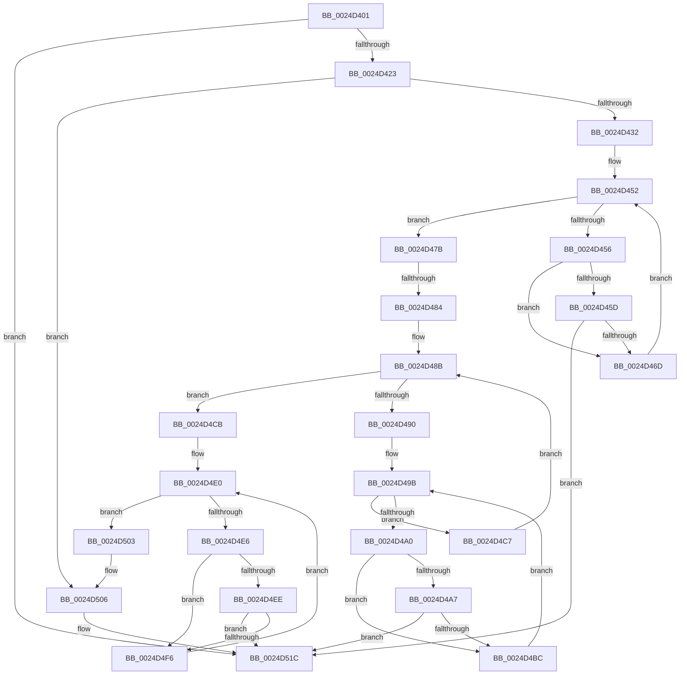

# sub_0024D401

- RVA: `0x0024D401`–`0x0024D53A` (길이 `313` bytes)
- VA: `0x000000014024D401`
- 실행 섹션: `.text`
- PDB 이름 있음: `아니요`; PDB Function 태그: `아니요`
- unwind 정보 RVA: `0x00062D28`
- 디코드: `88`개 명령, `313/313` bytes 표시
- 미해석 바이트: `0` (있으면 어셈블리에 `.byte`로 보존)

> 이 문서는 커널 이미지의 기계어와 PDB 기호를 분석해 생성했습니다. 4번과 5번은 함수 원형과 자료형을 바이너리 사용 방식에서 추정한 C 해석이며 원본 소스 복구 결과는 아닙니다.

## 1. Dependencies

- 직접 호출 지점: **0**; 고유 호출 대상: **0**
- 직접 호출자로 확인된 함수: **0**
- RIP 상대 이미지 참조: **5**

### Outgoing calls
- 직접 디코드된 call 명령이 없습니다.

### Direct callers
- 이 함수 시작 RVA로 연결되는 직접 call은 확인되지 않았습니다. 간접 호출은 완전히 역산할 수 없습니다.

### Static image references
- `0x0024D423` → RVA `0x000012E0` (`.rdata`; read)
- `0x0024D437` → RVA `0x00001318` (`.rdata`; read)
- `0x0024D441` → RVA `0x00001330` (`.rdata`; read)
- `0x0024D4CE` → RVA `0x00001328` (`.rdata`; read)
- `0x0024D4D5` → RVA `0x00001340` (`.rdata`; read)

## 2. Other-region calls and transfers

- 다른 실행 섹션으로 향하는 call: **0**
- call이 아닌 외부 분기/꼬리 이동: **1**
  - `0x0024D47E` → [sub_0024D557](Unknown_function_0024D557.md) (`tail-transfer`)

## 3. Assembly (complete function range)

```asm
0024D401  83 E0 FE                        and eax, 0xfffffffe
0024D404  83 C8 02                        or eax, 2
0024D407  89 01                           mov dword ptr [rcx], eax
0024D409  8B 41 04                        mov eax, dword ptr [rcx + 4]
0024D40C  89 41 08                        mov dword ptr [rcx + 8], eax
0024D40F  F0 41 FF 43 78                  lock inc dword ptr [r11 + 0x78]
0024D414  4D 8B 53 70                     mov r10, qword ptr [r11 + 0x70]
0024D418  41 8B 02                        mov eax, dword ptr [r10]
0024D41B  A8 01                           test al, 1
0024D41D  0F 84 F9 00 00 00               je 0x14024d51c
0024D423  48 8B 35 B6 3E DB FF            mov rsi, qword ptr [rip - 0x24c14a]
0024D42A  85 F6                           test esi, esi
0024D42C  0F 84 D4 00 00 00               je 0x14024d506
0024D432  45 0F B6 72 10                  movzx r14d, byte ptr [r10 + 0x10]
0024D437  48 8D 05 DA 3E DB FF            lea rax, [rip - 0x24c126]
0024D43E  45 84 F6                        test r14b, r14b
0024D441  48 8D 1D E8 3E DB FF            lea rbx, [rip - 0x24c118]
0024D448  41 8B D5                        mov edx, r13d
0024D44B  48 0F 44 D8                     cmove rbx, rax
0024D44F  4C 8B CB                        mov r9, rbx
0024D452  85 D2                           test edx, edx
0024D454  7F 25                           jg 0x14024d47b
0024D456  41 8B 39                        mov edi, dword ptr [r9]
0024D459  85 FF                           test edi, edi
0024D45B  74 10                           je 0x14024d46d
0024D45D  48 8B 44 24 20                  mov rax, qword ptr [rsp + 0x20]
0024D462  48 8B 00                        mov rax, qword ptr [rax]
0024D465  85 38                           test dword ptr [rax], edi
0024D467  0F 85 AF 00 00 00               jne 0x14024d51c
0024D46D  48 83 44 24 20 08               add qword ptr [rsp + 0x20], 8
0024D473  FF C2                           inc edx
0024D475  49 83 C1 04                     add r9, 4
0024D479  EB D7                           jmp 0x14024d452
0024D47B  83 FE 02                        cmp esi, 2
0024D47E  0F 85 D3 00 00 00               jne 0x14024d557
0024D484  44 8B 6D 08                     mov r13d, dword ptr [rbp + 8]
0024D488  41 8B ED                        mov ebp, r13d
0024D48B  41 3B ED                        cmp ebp, r13d
0024D48E  77 3B                           ja 0x14024d4cb
0024D490  BA 01 00 00 00                  mov edx, 1
0024D495  4C 8D 4B 04                     lea r9, [rbx + 4]
0024D499  8B FA                           mov edi, edx
0024D49B  83 FA 03                        cmp edx, 3
0024D49E  7F 27                           jg 0x14024d4c7
0024D4A0  41 8B 31                        mov esi, dword ptr [r9]
0024D4A3  85 F6                           test esi, esi
0024D4A5  74 15                           je 0x14024d4bc
0024D4A7  8B C5                           mov eax, ebp
0024D4A9  48 6B C0 1A                     imul rax, rax, 0x1a
0024D4AD  48 03 C7                        add rax, rdi
0024D4B0  49 8B 84 C3 F8 00 00 00         mov rax, qword ptr [r11 + rax*8 + 0xf8]
0024D4B8  85 30                           test dword ptr [rax], esi
0024D4BA  75 60                           jne 0x14024d51c
0024D4BC  FF C2                           inc edx
0024D4BE  48 FF C7                        inc rdi
0024D4C1  49 83 C1 04                     add r9, 4
0024D4C5  EB D4                           jmp 0x14024d49b
0024D4C7  FF C5                           inc ebp
0024D4C9  EB C0                           jmp 0x14024d48b
0024D4CB  45 84 F6                        test r14b, r14b
0024D4CE  48 8D 05 53 3E DB FF            lea rax, [rip - 0x24c1ad]
0024D4D5  48 8D 15 64 3E DB FF            lea rdx, [rip - 0x24c19c]
0024D4DC  48 0F 44 D0                     cmove rdx, rax
0024D4E0  41 83 FC 05                     cmp r12d, 5
0024D4E4  7F 1D                           jg 0x14024d503
0024D4E6  44 8B 0A                        mov r9d, dword ptr [rdx]
0024D4E9  45 85 C9                        test r9d, r9d
0024D4EC  74 08                           je 0x14024d4f6
0024D4EE  49 8B 00                        mov rax, qword ptr [r8]
0024D4F1  44 85 08                        test dword ptr [rax], r9d
0024D4F4  75 26                           jne 0x14024d51c
0024D4F6  41 FF C4                        inc r12d
0024D4F9  49 83 C0 08                     add r8, 8
0024D4FD  48 83 C2 04                     add rdx, 4
0024D501  EB DD                           jmp 0x14024d4e0
0024D503  41 8B 02                        mov eax, dword ptr [r10]
0024D506  83 E0 FE                        and eax, 0xfffffffe
0024D509  83 C8 02                        or eax, 2
0024D50C  41 89 02                        mov dword ptr [r10], eax
0024D50F  41 8B 42 04                     mov eax, dword ptr [r10 + 4]
0024D513  41 89 42 08                     mov dword ptr [r10 + 8], eax
0024D517  F0 41 FF 43 78                  lock inc dword ptr [r11 + 0x78]
0024D51C  48 8B 7C 24 50                  mov rdi, qword ptr [rsp + 0x50]
0024D521  48 8B 74 24 58                  mov rsi, qword ptr [rsp + 0x58]
0024D526  4C 8B 64 24 48                  mov r12, qword ptr [rsp + 0x48]
0024D52B  4C 8B 6C 24 40                  mov r13, qword ptr [rsp + 0x40]
0024D530  48 8B 5C 24 70                  mov rbx, qword ptr [rsp + 0x70]
0024D535  4C 8B 74 24 38                  mov r14, qword ptr [rsp + 0x38]
```

## 4. C-style interpretation (structured pseudocode)

```c
__int64 __fastcall sub_0024D401(__int64 a1, __int64 a2, __int64 a3, __int64 a4, __int64 a5, __int64 a6, __int64 a7, __int64 a8, __int64 a9, __int64 a10, __int64 a11, __int64 a12, __int64 a13, __int64 a14)
{
    __int64 result;
    __int64 v_r12;
    __int64 v_rbp;
    __int64 v_rbx;
    __int64 v_rdi;
    unsigned __int64 v_stack_p20;

    result = (unsigned int)((result) & (0xFFFFFFFEULL));
    result = (unsigned int)((result) | (2));
    *(unsigned int *)(a1) = (unsigned int)(result);
    *(unsigned int *)(a1 + 8) = (unsigned int)((unsigned int)(*(unsigned int *)(a1 + 4)));
    if ((((unsigned __int8)((unsigned int)(*(unsigned int *)(*(unsigned __int64 *)(v_r11 + 112))))) & (1)) == 0) goto loc_0024D51C;
    if ((unsigned int)(*(unsigned __int64 *)(v_rip - 2408778)) == 0) goto loc_0024D506;
    v_rbx = v_rip - 2408728;
    if ((unsigned __int8)(*(unsigned __int8 *)(*(unsigned __int64 *)(v_r11 + 112) + 16)) == 0) { v_rbx = v_rip - 2408742; }
loc_0024D452:
    if (condition_is_greater) goto loc_0024D47B;
    if ((unsigned int)((unsigned int)(*(unsigned int *)(v_rbx))) == 0) goto loc_0024D46D;
    if (((*(unsigned int *)(*(unsigned __int64 *)(v_stack_p20))) & ((unsigned int)((unsigned int)(*(unsigned int *)(v_rbx))))) != 0) goto loc_0024D51C;
loc_0024D46D:
    a2 = (unsigned int)(((unsigned int)((unsigned int)(v_r13))) + 1);
    a4 = (v_rbx) + (4);
    goto loc_0024D452;
loc_0024D47B:
loc_0024D48B:
    if (((unsigned int)((unsigned int)((unsigned int)((unsigned int)(*(unsigned int *)(v_rbp + 8)))))) > ((unsigned int)((unsigned int)(*(unsigned int *)(v_rbp + 8))))) goto loc_0024D4CB;
loc_0024D49B:
    if (1 > 3) goto loc_0024D4C7;
    if ((unsigned int)((unsigned int)(*(unsigned int *)(v_rbx + 4))) == 0) goto loc_0024D4BC;
    result = ((unsigned int)((unsigned int)((unsigned int)((unsigned int)((unsigned int)(*(unsigned int *)(v_rbp + 8))))))) * ((unsigned int)((unsigned int)((unsigned int)((unsigned int)((unsigned int)(*(unsigned int *)(v_rbp + 8)))))));
    result = (result) + (1);
    if (((*(unsigned int *)(*(unsigned __int64 *)(v_r11 + result * 8 + 248))) & ((unsigned int)((unsigned int)(*(unsigned int *)(v_rbx + 4))))) != 0) goto loc_0024D51C;
loc_0024D4BC:
    a2 = (unsigned int)((1) + 1);
    v_rdi = (1) + 1;
    a4 = (v_rbx + 4) + (4);
    goto loc_0024D49B;
loc_0024D4C7:
    v_rbp = (unsigned int)(((unsigned int)((unsigned int)((unsigned int)(*(unsigned int *)(v_rbp + 8))))) + 1);
    goto loc_0024D48B;
loc_0024D4CB:
    a2 = v_rip - 2408860;
    if ((unsigned __int8)(*(unsigned __int8 *)(*(unsigned __int64 *)(v_r11 + 112) + 16)) == 0) { a2 = v_rip - 2408877; }
loc_0024D4E0:
    if (((unsigned int)(v_r12)) > 5) goto loc_0024D503;
    if ((unsigned int)((unsigned int)(*(unsigned int *)(a2))) == 0) goto loc_0024D4F6;
    if (((*(unsigned int *)(*(unsigned __int64 *)(a3))) & ((unsigned int)((unsigned int)(*(unsigned int *)(a2))))) != 0) goto loc_0024D51C;
loc_0024D4F6:
    v_r12 = (unsigned int)((v_r12) + 1);
    a3 = (a3) + (8);
    a2 = (a2) + (4);
    goto loc_0024D4E0;
loc_0024D503:
loc_0024D506:
    result = (unsigned int)(((unsigned int)(*(unsigned int *)(*(unsigned __int64 *)(v_r11 + 112)))) & (0xFFFFFFFEULL));
    result = (unsigned int)((result) | (2));
    *(unsigned int *)(*(unsigned __int64 *)(v_r11 + 112)) = (unsigned int)(result);
    *(unsigned int *)(*(unsigned __int64 *)(v_r11 + 112) + 8) = (unsigned int)((unsigned int)(*(unsigned int *)(*(unsigned __int64 *)(v_r11 + 112) + 4)));
loc_0024D51C:
    return (unsigned int)(*(unsigned int *)(*(unsigned __int64 *)(v_r11 + 112) + 4));
}
```

## 5. (Beta) C Style

```c
int64_t sub_0024D401(void *Arg1, int64_t Arg2, void *Arg3, int64_t Arg4, uint64_t Arg5, uint64_t Arg6, int64_t Arg7, int64_t Arg8, int64_t Arg9, int64_t Arg10, int64_t Arg11, uint64_t Arg12, uint64_t Arg13, int64_t Arg14)
{
    uint8_t *arg1 = (uint8_t *)Arg1;
    uint8_t *arg3 = (uint8_t *)Arg3;

    int64_t result;
    int64_t local_r12;
    int64_t local_rbp;
    int64_t local_rbx;
    int64_t local_rdi;
    uint64_t v_stack_p20;

    result = (uint32_t)((result) & (0xFFFFFFFEULL));
    result = (uint32_t)((result) | (2));
    *(uint32_t *)(arg1) = (uint32_t)(result);
    *(uint32_t *)(arg1 + 0x8) = (uint32_t)((uint32_t)(*(uint32_t *)(arg1 + 0x4)));
    if ((((uint8_t)((uint32_t)(*(uint32_t *)(*(uint64_t *)(local_r11 + 0x70))))) & (1)) == 0) goto loc_0024D51C;
    if ((uint32_t)(*(uint64_t *)(v_rip - 0x24C14A)) == 0) goto loc_0024D506;
    local_rbx = v_rip - 2408728;
    if ((uint8_t)(*(uint8_t *)(*(uint64_t *)(local_r11 + 0x70) + 0x10)) == 0) { local_rbx = v_rip - 2408742; }
loc_0024D452:
    if (condition_is_greater) goto loc_0024D47B;
    if ((uint32_t)((uint32_t)(*(uint32_t *)(local_rbx))) == 0) goto loc_0024D46D;
    if (((*(uint32_t *)(*(uint64_t *)(v_stack_p20))) & ((uint32_t)((uint32_t)(*(uint32_t *)(local_rbx))))) != 0) goto loc_0024D51C;
loc_0024D46D:
    Arg2 = (uint32_t)(((uint32_t)((uint32_t)(local_r13))) + 1);
    Arg4 = (local_rbx) + (4);
    goto loc_0024D452;
loc_0024D47B:
loc_0024D48B:
    if (((uint32_t)((uint32_t)((uint32_t)((uint32_t)(*(uint32_t *)(local_rbp + 0x8)))))) > ((uint32_t)((uint32_t)(*(uint32_t *)(local_rbp + 0x8))))) goto loc_0024D4CB;
loc_0024D49B:
    if (1 > 3) goto loc_0024D4C7;
    if ((uint32_t)((uint32_t)(*(uint32_t *)(local_rbx + 0x4))) == 0) goto loc_0024D4BC;
    result = ((uint32_t)((uint32_t)((uint32_t)((uint32_t)((uint32_t)(*(uint32_t *)(local_rbp + 0x8))))))) * ((uint32_t)((uint32_t)((uint32_t)((uint32_t)((uint32_t)(*(uint32_t *)(local_rbp + 0x8)))))));
    result = (result) + (1);
    if (((*(uint32_t *)(*(uint64_t *)(local_r11 + result * 8 + 0xF8))) & ((uint32_t)((uint32_t)(*(uint32_t *)(local_rbx + 0x4))))) != 0) goto loc_0024D51C;
loc_0024D4BC:
    Arg2 = (uint32_t)((1) + 1);
    local_rdi = (1) + 1;
    Arg4 = (local_rbx + 4) + (4);
    goto loc_0024D49B;
loc_0024D4C7:
    local_rbp = (uint32_t)(((uint32_t)((uint32_t)((uint32_t)(*(uint32_t *)(local_rbp + 0x8))))) + 1);
    goto loc_0024D48B;
loc_0024D4CB:
    Arg2 = v_rip - 2408860;
    if ((uint8_t)(*(uint8_t *)(*(uint64_t *)(local_r11 + 0x70) + 0x10)) == 0) { Arg2 = v_rip - 2408877; }
loc_0024D4E0:
    if (((uint32_t)(local_r12)) > 5) goto loc_0024D503;
    if ((uint32_t)((uint32_t)(*(uint32_t *)(Arg2))) == 0) goto loc_0024D4F6;
    if (((*(uint32_t *)(*(uint64_t *)(arg3))) & ((uint32_t)((uint32_t)(*(uint32_t *)(Arg2))))) != 0) goto loc_0024D51C;
loc_0024D4F6:
    local_r12 = (uint32_t)((local_r12) + 1);
    Arg3 = (Arg3) + (8);
    Arg2 = (Arg2) + (4);
    goto loc_0024D4E0;
loc_0024D503:
loc_0024D506:
    result = (uint32_t)(((uint32_t)(*(uint32_t *)(*(uint64_t *)(local_r11 + 0x70)))) & (0xFFFFFFFEULL));
    result = (uint32_t)((result) | (2));
    *(uint32_t *)(*(uint64_t *)(local_r11 + 0x70)) = (uint32_t)(result);
    *(uint32_t *)(*(uint64_t *)(local_r11 + 0x70) + 0x8) = (uint32_t)((uint32_t)(*(uint32_t *)(*(uint64_t *)(local_r11 + 0x70) + 0x4)));
loc_0024D51C:
    return (uint32_t)(*(uint32_t *)(*(uint64_t *)(local_r11 + 0x70) + 0x4));
}
```

### 관측된 메모리 오프셋

구조체 형식이 확인되지 않은 접근은 인자 기준의 오프셋으로만 기록했습니다.

| 기준 인자 | 오프셋 표현 | 폭 (bit) | 접근 |
|---|---:|---:|---|
| `Arg1` | `+ 0x0` | `32` | `W` |
| `Arg1` | `+ 0x4` | `32` | `R` |
| `Arg1` | `+ 0x8` | `32` | `W` |
| `Arg3` | `+ 0x0` | `64` | `R` |

## 6. Execution-region graph

[열기: 2D/3D 그래프와 함수 탐색 컨트롤 패널](../../../control-panel.html?section=text&rva=0x0024D401&view=graph)

- 2D 그래프는 위에서 아래로 흐르고, 3D 그래프는 빈 공간을 드래그해 회전합니다. Shift+드래그는 이동, 휠은 확대·축소, 함수 노드 선택은 대상 보고서 이동입니다.

### Static fallback


