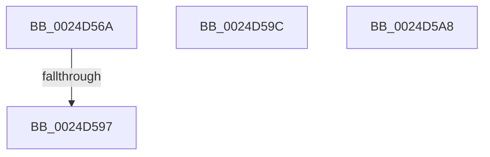

# sub_0024D56A

- RVA: `0x0024D56A`–`0x0024D5C7` (길이 `93` bytes)
- VA: `0x000000014024D56A`
- 실행 섹션: `.text`
- PDB 이름 있음: `아니요`; PDB Function 태그: `아니요`
- unwind 정보 RVA: `0x00062DA0`
- 디코드: `21`개 명령, `93/93` bytes 표시
- 미해석 바이트: `0` (있으면 어셈블리에 `.byte`로 보존)

> 이 문서는 커널 이미지의 기계어와 PDB 기호를 분석해 생성했습니다. 4번과 5번은 함수 원형과 자료형을 바이너리 사용 방식에서 추정한 C 해석이며 원본 소스 복구 결과는 아닙니다.

## 1. Dependencies

- 직접 호출 지점: **0**; 고유 호출 대상: **0**
- 직접 호출자로 확인된 함수: **0**
- RIP 상대 이미지 참조: **0**

### Outgoing calls
- 직접 디코드된 call 명령이 없습니다.

### Direct callers
- 이 함수 시작 RVA로 연결되는 직접 call은 확인되지 않았습니다. 간접 호출은 완전히 역산할 수 없습니다.

### Static image references
- 디코드된 RIP-relative 메모리 참조가 없습니다.

## 2. Other-region calls and transfers

- 다른 실행 섹션으로 향하는 call: **0**
- call이 아닌 외부 분기/꼬리 이동: **4**
  - `0x0024D591` → [sub_0024D11D + 0x11F](Unknown_function_0024D11D.md) (`tail-transfer`)
  - `0x0024D597` → [sub_0024D11D + 0x2D1](Unknown_function_0024D11D.md) (`tail-transfer`)
  - `0x0024D5A3` → [sub_0024D11D + 0x1D1](Unknown_function_0024D11D.md) (`tail-transfer`)
  - `0x0024D5C2` → [sub_0024D11D + 0x271](Unknown_function_0024D11D.md) (`tail-transfer`)

## 3. Assembly (complete function range)

```asm
0024D56A  8B 81 B4 00 00 00               mov eax, dword ptr [rcx + 0xb4]
0024D570  41 83 F8 03                     cmp r8d, 3
0024D574  41 8B DD                        mov ebx, r13d
0024D577  0F 45 D8                        cmovne ebx, eax
0024D57A  89 9C 24 80 00 00 00            mov dword ptr [rsp + 0x80], ebx
0024D581  8D 70 FF                        lea esi, [rax - 1]
0024D584  41 0F 45 F5                     cmovne esi, r13d
0024D588  89 B4 24 88 00 00 00            mov dword ptr [rsp + 0x88], esi
0024D58F  3B DE                           cmp ebx, esi
0024D591  0F 86 A5 FC FF FF               jbe 0x14024d23c
0024D597  E9 52 FE FF FF                  jmp 0x14024d3ee
0024D59C  41 8B D5                        mov edx, r13d
0024D59F  44 8D 70 FF                     lea r14d, [rax - 1]
0024D5A3  E9 46 FD FF FF                  jmp 0x14024d2ee
0024D5A8  41 8B 44 24 04                  mov eax, dword ptr [r12 + 4]
0024D5AD  41 83 E7 FE                     and r15d, 0xfffffffe
0024D5B1  41 83 CF 02                     or r15d, 2
0024D5B5  41 89 44 24 08                  mov dword ptr [r12 + 8], eax
0024D5BA  45 89 3C 24                     mov dword ptr [r12], r15d
0024D5BE  F0 FF 45 68                     lock inc dword ptr [rbp + 0x68]
0024D5C2  E9 C7 FD FF FF                  jmp 0x14024d38e
```

## 4. C-style interpretation (structured pseudocode)

```c
__int64 __fastcall sub_0024D56A(__int64 a1, __int64 a2, int a3)
{
    __int64 v_rbx;
    __int64 v_rsi;
    unsigned int v_stack_p80;
    unsigned int v_stack_p88;

    v_rbx = (unsigned int)((unsigned int)(v_r13));
    if (a3 != 3) { v_rbx = (unsigned int)((unsigned int)(*(unsigned int *)(a1 + 180))); }
    v_stack_p80 = (unsigned int)(v_rbx);
    v_rsi = (unsigned int)(*(unsigned int *)(a1 + 180)) - 1;
    if (a3 != 3) { v_rsi = (unsigned int)(v_r13); }
    v_stack_p88 = (unsigned int)(v_rsi);
}
```

## 5. (Beta) C Style

```c
int64_t sub_0024D56A(void *Arg1, int64_t Arg2, int32_t Arg3)
{
    uint8_t *arg1 = (uint8_t *)Arg1;

    int64_t local_rbx;
    int64_t local_rsi;
    uint32_t v_stack_p80;
    uint32_t v_stack_p88;

    local_rbx = (uint32_t)((uint32_t)(local_r13));
    if (Arg3 != 3) { local_rbx = (uint32_t)((uint32_t)(*(uint32_t *)(arg1 + 0xB4))); }
    v_stack_p80 = (uint32_t)(local_rbx);
    local_rsi = (uint32_t)(*(uint32_t *)(arg1 + 0xB4)) - 1;
    if (Arg3 != 3) { local_rsi = (uint32_t)(local_r13); }
    v_stack_p88 = (uint32_t)(local_rsi);
}
```

### 관측된 메모리 오프셋

구조체 형식이 확인되지 않은 접근은 인자 기준의 오프셋으로만 기록했습니다.

| 기준 인자 | 오프셋 표현 | 폭 (bit) | 접근 |
|---|---:|---:|---|
| `Arg1` | `+ 0xB4` | `32` | `R` |

## 6. Execution-region graph

[열기: 2D/3D 그래프와 함수 탐색 컨트롤 패널](../../../control-panel.html?section=text&rva=0x0024D56A&view=graph)

- 2D 그래프는 위에서 아래로 흐르고, 3D 그래프는 빈 공간을 드래그해 회전합니다. Shift+드래그는 이동, 휠은 확대·축소, 함수 노드 선택은 대상 보고서 이동입니다.

### Static fallback


