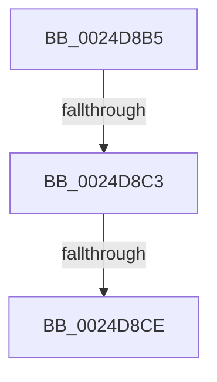

# sub_0024D8B5

- RVA: `0x0024D8B5`–`0x0024D8F3` (길이 `62` bytes)
- VA: `0x000000014024D8B5`
- 실행 섹션: `.text`
- PDB 이름 있음: `아니요`; PDB Function 태그: `아니요`
- unwind 정보 RVA: `0x00062E54`
- 디코드: `12`개 명령, `62/62` bytes 표시
- 미해석 바이트: `0` (있으면 어셈블리에 `.byte`로 보존)

> 이 문서는 커널 이미지의 기계어와 PDB 기호를 분석해 생성했습니다. 4번과 5번은 함수 원형과 자료형을 바이너리 사용 방식에서 추정한 C 해석이며 원본 소스 복구 결과는 아닙니다.

## 1. Dependencies

- 직접 호출 지점: **1**; 고유 호출 대상: **1**
- 직접 호출자로 확인된 함수: **0**
- RIP 상대 이미지 참조: **0**

### Outgoing calls
- `0x0024D8DB` → [memset](../6C/memset_function_006C6C40.md) (function, `0x006C6C40`)

### Direct callers
- 이 함수 시작 RVA로 연결되는 직접 call은 확인되지 않았습니다. 간접 호출은 완전히 역산할 수 없습니다.

### Static image references
- 디코드된 RIP-relative 메모리 참조가 없습니다.

## 2. Other-region calls and transfers

- 다른 실행 섹션으로 향하는 call: **0**
- call이 아닌 외부 분기/꼬리 이동: **3**
  - `0x0024D8BD` → [sub_0024D9D1](Unknown_function_0024D9D1.md) (`tail-transfer`)
  - `0x0024D8C8` → [sub_0024DA9B](Unknown_function_0024DA9B.md) (`tail-transfer`)
  - `0x0024D8ED` → [sub_0024D9D1 + 0x14](Unknown_function_0024D9D1.md) (`tail-transfer`)

## 3. Assembly (complete function range)

```asm
0024D8B5  48 89 9C 24 E0 00 00 00         mov qword ptr [rsp + 0xe0], rbx
0024D8BD  0F 84 0E 01 00 00               je 0x14024d9d1
0024D8C3  8B 47 38                        mov eax, dword ptr [rdi + 0x38]
0024D8C6  A8 20                           test al, 0x20
0024D8C8  0F 85 CD 01 00 00               jne 0x14024da9b
0024D8CE  33 D2                           xor edx, edx
0024D8D0  48 8D 4C 24 20                  lea rcx, [rsp + 0x20]
0024D8D5  41 B8 98 00 00 00               mov r8d, 0x98
0024D8DB  E8 60 93 47 00                  call 0x1406c6c40
0024D8E0  48 B8 00 00 00 00 00 00 40 00   movabs rax, 0x40000000000000
0024D8EA  48 3B F0                        cmp rsi, rax
0024D8ED  0F 83 F2 00 00 00               jae 0x14024d9e5
```

## 4. C-style interpretation (structured pseudocode)

```c
__int64 __fastcall sub_0024D8B5(__int64 a1, int a2)
{
    __int64 result;
    unsigned __int64 v_stack_p20;
    unsigned __int64 v_stack_pE0;

    v_stack_pE0 = v_rbx;
    a2 = 0;
    result = memset(v_stack_p20, a2, 152, a4);
}
```

## 5. (Beta) C Style

```c
int64_t sub_0024D8B5(int64_t Arg1, int32_t Arg2)
{
    int64_t result;
    uint64_t v_stack_p20;
    uint64_t v_stack_pE0;

    v_stack_pE0 = local_rbx;
    Arg2 = 0;
    result = memset(v_stack_p20, Arg2, 152, a4);
}
```

## 6. Execution-region graph

[열기: 2D/3D 그래프와 함수 탐색 컨트롤 패널](../../../control-panel.html?section=text&rva=0x0024D8B5&view=graph)

- 2D 그래프는 위에서 아래로 흐르고, 3D 그래프는 빈 공간을 드래그해 회전합니다. Shift+드래그는 이동, 휠은 확대·축소, 함수 노드 선택은 대상 보고서 이동입니다.

### Static fallback


