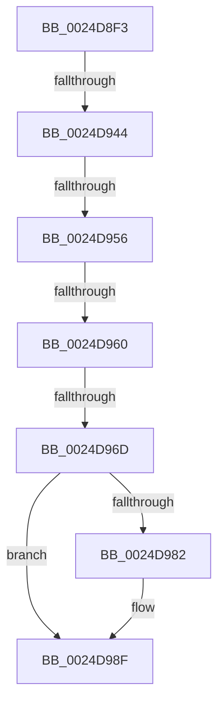

# sub_0024D8F3

- RVA: `0x0024D8F3`–`0x0024D9A3` (길이 `176` bytes)
- VA: `0x000000014024D8F3`
- 실행 섹션: `.text`
- PDB 이름 있음: `아니요`; PDB Function 태그: `아니요`
- unwind 정보 RVA: `0x00062E68`
- 디코드: `36`개 명령, `176/176` bytes 표시
- 미해석 바이트: `0` (있으면 어셈블리에 `.byte`로 보존)

> 이 문서는 커널 이미지의 기계어와 PDB 기호를 분석해 생성했습니다. 4번과 5번은 함수 원형과 자료형을 바이너리 사용 방식에서 추정한 C 해석이며 원본 소스 복구 결과는 아닙니다.

## 1. Dependencies

- 직접 호출 지점: **2**; 고유 호출 대상: **2**
- 직접 호출자로 확인된 함수: **0**
- RIP 상대 이미지 참조: **2**

### Outgoing calls
- `0x0024D907` → [ExAcquireSpinLockShared](ExAcquireSpinLockShared_function_0024DCE0.md) (function, `0x0024DCE0`)
- `0x0024D98A` → [KiLowerIrqlProcessIrqlFlags](../4F/KiLowerIrqlProcessIrqlFlags_function_004F5698.md) (function, `0x004F5698`)

### Direct callers
- 이 함수 시작 RVA로 연결되는 직접 call은 확인되지 않았습니다. 간접 호출은 완전히 역산할 수 없습니다.

### Static image references
- `0x0024D960` → RVA `0x00FC6B06` (`ALMOSTRO`; read)
- `0x0024D979` → RVA `0x00FC6D20` (`ALMOSTRO`; read)

## 2. Other-region calls and transfers

- 다른 실행 섹션으로 향하는 call: **0**
- call이 아닌 외부 분기/꼬리 이동: **4**
  - `0x0024D93E` → [sub_0024D9E9 + 0xB](Unknown_function_0024D9E9.md) (`tail-transfer`)
  - `0x0024D950` → [sub_0024D9E9 + 0xB](Unknown_function_0024D9E9.md) (`tail-transfer`)
  - `0x0024D95A` → [sub_0024D9E9](Unknown_function_0024D9E9.md) (`tail-transfer`)
  - `0x0024D967` → [sub_0024DAD4 + 0x7](Unknown_function_0024DAD4.md) (`tail-transfer`)

## 3. Assembly (complete function range)

```asm
0024D8F3  48 89 AC 24 E8 00 00 00         mov qword ptr [rsp + 0xe8], rbp
0024D8FB  48 8D 4F 48                     lea rcx, [rdi + 0x48]
0024D8FF  4C 89 BC 24 F0 00 00 00         mov qword ptr [rsp + 0xf0], r15
0024D907  E8 D4 03 00 00                  call 0x14024dce0
0024D90C  48 8B 9F 28 01 00 00            mov rbx, qword ptr [rdi + 0x128]
0024D913  48 C1 EE 0C                     shr rsi, 0xc
0024D917  44 0F B6 F8                     movzx r15d, al
0024D91B  8B 53 20                        mov edx, dword ptr [rbx + 0x20]
0024D91E  8B 4B 24                        mov ecx, dword ptr [rbx + 0x24]
0024D921  81 E2 C0 FF 00 00               and edx, 0xffc0
0024D927  8B 43 20                        mov eax, dword ptr [rbx + 0x20]
0024D92A  48 C1 E2 1A                     shl rdx, 0x1a
0024D92E  48 0B D1                        or rdx, rcx
0024D931  8B 4B 28                        mov ecx, dword ptr [rbx + 0x28]
0024D934  48 03 CA                        add rcx, rdx
0024D937  4C 8D 41 FF                     lea r8, [rcx - 1]
0024D93B  48 3B F2                        cmp rsi, rdx
0024D93E  0F 82 B0 00 00 00               jb 0x14024d9f4
0024D944  3D 00 00 10 00                  cmp eax, 0x100000
0024D949  49 0F 42 C8                     cmovb rcx, r8
0024D94D  48 3B F1                        cmp rsi, rcx
0024D950  0F 87 9E 00 00 00               ja 0x14024d9f4
0024D956  41 80 FF 11                     cmp r15b, 0x11
0024D95A  0F 84 89 00 00 00               je 0x14024d9e9
0024D960  F6 05 9F 91 D7 00 01            test byte ptr [rip + 0xd7919f], 1
0024D967  0F 85 6E 01 00 00               jne 0x14024dadb
0024D96D  F0 81 67 48 FF FF FF BF         lock and dword ptr [rdi + 0x48], 0xbfffffff
0024D975  F0 FF 4F 48                     lock dec dword ptr [rdi + 0x48]
0024D979  83 3D A0 93 D7 00 00            cmp dword ptr [rip + 0xd793a0], 0
0024D980  74 0D                           je 0x14024d98f
0024D982  44 0F 20 C1                     mov rcx, cr8
0024D986  41 0F B6 D7                     movzx edx, r15b
0024D98A  E8 09 7D 2A 00                  call 0x1404f5698
0024D98F  45 0F 22 C7                     mov cr8, r15
0024D993  48 8B AC 24 E8 00 00 00         mov rbp, qword ptr [rsp + 0xe8]
0024D99B  4C 8B BC 24 F0 00 00 00         mov r15, qword ptr [rsp + 0xf0]
```

## 4. C-style interpretation (structured pseudocode)

```c
__int64 __fastcall sub_0024D8F3(__int64 a1, __int64 a2, __int64 a3, __int64 a4, __int64 a5, __int64 a6, __int64 a7, __int64 a8, __int64 a9, __int64 a10, __int64 a11, __int64 a12, __int64 a13, __int64 a14, __int64 a15, __int64 a16, __int64 a17, __int64 a18, __int64 a19, __int64 a20, __int64 a21, __int64 a22, __int64 a23, __int64 a24, __int64 a25, __int64 a26, __int64 a27, __int64 a28, __int64 a29, __int64 a30)
{
    __int64 result;
    __int64 v_rsi;
    unsigned __int64 v_stack_pE8;
    unsigned __int64 v_stack_pF0;

    v_stack_pE8 = v_rbp;
    v_stack_pF0 = v_r15;
    result = ExAcquireSpinLockShared(v_rdi + 72, a2, a3, a4);
    v_rsi = (v_rsi) >> (12);
    a2 = (unsigned int)(((unsigned int)(*(unsigned int *)(*(unsigned __int64 *)(v_rdi + 296) + 32))) & (0xFFC0ULL));
    a2 = (a2) << (26);
    a2 = (a2) | ((unsigned int)(*(unsigned int *)(*(unsigned __int64 *)(v_rdi + 296) + 36)));
    a1 = ((unsigned int)(*(unsigned int *)(*(unsigned __int64 *)(v_rdi + 296) + 40))) + (a2);
    if (((unsigned int)((unsigned int)(*(unsigned int *)(*(unsigned __int64 *)(v_rdi + 296) + 32)))) < 0x100000ULL) { a1 = a1 - 1; }
    result = (unsigned int)(*(unsigned int *)(*(unsigned __int64 *)(v_rdi + 296) + 32));
    if ((*(unsigned int *)(v_rip + 14128032)) != 0) {
        a1 = v_cr8;
        a2 = (unsigned __int8)((unsigned __int8)(result));
        result = KiLowerIrqlProcessIrqlFlags(a1, a2, a1 - 1, a4);
    }
    return result;
}
```

## 5. (Beta) C Style

```c
int64_t sub_0024D8F3(int64_t Arg1, int64_t Arg2, int64_t Arg3, int64_t Arg4, uint64_t Arg5, uint64_t Arg6, uint64_t Arg7, uint64_t Arg8, uint64_t Arg9, uint64_t Arg10, uint64_t Arg11, uint64_t Arg12, uint64_t Arg13, uint64_t Arg14, uint64_t Arg15, uint64_t Arg16, uint64_t Arg17, uint64_t Arg18, uint64_t Arg19, uint64_t Arg20, uint64_t Arg21, uint64_t Arg22, uint64_t Arg23, uint64_t Arg24, uint64_t Arg25, uint64_t Arg26, uint64_t Arg27, uint64_t Arg28, int64_t Arg29, int64_t Arg30)
{
    int64_t result;
    int64_t local_rsi;
    uint64_t v_stack_pE8;
    uint64_t v_stack_pF0;

    v_stack_pE8 = local_rbp;
    v_stack_pF0 = local_r15;
    result = ExAcquireSpinLockShared(local_rdi + 72, Arg2, Arg3, Arg4);
    local_rsi = (local_rsi) >> (12);
    Arg2 = (uint32_t)(((uint32_t)(*(uint32_t *)(*(uint64_t *)(local_rdi + 0x128) + 0x20))) & (0xFFC0ULL));
    Arg2 = (Arg2) << (26);
    Arg2 = (Arg2) | ((uint32_t)(*(uint32_t *)(*(uint64_t *)(local_rdi + 0x128) + 0x24)));
    Arg1 = ((uint32_t)(*(uint32_t *)(*(uint64_t *)(local_rdi + 0x128) + 0x28))) + (Arg2);
    if (((uint32_t)((uint32_t)(*(uint32_t *)(*(uint64_t *)(local_rdi + 0x128) + 0x20)))) < 0x100000ULL) { Arg1 = Arg1 - 1; }
    result = (uint32_t)(*(uint32_t *)(*(uint64_t *)(local_rdi + 0x128) + 0x20));
    if ((*(uint32_t *)(v_rip + 0xD793A0)) != 0) {
        Arg1 = v_cr8;
        Arg2 = (uint8_t)((uint8_t)(result));
        result = KiLowerIrqlProcessIrqlFlags(Arg1, Arg2, Arg1 - 1, Arg4);
    }
    return result;
}
```

## 6. Execution-region graph

[열기: 2D/3D 그래프와 함수 탐색 컨트롤 패널](../../../control-panel.html?section=text&rva=0x0024D8F3&view=graph)

- 2D 그래프는 위에서 아래로 흐르고, 3D 그래프는 빈 공간을 드래그해 회전합니다. Shift+드래그는 이동, 휠은 확대·축소, 함수 노드 선택은 대상 보고서 이동입니다.

### Static fallback


