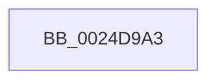

# sub_0024D9A3

- RVA: `0x0024D9A3`–`0x0024D9D0` (길이 `45` bytes)
- VA: `0x000000014024D9A3`
- 실행 섹션: `.text`
- PDB 이름 있음: `아니요`; PDB Function 태그: `아니요`
- unwind 정보 RVA: `0x00062E80`
- 디코드: `13`개 명령, `45/45` bytes 표시
- 미해석 바이트: `0` (있으면 어셈블리에 `.byte`로 보존)

> 이 문서는 커널 이미지의 기계어와 PDB 기호를 분석해 생성했습니다. 4번과 5번은 함수 원형과 자료형을 바이너리 사용 방식에서 추정한 C 해석이며 원본 소스 복구 결과는 아닙니다.

## 1. Dependencies

- 직접 호출 지점: **0**; 고유 호출 대상: **0**
- 직접 호출자로 확인된 함수: **0**
- RIP 상대 이미지 참조: **0**

### Outgoing calls
- 직접 디코드된 call 명령이 없습니다.

### Direct callers
- 이 함수 시작 RVA로 연결되는 직접 call은 확인되지 않았습니다. 간접 호출은 완전히 역산할 수 없습니다.

### Static image references
- 디코드된 RIP-relative 메모리 참조가 없습니다.

## 2. Other-region calls and transfers

- 다른 실행 섹션으로 향하는 call: **0**
- 별도 외부 분기/꼬리 이동을 확인하지 못했습니다.

## 3. Assembly (complete function range)

```asm
0024D9A3  8B 4B 20                        mov ecx, dword ptr [rbx + 0x20]
0024D9A6  8B 43 24                        mov eax, dword ptr [rbx + 0x24]
0024D9A9  81 E1 C0 FF 00 00               and ecx, 0xffc0
0024D9AF  48 C1 E1 1A                     shl rcx, 0x1a
0024D9B3  48 0B C8                        or rcx, rax
0024D9B6  49 29 0E                        sub qword ptr [r14], rcx
0024D9B9  48 8B C3                        mov rax, rbx
0024D9BC  48 8B 9C 24 E0 00 00 00         mov rbx, qword ptr [rsp + 0xe0]
0024D9C4  48 81 C4 C0 00 00 00            add rsp, 0xc0
0024D9CB  41 5E                           pop r14
0024D9CD  5F                              pop rdi
0024D9CE  5E                              pop rsi
0024D9CF  C3                              ret
```

## 4. C-style interpretation (structured pseudocode)

```c
__int64 __fastcall sub_0024D9A3(__int64 a1, __int64 a2, __int64 a3, __int64 a4, __int64 a5, __int64 a6, __int64 a7, __int64 a8, __int64 a9, __int64 a10, __int64 a11, __int64 a12, __int64 a13, __int64 a14, __int64 a15, __int64 a16, __int64 a17, __int64 a18, __int64 a19, __int64 a20, __int64 a21, __int64 a22, __int64 a23, __int64 a24, __int64 a25, __int64 a26, __int64 a27, __int64 a28)
{
    __int64 v_rsp;

    a1 = (unsigned int)(((unsigned int)(*(unsigned int *)(v_rbx + 32))) & (0xFFC0ULL));
    a1 = (a1) << (26);
    a1 = (a1) | ((unsigned int)(*(unsigned int *)(v_rbx + 36)));
    v_rsp = (v_rsp) + (192);
    return v_rbx;
}
```

## 5. (Beta) C Style

```c
int64_t sub_0024D9A3(int64_t Arg1, int64_t Arg2, int64_t Arg3, int64_t Arg4, uint64_t Arg5, uint64_t Arg6, uint64_t Arg7, uint64_t Arg8, uint64_t Arg9, uint64_t Arg10, uint64_t Arg11, uint64_t Arg12, uint64_t Arg13, uint64_t Arg14, uint64_t Arg15, uint64_t Arg16, uint64_t Arg17, uint64_t Arg18, uint64_t Arg19, uint64_t Arg20, uint64_t Arg21, uint64_t Arg22, uint64_t Arg23, uint64_t Arg24, uint64_t Arg25, uint64_t Arg26, uint64_t Arg27, int64_t Arg28)
{
    int64_t local_rsp;

    Arg1 = (uint32_t)(((uint32_t)(*(uint32_t *)(local_rbx + 0x20))) & (0xFFC0ULL));
    Arg1 = (Arg1) << (26);
    Arg1 = (Arg1) | ((uint32_t)(*(uint32_t *)(local_rbx + 0x24)));
    local_rsp = (local_rsp) + (192);
    return local_rbx;
}
```

## 6. Execution-region graph

[열기: 2D/3D 그래프와 함수 탐색 컨트롤 패널](../../../control-panel.html?section=text&rva=0x0024D9A3&view=graph)

- 2D 그래프는 위에서 아래로 흐르고, 3D 그래프는 빈 공간을 드래그해 회전합니다. Shift+드래그는 이동, 휠은 확대·축소, 함수 노드 선택은 대상 보고서 이동입니다.

### Static fallback


