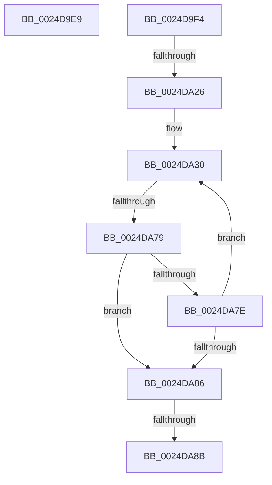

# sub_0024D9E9

- RVA: `0x0024D9E9`–`0x0024DA9B` (길이 `178` bytes)
- VA: `0x000000014024D9E9`
- 실행 섹션: `.text`
- PDB 이름 있음: `아니요`; PDB Function 태그: `아니요`
- unwind 정보 RVA: `0x00062EB8`
- 디코드: `45`개 명령, `178/178` bytes 표시
- 미해석 바이트: `0` (있으면 어셈블리에 `.byte`로 보존)

> 이 문서는 커널 이미지의 기계어와 PDB 기호를 분석해 생성했습니다. 4번과 5번은 함수 원형과 자료형을 바이너리 사용 방식에서 추정한 C 해석이며 원본 소스 복구 결과는 아닙니다.

## 1. Dependencies

- 직접 호출 지점: **1**; 고유 호출 대상: **1**
- 직접 호출자로 확인된 함수: **0**
- RIP 상대 이미지 참조: **0**

### Outgoing calls
- `0x0024D9ED` → [ExReleaseSpinLockSharedFromDpcLevel](ExReleaseSpinLockSharedFromDpcLevel_function_0024A590.md) (function, `0x0024A590`)

### Direct callers
- 이 함수 시작 RVA로 연결되는 직접 call은 확인되지 않았습니다. 간접 호출은 완전히 역산할 수 없습니다.

### Static image references
- 디코드된 RIP-relative 메모리 참조가 없습니다.

## 2. Other-region calls and transfers

- 다른 실행 섹션으로 향하는 call: **0**
- call이 아닌 외부 분기/꼬리 이동: **5**
  - `0x0024D9F2` → [sub_0024D8F3 + 0xA0](Unknown_function_0024D8F3.md) (`tail-transfer`)
  - `0x0024DA20` → [sub_0024DAD4](Unknown_function_0024DAD4.md) (`tail-transfer`)
  - `0x0024DA73` → [sub_0024DAD4 + 0x2B](Unknown_function_0024DAD4.md) (`tail-transfer`)
  - `0x0024DA89` → [sub_0024DAD4](Unknown_function_0024DAD4.md) (`tail-transfer`)
  - `0x0024DA96` → [sub_0024D8F3 + 0x63](Unknown_function_0024D8F3.md) (`tail-transfer`)

## 3. Assembly (complete function range)

```asm
0024D9E9  48 8D 4F 48                     lea rcx, [rdi + 0x48]
0024D9ED  E8 9E CB FF FF                  call 0x14024a590
0024D9F2  EB 9F                           jmp 0x14024d993
0024D9F4  8B 44 24 40                     mov eax, dword ptr [rsp + 0x40]
0024D9F8  4C 8B 97 18 01 00 00            mov r10, qword ptr [rdi + 0x118]
0024D9FF  89 74 24 44                     mov dword ptr [rsp + 0x44], esi
0024DA03  48 C1 EE 20                     shr rsi, 0x20
0024DA07  0F B7 D6                        movzx edx, si
0024DA0A  C1 E2 06                        shl edx, 6
0024DA0D  8B CA                           mov ecx, edx
0024DA0F  33 C8                           xor ecx, eax
0024DA11  81 E1 3F 00 FF FF               and ecx, 0xffff003f
0024DA17  33 CA                           xor ecx, edx
0024DA19  89 4C 24 40                     mov dword ptr [rsp + 0x40], ecx
0024DA1D  4D 85 D2                        test r10, r10
0024DA20  0F 84 AE 00 00 00               je 0x14024dad4
0024DA26  44 8B 5C 24 44                  mov r11d, dword ptr [rsp + 0x44]
0024DA2B  0F 1F 44 00 00                  nop dword ptr [rax + rax]
0024DA30  44 8B 4C 24 40                  mov r9d, dword ptr [rsp + 0x40]
0024DA35  41 8B 42 E8                     mov eax, dword ptr [r10 - 0x18]
0024DA39  41 81 E1 C0 FF 00 00            and r9d, 0xffc0
0024DA40  41 8B 4A EC                     mov ecx, dword ptr [r10 - 0x14]
0024DA44  25 C0 FF 00 00                  and eax, 0xffc0
0024DA49  45 8B 42 F0                     mov r8d, dword ptr [r10 - 0x10]
0024DA4D  48 C1 E0 1A                     shl rax, 0x1a
0024DA51  48 0B C1                        or rax, rcx
0024DA54  49 C1 E1 1A                     shl r9, 0x1a
0024DA58  41 8B 4A E8                     mov ecx, dword ptr [r10 - 0x18]
0024DA5C  4C 03 C0                        add r8, rax
0024DA5F  4D 0B CB                        or r9, r11
0024DA62  81 F9 00 00 10 00               cmp ecx, 0x100000
0024DA68  49 8D 50 FF                     lea rdx, [r8 - 1]
0024DA6C  4C 0F 42 C2                     cmovb r8, rdx
0024DA70  4D 3B C8                        cmp r9, r8
0024DA73  0F 87 86 00 00 00               ja 0x14024daff
0024DA79  4C 3B C8                        cmp r9, rax
0024DA7C  73 08                           jae 0x14024da86
0024DA7E  4D 8B 12                        mov r10, qword ptr [r10]
0024DA81  4D 85 D2                        test r10, r10
0024DA84  75 AA                           jne 0x14024da30
0024DA86  4D 85 D2                        test r10, r10
0024DA89  74 49                           je 0x14024dad4
0024DA8B  49 8D 5A C8                     lea rbx, [r10 - 0x38]
0024DA8F  48 89 9F 28 01 00 00            mov qword ptr [rdi + 0x128], rbx
0024DA96  E9 BB FE FF FF                  jmp 0x14024d956
```

## 4. C-style interpretation (structured pseudocode)

```c
__int64 __fastcall sub_0024D9E9(void)
{
    __int64 result;
    unsigned int v_stack_p40;
    unsigned int v_stack_p44;

    result = ExReleaseSpinLockSharedFromDpcLevel(v_rdi + 72, a2, a3, a4);
}
```

## 5. (Beta) C Style

```c
void sub_0024D9E9(void)
{
    int64_t result;
    uint32_t v_stack_p40;
    uint32_t v_stack_p44;

    result = ExReleaseSpinLockSharedFromDpcLevel(local_rdi + 72, a2, a3, a4);
}
```

## 6. Execution-region graph

[열기: 2D/3D 그래프와 함수 탐색 컨트롤 패널](../../../control-panel.html?section=text&rva=0x0024D9E9&view=graph)

- 2D 그래프는 위에서 아래로 흐르고, 3D 그래프는 빈 공간을 드래그해 회전합니다. Shift+드래그는 이동, 휠은 확대·축소, 함수 노드 선택은 대상 보고서 이동입니다.

### Static fallback


