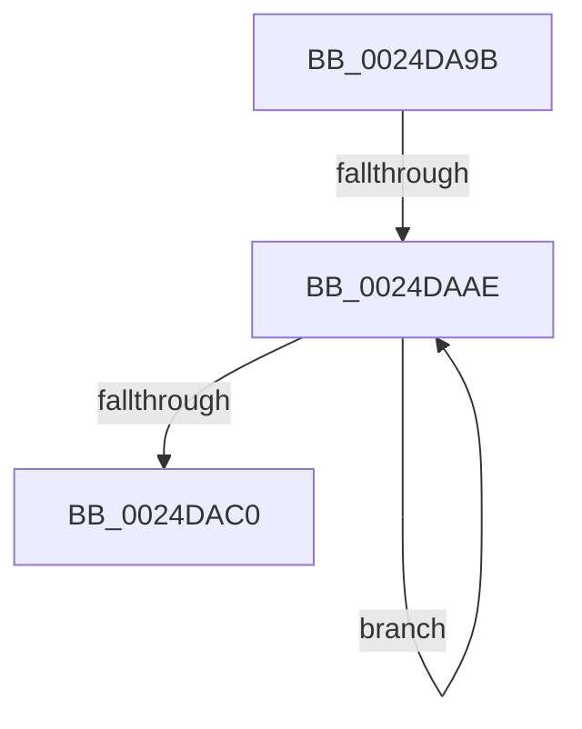

# sub_0024DA9B

- RVA: `0x0024DA9B`–`0x0024DAC5` (길이 `42` bytes)
- VA: `0x000000014024DA9B`
- 실행 섹션: `.text`
- PDB 이름 있음: `아니요`; PDB Function 태그: `아니요`
- unwind 정보 RVA: `0x00062ED4`
- 디코드: `11`개 명령, `42/42` bytes 표시
- 미해석 바이트: `0` (있으면 어셈블리에 `.byte`로 보존)

> 이 문서는 커널 이미지의 기계어와 PDB 기호를 분석해 생성했습니다. 4번과 5번은 함수 원형과 자료형을 바이너리 사용 방식에서 추정한 C 해석이며 원본 소스 복구 결과는 아닙니다.

## 1. Dependencies

- 직접 호출 지점: **0**; 고유 호출 대상: **0**
- 직접 호출자로 확인된 함수: **0**
- RIP 상대 이미지 참조: **0**

### Outgoing calls
- 직접 디코드된 call 명령이 없습니다.

### Direct callers
- 이 함수 시작 RVA로 연결되는 직접 call은 확인되지 않았습니다. 간접 호출은 완전히 역산할 수 없습니다.

### Static image references
- 디코드된 RIP-relative 메모리 참조가 없습니다.

## 2. Other-region calls and transfers

- 다른 실행 섹션으로 향하는 call: **0**
- call이 아닌 외부 분기/꼬리 이동: **2**
  - `0x0024DAA8` → [sub_0024D9A3 + 0x16](Unknown_function_0024D9A3.md) (`tail-transfer`)
  - `0x0024DAC0` → [sub_0024D9A3 + 0x16](Unknown_function_0024D9A3.md) (`tail-transfer`)

## 3. Assembly (complete function range)

```asm
0024DA9B  48 8D 9F 80 00 00 00            lea rbx, [rdi + 0x80]
0024DAA2  8B 43 2C                        mov eax, dword ptr [rbx + 0x2c]
0024DAA5  48 3B C8                        cmp rcx, rax
0024DAA8  0F 82 0B FF FF FF               jb 0x14024d9b9
0024DAAE  48 2B C8                        sub rcx, rax
0024DAB1  49 89 0E                        mov qword ptr [r14], rcx
0024DAB4  48 8B 5B 10                     mov rbx, qword ptr [rbx + 0x10]
0024DAB8  8B 43 2C                        mov eax, dword ptr [rbx + 0x2c]
0024DABB  48 3B C8                        cmp rcx, rax
0024DABE  73 EE                           jae 0x14024daae
0024DAC0  E9 F4 FE FF FF                  jmp 0x14024d9b9
```

## 4. C-style interpretation (structured pseudocode)

```c
__int64 __fastcall sub_0024DA9B(__int64 a1)
{
loc_0024DAAE:
    a1 = (a1) - ((unsigned int)(*(unsigned int *)(v_rdi + 128 + 44)));
    *(unsigned __int64 *)(v_r14) = a1;
    if (a1 >= ((unsigned int)(*(unsigned int *)(*(unsigned __int64 *)(v_rdi + 128 + 16) + 44)))) goto loc_0024DAAE;
}
```

## 5. (Beta) C Style

```c
int64_t sub_0024DA9B(int64_t Arg1)
{
loc_0024DAAE:
    Arg1 = (Arg1) - ((uint32_t)(*(uint32_t *)(local_rdi + 0x80 + 0x2C)));
    *(uint64_t *)(local_r14) = Arg1;
    if (Arg1 >= ((uint32_t)(*(uint32_t *)(*(uint64_t *)(local_rdi + 0x80 + 0x10) + 0x2C)))) goto loc_0024DAAE;
}
```

## 6. Execution-region graph

[열기: 2D/3D 그래프와 함수 탐색 컨트롤 패널](../../../control-panel.html?section=text&rva=0x0024DA9B&view=graph)

- 2D 그래프는 위에서 아래로 흐르고, 3D 그래프는 빈 공간을 드래그해 회전합니다. Shift+드래그는 이동, 휠은 확대·축소, 함수 노드 선택은 대상 보고서 이동입니다.

### Static fallback


