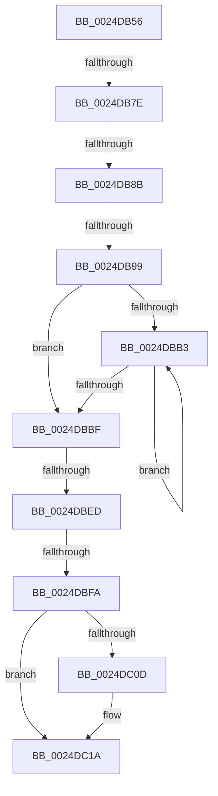

# sub_0024DB56

- RVA: `0x0024DB56`–`0x0024DC35` (길이 `223` bytes)
- VA: `0x000000014024DB56`
- 실행 섹션: `.text`
- PDB 이름 있음: `아니요`; PDB Function 태그: `아니요`
- unwind 정보 RVA: `0x00062F24`
- 디코드: `53`개 명령, `223/223` bytes 표시
- 미해석 바이트: `0` (있으면 어셈블리에 `.byte`로 보존)

> 이 문서는 커널 이미지의 기계어와 PDB 기호를 분석해 생성했습니다. 4번과 5번은 함수 원형과 자료형을 바이너리 사용 방식에서 추정한 C 해석이며 원본 소스 복구 결과는 아닙니다.

## 1. Dependencies

- 직접 호출 지점: **2**; 고유 호출 대상: **2**
- 직접 호출자로 확인된 함수: **0**
- RIP 상대 이미지 참조: **3**

### Outgoing calls
- `0x0024DBA0` → [ExpAcquireSpinLockSharedAtDpcLevelInstrumented](../27/ExpAcquireSpinLockSharedAtDpcLevelInstrumented_function_0027CD20.md) (function, `0x0027CD20`)
- `0x0024DC15` → [KiLowerIrqlProcessIrqlFlags](../4F/KiLowerIrqlProcessIrqlFlags_function_004F5698.md) (function, `0x004F5698`)

### Direct callers
- 이 함수 시작 RVA로 연결되는 직접 call은 확인되지 않았습니다. 간접 호출은 완전히 역산할 수 없습니다.

### Static image references
- `0x0024DB71` → RVA `0x00FC6D20` (`ALMOSTRO`; read)
- `0x0024DB7E` → RVA `0x00FC6B06` (`ALMOSTRO`; read)
- `0x0024DB8B` → RVA `0x00F0DE58` (`.data`; read)

## 2. Other-region calls and transfers

- 다른 실행 섹션으로 향하는 call: **0**
- call이 아닌 외부 분기/꼬리 이동: **5**
  - `0x0024DB78` → [sub_0024DC36 + 0x2B](Unknown_function_0024DC36.md) (`tail-transfer`)
  - `0x0024DB85` → [sub_0024DC36](Unknown_function_0024DC36.md) (`tail-transfer`)
  - `0x0024DB93` → [sub_0024DC36](Unknown_function_0024DC36.md) (`tail-transfer`)
  - `0x0024DBE7` → [sub_0024DC36 + 0x3C](Unknown_function_0024DC36.md) (`tail-transfer`)
  - `0x0024DBF4` → [sub_0024DCB7](Unknown_function_0024DCB7.md) (`tail-transfer`)

## 3. Assembly (complete function range)

```asm
0024DB56  48 89 74 24 30                  mov qword ptr [rsp + 0x30], rsi
0024DB5B  48 89 7C 24 38                  mov qword ptr [rsp + 0x38], rdi
0024DB60  48 8D 79 48                     lea rdi, [rcx + 0x48]
0024DB64  44 0F 20 C6                     mov rsi, cr8
0024DB68  B8 02 00 00 00                  mov eax, 2
0024DB6D  44 0F 22 C0                     mov cr8, rax
0024DB71  83 3D A8 91 D7 00 00            cmp dword ptr [rip + 0xd791a8], 0
0024DB78  0F 85 E3 00 00 00               jne 0x14024dc61
0024DB7E  F6 05 81 8F D7 00 21            test byte ptr [rip + 0xd78f81], 0x21
0024DB85  0F 84 AB 00 00 00               je 0x14024dc36
0024DB8B  8B 05 C7 02 CC 00               mov eax, dword ptr [rip + 0xcc02c7]
0024DB91  85 C0                           test eax, eax
0024DB93  0F 85 9D 00 00 00               jne 0x14024dc36
0024DB99  40 0F B6 D6                     movzx edx, sil
0024DB9D  48 8B CF                        mov rcx, rdi
0024DBA0  E8 7B F1 02 00                  call 0x14027cd20
0024DBA5  48 8B 83 18 01 00 00            mov rax, qword ptr [rbx + 0x118]
0024DBAC  33 D2                           xor edx, edx
0024DBAE  48 85 C0                        test rax, rax
0024DBB1  74 0C                           je 0x14024dbbf
0024DBB3  48 8B D0                        mov rdx, rax
0024DBB6  48 8B 40 08                     mov rax, qword ptr [rax + 8]
0024DBBA  48 85 C0                        test rax, rax
0024DBBD  75 F4                           jne 0x14024dbb3
0024DBBF  8B 5A E8                        mov ebx, dword ptr [rdx - 0x18]
0024DBC2  8B 42 EC                        mov eax, dword ptr [rdx - 0x14]
0024DBC5  81 E3 C0 FF 00 00               and ebx, 0xffc0
0024DBCB  48 C1 E3 1A                     shl rbx, 0x1a
0024DBCF  48 0B D8                        or rbx, rax
0024DBD2  8B 42 FC                        mov eax, dword ptr [rdx - 4]
0024DBD5  25 FF FF FF 3F                  and eax, 0x3fffffff
0024DBDA  48 2B D8                        sub rbx, rax
0024DBDD  8B 42 F4                        mov eax, dword ptr [rdx - 0xc]
0024DBE0  48 03 D8                        add rbx, rax
0024DBE3  40 80 FE 11                     cmp sil, 0x11
0024DBE7  0F 84 85 00 00 00               je 0x14024dc72
0024DBED  F6 05 12 8F D7 00 01            test byte ptr [rip + 0xd78f12], 1
0024DBF4  0F 85 BD 00 00 00               jne 0x14024dcb7
0024DBFA  F0 81 27 FF FF FF BF            lock and dword ptr [rdi], 0xbfffffff
0024DC01  F0 FF 0F                        lock dec dword ptr [rdi]
0024DC04  83 3D 15 91 D7 00 00            cmp dword ptr [rip + 0xd79115], 0
0024DC0B  74 0D                           je 0x14024dc1a
0024DC0D  44 0F 20 C1                     mov rcx, cr8
0024DC11  40 0F B6 D6                     movzx edx, sil
0024DC15  E8 7E 7A 2A 00                  call 0x1404f5698
0024DC1A  40 0F B6 CE                     movzx ecx, sil
0024DC1E  44 0F 22 C1                     mov cr8, rcx
0024DC22  48 8B 7C 24 38                  mov rdi, qword ptr [rsp + 0x38]
0024DC27  48 8B C3                        mov rax, rbx
0024DC2A  48 8B 74 24 30                  mov rsi, qword ptr [rsp + 0x30]
0024DC2F  48 83 C4 20                     add rsp, 0x20
0024DC33  5B                              pop rbx
0024DC34  C3                              ret
```

## 4. C-style interpretation (structured pseudocode)

```c
__int64 __fastcall sub_0024DB56(__int64 a1, __int64 a2, __int64 a3, __int64 a4, __int64 a5, __int64 a6, __int64 a7)
{
    __int64 result;
    __int64 v_rbx;
    __int64 v_rsp;
    unsigned __int64 v_stack_p30;
    unsigned __int64 v_stack_p38;

    v_stack_p30 = v_rsi;
    v_stack_p38 = v_rdi;
    result = ExpAcquireSpinLockSharedAtDpcLevelInstrumented(a1 + 72, (unsigned __int8)(v_cr8), a3, a4);
    a2 = 0;
    if (*(unsigned __int64 *)(v_rbx + 280) == 0) goto loc_0024DBBF;
loc_0024DBB3:
    if (*(unsigned __int64 *)(*(unsigned __int64 *)(v_rbx + 280) + 8) != 0) goto loc_0024DBB3;
loc_0024DBBF:
    v_rbx = (unsigned int)(((unsigned int)(*(unsigned int *)(*(unsigned __int64 *)(v_rbx + 280) - 24))) & (0xFFC0ULL));
    v_rbx = (v_rbx) << (26);
    v_rbx = (v_rbx) | ((unsigned int)(*(unsigned int *)(*(unsigned __int64 *)(v_rbx + 280) - 20)));
    result = (unsigned int)(((unsigned int)(*(unsigned int *)(*(unsigned __int64 *)(v_rbx + 280) - 4))) & (0x3FFFFFFFULL));
    v_rbx = (v_rbx) - (result);
    v_rbx = (v_rbx) + ((unsigned int)(*(unsigned int *)(*(unsigned __int64 *)(v_rbx + 280) - 12)));
    result = (unsigned int)(*(unsigned int *)(*(unsigned __int64 *)(v_rbx + 280) - 12));
    if ((*(unsigned int *)(v_rip + 14127381)) != 0) {
        a1 = 2;
        a2 = (unsigned __int8)(v_cr8);
        result = KiLowerIrqlProcessIrqlFlags(a1, a2, a3, a4);
    }
    v_rsp = (v_rsp) + (32);
    return v_rbx;
}
```

## 5. (Beta) C Style

```c
int64_t sub_0024DB56(void *Arg1, int64_t Arg2, int64_t Arg3, int64_t Arg4, uint64_t Arg5, int64_t Arg6, int64_t Arg7)
{
    uint8_t *arg1 = (uint8_t *)Arg1;

    int64_t result;
    int64_t local_rbx;
    int64_t local_rsp;
    uint64_t v_stack_p30;
    uint64_t v_stack_p38;

    v_stack_p30 = local_rsi;
    v_stack_p38 = local_rdi;
    result = ExpAcquireSpinLockSharedAtDpcLevelInstrumented(Arg1 + 72, (uint8_t)(v_cr8), Arg3, Arg4);
    Arg2 = 0;
    if (*(uint64_t *)(local_rbx + 0x118) == 0) goto loc_0024DBBF;
loc_0024DBB3:
    if (*(uint64_t *)(*(uint64_t *)(local_rbx + 0x118) + 0x8) != 0) goto loc_0024DBB3;
loc_0024DBBF:
    local_rbx = (uint32_t)(((uint32_t)(*(uint32_t *)(*(uint64_t *)(local_rbx + 0x118) - 0x18))) & (0xFFC0ULL));
    local_rbx = (local_rbx) << (26);
    local_rbx = (local_rbx) | ((uint32_t)(*(uint32_t *)(*(uint64_t *)(local_rbx + 0x118) - 0x14)));
    result = (uint32_t)(((uint32_t)(*(uint32_t *)(*(uint64_t *)(local_rbx + 0x118) - 0x4))) & (0x3FFFFFFFULL));
    local_rbx = (local_rbx) - (result);
    local_rbx = (local_rbx) + ((uint32_t)(*(uint32_t *)(*(uint64_t *)(local_rbx + 0x118) - 0xC)));
    result = (uint32_t)(*(uint32_t *)(*(uint64_t *)(local_rbx + 0x118) - 0xC));
    if ((*(uint32_t *)(v_rip + 0xD79115)) != 0) {
        Arg1 = 2;
        Arg2 = (uint8_t)(v_cr8);
        result = KiLowerIrqlProcessIrqlFlags(Arg1, Arg2, Arg3, Arg4);
    }
    local_rsp = (local_rsp) + (32);
    return local_rbx;
}
```

### 관측된 메모리 오프셋

구조체 형식이 확인되지 않은 접근은 인자 기준의 오프셋으로만 기록했습니다.

| 기준 인자 | 오프셋 표현 | 폭 (bit) | 접근 |
|---|---:|---:|---|
| `Arg1` | `+ 0x0` | `32` | `R/W` |
| `Arg1` | `+ 0x48` | `64` | `R` |

## 6. Execution-region graph

[열기: 2D/3D 그래프와 함수 탐색 컨트롤 패널](../../../control-panel.html?section=text&rva=0x0024DB56&view=graph)

- 2D 그래프는 위에서 아래로 흐르고, 3D 그래프는 빈 공간을 드래그해 회전합니다. Shift+드래그는 이동, 휠은 확대·축소, 함수 노드 선택은 대상 보고서 이동입니다.

### Static fallback


