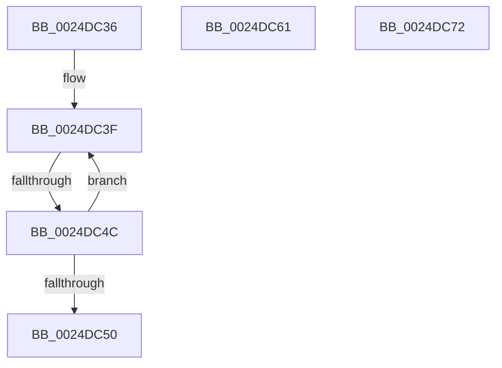

# sub_0024DC36

- RVA: `0x0024DC36`–`0x0024DC8D` (길이 `87` bytes)
- VA: `0x000000014024DC36`
- 실행 섹션: `.text`
- PDB 이름 있음: `아니요`; PDB Function 태그: `아니요`
- unwind 정보 RVA: `0x00062F50`
- 디코드: `24`개 명령, `87/87` bytes 표시
- 미해석 바이트: `0` (있으면 어셈블리에 `.byte`로 보존)

> 이 문서는 커널 이미지의 기계어와 PDB 기호를 분석해 생성했습니다. 4번과 5번은 함수 원형과 자료형을 바이너리 사용 방식에서 추정한 C 해석이며 원본 소스 복구 결과는 아닙니다.

## 1. Dependencies

- 직접 호출 지점: **3**; 고유 호출 대상: **3**
- 직접 호출자로 확인된 함수: **0**
- RIP 상대 이미지 참조: **0**

### Outgoing calls
- `0x0024DC57` → [ExpWaitForSpinLockSharedAndAcquire](../36/ExpWaitForSpinLockSharedAndAcquire_function_00362380.md) (function, `0x00362380`)
- `0x0024DC68` → [KiRaiseIrqlProcessIrqlFlags](../4F/KiRaiseIrqlProcessIrqlFlags_function_004F56FC.md) (function, `0x004F56FC`)
- `0x0024DC75` → [ExReleaseSpinLockSharedFromDpcLevel](ExReleaseSpinLockSharedFromDpcLevel_function_0024A590.md) (function, `0x0024A590`)

### Direct callers
- 이 함수 시작 RVA로 연결되는 직접 call은 확인되지 않았습니다. 간접 호출은 완전히 역산할 수 없습니다.

### Static image references
- 디코드된 RIP-relative 메모리 참조가 없습니다.

## 2. Other-region calls and transfers

- 다른 실행 섹션으로 향하는 call: **0**
- call이 아닌 외부 분기/꼬리 이동: **3**
  - `0x0024DC46` → [sub_0024DB56 + 0x4F](Unknown_function_0024DB56.md) (`tail-transfer`)
  - `0x0024DC5C` → [sub_0024DB56 + 0x4F](Unknown_function_0024DB56.md) (`tail-transfer`)
  - `0x0024DC6D` → [sub_0024DB56 + 0x28](Unknown_function_0024DB56.md) (`tail-transfer`)

## 3. Assembly (complete function range)

```asm
0024DC36  0F 0D 0F                        prefetchw byte ptr [rdi]
0024DC39  8B 07                           mov eax, dword ptr [rdi]
0024DC3B  0F BA F0 1F                     btr eax, 0x1f
0024DC3F  8D 48 01                        lea ecx, [rax + 1]
0024DC42  F0 0F B1 0F                     lock cmpxchg dword ptr [rdi], ecx
0024DC46  0F 84 59 FF FF FF               je 0x14024dba5
0024DC4C  85 C0                           test eax, eax
0024DC4E  79 EF                           jns 0x14024dc3f
0024DC50  40 0F B6 D6                     movzx edx, sil
0024DC54  48 8B CF                        mov rcx, rdi
0024DC57  E8 24 47 11 00                  call 0x140362380
0024DC5C  E9 44 FF FF FF                  jmp 0x14024dba5
0024DC61  0F B6 D0                        movzx edx, al
0024DC64  40 0F B6 CE                     movzx ecx, sil
0024DC68  E8 8F 7A 2A 00                  call 0x1404f56fc
0024DC6D  E9 0C FF FF FF                  jmp 0x14024db7e
0024DC72  48 8B CF                        mov rcx, rdi
0024DC75  E8 16 C9 FF FF                  call 0x14024a590
0024DC7A  48 8B 7C 24 38                  mov rdi, qword ptr [rsp + 0x38]
0024DC7F  48 8B C3                        mov rax, rbx
0024DC82  48 8B 74 24 30                  mov rsi, qword ptr [rsp + 0x30]
0024DC87  48 83 C4 20                     add rsp, 0x20
0024DC8B  5B                              pop rbx
0024DC8C  C3                              ret
```

## 4. C-style interpretation (structured pseudocode)

```c
__int64 __fastcall sub_0024DC36(void)
{
    __int64 result;
    unsigned __int64 v_stack_p30;
    unsigned __int64 v_stack_p38;

loc_0024DC3F:
    if (!sign_flag) goto loc_0024DC3F;
    result = ExpWaitForSpinLockSharedAndAcquire(v_rdi, (unsigned __int8)(v_rsi), a3, a4);
}
```

## 5. (Beta) C Style

```c
void sub_0024DC36(void)
{
    int64_t result;
    uint64_t v_stack_p30;
    uint64_t v_stack_p38;

loc_0024DC3F:
    if (!sign_flag) goto loc_0024DC3F;
    result = ExpWaitForSpinLockSharedAndAcquire(local_rdi, (uint8_t)(local_rsi), a3, a4);
}
```

## 6. Execution-region graph

[열기: 2D/3D 그래프와 함수 탐색 컨트롤 패널](../../../control-panel.html?section=text&rva=0x0024DC36&view=graph)

- 2D 그래프는 위에서 아래로 흐르고, 3D 그래프는 빈 공간을 드래그해 회전합니다. Shift+드래그는 이동, 휠은 확대·축소, 함수 노드 선택은 대상 보고서 이동입니다.

### Static fallback


