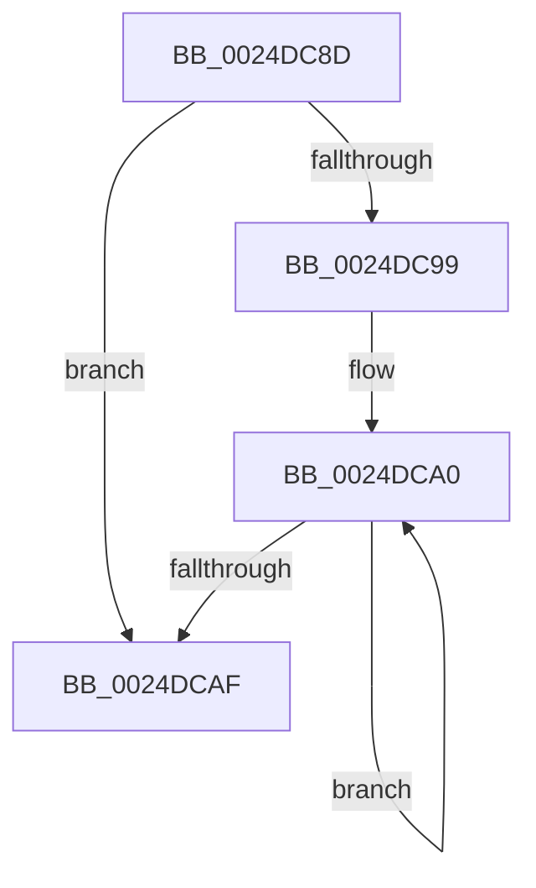

# sub_0024DC8D

- RVA: `0x0024DC8D`–`0x0024DCB7` (길이 `42` bytes)
- VA: `0x000000014024DC8D`
- 실행 섹션: `.text`
- PDB 이름 있음: `아니요`; PDB Function 태그: `아니요`
- unwind 정보 RVA: `0x00062F6C`
- 디코드: `12`개 명령, `42/42` bytes 표시
- 미해석 바이트: `0` (있으면 어셈블리에 `.byte`로 보존)

> 이 문서는 커널 이미지의 기계어와 PDB 기호를 분석해 생성했습니다. 4번과 5번은 함수 원형과 자료형을 바이너리 사용 방식에서 추정한 C 해석이며 원본 소스 복구 결과는 아닙니다.

## 1. Dependencies

- 직접 호출 지점: **0**; 고유 호출 대상: **0**
- 직접 호출자로 확인된 함수: **0**
- RIP 상대 이미지 참조: **0**

### Outgoing calls
- 직접 디코드된 call 명령이 없습니다.

### Direct callers
- 이 함수 시작 RVA로 연결되는 직접 call은 확인되지 않았습니다. 간접 호출은 완전히 역산할 수 없습니다.

### Static image references
- 디코드된 RIP-relative 메모리 참조가 없습니다.

## 2. Other-region calls and transfers

- 다른 실행 섹션으로 향하는 call: **0**
- call이 아닌 외부 분기/꼬리 이동: **1**
  - `0x0024DCB2` → [MiGetControlAreaPtes + 0x39](MiGetControlAreaPtes_function_0024DB10.md) (`tail-transfer`)

## 3. Assembly (complete function range)

```asm
0024DC8D  CC                              int3
0024DC8E  33 D2                           xor edx, edx
0024DC90  48 81 C3 80 00 00 00            add rbx, 0x80
0024DC97  74 16                           je 0x14024dcaf
0024DC99  0F 1F 80 00 00 00 00            nop dword ptr [rax]
0024DCA0  8B 4B 2C                        mov ecx, dword ptr [rbx + 0x2c]
0024DCA3  48 8B 5B 10                     mov rbx, qword ptr [rbx + 0x10]
0024DCA7  48 03 D1                        add rdx, rcx
0024DCAA  48 85 DB                        test rbx, rbx
0024DCAD  75 F1                           jne 0x14024dca0
0024DCAF  48 8B C2                        mov rax, rdx
0024DCB2  E9 92 FE FF FF                  jmp 0x14024db49
```

## 4. C-style interpretation (structured pseudocode)

```c
__int64 __fastcall sub_0024DC8D(__int64 a1, int a2)
{
    __int64 v_rbx;

    a2 = 0;
    v_rbx = (v_rbx) + (128);
    if (condition_is_equal) goto loc_0024DCAF;
loc_0024DCA0:
    a2 = (a2) + ((unsigned int)(*(unsigned int *)(v_rbx + 44)));
    if (*(unsigned __int64 *)(v_rbx + 16) != 0) goto loc_0024DCA0;
loc_0024DCAF:
}
```

## 5. (Beta) C Style

```c
int64_t sub_0024DC8D(int64_t Arg1, int32_t Arg2)
{
    int64_t local_rbx;

    Arg2 = 0;
    local_rbx = (local_rbx) + (128);
    if (condition_is_equal) goto loc_0024DCAF;
loc_0024DCA0:
    Arg2 = (Arg2) + ((uint32_t)(*(uint32_t *)(local_rbx + 0x2C)));
    if (*(uint64_t *)(local_rbx + 0x10) != 0) goto loc_0024DCA0;
loc_0024DCAF:
}
```

## 6. Execution-region graph

[열기: 2D/3D 그래프와 함수 탐색 컨트롤 패널](../../../control-panel.html?section=text&rva=0x0024DC8D&view=graph)

- 2D 그래프는 위에서 아래로 흐르고, 3D 그래프는 빈 공간을 드래그해 회전합니다. Shift+드래그는 이동, 휠은 확대·축소, 함수 노드 선택은 대상 보고서 이동입니다.

### Static fallback


