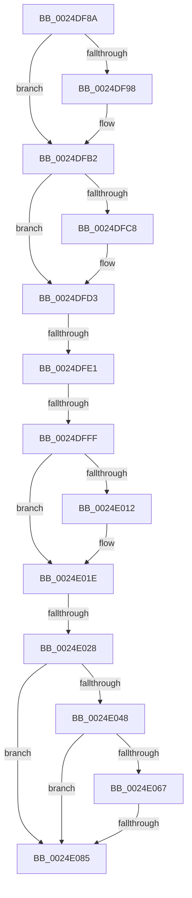

# sub_0024DF8A

- RVA: `0x0024DF8A`–`0x0024E092` (길이 `264` bytes)
- VA: `0x000000014024DF8A`
- 실행 섹션: `.text`
- PDB 이름 있음: `아니요`; PDB Function 태그: `아니요`
- unwind 정보 RVA: `0x00062FE4`
- 디코드: `63`개 명령, `264/264` bytes 표시
- 미해석 바이트: `0` (있으면 어셈블리에 `.byte`로 보존)

> 이 문서는 커널 이미지의 기계어와 PDB 기호를 분석해 생성했습니다. 4번과 5번은 함수 원형과 자료형을 바이너리 사용 방식에서 추정한 C 해석이며 원본 소스 복구 결과는 아닙니다.

## 1. Dependencies

- 직접 호출 지점: **2**; 고유 호출 대상: **2**
- 직접 호출자로 확인된 함수: **0**
- RIP 상대 이미지 참조: **5**

### Outgoing calls
- `0x0024DFAC` → [KeBugCheckEx](../4F/KeBugCheckEx_function_004FD660.md) (function, `0x004FD660`)
- `0x0024DFCE` → [IopFreeIrpExtension](IopFreeIrpExtension_function_0024EDB0.md) (function, `0x0024EDB0`)

### Direct callers
- 이 함수 시작 RVA로 연결되는 직접 call은 확인되지 않았습니다. 간접 호출은 완전히 역산할 수 없습니다.

### Static image references
- `0x0024DFE5` → RVA `0x00FC6A80` (`ALMOSTRO`; read)
- `0x0024DFF0` → RVA `0x00000000` (`image boundary/outside`; read)
- `0x0024E028` → RVA `0x00F8D210` (`.data`; read)
- `0x0024E034` → RVA `0x00F8D40C` (`.data`; read)
- `0x0024E03C` → RVA `0x00F8D408` (`.data`; read)

## 2. Other-region calls and transfers

- 다른 실행 섹션으로 향하는 call: **0**
- call이 아닌 외부 분기/꼬리 이동: **4**
  - `0x0024DFDB` → [sub_0024E626](Unknown_function_0024E626.md) (`tail-transfer`)
  - `0x0024DFF9` → [sub_0024E642](Unknown_function_0024E642.md) (`tail-transfer`)
  - `0x0024E022` → [sub_0024E371 + 0xF](Unknown_function_0024E371.md) (`tail-transfer`)
  - `0x0024E07F` → [sub_0024E371](Unknown_function_0024E371.md) (`tail-transfer`)

## 3. Assembly (complete function range)

```asm
0024DF8A  4C 89 74 24 58                  mov qword ptr [rsp + 0x58], r14
0024DF8F  45 33 F6                        xor r14d, r14d
0024DF92  66 83 39 06                     cmp word ptr [rcx], 6
0024DF96  74 1A                           je 0x14024dfb2
0024DF98  48 8B D1                        mov rdx, rcx
0024DF9B  4C 89 74 24 20                  mov qword ptr [rsp + 0x20], r14
0024DFA0  8D 48 44                        lea ecx, [rax + 0x44]
0024DFA3  45 33 C9                        xor r9d, r9d
0024DFA6  41 B8 EE 27 00 00               mov r8d, 0x27ee
0024DFAC  E8 AF F6 2A 00                  call 0x1404fd660
0024DFB1  CC                              int3
0024DFB2  F6 41 47 40                     test byte ptr [rcx + 0x47], 0x40
0024DFB6  4C 89 7C 24 50                  mov qword ptr [rsp + 0x50], r15
0024DFBB  49 C7 C7 FF FF FF FF            mov r15, 0xffffffffffffffff
0024DFC2  66 44 89 31                     mov word ptr [rcx], r14w
0024DFC6  74 0B                           je 0x14024dfd3
0024DFC8  41 B0 01                        mov r8b, 1
0024DFCB  41 8B D7                        mov edx, r15d
0024DFCE  E8 DD 0D 00 00                  call 0x14024edb0
0024DFD3  0F B6 43 47                     movzx eax, byte ptr [rbx + 0x47]
0024DFD7  24 21                           and al, 0x21
0024DFD9  3C 21                           cmp al, 0x21
0024DFDB  0F 84 45 06 00 00               je 0x14024e626
0024DFE1  0F B7 4B 04                     movzx ecx, word ptr [rbx + 4]
0024DFE5  8B 05 95 8A D7 00               mov eax, dword ptr [rip + 0xd78a95]
0024DFEB  48 89 7C 24 70                  mov qword ptr [rsp + 0x70], rdi
0024DFF0  48 8D 3D 09 20 DB FF            lea rdi, [rip - 0x24dff7]
0024DFF7  3B C8                           cmp ecx, eax
0024DFF9  0F 83 43 06 00 00               jae 0x14024e642
0024DFFF  0F AE E8                        lfence
0024E002  48 8B 94 CF 40 8C FC 00         mov rdx, qword ptr [rdi + rcx*8 + 0xfc8c40]
0024E00A  0F B6 43 47                     movzx eax, byte ptr [rbx + 0x47]
0024E00E  A8 08                           test al, 8
0024E010  74 0C                           je 0x14024e01e
0024E012  34 08                           xor al, 8
0024E014  88 43 47                        mov byte ptr [rbx + 0x47], al
0024E017  F0 FF 82 9C 2D 00 00            lock inc dword ptr [rdx + 0x2d9c]
0024E01E  F6 43 47 04                     test byte ptr [rbx + 0x47], 4
0024E022  0F 84 58 03 00 00               je 0x14024e380
0024E028  8B 05 E2 F1 D3 00               mov eax, dword ptr [rip + 0xd3f1e2]
0024E02E  41 BB D0 00 00 00               mov r11d, 0xd0
0024E034  44 0F BE 0D D0 F3 D3 00         movsx r9d, byte ptr [rip + 0xd3f3d0]
0024E03C  44 0F BE 15 C4 F3 D3 00         movsx r10d, byte ptr [rip + 0xd3f3c4]
0024E044  A8 03                           test al, 3
0024E046  74 3D                           je 0x14024e085
0024E048  44 0F B7 43 02                  movzx r8d, word ptr [rbx + 2]
0024E04D  41 0F B7 C1                     movzx eax, r9w
0024E051  66 C1 E0 03                     shl ax, 3
0024E055  42 8D 0C 08                     lea ecx, [rax + r9]
0024E059  66 C1 E1 03                     shl cx, 3
0024E05D  66 41 03 CB                     add cx, r11w
0024E061  66 44 3B C1                     cmp r8w, cx
0024E065  74 1E                           je 0x14024e085
0024E067  41 0F B7 C2                     movzx eax, r10w
0024E06B  66 C1 E0 03                     shl ax, 3
0024E06F  42 8D 0C 10                     lea ecx, [rax + r10]
0024E073  66 C1 E1 03                     shl cx, 3
0024E077  66 41 03 CB                     add cx, r11w
0024E07B  66 44 3B C1                     cmp r8w, cx
0024E07F  0F 85 EC 02 00 00               jne 0x14024e371
0024E085  44 0F B7 43 02                  movzx r8d, word ptr [rbx + 2]
0024E08A  41 0F B7 C1                     movzx eax, r9w
0024E08E  66 C1 E0 03                     shl ax, 3
```

## 4. C-style interpretation (structured pseudocode)

```c
__int64 __fastcall sub_0024DF8A(__int64 a1, __int64 a2, __int64 a3, int a4)
{
    __int64 result;
    __int64 v_r14;
    unsigned __int64 v_stack_p20;
    unsigned __int64 v_stack_p50;
    unsigned __int64 v_stack_p58;
    unsigned __int64 v_stack_p70;

    v_stack_p58 = v_r14;
    v_r14 = 0;
    if ((*(unsigned __int16 *)(a1)) != 6) {
        a2 = a1;
        v_stack_p20 = 0;
        a1 = result + 68;
        a4 = 0;
        a3 = 0x27EEULL;
        result = KeBugCheckEx(a1, a2, a3, a4);
    }
    v_stack_p50 = v_r15;
    *(unsigned __int16 *)(a1) = 0;
    if (((*(unsigned __int8 *)(a1 + 71)) & (64)) != 0) {
        a3 = 1;
        a2 = -1;
        result = IopFreeIrpExtension(a1, a2, a3, a4);
    }
    result = (unsigned __int8)((*(unsigned __int8 *)(v_rbx + 71)) & (33));
    v_stack_p70 = v_rdi;
    result = *(unsigned __int8 *)(v_rbx + 71);
    if ((((unsigned __int8)(*(unsigned __int8 *)(v_rbx + 71))) & (8)) != 0) {
        result = (unsigned __int8)((*(unsigned __int8 *)(v_rbx + 71)) ^ (8));
        *(unsigned __int8 *)(v_rbx + 71) = (unsigned __int8)(result);
    }
    if ((((unsigned __int8)((unsigned int)(*(unsigned int *)(v_rip + 13890018)))) & (3)) == 0) goto loc_0024E085;
    result = (unsigned __int16)(((unsigned __int16)((__int8)(*(unsigned __int8 *)(v_rip + 13890512)))) << (3));
    a1 = (unsigned __int16)((result + (__int8)(*(unsigned __int8 *)(v_rip + 13890512)) * 1) << (3));
    a1 = (unsigned __int16)((a1) + (208));
    if (((unsigned __int16)(*(unsigned __int16 *)(v_rbx + 2))) == ((unsigned __int16)(a1))) goto loc_0024E085;
    result = (unsigned __int16)(((unsigned __int16)((__int8)(*(unsigned __int8 *)(v_rip + 13890500)))) << (3));
    a1 = (unsigned __int16)((result + (__int8)(*(unsigned __int8 *)(v_rip + 13890500)) * 1) << (3));
    a1 = (unsigned __int16)((a1) + (208));
loc_0024E085:
    result = (unsigned __int16)(((unsigned __int16)((__int8)(*(unsigned __int8 *)(v_rip + 13890512)))) << (3));
    return result;
}
```

## 5. (Beta) C Style

```c
int64_t sub_0024DF8A(void *Arg1, int64_t Arg2, int64_t Arg3, int32_t Arg4)
{
    uint8_t *arg1 = (uint8_t *)Arg1;

    int64_t result;
    int64_t local_r14;
    uint64_t v_stack_p20;
    uint64_t v_stack_p50;
    uint64_t v_stack_p58;
    uint64_t v_stack_p70;

    v_stack_p58 = local_r14;
    local_r14 = 0;
    if ((*(uint16_t *)(arg1)) != 6) {
        Arg2 = Arg1;
        v_stack_p20 = 0;
        Arg1 = result + 68;
        Arg4 = 0;
        Arg3 = 0x27EEULL;
        result = KeBugCheckEx(Arg1, Arg2, Arg3, Arg4);
    }
    v_stack_p50 = local_r15;
    *(uint16_t *)(arg1) = 0;
    if (((*(uint8_t *)(arg1 + 0x47)) & (64)) != 0) {
        Arg3 = 1;
        Arg2 = -1;
        result = IopFreeIrpExtension(Arg1, Arg2, Arg3, Arg4);
    }
    result = (uint8_t)((*(uint8_t *)(local_rbx + 0x47)) & (33));
    v_stack_p70 = local_rdi;
    result = *(uint8_t *)(local_rbx + 0x47);
    if ((((uint8_t)(*(uint8_t *)(local_rbx + 0x47))) & (8)) != 0) {
        result = (uint8_t)((*(uint8_t *)(local_rbx + 0x47)) ^ (8));
        *(uint8_t *)(local_rbx + 0x47) = (uint8_t)(result);
    }
    if ((((uint8_t)((uint32_t)(*(uint32_t *)(v_rip + 0xD3F1E2)))) & (3)) == 0) goto loc_0024E085;
    result = (uint16_t)(((uint16_t)((int8_t)(*(uint8_t *)(v_rip + 0xD3F3D0)))) << (3));
    Arg1 = (uint16_t)((result + (int8_t)(*(uint8_t *)(v_rip + 0xD3F3D0)) * 1) << (3));
    Arg1 = (uint16_t)((Arg1) + (208));
    if (((uint16_t)(*(uint16_t *)(local_rbx + 0x2))) == ((uint16_t)(Arg1))) goto loc_0024E085;
    result = (uint16_t)(((uint16_t)((int8_t)(*(uint8_t *)(v_rip + 0xD3F3C4)))) << (3));
    Arg1 = (uint16_t)((result + (int8_t)(*(uint8_t *)(v_rip + 0xD3F3C4)) * 1) << (3));
    Arg1 = (uint16_t)((Arg1) + (208));
loc_0024E085:
    result = (uint16_t)(((uint16_t)((int8_t)(*(uint8_t *)(v_rip + 0xD3F3D0)))) << (3));
    return result;
}
```

### 관측된 메모리 오프셋

구조체 형식이 확인되지 않은 접근은 인자 기준의 오프셋으로만 기록했습니다.

| 기준 인자 | 오프셋 표현 | 폭 (bit) | 접근 |
|---|---:|---:|---|
| `Arg1` | `+ 0x0` | `16` | `R` |

## 6. Execution-region graph

[열기: 2D/3D 그래프와 함수 탐색 컨트롤 패널](../../../control-panel.html?section=text&rva=0x0024DF8A&view=graph)

- 2D 그래프는 위에서 아래로 흐르고, 3D 그래프는 빈 공간을 드래그해 회전합니다. Shift+드래그는 이동, 휠은 확대·축소, 함수 노드 선택은 대상 보고서 이동입니다.

### Static fallback


