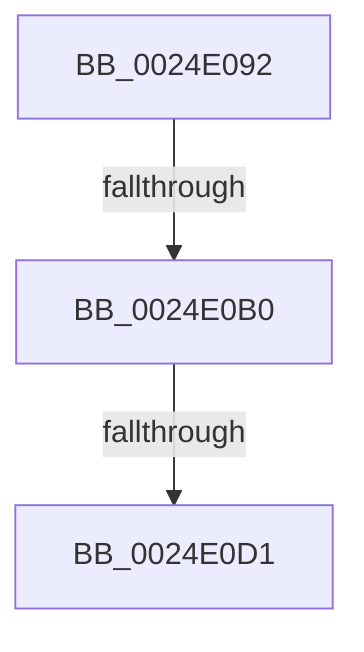

# sub_0024E092

- RVA: `0x0024E092`–`0x0024E0D5` (길이 `67` bytes)
- VA: `0x000000014024E092`
- 실행 섹션: `.text`
- PDB 이름 있음: `아니요`; PDB Function 태그: `아니요`
- unwind 정보 RVA: `0x00063000`
- 디코드: `15`개 명령, `67/67` bytes 표시
- 미해석 바이트: `0` (있으면 어셈블리에 `.byte`로 보존)

> 이 문서는 커널 이미지의 기계어와 PDB 기호를 분석해 생성했습니다. 4번과 5번은 함수 원형과 자료형을 바이너리 사용 방식에서 추정한 C 해석이며 원본 소스 복구 결과는 아닙니다.

## 1. Dependencies

- 직접 호출 지점: **0**; 고유 호출 대상: **0**
- 직접 호출자로 확인된 함수: **0**
- RIP 상대 이미지 참조: **0**

### Outgoing calls
- 직접 디코드된 call 명령이 없습니다.

### Direct callers
- 이 함수 시작 RVA로 연결되는 직접 call은 확인되지 않았습니다. 간접 호출은 완전히 역산할 수 없습니다.

### Static image references
- 디코드된 RIP-relative 메모리 참조가 없습니다.

## 2. Other-region calls and transfers

- 다른 실행 섹션으로 향하는 call: **0**
- call이 아닌 외부 분기/꼬리 이동: **2**
  - `0x0024E0AA` → [sub_0024E316](Unknown_function_0024E316.md) (`tail-transfer`)
  - `0x0024E0CB` → [sub_0024E316 + 0x27](Unknown_function_0024E316.md) (`tail-transfer`)

## 3. Assembly (complete function range)

```asm
0024E092  48 89 AC 24 90 00 00 00         mov qword ptr [rsp + 0x90], rbp
0024E09A  42 8D 0C 08                     lea ecx, [rax + r9]
0024E09E  66 C1 E1 03                     shl cx, 3
0024E0A2  66 41 03 CB                     add cx, r11w
0024E0A6  66 44 3B C1                     cmp r8w, cx
0024E0AA  0F 82 66 02 00 00               jb 0x14024e316
0024E0B0  BD 20 08 00 00                  mov ebp, 0x820
0024E0B5  8D 4D 08                        lea ecx, [rbp + 8]
0024E0B8  4C 89 43 38                     mov qword ptr [rbx + 0x38], r8
0024E0BC  48 8B 2C 2A                     mov rbp, qword ptr [rdx + rbp]
0024E0C0  FF 45 1C                        inc dword ptr [rbp + 0x1c]
0024E0C3  0F B7 45 10                     movzx eax, word ptr [rbp + 0x10]
0024E0C7  66 39 45 00                     cmp word ptr [rbp], ax
0024E0CB  0F 83 6C 02 00 00               jae 0x14024e33d
0024E0D1  0F B6 43 47                     movzx eax, byte ptr [rbx + 0x47]
```

## 4. C-style interpretation (structured pseudocode)

```c
__int64 __fastcall sub_0024E092(__int64 a1, __int64 a2, __int64 a3, __int64 a4)
{
    unsigned __int64 v_stack_p90;

    v_stack_p90 = v_rbp;
    a1 = (unsigned __int16)((result + a4 * 1) << (3));
    a1 = (unsigned __int16)((a1) + ((unsigned __int16)(v_r11)));
    *(unsigned __int64 *)(v_rbx + 56) = a3;
    return *(unsigned __int8 *)(v_rbx + 71);
}
```

## 5. (Beta) C Style

```c
int64_t sub_0024E092(int64_t Arg1, void *Arg2, int64_t Arg3, int64_t Arg4)
{
    uint8_t *arg2 = (uint8_t *)Arg2;

    uint64_t v_stack_p90;

    v_stack_p90 = local_rbp;
    Arg1 = (uint16_t)((result + Arg4 * 1) << (3));
    Arg1 = (uint16_t)((Arg1) + ((uint16_t)(local_r11)));
    *(uint64_t *)(local_rbx + 0x38) = Arg3;
    return *(uint8_t *)(local_rbx + 0x47);
}
```

### 관측된 메모리 오프셋

구조체 형식이 확인되지 않은 접근은 인자 기준의 오프셋으로만 기록했습니다.

| 기준 인자 | 오프셋 표현 | 폭 (bit) | 접근 |
|---|---:|---:|---|
| `Arg2` | `+ 0x0 + rbp*1` | `64` | `R` |

## 6. Execution-region graph

[열기: 2D/3D 그래프와 함수 탐색 컨트롤 패널](../../../control-panel.html?section=text&rva=0x0024E092&view=graph)

- 2D 그래프는 위에서 아래로 흐르고, 3D 그래프는 빈 공간을 드래그해 회전합니다. Shift+드래그는 이동, 휠은 확대·축소, 함수 노드 선택은 대상 보고서 이동입니다.

### Static fallback


