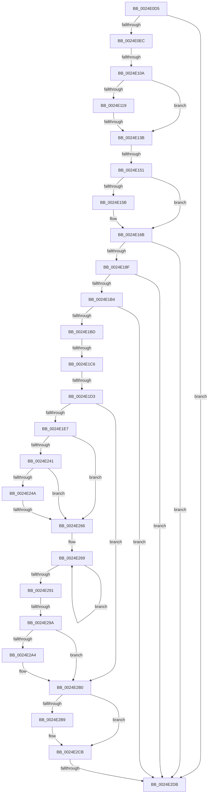

# sub_0024E0D5

- RVA: `0x0024E0D5`–`0x0024E2F5` (길이 `544` bytes)
- VA: `0x000000014024E0D5`
- 실행 섹션: `.text`
- PDB 이름 있음: `아니요`; PDB Function 태그: `아니요`
- unwind 정보 RVA: `0x00063014`
- 디코드: `125`개 명령, `544/544` bytes 표시
- 미해석 바이트: `0` (있으면 어셈블리에 `.byte`로 보존)

> 이 문서는 커널 이미지의 기계어와 PDB 기호를 분석해 생성했습니다. 4번과 5번은 함수 원형과 자료형을 바이너리 사용 방식에서 추정한 C 해석이며 원본 소스 복구 결과는 아닙니다.

## 1. Dependencies

- 직접 호출 지점: **2**; 고유 호출 대상: **2**
- 직접 호출자로 확인된 함수: **0**
- RIP 상대 이미지 참조: **5**

### Outgoing calls
- `0x0024E2C6` → [ObpPushStackInfo](../21/ObpPushStackInfo_function_002109E4.md) (function, `0x002109E4`)
- `0x0024E2E1` → [ExpInterlockedPushEntrySList](../6B/ExpInterlockedPushEntrySList_function_006BA5B0.md) (function, `0x006BA5B0`)

### Direct callers
- 이 함수 시작 RVA로 연결되는 직접 call은 확인되지 않았습니다. 간접 호출은 완전히 역산할 수 없습니다.

### Static image references
- `0x0024E0FC` → RVA `0x00EFED20` (`.data`; read)
- `0x0024E199` → RVA `0x00FC7228` (`ALMOSTRO`; read)
- `0x0024E1DA` → RVA `0x00FC6AB0` (`ALMOSTRO`; read)
- `0x0024E1EE` → RVA `0x00000000` (`image boundary/outside`; read)
- `0x0024E2B0` → RVA `0x00FC5010` (`ALMOSTRO`; read)

## 2. Other-region calls and transfers

- 다른 실행 섹션으로 향하는 call: **0**
- call이 아닌 외부 분기/꼬리 이동: **8**
  - `0x0024E104` → [sub_0024E650](Unknown_function_0024E650.md) (`tail-transfer`)
  - `0x0024E135` → [sub_0024E650 + 0x36](Unknown_function_0024E650.md) (`tail-transfer`)
  - `0x0024E14B` → [sub_0024E38F + 0x61](Unknown_function_0024E38F.md) (`tail-transfer`)
  - `0x0024E1C0` → [sub_0024E5BF + 0x43](Unknown_function_0024E5BF.md) (`tail-transfer`)
  - `0x0024E1CD` → [sub_0024E5BF + 0x43](Unknown_function_0024E5BF.md) (`tail-transfer`)
  - `0x0024E260` → [sub_0024E38F](Unknown_function_0024E38F.md) (`tail-transfer`)
  - `0x0024E294` → [sub_0024E38F + 0x180](Unknown_function_0024E38F.md) (`tail-transfer`)
  - `0x0024E2D5` → [sub_0024E38F + 0x1F8](Unknown_function_0024E38F.md) (`tail-transfer`)

## 3. Assembly (complete function range)

```asm
0024E0D5  48 89 74 24 78                  mov qword ptr [rsp + 0x78], rsi
0024E0DA  4C 89 64 24 68                  mov qword ptr [rsp + 0x68], r12
0024E0DF  4C 89 6C 24 60                  mov qword ptr [rsp + 0x60], r13
0024E0E4  A8 01                           test al, 1
0024E0E6  0F 84 EF 01 00 00               je 0x14024e2db
0024E0EC  34 01                           xor al, 1
0024E0EE  44 89 B4 24 A0 00 00 00         mov dword ptr [rsp + 0xa0], r14d
0024E0F6  88 43 47                        mov byte ptr [rbx + 0x47], al
0024E0F9  4D 8B E6                        mov r12, r14
0024E0FC  8B 05 1E 0C CB 00               mov eax, dword ptr [rip + 0xcb0c1e]
0024E102  85 C0                           test eax, eax
0024E104  0F 85 46 05 00 00               jne 0x14024e650
0024E10A  48 BA 00 00 00 00 00 80 FF FF   movabs rdx, 0xffff800000000000
0024E114  48 3B DA                        cmp rbx, rdx
0024E117  72 22                           jb 0x14024e13b
0024E119  48 8B C3                        mov rax, rbx
0024E11C  48 C1 E8 27                     shr rax, 0x27
0024E120  25 FF 01 00 00                  and eax, 0x1ff
0024E125  2D 00 01 00 00                  sub eax, 0x100
0024E12A  0F B6 8C 38 A8 8A E3 00         movzx ecx, byte ptr [rax + rdi + 0xe38aa8]
0024E132  80 F9 05                        cmp cl, 5
0024E135  0F 84 4B 05 00 00               je 0x14024e686
0024E13B  41 BD 40 00 00 00               mov r13d, 0x40
0024E141  49 8B FE                        mov rdi, r14
0024E144  48 F7 C3 FF 0F 00 00            test rbx, 0xfff
0024E14B  0F 84 9F 02 00 00               je 0x14024e3f0
0024E151  F6 43 F3 04                     test byte ptr [rbx - 0xd], 4
0024E155  48 8D 7B F0                     lea rdi, [rbx - 0x10]
0024E159  74 10                           je 0x14024e16b
0024E15B  0F B7 07                        movzx eax, word ptr [rdi]
0024E15E  0F B6 C8                        movzx ecx, al
0024E161  48 F7 D9                        neg rcx
0024E164  48 C1 E1 04                     shl rcx, 4
0024E168  48 03 F9                        add rdi, rcx
0024E16B  0F B7 47 02                     movzx eax, word ptr [rdi + 2]
0024E16F  44 8B 47 04                     mov r8d, dword ptr [rdi + 4]
0024E173  44 0F B6 E0                     movzx r12d, al
0024E177  49 C1 E4 04                     shl r12, 4
0024E17B  66 C1 E8 08                     shr ax, 8
0024E17F  44 89 84 24 A0 00 00 00         mov dword ptr [rsp + 0xa0], r8d
0024E187  A8 08                           test al, 8
0024E189  0F 84 4C 01 00 00               je 0x14024e2db
0024E18F  48 8B F7                        mov rsi, rdi
0024E192  48 8B C7                        mov rax, rdi
0024E195  48 33 77 08                     xor rsi, qword ptr [rdi + 8]
0024E199  48 33 35 88 90 D7 00            xor rsi, qword ptr [rip + 0xd79088]
0024E1A0  48 33 05 81 90 D7 00            xor rax, qword ptr [rip + 0xd79081]
0024E1A7  48 89 47 08                     mov qword ptr [rdi + 8], rax
0024E1AB  48 85 F6                        test rsi, rsi
0024E1AE  0F 84 27 01 00 00               je 0x14024e2db
0024E1B4  49 3B F7                        cmp rsi, r15
0024E1B7  0F 84 1E 01 00 00               je 0x14024e2db
0024E1BD  48 3B F2                        cmp rsi, rdx
0024E1C0  0F 82 3C 04 00 00               jb 0x14024e602
0024E1C6  0F B6 06                        movzx eax, byte ptr [rsi]
0024E1C9  24 7F                           and al, 0x7f
0024E1CB  3C 03                           cmp al, 3
0024E1CD  0F 85 2F 04 00 00               jne 0x14024e602
0024E1D3  41 81 E5 00 01 00 00            and r13d, 0x100
0024E1DA  48 3B 35 CF 88 D7 00            cmp rsi, qword ptr [rip + 0xd788cf]
0024E1E1  0F 84 C9 00 00 00               je 0x14024e2b0
0024E1E7  48 8B 8E F8 02 00 00            mov rcx, qword ptr [rsi + 0x2f8]
0024E1EE  48 8D 15 0B 1E DB FF            lea rdx, [rip - 0x24e1f5]
0024E1F5  4D 85 ED                        test r13, r13
0024E1F8  48 89 8C 24 A8 00 00 00         mov qword ptr [rsp + 0xa8], rcx
0024E200  41 8B C6                        mov eax, r14d
0024E203  0F 95 C0                        setne al
0024E206  44 8B D8                        mov r11d, eax
0024E209  4C 89 5C 24 30                  mov qword ptr [rsp + 0x30], r11
0024E20E  42 0F B6 84 DA 50 73 FC 00      movzx eax, byte ptr [rdx + r11*8 + 0xfc7350]
0024E217  88 84 24 98 00 00 00            mov byte ptr [rsp + 0x98], al
0024E21E  41 8B C3                        mov eax, r11d
0024E221  48 C1 E0 07                     shl rax, 7
0024E225  48 89 44 24 38                  mov qword ptr [rsp + 0x38], rax
0024E22A  4C 8D 2C 08                     lea r13, [rax + rcx]
0024E22E  41 0F 0D 4D 00                  prefetchw byte ptr [r13]
0024E233  49 8B 7D 00                     mov rdi, qword ptr [r13]
0024E237  49 8B 45 40                     mov rax, qword ptr [r13 + 0x40]
0024E23B  4D 39 75 50                     cmp qword ptr [r13 + 0x50], r14
0024E23F  74 25                           je 0x14024e266
0024E241  49 6B CB 38                     imul rcx, r11, 0x38
0024E245  48 3B C7                        cmp rax, rdi
0024E248  76 1C                           jbe 0x14024e266
0024E24A  4C 8D 8A 48 66 F0 00            lea r9, [rdx + 0xf06648]
0024E251  4C 03 C9                        add r9, rcx
0024E254  48 8B C8                        mov rcx, rax
0024E257  48 2B CF                        sub rcx, rdi
0024E25A  49 8B 11                        mov rdx, qword ptr [r9]
0024E25D  48 3B CA                        cmp rcx, rdx
0024E260  0F 87 29 01 00 00               ja 0x14024e38f
0024E266  4D 8B D4                        mov r10, r12
0024E269  4C 3B E7                        cmp r12, rdi
0024E26C  4C 8B CF                        mov r9, rdi
0024E26F  48 8B CF                        mov rcx, rdi
0024E272  49 8B D6                        mov rdx, r14
0024E275  4D 0F 42 CC                     cmovb r9, r12
0024E279  48 8B C7                        mov rax, rdi
0024E27C  49 2B CC                        sub rcx, r12
0024E27F  4C 3B E7                        cmp r12, rdi
0024E282  48 0F 42 D1                     cmovb rdx, rcx
0024E286  F0 49 0F B1 55 00               lock cmpxchg qword ptr [r13], rdx
0024E28C  48 8B F8                        mov rdi, rax
0024E28F  75 D8                           jne 0x14024e269
0024E291  4D 2B E1                        sub r12, r9
0024E294  0F 85 75 02 00 00               jne 0x14024e50f
0024E29A  F6 84 24 98 00 00 00 04         test byte ptr [rsp + 0x98], 4
0024E2A2  74 0C                           je 0x14024e2b0
0024E2A4  49 F7 DA                        neg r10
0024E2A7  F0 4E 01 94 DE 00 02 00 00      lock add qword ptr [rsi + r11*8 + 0x200], r10
0024E2B0  44 39 35 59 6D D7 00            cmp dword ptr [rip + 0xd76d59], r14d
0024E2B7  74 12                           je 0x14024e2cb
0024E2B9  33 D2                           xor edx, edx
0024E2BB  48 8D 4E D0                     lea rcx, [rsi - 0x30]
0024E2BF  45 8B C8                        mov r9d, r8d
0024E2C2  44 8D 42 01                     lea r8d, [rdx + 1]
0024E2C6  E8 19 27 FC FF                  call 0x1402109e4
0024E2CB  F0 4C 0F C1 7E D0               lock xadd qword ptr [rsi - 0x30], r15
0024E2D1  49 83 EF 01                     sub r15, 1
0024E2D5  0F 8E AC 02 00 00               jle 0x14024e587
0024E2DB  48 8B D3                        mov rdx, rbx
0024E2DE  48 8B CD                        mov rcx, rbp
0024E2E1  E8 CA C2 46 00                  call 0x1406ba5b0
0024E2E6  4C 8B 64 24 68                  mov r12, qword ptr [rsp + 0x68]
0024E2EB  4C 8B 6C 24 60                  mov r13, qword ptr [rsp + 0x60]
0024E2F0  48 8B 74 24 78                  mov rsi, qword ptr [rsp + 0x78]
```

## 4. C-style interpretation (structured pseudocode)

```c
__int64 __fastcall sub_0024E0D5(__int64 a1, __int64 a2, __int64 a3, __int64 a4, __int64 a5, __int64 a6, __int64 a7, __int64 a8, __int64 a9, __int64 a10, __int64 a11, __int64 a12, __int64 a13, __int64 a14, __int64 a15, __int64 a16, __int64 a17, __int64 a18, unsigned __int8 a19)
{
    __int64 result;
    __int64 v_r10;
    __int64 v_r12;
    __int64 v_r13;
    __int64 v_r15;
    __int64 v_rdi;
    __int64 v_rsi;
    unsigned __int64 v_stack_p30;
    unsigned __int64 v_stack_p38;
    unsigned __int64 v_stack_p60;
    unsigned __int64 v_stack_p68;
    unsigned __int64 v_stack_p78;
    unsigned __int8 v_stack_p98;
    unsigned int v_stack_pA0;
    unsigned __int64 v_stack_pA8;

    v_stack_p78 = v_rsi;
    v_stack_p68 = v_r12;
    v_stack_p60 = v_r13;
    if ((((unsigned __int8)(result)) & (1)) == 0) goto loc_0024E2DB;
    result = (unsigned __int8)((result) ^ (1));
    v_stack_pA0 = (unsigned int)(v_r14);
    *(unsigned __int8 *)(v_rbx + 71) = (unsigned __int8)(result);
    if (v_rbx < a2) goto loc_0024E13B;
    result = (v_rbx) >> (39);
    result = (unsigned int)((result) & (511));
    result = (unsigned int)((result) - (256));
loc_0024E13B:
    v_rdi = v_rbx - 16;
    if (((*(unsigned __int8 *)(v_rbx - 13)) & (4)) != 0) {
        result = *(unsigned __int16 *)(v_rbx - 16);
        a1 = (unsigned __int8)(result);
        a1 = -(a1);
        a1 = (a1) << (4);
        v_rdi = (v_rbx - 16) + (a1);
    }
    v_r12 = ((unsigned __int8)(*(unsigned __int16 *)(v_rdi + 2))) << (4);
    result = (unsigned __int16)((*(unsigned __int16 *)(v_rdi + 2)) >> (8));
    v_stack_pA0 = (unsigned int)((unsigned int)(*(unsigned int *)(v_rdi + 4)));
    if ((((unsigned __int8)(result)) & (8)) == 0) goto loc_0024E2DB;
    v_rsi = (v_rdi) ^ (*(unsigned __int64 *)(v_rdi + 8));
    v_rsi = (v_rsi) ^ (*(unsigned __int64 *)(v_rip + 14127240));
    result = (v_rdi) ^ (*(unsigned __int64 *)(v_rip + 14127233));
    *(unsigned __int64 *)(v_rdi + 8) = result;
    if (v_rsi == 0) goto loc_0024E2DB;
    if (v_rsi == v_r15) goto loc_0024E2DB;
    result = (unsigned __int8)((*(unsigned __int8 *)(v_rsi)) & (127));
    v_r13 = (unsigned int)((64) & (256));
    if (v_rsi == (*(unsigned __int64 *)(v_rip + 14125263))) goto loc_0024E2B0;
    v_stack_pA8 = *(unsigned __int64 *)(v_rsi + 760);
    result = (v_r13 != 0) ? 1 : 0;
    v_stack_p30 = (unsigned int)((unsigned int)(result));
    v_stack_p98 = (unsigned __int8)(*(unsigned __int8 *)(v_rip - 2417141 + (unsigned int)((unsigned int)(result)) * 8 + 16544592));
    result = ((unsigned int)((unsigned int)((unsigned int)((unsigned int)(result))))) << (7);
    v_stack_p38 = result;
    if ((*(unsigned __int64 *)(result + *(unsigned __int64 *)(v_rsi + 760) * 1 + 80)) == v_r14) goto loc_0024E266;
    a1 = (*(unsigned __int64 *)(v_rsi + 760)) * ((unsigned int)((unsigned int)(result)));
    if ((*(unsigned __int64 *)(result + *(unsigned __int64 *)(v_rsi + 760) * 1 + 64)) <= (*(unsigned __int64 *)(result + *(unsigned __int64 *)(v_rsi + 760) * 1))) goto loc_0024E266;
    a4 = (v_rip - 2417141 + 15754824) + (a1);
    a1 = (*(unsigned __int64 *)(result + *(unsigned __int64 *)(v_rsi + 760) * 1 + 64)) - (*(unsigned __int64 *)(result + *(unsigned __int64 *)(v_rsi + 760) * 1));
loc_0024E266:
loc_0024E269:
    a4 = *(unsigned __int64 *)(result + *(unsigned __int64 *)(v_rsi + 760) * 1);
    if (v_r12 < (*(unsigned __int64 *)(result + *(unsigned __int64 *)(v_rsi + 760) * 1))) { a4 = v_r12; }
    a1 = (*(unsigned __int64 *)(result + *(unsigned __int64 *)(v_rsi + 760) * 1)) - (v_r12);
    a2 = v_r14;
    if (v_r12 < (*(unsigned __int64 *)(result + *(unsigned __int64 *)(v_rsi + 760) * 1))) { a2 = a1; }
    if (v_r12 != (*(unsigned __int64 *)(result + *(unsigned __int64 *)(v_rsi + 760) * 1))) goto loc_0024E269;
    v_r12 = (v_r12) - (a4);
    v_r10 = v_r12;
    if (((a19) & (4)) != 0) {
        v_r10 = -(v_r12);
    }
    result = *(unsigned __int64 *)(result + *(unsigned __int64 *)(v_rsi + 760) * 1);
    if ((*(unsigned int *)(v_rip + 14118233)) != ((unsigned int)(v_r14))) {
        a2 = 0;
        a1 = v_rsi - 48;
        a4 = (unsigned int)((unsigned int)(*(unsigned int *)(v_rdi + 4)));
        a3 = a2 + 1;
        result = ObpPushStackInfo(a1, a2, a3, a4);
    }
    v_r15 = (v_r15) - (1);
loc_0024E2DB:
    result = ExpInterlockedPushEntrySList(v_rbp, v_rbx, a3, a4);
    return result;
}
```

## 5. (Beta) C Style

```c
int64_t sub_0024E0D5(int64_t Arg1, int64_t Arg2, int64_t Arg3, int64_t Arg4, uint64_t Arg5, uint64_t Arg6, uint64_t Arg7, uint64_t Arg8, uint64_t Arg9, uint64_t Arg10, uint64_t Arg11, int64_t Arg12, int64_t Arg13, uint64_t Arg14, int64_t Arg15, uint64_t Arg16, uint64_t Arg17, uint64_t Arg18, uint8_t Arg19)
{
    int64_t result;
    int64_t local_r10;
    int64_t local_r12;
    int64_t local_r13;
    int64_t local_r15;
    int64_t local_rdi;
    int64_t local_rsi;
    uint64_t v_stack_p30;
    uint64_t v_stack_p38;
    uint64_t v_stack_p60;
    uint64_t v_stack_p68;
    uint64_t v_stack_p78;
    uint8_t v_stack_p98;
    uint32_t v_stack_pA0;
    uint64_t v_stack_pA8;

    v_stack_p78 = local_rsi;
    v_stack_p68 = local_r12;
    v_stack_p60 = local_r13;
    if ((((uint8_t)(result)) & (1)) == 0) goto loc_0024E2DB;
    result = (uint8_t)((result) ^ (1));
    v_stack_pA0 = (uint32_t)(local_r14);
    *(uint8_t *)(local_rbx + 0x47) = (uint8_t)(result);
    if (local_rbx < Arg2) goto loc_0024E13B;
    result = (local_rbx) >> (39);
    result = (uint32_t)((result) & (511));
    result = (uint32_t)((result) - (256));
loc_0024E13B:
    local_rdi = local_rbx - 16;
    if (((*(uint8_t *)(local_rbx - 0xD)) & (4)) != 0) {
        result = *(uint16_t *)(local_rbx - 0x10);
        Arg1 = (uint8_t)(result);
        Arg1 = -(Arg1);
        Arg1 = (Arg1) << (4);
        local_rdi = (local_rbx - 16) + (Arg1);
    }
    local_r12 = ((uint8_t)(*(uint16_t *)(local_rdi + 0x2))) << (4);
    result = (uint16_t)((*(uint16_t *)(local_rdi + 0x2)) >> (8));
    v_stack_pA0 = (uint32_t)((uint32_t)(*(uint32_t *)(local_rdi + 0x4)));
    if ((((uint8_t)(result)) & (8)) == 0) goto loc_0024E2DB;
    local_rsi = (local_rdi) ^ (*(uint64_t *)(local_rdi + 0x8));
    local_rsi = (local_rsi) ^ (*(uint64_t *)(v_rip + 0xD79088));
    result = (local_rdi) ^ (*(uint64_t *)(v_rip + 0xD79081));
    *(uint64_t *)(local_rdi + 0x8) = result;
    if (local_rsi == 0) goto loc_0024E2DB;
    if (local_rsi == local_r15) goto loc_0024E2DB;
    result = (uint8_t)((*(uint8_t *)(local_rsi)) & (127));
    local_r13 = (uint32_t)((64) & (256));
    if (local_rsi == (*(uint64_t *)(v_rip + 0xD788CF))) goto loc_0024E2B0;
    v_stack_pA8 = *(uint64_t *)(local_rsi + 0x2F8);
    result = (local_r13 != 0) ? 1 : 0;
    v_stack_p30 = (uint32_t)((uint32_t)(result));
    v_stack_p98 = (uint8_t)(*(uint8_t *)(v_rip - 0x24E1F5 + (uint32_t)((uint32_t)(result)) * 8 + 0xFC7350));
    result = ((uint32_t)((uint32_t)((uint32_t)((uint32_t)(result))))) << (7);
    v_stack_p38 = result;
    if ((*(uint64_t *)(result + *(uint64_t *)(local_rsi + 0x2F8) * 1 + 0x50)) == local_r14) goto loc_0024E266;
    Arg1 = (*(uint64_t *)(local_rsi + 0x2F8)) * ((uint32_t)((uint32_t)(result)));
    if ((*(uint64_t *)(result + *(uint64_t *)(local_rsi + 0x2F8) * 1 + 0x40)) <= (*(uint64_t *)(result + *(uint64_t *)(local_rsi + 0x2F8) * 1))) goto loc_0024E266;
    Arg4 = (v_rip - 2417141 + 15754824) + (Arg1);
    Arg1 = (*(uint64_t *)(result + *(uint64_t *)(local_rsi + 0x2F8) * 1 + 0x40)) - (*(uint64_t *)(result + *(uint64_t *)(local_rsi + 0x2F8) * 1));
loc_0024E266:
loc_0024E269:
    Arg4 = *(uint64_t *)(result + *(uint64_t *)(local_rsi + 0x2F8) * 1);
    if (local_r12 < (*(uint64_t *)(result + *(uint64_t *)(local_rsi + 0x2F8) * 1))) { Arg4 = local_r12; }
    Arg1 = (*(uint64_t *)(result + *(uint64_t *)(local_rsi + 0x2F8) * 1)) - (local_r12);
    Arg2 = local_r14;
    if (local_r12 < (*(uint64_t *)(result + *(uint64_t *)(local_rsi + 0x2F8) * 1))) { Arg2 = Arg1; }
    if (local_r12 != (*(uint64_t *)(result + *(uint64_t *)(local_rsi + 0x2F8) * 1))) goto loc_0024E269;
    local_r12 = (local_r12) - (Arg4);
    local_r10 = local_r12;
    if (((Arg19) & (4)) != 0) {
        local_r10 = -(local_r12);
    }
    result = *(uint64_t *)(result + *(uint64_t *)(local_rsi + 0x2F8) * 1);
    if ((*(uint32_t *)(v_rip + 0xD76D59)) != ((uint32_t)(local_r14))) {
        Arg2 = 0;
        Arg1 = local_rsi - 48;
        Arg4 = (uint32_t)((uint32_t)(*(uint32_t *)(local_rdi + 0x4)));
        Arg3 = Arg2 + 1;
        result = ObpPushStackInfo(Arg1, Arg2, Arg3, Arg4);
    }
    local_r15 = (local_r15) - (1);
loc_0024E2DB:
    result = ExpInterlockedPushEntrySList(local_rbp, local_rbx, Arg3, Arg4);
    return result;
}
```

## 6. Execution-region graph

[열기: 2D/3D 그래프와 함수 탐색 컨트롤 패널](../../../control-panel.html?section=text&rva=0x0024E0D5&view=graph)

- 2D 그래프는 위에서 아래로 흐르고, 3D 그래프는 빈 공간을 드래그해 회전합니다. Shift+드래그는 이동, 휠은 확대·축소, 함수 노드 선택은 대상 보고서 이동입니다.

### Static fallback


