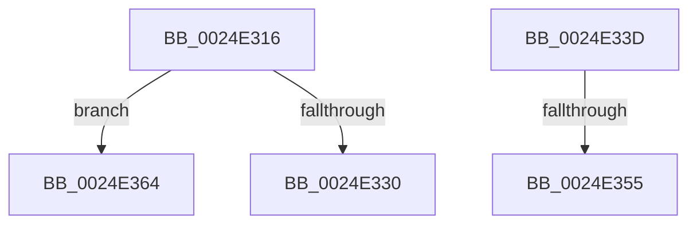

# sub_0024E316

- RVA: `0x0024E316`–`0x0024E371` (길이 `91` bytes)
- VA: `0x000000014024E316`
- 실행 섹션: `.text`
- PDB 이름 있음: `아니요`; PDB Function 태그: `아니요`
- unwind 정보 RVA: `0x00063064`
- 디코드: `24`개 명령, `91/91` bytes 표시
- 미해석 바이트: `0` (있으면 어셈블리에 `.byte`로 보존)

> 이 문서는 커널 이미지의 기계어와 PDB 기호를 분석해 생성했습니다. 4번과 5번은 함수 원형과 자료형을 바이너리 사용 방식에서 추정한 C 해석이며 원본 소스 복구 결과는 아닙니다.

## 1. Dependencies

- 직접 호출 지점: **1**; 고유 호출 대상: **1**
- 직접 호출자로 확인된 함수: **0**
- RIP 상대 이미지 참조: **0**

### Outgoing calls
- `0x0024E35D` → [ExFreePoolWithTag](../../poolcode/B8/ExFreePoolWithTag_function_00B82870.md) (function, `0x00B82870`)

### Direct callers
- 이 함수 시작 RVA로 연결되는 직접 call은 확인되지 않았습니다. 간접 호출은 완전히 역산할 수 없습니다.

### Static image references
- 디코드된 RIP-relative 메모리 참조가 없습니다.

## 2. Other-region calls and transfers

- 다른 실행 섹션으로 향하는 call: **1**
  - `0x0024E35D` → [ExFreePoolWithTag](../../poolcode/B8/ExFreePoolWithTag_function_00B82870.md) (`.text` → `POOLCODE`)
- call이 아닌 외부 분기/꼬리 이동: **4**
  - `0x0024E338` → [sub_0024E092 + 0x26](Unknown_function_0024E092.md) (`tail-transfer`)
  - `0x0024E34F` → [sub_0024E092 + 0x3F](Unknown_function_0024E092.md) (`tail-transfer`)
  - `0x0024E362` → [sub_0024E2F5](Unknown_function_0024E2F5.md) (`tail-transfer`)
  - `0x0024E36C` → [sub_0024E092 + 0x26](Unknown_function_0024E092.md) (`tail-transfer`)

## 3. Assembly (complete function range)

```asm
0024E316  41 0F B7 C2                     movzx eax, r10w
0024E31A  66 C1 E0 03                     shl ax, 3
0024E31E  42 8D 0C 10                     lea ecx, [rax + r10]
0024E322  66 C1 E1 03                     shl cx, 3
0024E326  66 41 03 CB                     add cx, r11w
0024E32A  66 44 3B C1                     cmp r8w, cx
0024E32E  72 34                           jb 0x14024e364
0024E330  BD 10 08 00 00                  mov ebp, 0x810
0024E335  8D 4D 08                        lea ecx, [rbp + 8]
0024E338  E9 7B FD FF FF                  jmp 0x14024e0b8
0024E33D  FF 45 20                        inc dword ptr [rbp + 0x20]
0024E340  48 8B 2C 0A                     mov rbp, qword ptr [rdx + rcx]
0024E344  FF 45 1C                        inc dword ptr [rbp + 0x1c]
0024E347  0F B7 45 10                     movzx eax, word ptr [rbp + 0x10]
0024E34B  66 39 45 00                     cmp word ptr [rbp], ax
0024E34F  0F 82 7C FD FF FF               jb 0x14024e0d1
0024E355  FF 45 20                        inc dword ptr [rbp + 0x20]
0024E358  33 D2                           xor edx, edx
0024E35A  48 8B CB                        mov rcx, rbx
0024E35D  E8 0E 45 93 00                  call 0x140b82870
0024E362  EB 91                           jmp 0x14024e2f5
0024E364  BD 00 08 00 00                  mov ebp, 0x800
0024E369  8D 4D 08                        lea ecx, [rbp + 8]
0024E36C  E9 47 FD FF FF                  jmp 0x14024e0b8
```

## 4. C-style interpretation (structured pseudocode)

```c
__int64 __fastcall sub_0024E316(__int64 a1, __int64 a2, unsigned __int16 a3)
{
    __int64 result;

    result = (unsigned __int16)(((unsigned __int16)(v_r10)) << (3));
    a1 = (unsigned __int16)((result + v_r10 * 1) << (3));
    a1 = (unsigned __int16)((a1) + ((unsigned __int16)(v_r11)));
    if (a3 < ((unsigned __int16)(a1))) goto loc_0024E364;
loc_0024E364:
}
```

## 5. (Beta) C Style

```c
int64_t sub_0024E316(int64_t Arg1, int64_t Arg2, uint16_t Arg3)
{
    int64_t result;

    result = (uint16_t)(((uint16_t)(local_r10)) << (3));
    Arg1 = (uint16_t)((result + local_r10 * 1) << (3));
    Arg1 = (uint16_t)((Arg1) + ((uint16_t)(local_r11)));
    if (Arg3 < ((uint16_t)(Arg1))) goto loc_0024E364;
loc_0024E364:
}
```

## 6. Execution-region graph

[열기: 2D/3D 그래프와 함수 탐색 컨트롤 패널](../../../control-panel.html?section=text&rva=0x0024E316&view=graph)

- 2D 그래프는 위에서 아래로 흐르고, 3D 그래프는 빈 공간을 드래그해 회전합니다. Shift+드래그는 이동, 휠은 확대·축소, 함수 노드 선택은 대상 보고서 이동입니다.

### Static fallback


