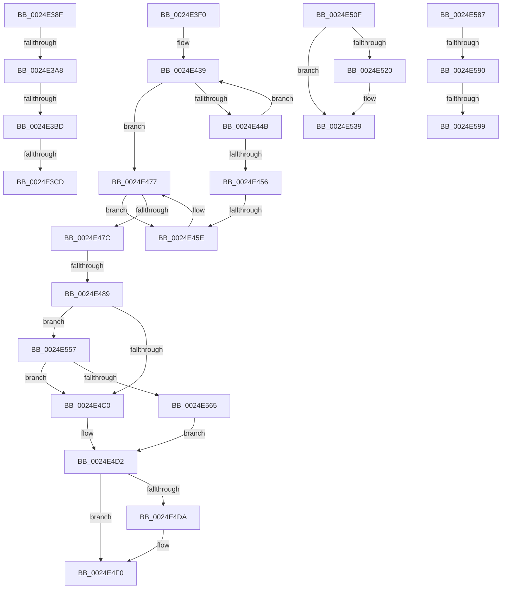

# sub_0024E38F

- RVA: `0x0024E38F`–`0x0024E5B0` (길이 `545` bytes)
- VA: `0x000000014024E38F`
- 실행 섹션: `.text`
- PDB 이름 있음: `아니요`; PDB Function 태그: `아니요`
- unwind 정보 RVA: `0x000630A0`
- 디코드: `121`개 명령, `545/545` bytes 표시
- 미해석 바이트: `0` (있으면 어셈블리에 `.byte`로 보존)

> 이 문서는 커널 이미지의 기계어와 PDB 기호를 분석해 생성했습니다. 4번과 5번은 함수 원형과 자료형을 바이너리 사용 방식에서 추정한 C 해석이며 원본 소스 복구 결과는 아닙니다.

## 1. Dependencies

- 직접 호출 지점: **7**; 고유 호출 대상: **5**
- 직접 호출자로 확인된 함수: **0**
- RIP 상대 이미지 참조: **9**

### Outgoing calls
- `0x0024E3D9` → [PspReturnResourceQuota](../38/PspReturnResourceQuota_function_0038FFC4.md) (function, `0x0038FFC4`)
- `0x0024E3F7` → [ExAcquireSpinLockShared](ExAcquireSpinLockShared_function_0024DCE0.md) (function, `0x0024DCE0`)
- `0x0024E471` → [KeBugCheckEx](../4F/KeBugCheckEx_function_004FD660.md) (function, `0x004FD660`)
- `0x0024E4E2` → [KiLowerIrqlProcessIrqlFlags](../4F/KiLowerIrqlProcessIrqlFlags_function_004F5698.md) (function, `0x004F5698`)
- `0x0024E533` → [KeBugCheckEx](../4F/KeBugCheckEx_function_004FD660.md) (function, `0x004FD660`)
- `0x0024E574` → [ExpReleaseSpinLockSharedFromDpcLevelInstrumented](../2F/ExpReleaseSpinLockSharedFromDpcLevelInstrumented_function_002F0F48.md) (function, `0x002F0F48`)
- `0x0024E5AA` → [KeBugCheckEx](../4F/KeBugCheckEx_function_004FD660.md) (function, `0x004FD660`)

### Direct callers
- 이 함수 시작 RVA로 연결되는 직접 call은 확인되지 않았습니다. 간접 호출은 완전히 역산할 수 없습니다.

### Static image references
- `0x0024E3F0` → RVA `0x00EFACF8` (`.data`; read)
- `0x0024E3FC` → RVA `0x00EFED38` (`.data`; read)
- `0x0024E406` → RVA `0x00EFED30` (`.data`; read)
- `0x0024E490` → RVA `0x00FC7228` (`ALMOSTRO`; read)
- `0x0024E4B3` → RVA `0x00FC6B06` (`ALMOSTRO`; read)
- `0x0024E4C0` → RVA `0x00EFACF8` (`.data`; read/write)
- `0x0024E4D2` → RVA `0x00FC6D20` (`ALMOSTRO`; read)
- `0x0024E50F` → RVA `0x00E27F80` (`.data`; read)
- `0x0024E557` → RVA `0x00F0DE58` (`.data`; read)

## 2. Other-region calls and transfers

- 다른 실행 섹션으로 향하는 call: **0**
- call이 아닌 외부 분기/꼬리 이동: **10**
  - `0x0024E3A2` → [sub_0024E0D5 + 0x191](Unknown_function_0024E0D5.md) (`tail-transfer`)
  - `0x0024E3B7` → [sub_0024E0D5 + 0x191](Unknown_function_0024E0D5.md) (`tail-transfer`)
  - `0x0024E3C7` → [sub_0024E0D5 + 0x191](Unknown_function_0024E0D5.md) (`tail-transfer`)
  - `0x0024E3EB` → [sub_0024E0D5 + 0x191](Unknown_function_0024E0D5.md) (`tail-transfer`)
  - `0x0024E458` → [sub_0024E650 + 0x1D](Unknown_function_0024E650.md) (`tail-transfer`)
  - `0x0024E483` → [sub_0024E650 + 0x15](Unknown_function_0024E650.md) (`tail-transfer`)
  - `0x0024E50A` → [sub_0024E0D5 + 0xD6](Unknown_function_0024E0D5.md) (`tail-transfer`)
  - `0x0024E552` → [sub_0024E0D5 + 0x194](Unknown_function_0024E0D5.md) (`tail-transfer`)
  - `0x0024E58E` → [sub_0024E5BF](Unknown_function_0024E5BF.md) (`tail-transfer`)
  - `0x0024E593` → [sub_0024E650 + 0x28](Unknown_function_0024E650.md) (`tail-transfer`)

## 3. Assembly (complete function range)

```asm
0024E38F  49 3B D4                        cmp rdx, r12
0024E392  48 8B C8                        mov rcx, rax
0024E395  49 0F 47 D4                     cmova rdx, r12
0024E399  48 2B CA                        sub rcx, rdx
0024E39C  F0 49 0F B1 4D 40               lock cmpxchg qword ptr [r13 + 0x40], rcx
0024E3A2  0F 85 BE FE FF FF               jne 0x14024e266
0024E3A8  48 8B C2                        mov rax, rdx
0024E3AB  F0 49 0F C1 45 48               lock xadd qword ptr [r13 + 0x48], rax
0024E3B1  48 03 D0                        add rdx, rax
0024E3B4  49 3B 11                        cmp rdx, qword ptr [r9]
0024E3B7  0F 86 A9 FE FF FF               jbe 0x14024e266
0024E3BD  49 8B C6                        mov rax, r14
0024E3C0  49 87 45 48                     xchg qword ptr [r13 + 0x48], rax
0024E3C4  48 85 C0                        test rax, rax
0024E3C7  0F 84 99 FE FF FF               je 0x14024e266
0024E3CD  45 33 C9                        xor r9d, r9d
0024E3D0  4C 8B C0                        mov r8, rax
0024E3D3  49 8B D5                        mov rdx, r13
0024E3D6  41 8B CB                        mov ecx, r11d
0024E3D9  E8 E6 1B 14 00                  call 0x14038ffc4
0024E3DE  44 8B 84 24 A0 00 00 00         mov r8d, dword ptr [rsp + 0xa0]
0024E3E6  4C 8B 5C 24 30                  mov r11, qword ptr [rsp + 0x30]
0024E3EB  E9 76 FE FF FF                  jmp 0x14024e266
0024E3F0  48 8D 0D 01 C9 CA 00            lea rcx, [rip + 0xcac901]
0024E3F7  E8 E4 F8 FF FF                  call 0x14024dce0
0024E3FC  4C 8B 15 35 09 CB 00            mov r10, qword ptr [rip + 0xcb0935]
0024E403  48 8B CB                        mov rcx, rbx
0024E406  4C 8B 1D 23 09 CB 00            mov r11, qword ptr [rip + 0xcb0923]
0024E40D  44 0F B6 C0                     movzx r8d, al
0024E411  48 C1 E9 0C                     shr rcx, 0xc
0024E415  BE 01 00 00 00                  mov esi, 1
0024E41A  48 69 D1 5F 9E 00 00            imul rdx, rcx, 0x9e5f
0024E421  41 8D 4A FF                     lea ecx, [r10 - 1]
0024E425  88 84 24 98 00 00 00            mov byte ptr [rsp + 0x98], al
0024E42C  4C 8B CA                        mov r9, rdx
0024E42F  49 C1 E9 20                     shr r9, 0x20
0024E433  44 33 CA                        xor r9d, edx
0024E436  44 23 C9                        and r9d, ecx
0024E439  41 8B D1                        mov edx, r9d
0024E43C  48 C1 E2 05                     shl rdx, 5
0024E440  49 03 D3                        add rdx, r11
0024E443  48 8B 02                        mov rax, qword ptr [rdx]
0024E446  48 3B C3                        cmp rax, rbx
0024E449  74 2C                           je 0x14024e477
0024E44B  41 FF C1                        inc r9d
0024E44E  41 8B C1                        mov eax, r9d
0024E451  49 3B C2                        cmp rax, r10
0024E454  72 E3                           jb 0x14024e439
0024E456  85 F6                           test esi, esi
0024E458  0F 85 0F 02 00 00               jne 0x14024e66d
0024E45E  BA 22 00 00 00                  mov edx, 0x22
0024E463  4C 89 74 24 20                  mov qword ptr [rsp + 0x20], r14
0024E468  4D 8B CD                        mov r9, r13
0024E46B  4C 8B C3                        mov r8, rbx
0024E46E  8D 4A F7                        lea ecx, [rdx - 9]
0024E471  E8 EA F1 2A 00                  call 0x1404fd660
0024E476  CC                              int3
0024E477  48 85 D2                        test rdx, rdx
0024E47A  74 E2                           je 0x14024e45e
0024E47C  F7 42 0C 00 01 00 00            test dword ptr [rdx + 0xc], 0x100
0024E483  0F 84 DC 01 00 00               je 0x14024e665
0024E489  48 8B 72 18                     mov rsi, qword ptr [rdx + 0x18]
0024E48D  48 8B C3                        mov rax, rbx
0024E490  48 33 35 91 8D D7 00            xor rsi, qword ptr [rip + 0xd78d91]
0024E497  4C 8B 62 10                     mov r12, qword ptr [rdx + 0x10]
0024E49B  48 33 F3                        xor rsi, rbx
0024E49E  48 33 05 83 8D D7 00            xor rax, qword ptr [rip + 0xd78d83]
0024E4A5  48 89 42 18                     mov qword ptr [rdx + 0x18], rax
0024E4A9  8B 42 08                        mov eax, dword ptr [rdx + 8]
0024E4AC  89 84 24 A0 00 00 00            mov dword ptr [rsp + 0xa0], eax
0024E4B3  F6 05 4C 86 D7 00 01            test byte ptr [rip + 0xd7864c], 1
0024E4BA  0F 85 97 00 00 00               jne 0x14024e557
0024E4C0  F0 81 25 2D C8 CA 00 FF FF FF BF  lock and dword ptr [rip + 0xcac82d], 0xbfffffff
0024E4CB  F0 FF 0D 26 C8 CA 00            lock dec dword ptr [rip + 0xcac826]
0024E4D2  39 3D 48 88 D7 00               cmp dword ptr [rip + 0xd78848], edi
0024E4D8  74 16                           je 0x14024e4f0
0024E4DA  44 0F 20 C1                     mov rcx, cr8
0024E4DE  41 0F B6 D0                     movzx edx, r8b
0024E4E2  E8 B1 71 2A 00                  call 0x1404f5698
0024E4E7  44 0F B6 84 24 98 00 00 00      movzx r8d, byte ptr [rsp + 0x98]
0024E4F0  41 0F B6 C0                     movzx eax, r8b
0024E4F4  44 0F 22 C0                     mov cr8, rax
0024E4F8  44 8B 84 24 A0 00 00 00         mov r8d, dword ptr [rsp + 0xa0]
0024E500  48 BA 00 00 00 00 00 80 FF FF   movabs rdx, 0xffff800000000000
0024E50A  E9 9C FC FF FF                  jmp 0x14024e1ab
0024E50F  48 8D 0D 6A 9A BD 00            lea rcx, [rip + 0xbd9a6a]
0024E516  48 39 8C 24 A8 00 00 00         cmp qword ptr [rsp + 0xa8], rcx
0024E51E  75 19                           jne 0x14024e539
0024E520  4D 8B CA                        mov r9, r10
0024E523  4C 89 64 24 20                  mov qword ptr [rsp + 0x20], r12
0024E528  4D 8B C3                        mov r8, r11
0024E52B  48 8B D6                        mov rdx, rsi
0024E52E  B9 21 00 00 00                  mov ecx, 0x21
0024E533  E8 28 F1 2A 00                  call 0x1404fd660
0024E538  CC                              int3
0024E539  4C 8B 6C 24 38                  mov r13, qword ptr [rsp + 0x38]
0024E53E  4C 03 E9                        add r13, rcx
0024E541  48 89 8C 24 A8 00 00 00         mov qword ptr [rsp + 0xa8], rcx
0024E549  41 0F 0D 4D 00                  prefetchw byte ptr [r13]
0024E54E  49 8B 7D 00                     mov rdi, qword ptr [r13]
0024E552  E9 12 FD FF FF                  jmp 0x14024e269
0024E557  8B 05 FB F8 CB 00               mov eax, dword ptr [rip + 0xcbf8fb]
0024E55D  85 C0                           test eax, eax
0024E55F  0F 85 5B FF FF FF               jne 0x14024e4c0
0024E565  48 8B 94 24 88 00 00 00         mov rdx, qword ptr [rsp + 0x88]
0024E56D  48 8D 0D 84 C7 CA 00            lea rcx, [rip + 0xcac784]
0024E574  E8 CF 29 0A 00                  call 0x1402f0f48
0024E579  44 0F B6 84 24 98 00 00 00      movzx r8d, byte ptr [rsp + 0x98]
0024E582  E9 4B FF FF FF                  jmp 0x14024e4d2
0024E587  48 8B 4E D8                     mov rcx, qword ptr [rsi - 0x28]
0024E58B  48 85 C9                        test rcx, rcx
0024E58E  75 2F                           jne 0x14024e5bf
0024E590  4D 85 FF                        test r15, r15
0024E593  0F 89 DF 00 00 00               jns 0x14024e678
0024E599  33 D2                           xor edx, edx
0024E59B  4C 89 7C 24 20                  mov qword ptr [rsp + 0x20], r15
0024E5A0  44 8D 49 04                     lea r9d, [rcx + 4]
0024E5A4  4C 8B C6                        mov r8, rsi
0024E5A7  8D 4A 18                        lea ecx, [rdx + 0x18]
0024E5AA  E8 B1 F0 2A 00                  call 0x1404fd660
0024E5AF  CC                              int3
```

## 4. C-style interpretation (structured pseudocode)

```c
__int64 __fastcall sub_0024E38F(__int64 a1, __int64 a2, __int64 a3, __int64 a4, __int64 a5, __int64 a6, __int64 a7, __int64 a8, __int64 a9, __int64 a10, __int64 a11, __int64 a12, __int64 a13, __int64 a14, __int64 a15, __int64 a16, __int64 a17, __int64 a18, __int64 a19, unsigned int a20)
{
    __int64 result;
    unsigned __int64 v_stack_p20;
    unsigned __int64 v_stack_p38;
    unsigned __int64 v_stack_p88;
    unsigned __int8 v_stack_p98;
    unsigned int v_stack_pA0;
    unsigned __int64 v_stack_pA8;

    if (a2 > v_r12) { a2 = v_r12; }
    a1 = (result) - (a2);
    a2 = (a2) + (a2);
    a4 = 0;
    result = PspReturnResourceQuota((unsigned int)((unsigned int)(v_r11)), v_r13, v_r14, a4);
}
```

## 5. (Beta) C Style

```c
int64_t sub_0024E38F(int64_t Arg1, int64_t Arg2, int64_t Arg3, void *Arg4, uint64_t Arg5, int64_t Arg6, uint64_t Arg7, uint64_t Arg8, uint64_t Arg9, uint64_t Arg10, uint64_t Arg11, uint64_t Arg12, uint64_t Arg13, uint64_t Arg14, uint64_t Arg15, uint64_t Arg16, uint64_t Arg17, uint64_t Arg18, uint64_t Arg19, uint32_t Arg20)
{
    uint8_t *arg4 = (uint8_t *)Arg4;

    int64_t result;
    uint64_t v_stack_p20;
    uint64_t v_stack_p38;
    uint64_t v_stack_p88;
    uint8_t v_stack_p98;
    uint32_t v_stack_pA0;
    uint64_t v_stack_pA8;

    if (Arg2 > local_r12) { Arg2 = local_r12; }
    Arg1 = (result) - (Arg2);
    Arg2 = (Arg2) + (Arg2);
    Arg4 = 0;
    result = PspReturnResourceQuota((uint32_t)((uint32_t)(local_r11)), local_r13, local_r14, Arg4);
}
```

### 관측된 메모리 오프셋

구조체 형식이 확인되지 않은 접근은 인자 기준의 오프셋으로만 기록했습니다.

| 기준 인자 | 오프셋 표현 | 폭 (bit) | 접근 |
|---|---:|---:|---|
| `Arg4` | `+ 0x0` | `64` | `R` |

## 6. Execution-region graph

[열기: 2D/3D 그래프와 함수 탐색 컨트롤 패널](../../../control-panel.html?section=text&rva=0x0024E38F&view=graph)

- 2D 그래프는 위에서 아래로 흐르고, 3D 그래프는 빈 공간을 드래그해 회전합니다. Shift+드래그는 이동, 휠은 확대·축소, 함수 노드 선택은 대상 보고서 이동입니다.

### Static fallback


