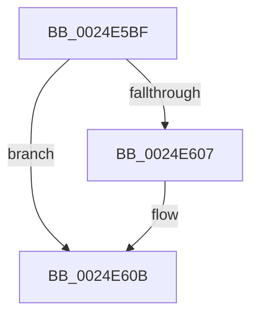

# sub_0024E5BF

- RVA: `0x0024E5BF`–`0x0024E626` (길이 `103` bytes)
- VA: `0x000000014024E5BF`
- 실행 섹션: `.text`
- PDB 이름 있음: `아니요`; PDB Function 태그: `아니요`
- unwind 정보 RVA: `0x000630E0`
- 디코드: `25`개 명령, `103/103` bytes 표시
- 미해석 바이트: `0` (있으면 어셈블리에 `.byte`로 보존)

> 이 문서는 커널 이미지의 기계어와 PDB 기호를 분석해 생성했습니다. 4번과 5번은 함수 원형과 자료형을 바이너리 사용 방식에서 추정한 C 해석이며 원본 소스 복구 결과는 아닙니다.

## 1. Dependencies

- 직접 호출 지점: **2**; 고유 호출 대상: **1**
- 직접 호출자로 확인된 함수: **0**
- RIP 상대 이미지 참조: **2**

### Outgoing calls
- `0x0024E5FC` → [KeBugCheckEx](../4F/KeBugCheckEx_function_004FD660.md) (function, `0x004FD660`)
- `0x0024E620` → [KeBugCheckEx](../4F/KeBugCheckEx_function_004FD660.md) (function, `0x004FD660`)

### Direct callers
- 이 함수 시작 RVA로 연결되는 직접 call은 확인되지 않았습니다. 간접 호출은 완전히 역산할 수 없습니다.

### Static image references
- `0x0024E5E3` → RVA `0x00FC6E4C` (`ALMOSTRO`; read)
- `0x0024E5ED` → RVA `0x00000000` (`image boundary/outside`; read)

## 2. Other-region calls and transfers

- 다른 실행 섹션으로 향하는 call: **0**
- 별도 외부 분기/꼬리 이동을 확인하지 못했습니다.

## 3. Assembly (complete function range)

```asm
0024E5BF  41 B9 03 00 00 00               mov r9d, 3
0024E5C5  48 89 4C 24 20                  mov qword ptr [rsp + 0x20], rcx
0024E5CA  48 8D 46 D0                     lea rax, [rsi - 0x30]
0024E5CE  4C 8B C6                        mov r8, rsi
0024E5D1  48 C1 E8 08                     shr rax, 8
0024E5D5  0F B6 D0                        movzx edx, al
0024E5D8  0F B6 46 E8                     movzx eax, byte ptr [rsi - 0x18]
0024E5DC  41 8D 49 15                     lea ecx, [r9 + 0x15]
0024E5E0  48 33 D0                        xor rdx, rax
0024E5E3  0F B6 05 62 88 D7 00            movzx eax, byte ptr [rip + 0xd78862]
0024E5EA  48 33 D0                        xor rdx, rax
0024E5ED  48 8D 05 0C 1A DB FF            lea rax, [rip - 0x24e5f4]
0024E5F4  48 8B 94 D0 00 78 FC 00         mov rdx, qword ptr [rax + rdx*8 + 0xfc7800]
0024E5FC  E8 5F F0 2A 00                  call 0x1404fd660
0024E601  CC                              int3
0024E602  48 85 FF                        test rdi, rdi
0024E605  74 04                           je 0x14024e60b
0024E607  44 8B 77 04                     mov r14d, dword ptr [rdi + 4]
0024E60B  45 8B CE                        mov r9d, r14d
0024E60E  4C 8B C3                        mov r8, rbx
0024E611  BA 0D 00 00 00                  mov edx, 0xd
0024E616  48 89 74 24 20                  mov qword ptr [rsp + 0x20], rsi
0024E61B  B9 C2 00 00 00                  mov ecx, 0xc2
0024E620  E8 3B F0 2A 00                  call 0x1404fd660
0024E625  CC                              int3
```

## 4. C-style interpretation (structured pseudocode)

```c
__int64 __fastcall sub_0024E5BF(__int64 a1)
{
    __int64 result;
    __int64 v_r14;
    unsigned __int64 v_stack_p20;

    v_stack_p20 = a1;
    result = (v_rsi - 48) >> (8);
    a2 = ((unsigned __int8)(result)) ^ (*(unsigned __int8 *)(v_rsi - 24));
    a2 = (a2) ^ (*(unsigned __int8 *)(v_rip + 14125154));
    result = KeBugCheckEx(3 + 21, *(unsigned __int64 *)(v_rip - 2418164 + a2 * 8 + 16545792), v_rsi, 3);
    if (v_rdi != 0) {
        v_r14 = *(unsigned int *)(v_rdi + 4);
    }
    v_stack_p20 = v_rsi;
    result = KeBugCheckEx(194, 13, v_rbx, (unsigned int)((unsigned int)(v_r14)));
    return result;
}
```

## 5. (Beta) C Style

```c
int64_t sub_0024E5BF(int64_t Arg1)
{
    int64_t result;
    int64_t local_r14;
    uint64_t v_stack_p20;

    v_stack_p20 = Arg1;
    result = (local_rsi - 48) >> (8);
    a2 = ((uint8_t)(result)) ^ (*(uint8_t *)(local_rsi - 0x18));
    a2 = (a2) ^ (*(uint8_t *)(v_rip + 0xD78862));
    result = KeBugCheckEx(3 + 21, *(uint64_t *)(v_rip - 0x24E5F4 + a2 * 8 + 0xFC7800), local_rsi, 3);
    if (local_rdi != 0) {
        local_r14 = *(uint32_t *)(local_rdi + 0x4);
    }
    v_stack_p20 = local_rsi;
    result = KeBugCheckEx(194, 13, local_rbx, (uint32_t)((uint32_t)(local_r14)));
    return result;
}
```

## 6. Execution-region graph

[열기: 2D/3D 그래프와 함수 탐색 컨트롤 패널](../../../control-panel.html?section=text&rva=0x0024E5BF&view=graph)

- 2D 그래프는 위에서 아래로 흐르고, 3D 그래프는 빈 공간을 드래그해 회전합니다. Shift+드래그는 이동, 휠은 확대·축소, 함수 노드 선택은 대상 보고서 이동입니다.

### Static fallback


