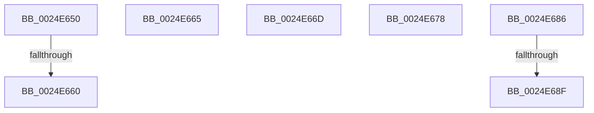

# sub_0024E650

- RVA: `0x0024E650`–`0x0024E69A` (길이 `74` bytes)
- VA: `0x000000014024E650`
- 실행 섹션: `.text`
- PDB 이름 있음: `아니요`; PDB Function 태그: `아니요`
- unwind 정보 RVA: `0x00063154`
- 디코드: `17`개 명령, `74/74` bytes 표시
- 미해석 바이트: `0` (있으면 어셈블리에 `.byte`로 보존)

> 이 문서는 커널 이미지의 기계어와 PDB 기호를 분석해 생성했습니다. 4번과 5번은 함수 원형과 자료형을 바이너리 사용 방식에서 추정한 C 해석이며 원본 소스 복구 결과는 아닙니다.

## 1. Dependencies

- 직접 호출 지점: **2**; 고유 호출 대상: **2**
- 직접 호출자로 확인된 함수: **0**
- RIP 상대 이미지 참조: **0**

### Outgoing calls
- `0x0024E653` → [ExIsSpecialPoolAddress](../49/ExIsSpecialPoolAddress_function_0049C410.md) (function, `0x0049C410`)
- `0x0024E67C` → [ObpDeferObjectDeletion](../3A/ObpDeferObjectDeletion_function_003A2394.md) (function, `0x003A2394`)

### Direct callers
- 이 함수 시작 RVA로 연결되는 직접 call은 확인되지 않았습니다. 간접 호출은 완전히 역산할 수 없습니다.

### Static image references
- 디코드된 RIP-relative 메모리 참조가 없습니다.

## 2. Other-region calls and transfers

- 다른 실행 섹션으로 향하는 call: **0**
- call이 아닌 외부 분기/꼬리 이동: **7**
  - `0x0024E65A` → [sub_0024E0D5 + 0x35](Unknown_function_0024E0D5.md) (`tail-transfer`)
  - `0x0024E660` → [sub_0024E0D5 + 0x206](Unknown_function_0024E0D5.md) (`tail-transfer`)
  - `0x0024E668` → [sub_0024E38F + 0x124](Unknown_function_0024E38F.md) (`tail-transfer`)
  - `0x0024E673` → [sub_0024E38F + 0xAA](Unknown_function_0024E38F.md) (`tail-transfer`)
  - `0x0024E681` → [sub_0024E0D5 + 0x206](Unknown_function_0024E0D5.md) (`tail-transfer`)
  - `0x0024E689` → [sub_0024E0D5 + 0x66](Unknown_function_0024E0D5.md) (`tail-transfer`)
  - `0x0024E695` → [sub_0024E0D5 + 0x6C](Unknown_function_0024E0D5.md) (`tail-transfer`)

## 3. Assembly (complete function range)

```asm
0024E650  48 8B CB                        mov rcx, rbx
0024E653  E8 B8 DD 24 00                  call 0x14049c410
0024E658  85 C0                           test eax, eax
0024E65A  0F 84 AA FA FF FF               je 0x14024e10a
0024E660  E9 76 FC FF FF                  jmp 0x14024e2db
0024E665  49 8B F7                        mov rsi, r15
0024E668  E9 46 FE FF FF                  jmp 0x14024e4b3
0024E66D  45 8B CE                        mov r9d, r14d
0024E670  41 8B F6                        mov esi, r14d
0024E673  E9 C1 FD FF FF                  jmp 0x14024e439
0024E678  48 8D 4E D0                     lea rcx, [rsi - 0x30]
0024E67C  E8 13 3D 15 00                  call 0x1403a2394
0024E681  E9 55 FC FF FF                  jmp 0x14024e2db
0024E686  80 F9 04                        cmp cl, 4
0024E689  0F 84 AC FA FF FF               je 0x14024e13b
0024E68F  41 BD 00 01 00 00               mov r13d, 0x100
0024E695  E9 A7 FA FF FF                  jmp 0x14024e141
```

## 4. C-style interpretation (structured pseudocode)

```c
__int64 __fastcall sub_0024E650(void)
{
    __int64 result;

    result = ExIsSpecialPoolAddress(v_rbx, a2, a3, a4);
}
```

## 5. (Beta) C Style

```c
void sub_0024E650(void)
{
    int64_t result;

    result = ExIsSpecialPoolAddress(local_rbx, a2, a3, a4);
}
```

## 6. Execution-region graph

[열기: 2D/3D 그래프와 함수 탐색 컨트롤 패널](../../../control-panel.html?section=text&rva=0x0024E650&view=graph)

- 2D 그래프는 위에서 아래로 흐르고, 3D 그래프는 빈 공간을 드래그해 회전합니다. Shift+드래그는 이동, 휠은 확대·축소, 함수 노드 선택은 대상 보고서 이동입니다.

### Static fallback


