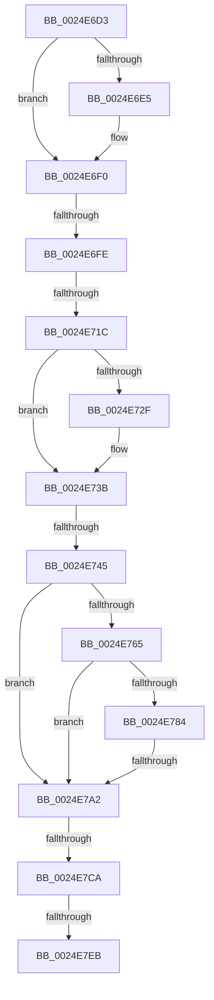

# sub_0024E6D3

- RVA: `0x0024E6D3`–`0x0024E7EF` (길이 `284` bytes)
- VA: `0x000000014024E6D3`
- 실행 섹션: `.text`
- PDB 이름 있음: `아니요`; PDB Function 태그: `아니요`
- unwind 정보 RVA: `0x0006318C`
- 디코드: `66`개 명령, `284/284` bytes 표시
- 미해석 바이트: `0` (있으면 어셈블리에 `.byte`로 보존)

> 이 문서는 커널 이미지의 기계어와 PDB 기호를 분석해 생성했습니다. 4번과 5번은 함수 원형과 자료형을 바이너리 사용 방식에서 추정한 C 해석이며 원본 소스 복구 결과는 아닙니다.

## 1. Dependencies

- 직접 호출 지점: **1**; 고유 호출 대상: **1**
- 직접 호출자로 확인된 함수: **0**
- RIP 상대 이미지 참조: **5**

### Outgoing calls
- `0x0024E6EB` → [IopFreeIrpExtension](IopFreeIrpExtension_function_0024EDB0.md) (function, `0x0024EDB0`)

### Direct callers
- 이 함수 시작 RVA로 연결되는 직접 call은 확인되지 않았습니다. 간접 호출은 완전히 역산할 수 없습니다.

### Static image references
- `0x0024E702` → RVA `0x00FC6A80` (`ALMOSTRO`; read)
- `0x0024E70D` → RVA `0x00000000` (`image boundary/outside`; read)
- `0x0024E745` → RVA `0x00F8D210` (`.data`; read)
- `0x0024E751` → RVA `0x00F8D40C` (`.data`; read)
- `0x0024E759` → RVA `0x00F8D408` (`.data`; read)

## 2. Other-region calls and transfers

- 다른 실행 섹션으로 향하는 call: **0**
- call이 아닌 외부 분기/꼬리 이동: **6**
  - `0x0024E6F8` → [sub_0024ED3C](Unknown_function_0024ED3C.md) (`tail-transfer`)
  - `0x0024E716` → [sub_0024ED52](Unknown_function_0024ED52.md) (`tail-transfer`)
  - `0x0024E73F` → [sub_0024EA85 + 0xF](Unknown_function_0024EA85.md) (`tail-transfer`)
  - `0x0024E79C` → [sub_0024EA85](Unknown_function_0024EA85.md) (`tail-transfer`)
  - `0x0024E7C4` → [sub_0024EA2A](Unknown_function_0024EA2A.md) (`tail-transfer`)
  - `0x0024E7E5` → [sub_0024EA2A + 0x27](Unknown_function_0024EA2A.md) (`tail-transfer`)

## 3. Assembly (complete function range)

```asm
0024E6D3  4C 89 7C 24 48                  mov qword ptr [rsp + 0x48], r15
0024E6D8  49 C7 C7 FF FF FF FF            mov r15, 0xffffffffffffffff
0024E6DF  66 44 89 31                     mov word ptr [rcx], r14w
0024E6E3  74 0B                           je 0x14024e6f0
0024E6E5  41 B0 01                        mov r8b, 1
0024E6E8  41 8B D7                        mov edx, r15d
0024E6EB  E8 C0 06 00 00                  call 0x14024edb0
0024E6F0  0F B6 43 47                     movzx eax, byte ptr [rbx + 0x47]
0024E6F4  24 21                           and al, 0x21
0024E6F6  3C 21                           cmp al, 0x21
0024E6F8  0F 84 3E 06 00 00               je 0x14024ed3c
0024E6FE  0F B7 4B 04                     movzx ecx, word ptr [rbx + 4]
0024E702  8B 05 78 83 D7 00               mov eax, dword ptr [rip + 0xd78378]
0024E708  48 89 7C 24 60                  mov qword ptr [rsp + 0x60], rdi
0024E70D  48 8D 3D EC 18 DB FF            lea rdi, [rip - 0x24e714]
0024E714  3B C8                           cmp ecx, eax
0024E716  0F 83 36 06 00 00               jae 0x14024ed52
0024E71C  0F AE E8                        lfence
0024E71F  48 8B 94 CF 40 8C FC 00         mov rdx, qword ptr [rdi + rcx*8 + 0xfc8c40]
0024E727  0F B6 43 47                     movzx eax, byte ptr [rbx + 0x47]
0024E72B  A8 08                           test al, 8
0024E72D  74 0C                           je 0x14024e73b
0024E72F  34 08                           xor al, 8
0024E731  88 43 47                        mov byte ptr [rbx + 0x47], al
0024E734  F0 FF 82 9C 2D 00 00            lock inc dword ptr [rdx + 0x2d9c]
0024E73B  F6 43 47 04                     test byte ptr [rbx + 0x47], 4
0024E73F  0F 84 4F 03 00 00               je 0x14024ea94
0024E745  8B 05 C5 EA D3 00               mov eax, dword ptr [rip + 0xd3eac5]
0024E74B  41 BB D0 00 00 00               mov r11d, 0xd0
0024E751  44 0F BE 0D B3 EC D3 00         movsx r9d, byte ptr [rip + 0xd3ecb3]
0024E759  44 0F BE 15 A7 EC D3 00         movsx r10d, byte ptr [rip + 0xd3eca7]
0024E761  A8 03                           test al, 3
0024E763  74 3D                           je 0x14024e7a2
0024E765  44 0F B7 43 02                  movzx r8d, word ptr [rbx + 2]
0024E76A  41 0F B7 C1                     movzx eax, r9w
0024E76E  66 C1 E0 03                     shl ax, 3
0024E772  42 8D 0C 08                     lea ecx, [rax + r9]
0024E776  66 C1 E1 03                     shl cx, 3
0024E77A  66 41 03 CB                     add cx, r11w
0024E77E  66 44 3B C1                     cmp r8w, cx
0024E782  74 1E                           je 0x14024e7a2
0024E784  41 0F B7 C2                     movzx eax, r10w
0024E788  66 C1 E0 03                     shl ax, 3
0024E78C  42 8D 0C 10                     lea ecx, [rax + r10]
0024E790  66 C1 E1 03                     shl cx, 3
0024E794  66 41 03 CB                     add cx, r11w
0024E798  66 44 3B C1                     cmp r8w, cx
0024E79C  0F 85 E3 02 00 00               jne 0x14024ea85
0024E7A2  44 0F B7 43 02                  movzx r8d, word ptr [rbx + 2]
0024E7A7  41 0F B7 C1                     movzx eax, r9w
0024E7AB  66 C1 E0 03                     shl ax, 3
0024E7AF  48 89 6C 24 70                  mov qword ptr [rsp + 0x70], rbp
0024E7B4  42 8D 0C 08                     lea ecx, [rax + r9]
0024E7B8  66 C1 E1 03                     shl cx, 3
0024E7BC  66 41 03 CB                     add cx, r11w
0024E7C0  66 44 3B C1                     cmp r8w, cx
0024E7C4  0F 82 60 02 00 00               jb 0x14024ea2a
0024E7CA  BD 20 08 00 00                  mov ebp, 0x820
0024E7CF  8D 4D 08                        lea ecx, [rbp + 8]
0024E7D2  4C 89 43 38                     mov qword ptr [rbx + 0x38], r8
0024E7D6  48 8B 2C 2A                     mov rbp, qword ptr [rdx + rbp]
0024E7DA  FF 45 1C                        inc dword ptr [rbp + 0x1c]
0024E7DD  0F B7 45 10                     movzx eax, word ptr [rbp + 0x10]
0024E7E1  66 39 45 00                     cmp word ptr [rbp], ax
0024E7E5  0F 83 66 02 00 00               jae 0x14024ea51
0024E7EB  0F B6 43 47                     movzx eax, byte ptr [rbx + 0x47]
```

## 4. C-style interpretation (structured pseudocode)

```c
__int64 __fastcall sub_0024E6D3(__int64 a1)
{
    __int64 result;
    unsigned __int64 v_stack_p48;
    unsigned __int64 v_stack_p60;
    unsigned __int64 v_stack_p70;

    v_stack_p48 = v_r15;
    *(unsigned __int16 *)(a1) = (unsigned __int16)(v_r14);
    if (!(condition_is_equal)) {
        a3 = 1;
        a2 = -1;
        result = IopFreeIrpExtension(a1, a2, a3, a4);
    }
    result = (unsigned __int8)((*(unsigned __int8 *)(v_rbx + 71)) & (33));
    v_stack_p60 = v_rdi;
    result = *(unsigned __int8 *)(v_rbx + 71);
    if ((((unsigned __int8)(*(unsigned __int8 *)(v_rbx + 71))) & (8)) != 0) {
        result = (unsigned __int8)((*(unsigned __int8 *)(v_rbx + 71)) ^ (8));
        *(unsigned __int8 *)(v_rbx + 71) = (unsigned __int8)(result);
    }
    if ((((unsigned __int8)((unsigned int)(*(unsigned int *)(v_rip + 13888197)))) & (3)) == 0) goto loc_0024E7A2;
    result = (unsigned __int16)(((unsigned __int16)((__int8)(*(unsigned __int8 *)(v_rip + 13888691)))) << (3));
    a1 = (unsigned __int16)((result + (__int8)(*(unsigned __int8 *)(v_rip + 13888691)) * 1) << (3));
    a1 = (unsigned __int16)((a1) + (208));
    if (((unsigned __int16)(*(unsigned __int16 *)(v_rbx + 2))) == ((unsigned __int16)(a1))) goto loc_0024E7A2;
    result = (unsigned __int16)(((unsigned __int16)((__int8)(*(unsigned __int8 *)(v_rip + 13888679)))) << (3));
    a1 = (unsigned __int16)((result + (__int8)(*(unsigned __int8 *)(v_rip + 13888679)) * 1) << (3));
    a1 = (unsigned __int16)((a1) + (208));
loc_0024E7A2:
    result = (unsigned __int16)(((unsigned __int16)((__int8)(*(unsigned __int8 *)(v_rip + 13888691)))) << (3));
    v_stack_p70 = v_rbp;
    a1 = (unsigned __int16)((result + (__int8)(*(unsigned __int8 *)(v_rip + 13888691)) * 1) << (3));
    a1 = (unsigned __int16)((a1) + (208));
    *(unsigned __int64 *)(v_rbx + 56) = *(unsigned __int16 *)(v_rbx + 2);
    return *(unsigned __int8 *)(v_rbx + 71);
}
```

## 5. (Beta) C Style

```c
int64_t sub_0024E6D3(void *Arg1)
{
    uint8_t *arg1 = (uint8_t *)Arg1;

    int64_t result;
    uint64_t v_stack_p48;
    uint64_t v_stack_p60;
    uint64_t v_stack_p70;

    v_stack_p48 = local_r15;
    *(uint16_t *)(arg1) = (uint16_t)(local_r14);
    if (!(condition_is_equal)) {
        a3 = 1;
        a2 = -1;
        result = IopFreeIrpExtension(Arg1, a2, a3, a4);
    }
    result = (uint8_t)((*(uint8_t *)(local_rbx + 0x47)) & (33));
    v_stack_p60 = local_rdi;
    result = *(uint8_t *)(local_rbx + 0x47);
    if ((((uint8_t)(*(uint8_t *)(local_rbx + 0x47))) & (8)) != 0) {
        result = (uint8_t)((*(uint8_t *)(local_rbx + 0x47)) ^ (8));
        *(uint8_t *)(local_rbx + 0x47) = (uint8_t)(result);
    }
    if ((((uint8_t)((uint32_t)(*(uint32_t *)(v_rip + 0xD3EAC5)))) & (3)) == 0) goto loc_0024E7A2;
    result = (uint16_t)(((uint16_t)((int8_t)(*(uint8_t *)(v_rip + 0xD3ECB3)))) << (3));
    Arg1 = (uint16_t)((result + (int8_t)(*(uint8_t *)(v_rip + 0xD3ECB3)) * 1) << (3));
    Arg1 = (uint16_t)((Arg1) + (208));
    if (((uint16_t)(*(uint16_t *)(local_rbx + 0x2))) == ((uint16_t)(Arg1))) goto loc_0024E7A2;
    result = (uint16_t)(((uint16_t)((int8_t)(*(uint8_t *)(v_rip + 0xD3ECA7)))) << (3));
    Arg1 = (uint16_t)((result + (int8_t)(*(uint8_t *)(v_rip + 0xD3ECA7)) * 1) << (3));
    Arg1 = (uint16_t)((Arg1) + (208));
loc_0024E7A2:
    result = (uint16_t)(((uint16_t)((int8_t)(*(uint8_t *)(v_rip + 0xD3ECB3)))) << (3));
    v_stack_p70 = local_rbp;
    Arg1 = (uint16_t)((result + (int8_t)(*(uint8_t *)(v_rip + 0xD3ECB3)) * 1) << (3));
    Arg1 = (uint16_t)((Arg1) + (208));
    *(uint64_t *)(local_rbx + 0x38) = *(uint16_t *)(local_rbx + 0x2);
    return *(uint8_t *)(local_rbx + 0x47);
}
```

### 관측된 메모리 오프셋

구조체 형식이 확인되지 않은 접근은 인자 기준의 오프셋으로만 기록했습니다.

| 기준 인자 | 오프셋 표현 | 폭 (bit) | 접근 |
|---|---:|---:|---|
| `Arg1` | `+ 0x0` | `16` | `W` |

## 6. Execution-region graph

[열기: 2D/3D 그래프와 함수 탐색 컨트롤 패널](../../../control-panel.html?section=text&rva=0x0024E6D3&view=graph)

- 2D 그래프는 위에서 아래로 흐르고, 3D 그래프는 빈 공간을 드래그해 회전합니다. Shift+드래그는 이동, 휠은 확대·축소, 함수 노드 선택은 대상 보고서 이동입니다.

### Static fallback


