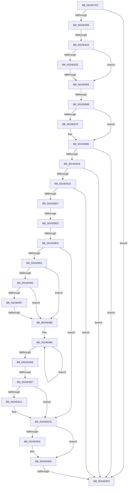

# sub_0024E7EF

- RVA: `0x0024E7EF`–`0x0024EA12` (길이 `547` bytes)
- VA: `0x000000014024E7EF`
- 실행 섹션: `.text`
- PDB 이름 있음: `아니요`; PDB Function 태그: `아니요`
- unwind 정보 RVA: `0x000631A8`
- 디코드: `125`개 명령, `547/547` bytes 표시
- 미해석 바이트: `0` (있으면 어셈블리에 `.byte`로 보존)

> 이 문서는 커널 이미지의 기계어와 PDB 기호를 분석해 생성했습니다. 4번과 5번은 함수 원형과 자료형을 바이너리 사용 방식에서 추정한 C 해석이며 원본 소스 복구 결과는 아닙니다.

## 1. Dependencies

- 직접 호출 지점: **2**; 고유 호출 대상: **2**
- 직접 호출자로 확인된 함수: **0**
- RIP 상대 이미지 참조: **5**

### Outgoing calls
- `0x0024E9E3` → [ObpPushStackInfo](../21/ObpPushStackInfo_function_002109E4.md) (function, `0x002109E4`)
- `0x0024E9FE` → [ExpInterlockedPushEntrySList](../6B/ExpInterlockedPushEntrySList_function_006BA5B0.md) (function, `0x006BA5B0`)

### Direct callers
- 이 함수 시작 RVA로 연결되는 직접 call은 확인되지 않았습니다. 간접 호출은 완전히 역산할 수 없습니다.

### Static image references
- `0x0024E816` → RVA `0x00EFED20` (`.data`; read)
- `0x0024E8B3` → RVA `0x00FC7228` (`ALMOSTRO`; read)
- `0x0024E8F4` → RVA `0x00FC6AB0` (`ALMOSTRO`; read)
- `0x0024E908` → RVA `0x00000000` (`image boundary/outside`; read)
- `0x0024E9CD` → RVA `0x00FC5010` (`ALMOSTRO`; read)

## 2. Other-region calls and transfers

- 다른 실행 섹션으로 향하는 call: **0**
- call이 아닌 외부 분기/꼬리 이동: **8**
  - `0x0024E81E` → [sub_0024ED60](Unknown_function_0024ED60.md) (`tail-transfer`)
  - `0x0024E84F` → [sub_0024ED60 + 0x36](Unknown_function_0024ED60.md) (`tail-transfer`)
  - `0x0024E865` → [sub_0024EAB1 + 0x64](Unknown_function_0024EAB1.md) (`tail-transfer`)
  - `0x0024E8DA` → [sub_0024EAB1 + 0x267](Unknown_function_0024EAB1.md) (`tail-transfer`)
  - `0x0024E8E7` → [sub_0024EAB1 + 0x267](Unknown_function_0024EAB1.md) (`tail-transfer`)
  - `0x0024E97D` → [sub_0024EAB1](Unknown_function_0024EAB1.md) (`tail-transfer`)
  - `0x0024E9B1` → [sub_0024EAB1 + 0x183](Unknown_function_0024EAB1.md) (`tail-transfer`)
  - `0x0024E9F2` → [sub_0024EAB1 + 0x1FB](Unknown_function_0024EAB1.md) (`tail-transfer`)

## 3. Assembly (complete function range)

```asm
0024E7EF  48 89 74 24 68                  mov qword ptr [rsp + 0x68], rsi
0024E7F4  4C 89 64 24 58                  mov qword ptr [rsp + 0x58], r12
0024E7F9  4C 89 6C 24 50                  mov qword ptr [rsp + 0x50], r13
0024E7FE  A8 01                           test al, 1
0024E800  0F 84 F2 01 00 00               je 0x14024e9f8
0024E806  34 01                           xor al, 1
0024E808  44 89 B4 24 98 00 00 00         mov dword ptr [rsp + 0x98], r14d
0024E810  88 43 47                        mov byte ptr [rbx + 0x47], al
0024E813  4D 8B E6                        mov r12, r14
0024E816  8B 05 04 05 CB 00               mov eax, dword ptr [rip + 0xcb0504]
0024E81C  85 C0                           test eax, eax
0024E81E  0F 85 3C 05 00 00               jne 0x14024ed60
0024E824  48 BA 00 00 00 00 00 80 FF FF   movabs rdx, 0xffff800000000000
0024E82E  48 3B DA                        cmp rbx, rdx
0024E831  72 22                           jb 0x14024e855
0024E833  48 8B C3                        mov rax, rbx
0024E836  48 C1 E8 27                     shr rax, 0x27
0024E83A  25 FF 01 00 00                  and eax, 0x1ff
0024E83F  2D 00 01 00 00                  sub eax, 0x100
0024E844  0F B6 8C 38 A8 8A E3 00         movzx ecx, byte ptr [rax + rdi + 0xe38aa8]
0024E84C  80 F9 05                        cmp cl, 5
0024E84F  0F 84 41 05 00 00               je 0x14024ed96
0024E855  41 BD 40 00 00 00               mov r13d, 0x40
0024E85B  49 8B FE                        mov rdi, r14
0024E85E  48 F7 C3 FF 0F 00 00            test rbx, 0xfff
0024E865  0F 84 AA 02 00 00               je 0x14024eb15
0024E86B  F6 43 F3 04                     test byte ptr [rbx - 0xd], 4
0024E86F  48 8D 7B F0                     lea rdi, [rbx - 0x10]
0024E873  74 10                           je 0x14024e885
0024E875  0F B7 07                        movzx eax, word ptr [rdi]
0024E878  0F B6 C8                        movzx ecx, al
0024E87B  48 F7 D9                        neg rcx
0024E87E  48 C1 E1 04                     shl rcx, 4
0024E882  48 03 F9                        add rdi, rcx
0024E885  0F B7 47 02                     movzx eax, word ptr [rdi + 2]
0024E889  44 8B 47 04                     mov r8d, dword ptr [rdi + 4]
0024E88D  44 0F B6 E0                     movzx r12d, al
0024E891  49 C1 E4 04                     shl r12, 4
0024E895  66 C1 E8 08                     shr ax, 8
0024E899  44 89 84 24 98 00 00 00         mov dword ptr [rsp + 0x98], r8d
0024E8A1  A8 08                           test al, 8
0024E8A3  0F 84 4F 01 00 00               je 0x14024e9f8
0024E8A9  48 8B F7                        mov rsi, rdi
0024E8AC  48 8B C7                        mov rax, rdi
0024E8AF  48 33 77 08                     xor rsi, qword ptr [rdi + 8]
0024E8B3  48 33 35 6E 89 D7 00            xor rsi, qword ptr [rip + 0xd7896e]
0024E8BA  48 33 05 67 89 D7 00            xor rax, qword ptr [rip + 0xd78967]
0024E8C1  48 89 47 08                     mov qword ptr [rdi + 8], rax
0024E8C5  48 85 F6                        test rsi, rsi
0024E8C8  0F 84 2A 01 00 00               je 0x14024e9f8
0024E8CE  49 3B F7                        cmp rsi, r15
0024E8D1  0F 84 21 01 00 00               je 0x14024e9f8
0024E8D7  48 3B F2                        cmp rsi, rdx
0024E8DA  0F 82 38 04 00 00               jb 0x14024ed18
0024E8E0  0F B6 06                        movzx eax, byte ptr [rsi]
0024E8E3  24 7F                           and al, 0x7f
0024E8E5  3C 03                           cmp al, 3
0024E8E7  0F 85 2B 04 00 00               jne 0x14024ed18
0024E8ED  41 81 E5 00 01 00 00            and r13d, 0x100
0024E8F4  48 3B 35 B5 81 D7 00            cmp rsi, qword ptr [rip + 0xd781b5]
0024E8FB  0F 84 CC 00 00 00               je 0x14024e9cd
0024E901  48 8B 8E F8 02 00 00            mov rcx, qword ptr [rsi + 0x2f8]
0024E908  48 8D 15 F1 16 DB FF            lea rdx, [rip - 0x24e90f]
0024E90F  4D 85 ED                        test r13, r13
0024E912  48 89 8C 24 A0 00 00 00         mov qword ptr [rsp + 0xa0], rcx
0024E91A  41 8B C6                        mov eax, r14d
0024E91D  0F 95 C0                        setne al
0024E920  44 8B D8                        mov r11d, eax
0024E923  4C 89 9C 24 A8 00 00 00         mov qword ptr [rsp + 0xa8], r11
0024E92B  42 0F B6 84 DA 50 73 FC 00      movzx eax, byte ptr [rdx + r11*8 + 0xfc7350]
0024E934  88 84 24 90 00 00 00            mov byte ptr [rsp + 0x90], al
0024E93B  41 8B C3                        mov eax, r11d
0024E93E  48 C1 E0 07                     shl rax, 7
0024E942  48 89 44 24 30                  mov qword ptr [rsp + 0x30], rax
0024E947  4C 8D 2C 08                     lea r13, [rax + rcx]
0024E94B  41 0F 0D 4D 00                  prefetchw byte ptr [r13]
0024E950  49 8B 7D 00                     mov rdi, qword ptr [r13]
0024E954  49 8B 45 40                     mov rax, qword ptr [r13 + 0x40]
0024E958  4D 39 75 50                     cmp qword ptr [r13 + 0x50], r14
0024E95C  74 25                           je 0x14024e983
0024E95E  49 6B CB 38                     imul rcx, r11, 0x38
0024E962  48 3B C7                        cmp rax, rdi
0024E965  76 1C                           jbe 0x14024e983
0024E967  4C 8D 8A 48 66 F0 00            lea r9, [rdx + 0xf06648]
0024E96E  4C 03 C9                        add r9, rcx
0024E971  48 8B C8                        mov rcx, rax
0024E974  48 2B CF                        sub rcx, rdi
0024E977  49 8B 11                        mov rdx, qword ptr [r9]
0024E97A  48 3B CA                        cmp rcx, rdx
0024E97D  0F 87 2E 01 00 00               ja 0x14024eab1
0024E983  4D 8B D4                        mov r10, r12
0024E986  4C 3B E7                        cmp r12, rdi
0024E989  4C 8B CF                        mov r9, rdi
0024E98C  48 8B CF                        mov rcx, rdi
0024E98F  49 8B D6                        mov rdx, r14
0024E992  4D 0F 42 CC                     cmovb r9, r12
0024E996  48 8B C7                        mov rax, rdi
0024E999  49 2B CC                        sub rcx, r12
0024E99C  4C 3B E7                        cmp r12, rdi
0024E99F  48 0F 42 D1                     cmovb rdx, rcx
0024E9A3  F0 49 0F B1 55 00               lock cmpxchg qword ptr [r13], rdx
0024E9A9  48 8B F8                        mov rdi, rax
0024E9AC  75 D8                           jne 0x14024e986
0024E9AE  4D 2B E1                        sub r12, r9
0024E9B1  0F 85 7D 02 00 00               jne 0x14024ec34
0024E9B7  F6 84 24 90 00 00 00 04         test byte ptr [rsp + 0x90], 4
0024E9BF  74 0C                           je 0x14024e9cd
0024E9C1  49 F7 DA                        neg r10
0024E9C4  F0 4E 01 94 DE 00 02 00 00      lock add qword ptr [rsi + r11*8 + 0x200], r10
0024E9CD  44 39 35 3C 66 D7 00            cmp dword ptr [rip + 0xd7663c], r14d
0024E9D4  74 12                           je 0x14024e9e8
0024E9D6  33 D2                           xor edx, edx
0024E9D8  48 8D 4E D0                     lea rcx, [rsi - 0x30]
0024E9DC  45 8B C8                        mov r9d, r8d
0024E9DF  44 8D 42 01                     lea r8d, [rdx + 1]
0024E9E3  E8 FC 1F FC FF                  call 0x1402109e4
0024E9E8  F0 4C 0F C1 7E D0               lock xadd qword ptr [rsi - 0x30], r15
0024E9EE  49 83 EF 01                     sub r15, 1
0024E9F2  0F 8E B4 02 00 00               jle 0x14024ecac
0024E9F8  48 8B D3                        mov rdx, rbx
0024E9FB  48 8B CD                        mov rcx, rbp
0024E9FE  E8 AD BB 46 00                  call 0x1406ba5b0
0024EA03  4C 8B 6C 24 50                  mov r13, qword ptr [rsp + 0x50]
0024EA08  4C 8B 64 24 58                  mov r12, qword ptr [rsp + 0x58]
0024EA0D  48 8B 74 24 68                  mov rsi, qword ptr [rsp + 0x68]
```

## 4. C-style interpretation (structured pseudocode)

```c
__int64 __fastcall sub_0024E7EF(__int64 a1, __int64 a2, __int64 a3, __int64 a4, __int64 a5, __int64 a6, __int64 a7, __int64 a8, __int64 a9, __int64 a10, __int64 a11, __int64 a12, __int64 a13, __int64 a14, __int64 a15, __int64 a16, __int64 a17, unsigned __int8 a18)
{
    __int64 result;
    __int64 v_r10;
    __int64 v_r12;
    __int64 v_r13;
    __int64 v_r15;
    __int64 v_rdi;
    __int64 v_rsi;
    unsigned __int64 v_stack_p30;
    unsigned __int64 v_stack_p50;
    unsigned __int64 v_stack_p58;
    unsigned __int64 v_stack_p68;
    unsigned __int8 v_stack_p90;
    unsigned int v_stack_p98;
    unsigned __int64 v_stack_pA0;
    unsigned __int64 v_stack_pA8;

    v_stack_p68 = v_rsi;
    v_stack_p58 = v_r12;
    v_stack_p50 = v_r13;
    if ((((unsigned __int8)(result)) & (1)) == 0) goto loc_0024E9F8;
    result = (unsigned __int8)((result) ^ (1));
    v_stack_p98 = (unsigned int)(v_r14);
    *(unsigned __int8 *)(v_rbx + 71) = (unsigned __int8)(result);
    if (v_rbx < a2) goto loc_0024E855;
    result = (v_rbx) >> (39);
    result = (unsigned int)((result) & (511));
    result = (unsigned int)((result) - (256));
loc_0024E855:
    v_rdi = v_rbx - 16;
    if (((*(unsigned __int8 *)(v_rbx - 13)) & (4)) != 0) {
        result = *(unsigned __int16 *)(v_rbx - 16);
        a1 = (unsigned __int8)(result);
        a1 = -(a1);
        a1 = (a1) << (4);
        v_rdi = (v_rbx - 16) + (a1);
    }
    v_r12 = ((unsigned __int8)(*(unsigned __int16 *)(v_rdi + 2))) << (4);
    result = (unsigned __int16)((*(unsigned __int16 *)(v_rdi + 2)) >> (8));
    v_stack_p98 = (unsigned int)((unsigned int)(*(unsigned int *)(v_rdi + 4)));
    if ((((unsigned __int8)(result)) & (8)) == 0) goto loc_0024E9F8;
    v_rsi = (v_rdi) ^ (*(unsigned __int64 *)(v_rdi + 8));
    v_rsi = (v_rsi) ^ (*(unsigned __int64 *)(v_rip + 14125422));
    result = (v_rdi) ^ (*(unsigned __int64 *)(v_rip + 14125415));
    *(unsigned __int64 *)(v_rdi + 8) = result;
    if (v_rsi == 0) goto loc_0024E9F8;
    if (v_rsi == v_r15) goto loc_0024E9F8;
    result = (unsigned __int8)((*(unsigned __int8 *)(v_rsi)) & (127));
    v_r13 = (unsigned int)((64) & (256));
    if (v_rsi == (*(unsigned __int64 *)(v_rip + 14123445))) goto loc_0024E9CD;
    v_stack_pA0 = *(unsigned __int64 *)(v_rsi + 760);
    result = (v_r13 != 0) ? 1 : 0;
    v_stack_pA8 = (unsigned int)((unsigned int)(result));
    v_stack_p90 = (unsigned __int8)(*(unsigned __int8 *)(v_rip - 2418959 + (unsigned int)((unsigned int)(result)) * 8 + 16544592));
    result = ((unsigned int)((unsigned int)((unsigned int)((unsigned int)(result))))) << (7);
    v_stack_p30 = result;
    if ((*(unsigned __int64 *)(result + *(unsigned __int64 *)(v_rsi + 760) * 1 + 80)) == v_r14) goto loc_0024E983;
    a1 = (*(unsigned __int64 *)(v_rsi + 760)) * ((unsigned int)((unsigned int)(result)));
    if ((*(unsigned __int64 *)(result + *(unsigned __int64 *)(v_rsi + 760) * 1 + 64)) <= (*(unsigned __int64 *)(result + *(unsigned __int64 *)(v_rsi + 760) * 1))) goto loc_0024E983;
    a4 = (v_rip - 2418959 + 15754824) + (a1);
    a1 = (*(unsigned __int64 *)(result + *(unsigned __int64 *)(v_rsi + 760) * 1 + 64)) - (*(unsigned __int64 *)(result + *(unsigned __int64 *)(v_rsi + 760) * 1));
loc_0024E983:
loc_0024E986:
    a4 = *(unsigned __int64 *)(result + *(unsigned __int64 *)(v_rsi + 760) * 1);
    if (v_r12 < (*(unsigned __int64 *)(result + *(unsigned __int64 *)(v_rsi + 760) * 1))) { a4 = v_r12; }
    a1 = (*(unsigned __int64 *)(result + *(unsigned __int64 *)(v_rsi + 760) * 1)) - (v_r12);
    a2 = v_r14;
    if (v_r12 < (*(unsigned __int64 *)(result + *(unsigned __int64 *)(v_rsi + 760) * 1))) { a2 = a1; }
    if (v_r12 != (*(unsigned __int64 *)(result + *(unsigned __int64 *)(v_rsi + 760) * 1))) goto loc_0024E986;
    v_r12 = (v_r12) - (a4);
    v_r10 = v_r12;
    if (((a18) & (4)) != 0) {
        v_r10 = -(v_r12);
    }
    result = *(unsigned __int64 *)(result + *(unsigned __int64 *)(v_rsi + 760) * 1);
    if ((*(unsigned int *)(v_rip + 14116412)) != ((unsigned int)(v_r14))) {
        a2 = 0;
        a1 = v_rsi - 48;
        a4 = (unsigned int)((unsigned int)(*(unsigned int *)(v_rdi + 4)));
        a3 = a2 + 1;
        result = ObpPushStackInfo(a1, a2, a3, a4);
    }
    v_r15 = (v_r15) - (1);
loc_0024E9F8:
    result = ExpInterlockedPushEntrySList(v_rbp, v_rbx, a3, a4);
    return result;
}
```

## 5. (Beta) C Style

```c
int64_t sub_0024E7EF(int64_t Arg1, int64_t Arg2, int64_t Arg3, int64_t Arg4, uint64_t Arg5, uint64_t Arg6, uint64_t Arg7, uint64_t Arg8, uint64_t Arg9, int64_t Arg10, int64_t Arg11, uint64_t Arg12, int64_t Arg13, uint64_t Arg14, uint64_t Arg15, uint64_t Arg16, uint64_t Arg17, uint8_t Arg18)
{
    int64_t result;
    int64_t local_r10;
    int64_t local_r12;
    int64_t local_r13;
    int64_t local_r15;
    int64_t local_rdi;
    int64_t local_rsi;
    uint64_t v_stack_p30;
    uint64_t v_stack_p50;
    uint64_t v_stack_p58;
    uint64_t v_stack_p68;
    uint8_t v_stack_p90;
    uint32_t v_stack_p98;
    uint64_t v_stack_pA0;
    uint64_t v_stack_pA8;

    v_stack_p68 = local_rsi;
    v_stack_p58 = local_r12;
    v_stack_p50 = local_r13;
    if ((((uint8_t)(result)) & (1)) == 0) goto loc_0024E9F8;
    result = (uint8_t)((result) ^ (1));
    v_stack_p98 = (uint32_t)(local_r14);
    *(uint8_t *)(local_rbx + 0x47) = (uint8_t)(result);
    if (local_rbx < Arg2) goto loc_0024E855;
    result = (local_rbx) >> (39);
    result = (uint32_t)((result) & (511));
    result = (uint32_t)((result) - (256));
loc_0024E855:
    local_rdi = local_rbx - 16;
    if (((*(uint8_t *)(local_rbx - 0xD)) & (4)) != 0) {
        result = *(uint16_t *)(local_rbx - 0x10);
        Arg1 = (uint8_t)(result);
        Arg1 = -(Arg1);
        Arg1 = (Arg1) << (4);
        local_rdi = (local_rbx - 16) + (Arg1);
    }
    local_r12 = ((uint8_t)(*(uint16_t *)(local_rdi + 0x2))) << (4);
    result = (uint16_t)((*(uint16_t *)(local_rdi + 0x2)) >> (8));
    v_stack_p98 = (uint32_t)((uint32_t)(*(uint32_t *)(local_rdi + 0x4)));
    if ((((uint8_t)(result)) & (8)) == 0) goto loc_0024E9F8;
    local_rsi = (local_rdi) ^ (*(uint64_t *)(local_rdi + 0x8));
    local_rsi = (local_rsi) ^ (*(uint64_t *)(v_rip + 0xD7896E));
    result = (local_rdi) ^ (*(uint64_t *)(v_rip + 0xD78967));
    *(uint64_t *)(local_rdi + 0x8) = result;
    if (local_rsi == 0) goto loc_0024E9F8;
    if (local_rsi == local_r15) goto loc_0024E9F8;
    result = (uint8_t)((*(uint8_t *)(local_rsi)) & (127));
    local_r13 = (uint32_t)((64) & (256));
    if (local_rsi == (*(uint64_t *)(v_rip + 0xD781B5))) goto loc_0024E9CD;
    v_stack_pA0 = *(uint64_t *)(local_rsi + 0x2F8);
    result = (local_r13 != 0) ? 1 : 0;
    v_stack_pA8 = (uint32_t)((uint32_t)(result));
    v_stack_p90 = (uint8_t)(*(uint8_t *)(v_rip - 0x24E90F + (uint32_t)((uint32_t)(result)) * 8 + 0xFC7350));
    result = ((uint32_t)((uint32_t)((uint32_t)((uint32_t)(result))))) << (7);
    v_stack_p30 = result;
    if ((*(uint64_t *)(result + *(uint64_t *)(local_rsi + 0x2F8) * 1 + 0x50)) == local_r14) goto loc_0024E983;
    Arg1 = (*(uint64_t *)(local_rsi + 0x2F8)) * ((uint32_t)((uint32_t)(result)));
    if ((*(uint64_t *)(result + *(uint64_t *)(local_rsi + 0x2F8) * 1 + 0x40)) <= (*(uint64_t *)(result + *(uint64_t *)(local_rsi + 0x2F8) * 1))) goto loc_0024E983;
    Arg4 = (v_rip - 2418959 + 15754824) + (Arg1);
    Arg1 = (*(uint64_t *)(result + *(uint64_t *)(local_rsi + 0x2F8) * 1 + 0x40)) - (*(uint64_t *)(result + *(uint64_t *)(local_rsi + 0x2F8) * 1));
loc_0024E983:
loc_0024E986:
    Arg4 = *(uint64_t *)(result + *(uint64_t *)(local_rsi + 0x2F8) * 1);
    if (local_r12 < (*(uint64_t *)(result + *(uint64_t *)(local_rsi + 0x2F8) * 1))) { Arg4 = local_r12; }
    Arg1 = (*(uint64_t *)(result + *(uint64_t *)(local_rsi + 0x2F8) * 1)) - (local_r12);
    Arg2 = local_r14;
    if (local_r12 < (*(uint64_t *)(result + *(uint64_t *)(local_rsi + 0x2F8) * 1))) { Arg2 = Arg1; }
    if (local_r12 != (*(uint64_t *)(result + *(uint64_t *)(local_rsi + 0x2F8) * 1))) goto loc_0024E986;
    local_r12 = (local_r12) - (Arg4);
    local_r10 = local_r12;
    if (((Arg18) & (4)) != 0) {
        local_r10 = -(local_r12);
    }
    result = *(uint64_t *)(result + *(uint64_t *)(local_rsi + 0x2F8) * 1);
    if ((*(uint32_t *)(v_rip + 0xD7663C)) != ((uint32_t)(local_r14))) {
        Arg2 = 0;
        Arg1 = local_rsi - 48;
        Arg4 = (uint32_t)((uint32_t)(*(uint32_t *)(local_rdi + 0x4)));
        Arg3 = Arg2 + 1;
        result = ObpPushStackInfo(Arg1, Arg2, Arg3, Arg4);
    }
    local_r15 = (local_r15) - (1);
loc_0024E9F8:
    result = ExpInterlockedPushEntrySList(local_rbp, local_rbx, Arg3, Arg4);
    return result;
}
```

## 6. Execution-region graph

[열기: 2D/3D 그래프와 함수 탐색 컨트롤 패널](../../../control-panel.html?section=text&rva=0x0024E7EF&view=graph)

- 2D 그래프는 위에서 아래로 흐르고, 3D 그래프는 빈 공간을 드래그해 회전합니다. Shift+드래그는 이동, 휠은 확대·축소, 함수 노드 선택은 대상 보고서 이동입니다.

### Static fallback


