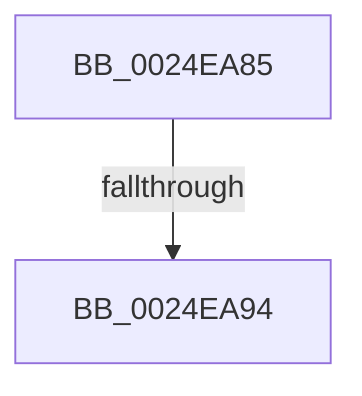

# sub_0024EA85

- RVA: `0x0024EA85`–`0x0024EAA8` (길이 `35` bytes)
- VA: `0x000000014024EA85`
- 실행 섹션: `.text`
- PDB 이름 있음: `아니요`; PDB Function 태그: `아니요`
- unwind 정보 RVA: `0x00063204`
- 디코드: `8`개 명령, `35/35` bytes 표시
- 미해석 바이트: `0` (있으면 어셈블리에 `.byte`로 보존)

> 이 문서는 커널 이미지의 기계어와 PDB 기호를 분석해 생성했습니다. 4번과 5번은 함수 원형과 자료형을 바이너리 사용 방식에서 추정한 C 해석이며 원본 소스 복구 결과는 아닙니다.

## 1. Dependencies

- 직접 호출 지점: **1**; 고유 호출 대상: **1**
- 직접 호출자로 확인된 함수: **0**
- RIP 상대 이미지 참조: **0**

### Outgoing calls
- `0x0024EA99` → [ExFreePoolWithTag](../../poolcode/B8/ExFreePoolWithTag_function_00B82870.md) (function, `0x00B82870`)

### Direct callers
- 이 함수 시작 RVA로 연결되는 직접 call은 확인되지 않았습니다. 간접 호출은 완전히 역산할 수 없습니다.

### Static image references
- 디코드된 RIP-relative 메모리 참조가 없습니다.

## 2. Other-region calls and transfers

- 다른 실행 섹션으로 향하는 call: **1**
  - `0x0024EA99` → [ExFreePoolWithTag](../../poolcode/B8/ExFreePoolWithTag_function_00B82870.md) (`.text` → `POOLCODE`)
- call이 아닌 외부 분기/꼬리 이동: **1**
  - `0x0024EA8E` → [sub_0024E6D3 + 0xCF](Unknown_function_0024E6D3.md) (`tail-transfer`)

## 3. Assembly (complete function range)

```asm
0024EA85  B8 18 01 00 00                  mov eax, 0x118
0024EA8A  66 44 3B C0                     cmp r8w, ax
0024EA8E  0F 84 0E FD FF FF               je 0x14024e7a2
0024EA94  33 D2                           xor edx, edx
0024EA96  48 8B CB                        mov rcx, rbx
0024EA99  E8 D2 3D 93 00                  call 0x140b82870
0024EA9E  48 8B 7C 24 60                  mov rdi, qword ptr [rsp + 0x60]
0024EAA3  4C 8B 7C 24 48                  mov r15, qword ptr [rsp + 0x48]
```

## 4. C-style interpretation (structured pseudocode)

```c
__int64 __fastcall sub_0024EA85(__int64 a1, int a2, unsigned __int16 a3, __int64 a4, __int64 a5, __int64 a6, __int64 a7, __int64 a8, __int64 a9, __int64 a10, __int64 a11, __int64 a12)
{
    __int64 result;

    a2 = 0;
    result = ExFreePoolWithTag(v_rbx, a2, a3, a4);
    return result;
}
```

## 5. (Beta) C Style

```c
int64_t sub_0024EA85(int64_t Arg1, int32_t Arg2, uint16_t Arg3, int64_t Arg4, uint64_t Arg5, uint64_t Arg6, uint64_t Arg7, uint64_t Arg8, int64_t Arg9, uint64_t Arg10, uint64_t Arg11, int64_t Arg12)
{
    int64_t result;

    Arg2 = 0;
    result = ExFreePoolWithTag(local_rbx, Arg2, Arg3, Arg4);
    return result;
}
```

## 6. Execution-region graph

[열기: 2D/3D 그래프와 함수 탐색 컨트롤 패널](../../../control-panel.html?section=text&rva=0x0024EA85&view=graph)

- 2D 그래프는 위에서 아래로 흐르고, 3D 그래프는 빈 공간을 드래그해 회전합니다. Shift+드래그는 이동, 휠은 확대·축소, 함수 노드 선택은 대상 보고서 이동입니다.

### Static fallback


