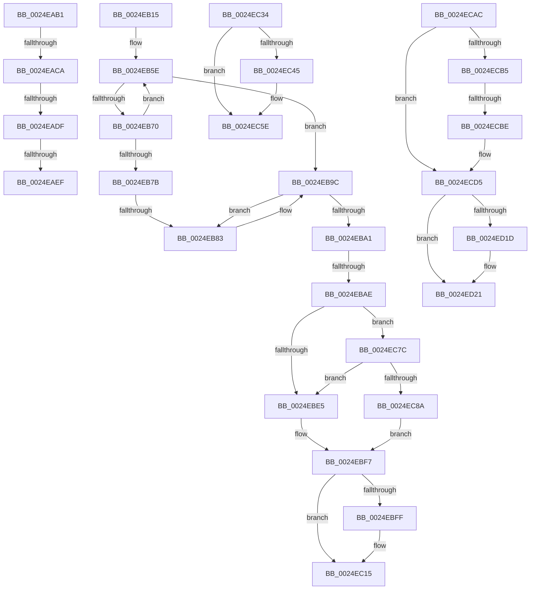

# sub_0024EAB1

- RVA: `0x0024EAB1`–`0x0024ED3C` (길이 `651` bytes)
- VA: `0x000000014024EAB1`
- 실행 섹션: `.text`
- PDB 이름 있음: `아니요`; PDB Function 태그: `아니요`
- unwind 정보 RVA: `0x00063230`
- 디코드: `146`개 명령, `651/651` bytes 표시
- 미해석 바이트: `0` (있으면 어셈블리에 `.byte`로 보존)

> 이 문서는 커널 이미지의 기계어와 PDB 기호를 분석해 생성했습니다. 4번과 5번은 함수 원형과 자료형을 바이너리 사용 방식에서 추정한 C 해석이며 원본 소스 복구 결과는 아닙니다.

## 1. Dependencies

- 직접 호출 지점: **9**; 고유 호출 대상: **5**
- 직접 호출자로 확인된 함수: **0**
- RIP 상대 이미지 참조: **11**

### Outgoing calls
- `0x0024EAFB` → [PspReturnResourceQuota](../38/PspReturnResourceQuota_function_0038FFC4.md) (function, `0x0038FFC4`)
- `0x0024EB1C` → [ExAcquireSpinLockShared](ExAcquireSpinLockShared_function_0024DCE0.md) (function, `0x0024DCE0`)
- `0x0024EB96` → [KeBugCheckEx](../4F/KeBugCheckEx_function_004FD660.md) (function, `0x004FD660`)
- `0x0024EC07` → [KiLowerIrqlProcessIrqlFlags](../4F/KiLowerIrqlProcessIrqlFlags_function_004F5698.md) (function, `0x004F5698`)
- `0x0024EC58` → [KeBugCheckEx](../4F/KeBugCheckEx_function_004FD660.md) (function, `0x004FD660`)
- `0x0024EC99` → [ExpReleaseSpinLockSharedFromDpcLevelInstrumented](../2F/ExpReleaseSpinLockSharedFromDpcLevelInstrumented_function_002F0F48.md) (function, `0x002F0F48`)
- `0x0024ECCF` → [KeBugCheckEx](../4F/KeBugCheckEx_function_004FD660.md) (function, `0x004FD660`)
- `0x0024ED12` → [KeBugCheckEx](../4F/KeBugCheckEx_function_004FD660.md) (function, `0x004FD660`)
- `0x0024ED36` → [KeBugCheckEx](../4F/KeBugCheckEx_function_004FD660.md) (function, `0x004FD660`)

### Direct callers
- 이 함수 시작 RVA로 연결되는 직접 call은 확인되지 않았습니다. 간접 호출은 완전히 역산할 수 없습니다.

### Static image references
- `0x0024EB15` → RVA `0x00EFACF8` (`.data`; read)
- `0x0024EB21` → RVA `0x00EFED38` (`.data`; read)
- `0x0024EB2B` → RVA `0x00EFED30` (`.data`; read)
- `0x0024EBB5` → RVA `0x00FC7228` (`ALMOSTRO`; read)
- `0x0024EBD8` → RVA `0x00FC6B06` (`ALMOSTRO`; read)
- `0x0024EBE5` → RVA `0x00EFACF8` (`.data`; read/write)
- `0x0024EBF7` → RVA `0x00FC6D20` (`ALMOSTRO`; read)
- `0x0024EC34` → RVA `0x00E27F80` (`.data`; read)
- `0x0024EC7C` → RVA `0x00F0DE58` (`.data`; read)
- `0x0024ECF9` → RVA `0x00FC6E4C` (`ALMOSTRO`; read)
- `0x0024ED03` → RVA `0x00000000` (`image boundary/outside`; read)

## 2. Other-region calls and transfers

- 다른 실행 섹션으로 향하는 call: **0**
- call이 아닌 외부 분기/꼬리 이동: **9**
  - `0x0024EAC4` → [sub_0024E7EF + 0x194](Unknown_function_0024E7EF.md) (`tail-transfer`)
  - `0x0024EAD9` → [sub_0024E7EF + 0x194](Unknown_function_0024E7EF.md) (`tail-transfer`)
  - `0x0024EAE9` → [sub_0024E7EF + 0x194](Unknown_function_0024E7EF.md) (`tail-transfer`)
  - `0x0024EB10` → [sub_0024E7EF + 0x194](Unknown_function_0024E7EF.md) (`tail-transfer`)
  - `0x0024EB7D` → [sub_0024ED60 + 0x1D](Unknown_function_0024ED60.md) (`tail-transfer`)
  - `0x0024EBA8` → [sub_0024ED60 + 0x15](Unknown_function_0024ED60.md) (`tail-transfer`)
  - `0x0024EC2F` → [sub_0024E7EF + 0xD6](Unknown_function_0024E7EF.md) (`tail-transfer`)
  - `0x0024EC77` → [sub_0024E7EF + 0x197](Unknown_function_0024E7EF.md) (`tail-transfer`)
  - `0x0024ECB8` → [sub_0024ED60 + 0x28](Unknown_function_0024ED60.md) (`tail-transfer`)

## 3. Assembly (complete function range)

```asm
0024EAB1  49 3B D4                        cmp rdx, r12
0024EAB4  48 8B C8                        mov rcx, rax
0024EAB7  49 0F 47 D4                     cmova rdx, r12
0024EABB  48 2B CA                        sub rcx, rdx
0024EABE  F0 49 0F B1 4D 40               lock cmpxchg qword ptr [r13 + 0x40], rcx
0024EAC4  0F 85 B9 FE FF FF               jne 0x14024e983
0024EACA  48 8B C2                        mov rax, rdx
0024EACD  F0 49 0F C1 45 48               lock xadd qword ptr [r13 + 0x48], rax
0024EAD3  48 03 D0                        add rdx, rax
0024EAD6  49 3B 11                        cmp rdx, qword ptr [r9]
0024EAD9  0F 86 A4 FE FF FF               jbe 0x14024e983
0024EADF  49 8B C6                        mov rax, r14
0024EAE2  49 87 45 48                     xchg qword ptr [r13 + 0x48], rax
0024EAE6  48 85 C0                        test rax, rax
0024EAE9  0F 84 94 FE FF FF               je 0x14024e983
0024EAEF  45 33 C9                        xor r9d, r9d
0024EAF2  4C 8B C0                        mov r8, rax
0024EAF5  49 8B D5                        mov rdx, r13
0024EAF8  41 8B CB                        mov ecx, r11d
0024EAFB  E8 C4 14 14 00                  call 0x14038ffc4
0024EB00  44 8B 84 24 98 00 00 00         mov r8d, dword ptr [rsp + 0x98]
0024EB08  4C 8B 9C 24 A8 00 00 00         mov r11, qword ptr [rsp + 0xa8]
0024EB10  E9 6E FE FF FF                  jmp 0x14024e983
0024EB15  48 8D 0D DC C1 CA 00            lea rcx, [rip + 0xcac1dc]
0024EB1C  E8 BF F1 FF FF                  call 0x14024dce0
0024EB21  4C 8B 15 10 02 CB 00            mov r10, qword ptr [rip + 0xcb0210]
0024EB28  48 8B CB                        mov rcx, rbx
0024EB2B  4C 8B 1D FE 01 CB 00            mov r11, qword ptr [rip + 0xcb01fe]
0024EB32  44 0F B6 C0                     movzx r8d, al
0024EB36  48 C1 E9 0C                     shr rcx, 0xc
0024EB3A  BE 01 00 00 00                  mov esi, 1
0024EB3F  48 69 D1 5F 9E 00 00            imul rdx, rcx, 0x9e5f
0024EB46  41 8D 4A FF                     lea ecx, [r10 - 1]
0024EB4A  88 84 24 90 00 00 00            mov byte ptr [rsp + 0x90], al
0024EB51  4C 8B CA                        mov r9, rdx
0024EB54  49 C1 E9 20                     shr r9, 0x20
0024EB58  44 33 CA                        xor r9d, edx
0024EB5B  44 23 C9                        and r9d, ecx
0024EB5E  41 8B D1                        mov edx, r9d
0024EB61  48 C1 E2 05                     shl rdx, 5
0024EB65  49 03 D3                        add rdx, r11
0024EB68  48 8B 02                        mov rax, qword ptr [rdx]
0024EB6B  48 3B C3                        cmp rax, rbx
0024EB6E  74 2C                           je 0x14024eb9c
0024EB70  41 FF C1                        inc r9d
0024EB73  41 8B C1                        mov eax, r9d
0024EB76  49 3B C2                        cmp rax, r10
0024EB79  72 E3                           jb 0x14024eb5e
0024EB7B  85 F6                           test esi, esi
0024EB7D  0F 85 FA 01 00 00               jne 0x14024ed7d
0024EB83  BA 22 00 00 00                  mov edx, 0x22
0024EB88  4C 89 74 24 20                  mov qword ptr [rsp + 0x20], r14
0024EB8D  4D 8B CD                        mov r9, r13
0024EB90  4C 8B C3                        mov r8, rbx
0024EB93  8D 4A F7                        lea ecx, [rdx - 9]
0024EB96  E8 C5 EA 2A 00                  call 0x1404fd660
0024EB9B  CC                              int3
0024EB9C  48 85 D2                        test rdx, rdx
0024EB9F  74 E2                           je 0x14024eb83
0024EBA1  F7 42 0C 00 01 00 00            test dword ptr [rdx + 0xc], 0x100
0024EBA8  0F 84 C7 01 00 00               je 0x14024ed75
0024EBAE  48 8B 72 18                     mov rsi, qword ptr [rdx + 0x18]
0024EBB2  48 8B C3                        mov rax, rbx
0024EBB5  48 33 35 6C 86 D7 00            xor rsi, qword ptr [rip + 0xd7866c]
0024EBBC  4C 8B 62 10                     mov r12, qword ptr [rdx + 0x10]
0024EBC0  48 33 F3                        xor rsi, rbx
0024EBC3  48 33 05 5E 86 D7 00            xor rax, qword ptr [rip + 0xd7865e]
0024EBCA  48 89 42 18                     mov qword ptr [rdx + 0x18], rax
0024EBCE  8B 42 08                        mov eax, dword ptr [rdx + 8]
0024EBD1  89 84 24 98 00 00 00            mov dword ptr [rsp + 0x98], eax
0024EBD8  F6 05 27 7F D7 00 01            test byte ptr [rip + 0xd77f27], 1
0024EBDF  0F 85 97 00 00 00               jne 0x14024ec7c
0024EBE5  F0 81 25 08 C1 CA 00 FF FF FF BF  lock and dword ptr [rip + 0xcac108], 0xbfffffff
0024EBF0  F0 FF 0D 01 C1 CA 00            lock dec dword ptr [rip + 0xcac101]
0024EBF7  39 3D 23 81 D7 00               cmp dword ptr [rip + 0xd78123], edi
0024EBFD  74 16                           je 0x14024ec15
0024EBFF  44 0F 20 C1                     mov rcx, cr8
0024EC03  41 0F B6 D0                     movzx edx, r8b
0024EC07  E8 8C 6A 2A 00                  call 0x1404f5698
0024EC0C  44 0F B6 84 24 90 00 00 00      movzx r8d, byte ptr [rsp + 0x90]
0024EC15  41 0F B6 C0                     movzx eax, r8b
0024EC19  44 0F 22 C0                     mov cr8, rax
0024EC1D  44 8B 84 24 98 00 00 00         mov r8d, dword ptr [rsp + 0x98]
0024EC25  48 BA 00 00 00 00 00 80 FF FF   movabs rdx, 0xffff800000000000
0024EC2F  E9 91 FC FF FF                  jmp 0x14024e8c5
0024EC34  48 8D 0D 45 93 BD 00            lea rcx, [rip + 0xbd9345]
0024EC3B  48 39 8C 24 A0 00 00 00         cmp qword ptr [rsp + 0xa0], rcx
0024EC43  75 19                           jne 0x14024ec5e
0024EC45  4D 8B CA                        mov r9, r10
0024EC48  4C 89 64 24 20                  mov qword ptr [rsp + 0x20], r12
0024EC4D  4D 8B C3                        mov r8, r11
0024EC50  48 8B D6                        mov rdx, rsi
0024EC53  B9 21 00 00 00                  mov ecx, 0x21
0024EC58  E8 03 EA 2A 00                  call 0x1404fd660
0024EC5D  CC                              int3
0024EC5E  4C 8B 6C 24 30                  mov r13, qword ptr [rsp + 0x30]
0024EC63  4C 03 E9                        add r13, rcx
0024EC66  48 89 8C 24 A0 00 00 00         mov qword ptr [rsp + 0xa0], rcx
0024EC6E  41 0F 0D 4D 00                  prefetchw byte ptr [r13]
0024EC73  49 8B 7D 00                     mov rdi, qword ptr [r13]
0024EC77  E9 0A FD FF FF                  jmp 0x14024e986
0024EC7C  8B 05 D6 F1 CB 00               mov eax, dword ptr [rip + 0xcbf1d6]
0024EC82  85 C0                           test eax, eax
0024EC84  0F 85 5B FF FF FF               jne 0x14024ebe5
0024EC8A  48 8B 94 24 88 00 00 00         mov rdx, qword ptr [rsp + 0x88]
0024EC92  48 8D 0D 5F C0 CA 00            lea rcx, [rip + 0xcac05f]
0024EC99  E8 AA 22 0A 00                  call 0x1402f0f48
0024EC9E  44 0F B6 84 24 90 00 00 00      movzx r8d, byte ptr [rsp + 0x90]
0024ECA7  E9 4B FF FF FF                  jmp 0x14024ebf7
0024ECAC  48 8B 4E D8                     mov rcx, qword ptr [rsi - 0x28]
0024ECB0  48 85 C9                        test rcx, rcx
0024ECB3  75 20                           jne 0x14024ecd5
0024ECB5  4D 85 FF                        test r15, r15
0024ECB8  0F 89 CA 00 00 00               jns 0x14024ed88
0024ECBE  33 D2                           xor edx, edx
0024ECC0  4C 89 7C 24 20                  mov qword ptr [rsp + 0x20], r15
0024ECC5  44 8D 49 04                     lea r9d, [rcx + 4]
0024ECC9  4C 8B C6                        mov r8, rsi
0024ECCC  8D 4A 18                        lea ecx, [rdx + 0x18]
0024ECCF  E8 8C E9 2A 00                  call 0x1404fd660
0024ECD4  CC                              int3
0024ECD5  41 B9 03 00 00 00               mov r9d, 3
0024ECDB  48 89 4C 24 20                  mov qword ptr [rsp + 0x20], rcx
0024ECE0  48 8D 46 D0                     lea rax, [rsi - 0x30]
0024ECE4  4C 8B C6                        mov r8, rsi
0024ECE7  48 C1 E8 08                     shr rax, 8
0024ECEB  0F B6 D0                        movzx edx, al
0024ECEE  0F B6 46 E8                     movzx eax, byte ptr [rsi - 0x18]
0024ECF2  41 8D 49 15                     lea ecx, [r9 + 0x15]
0024ECF6  48 33 D0                        xor rdx, rax
0024ECF9  0F B6 05 4C 81 D7 00            movzx eax, byte ptr [rip + 0xd7814c]
0024ED00  48 33 D0                        xor rdx, rax
0024ED03  48 8D 05 F6 12 DB FF            lea rax, [rip - 0x24ed0a]
0024ED0A  48 8B 94 D0 00 78 FC 00         mov rdx, qword ptr [rax + rdx*8 + 0xfc7800]
0024ED12  E8 49 E9 2A 00                  call 0x1404fd660
0024ED17  CC                              int3
0024ED18  48 85 FF                        test rdi, rdi
0024ED1B  74 04                           je 0x14024ed21
0024ED1D  44 8B 77 04                     mov r14d, dword ptr [rdi + 4]
0024ED21  45 8B CE                        mov r9d, r14d
0024ED24  4C 8B C3                        mov r8, rbx
0024ED27  BA 0D 00 00 00                  mov edx, 0xd
0024ED2C  48 89 74 24 20                  mov qword ptr [rsp + 0x20], rsi
0024ED31  B9 C2 00 00 00                  mov ecx, 0xc2
0024ED36  E8 25 E9 2A 00                  call 0x1404fd660
0024ED3B  CC                              int3
```

## 4. C-style interpretation (structured pseudocode)

```c
__int64 __fastcall sub_0024EAB1(__int64 a1, __int64 a2, __int64 a3, __int64 a4, __int64 a5, __int64 a6, __int64 a7, __int64 a8, __int64 a9, __int64 a10, __int64 a11, __int64 a12, __int64 a13, __int64 a14, __int64 a15, __int64 a16, __int64 a17, __int64 a18, unsigned int a19, __int64 a20, __int64 a21)
{
    __int64 result;
    unsigned __int64 v_stack_p20;
    unsigned __int64 v_stack_p30;
    unsigned __int64 v_stack_p88;
    unsigned __int8 v_stack_p90;
    unsigned int v_stack_p98;
    unsigned __int64 v_stack_pA0;

    if (a2 > v_r12) { a2 = v_r12; }
    a1 = (result) - (a2);
    a2 = (a2) + (a2);
    a4 = 0;
    result = PspReturnResourceQuota((unsigned int)((unsigned int)(v_r11)), v_r13, v_r14, a4);
}
```

## 5. (Beta) C Style

```c
int64_t sub_0024EAB1(int64_t Arg1, int64_t Arg2, int64_t Arg3, void *Arg4, uint64_t Arg5, uint64_t Arg6, uint64_t Arg7, uint64_t Arg8, uint64_t Arg9, uint64_t Arg10, uint64_t Arg11, uint64_t Arg12, uint64_t Arg13, uint64_t Arg14, uint64_t Arg15, uint64_t Arg16, uint64_t Arg17, uint64_t Arg18, uint32_t Arg19, uint64_t Arg20, int64_t Arg21)
{
    uint8_t *arg4 = (uint8_t *)Arg4;

    int64_t result;
    uint64_t v_stack_p20;
    uint64_t v_stack_p30;
    uint64_t v_stack_p88;
    uint8_t v_stack_p90;
    uint32_t v_stack_p98;
    uint64_t v_stack_pA0;

    if (Arg2 > local_r12) { Arg2 = local_r12; }
    Arg1 = (result) - (Arg2);
    Arg2 = (Arg2) + (Arg2);
    Arg4 = 0;
    result = PspReturnResourceQuota((uint32_t)((uint32_t)(local_r11)), local_r13, local_r14, Arg4);
}
```

### 관측된 메모리 오프셋

구조체 형식이 확인되지 않은 접근은 인자 기준의 오프셋으로만 기록했습니다.

| 기준 인자 | 오프셋 표현 | 폭 (bit) | 접근 |
|---|---:|---:|---|
| `Arg4` | `+ 0x0` | `64` | `R` |

## 6. Execution-region graph

[열기: 2D/3D 그래프와 함수 탐색 컨트롤 패널](../../../control-panel.html?section=text&rva=0x0024EAB1&view=graph)

- 2D 그래프는 위에서 아래로 흐르고, 3D 그래프는 빈 공간을 드래그해 회전합니다. Shift+드래그는 이동, 휠은 확대·축소, 함수 노드 선택은 대상 보고서 이동입니다.

### Static fallback


