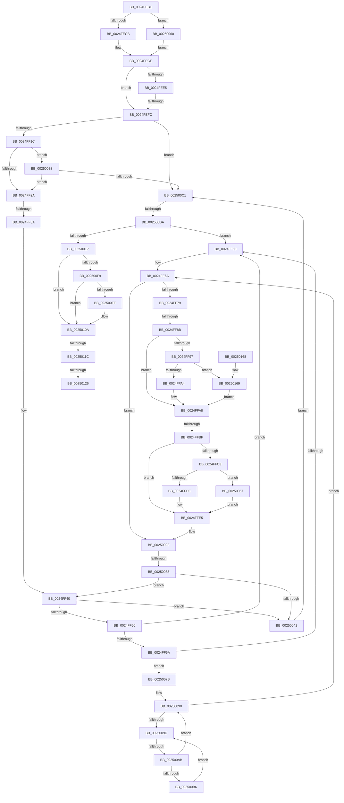

# sub_0024FEBE

- RVA: `0x0024FEBE`–`0x00250185` (길이 `711` bytes)
- VA: `0x000000014024FEBE`
- 실행 섹션: `.text`
- PDB 이름 있음: `아니요`; PDB Function 태그: `아니요`
- unwind 정보 RVA: `0x0006334C`
- 디코드: `166`개 명령, `711/711` bytes 표시
- 미해석 바이트: `0` (있으면 어셈블리에 `.byte`로 보존)

> 이 문서는 커널 이미지의 기계어와 PDB 기호를 분석해 생성했습니다. 4번과 5번은 함수 원형과 자료형을 바이너리 사용 방식에서 추정한 C 해석이며 원본 소스 복구 결과는 아닙니다.

## 1. Dependencies

- 직접 호출 지점: **4**; 고유 호출 대상: **4**
- 직접 호출자로 확인된 함수: **0**
- RIP 상대 이미지 참조: **1**

### Outgoing calls
- `0x0024FF02` → [KiAcquireKobjectLockSafe](../25/KiAcquireKobjectLockSafe_function_00251C90.md) (function, `0x00251C90`)
- `0x0024FFAB` → [KiRemovePrcbWaitEntry](../25/KiRemovePrcbWaitEntry_function_002502D0.md) (function, `0x002502D0`)
- `0x00250105` → [KiWakeOtherQueueWaiters](../39/KiWakeOtherQueueWaiters_function_003964D0.md) (function, `0x003964D0`)
- `0x00250148` → [KiExitDispatcher](../25/KiExitDispatcher_function_00251CF0.md) (function, `0x00251CF0`)

### Direct callers
- 이 함수 시작 RVA로 연결되는 직접 call은 확인되지 않았습니다. 간접 호출은 완전히 역산할 수 없습니다.

### Static image references
- `0x0025009F` → RVA `0x00FC52AC` (`ALMOSTRO`; reference)

## 2. Other-region calls and transfers

- 다른 실행 섹션으로 향하는 call: **0**
- call이 아닌 외부 분기/꼬리 이동: **9**
  - `0x0024FEF6` → [sub_002501EF + 0x2E](../25/Unknown_function_002501EF.md) (`tail-transfer`)
  - `0x0024FF34` → [sub_002501EF + 0x1C](../25/Unknown_function_002501EF.md) (`tail-transfer`)
  - `0x0024FF85` → [sub_002501EF + 0x5A](../25/Unknown_function_002501EF.md) (`tail-transfer`)
  - `0x0024FFB9` → [sub_002501EF + 0x13](../25/Unknown_function_002501EF.md) (`tail-transfer`)
  - `0x00250032` → [sub_00250195](../25/Unknown_function_00250195.md) (`tail-transfer`)
  - `0x002500A5` → [sub_00250195 + 0x17](../25/Unknown_function_00250195.md) (`tail-transfer`)
  - `0x002500D4` → [sub_002501EF + 0xB4](../25/Unknown_function_002501EF.md) (`tail-transfer`)
  - `0x00250116` → [sub_002501EF](../25/Unknown_function_002501EF.md) (`tail-transfer`)
  - `0x00250120` → [sub_002501EF + 0x36](../25/Unknown_function_002501EF.md) (`tail-transfer`)

## 3. Assembly (complete function range)

```asm
0024FEBE  4C 89 64 24 48                  mov qword ptr [rsp + 0x48], r12
0024FEC3  85 FF                           test edi, edi
0024FEC5  0F 85 95 01 00 00               jne 0x140250060
0024FECB  45 33 E4                        xor r12d, r12d
0024FECE  48 8B 83 50 06 00 00            mov rax, qword ptr [rbx + 0x650]
0024FED5  48 8B CB                        mov rcx, rbx
0024FED8  48 85 C0                        test rax, rax
0024FEDB  48 0F 45 C8                     cmovne rcx, rax
0024FEDF  40 F6 C5 05                     test bpl, 5
0024FEE3  74 17                           je 0x14024fefc
0024FEE5  48 8B 81 20 02 00 00            mov rax, qword ptr [rcx + 0x220]
0024FEEC  8B 80 88 00 00 00               mov eax, dword ptr [rax + 0x88]
0024FEF2  0F BA E0 0D                     bt eax, 0xd
0024FEF6  0F 82 21 03 00 00               jb 0x14025021d
0024FEFC  40 32 FF                        xor dil, dil
0024FEFF  49 8B CE                        mov rcx, r14
0024FF02  E8 89 1D 00 00                  call 0x140251c90
0024FF07  41 8B 46 04                     mov eax, dword ptr [r14 + 4]
0024FF0B  89 84 24 90 00 00 00            mov dword ptr [rsp + 0x90], eax
0024FF12  4D 39 6D 00                     cmp qword ptr [r13], r13
0024FF16  0F 84 A5 01 00 00               je 0x1402500c1
0024FF1C  41 8B 46 28                     mov eax, dword ptr [r14 + 0x28]
0024FF20  41 3B 46 2C                     cmp eax, dword ptr [r14 + 0x2c]
0024FF24  0F 83 8E 01 00 00               jae 0x1402500b8
0024FF2A  48 8B 83 E8 00 00 00            mov rax, qword ptr [rbx + 0xe8]
0024FF31  49 3B C6                        cmp rax, r14
0024FF34  0F 84 D1 02 00 00               je 0x14025020b
0024FF3A  49 8B 75 00                     mov rsi, qword ptr [r13]
0024FF3E  66 90                           nop
0024FF40  48 8B FE                        mov rdi, rsi
0024FF43  48 8B 36                        mov rsi, qword ptr [rsi]
0024FF46  80 7F 10 03                     cmp byte ptr [rdi + 0x10], 3
0024FF4A  0F 85 F1 00 00 00               jne 0x140250041
0024FF50  48 8B 47 08                     mov rax, qword ptr [rdi + 8]
0024FF54  48 39 7E 08                     cmp qword ptr [rsi + 8], rdi
0024FF58  75 09                           jne 0x14024ff63
0024FF5A  48 39 38                        cmp qword ptr [rax], rdi
0024FF5D  0F 84 18 01 00 00               je 0x14025007b
0024FF63  B9 03 00 00 00                  mov ecx, 3
0024FF68  CD 29                           int 0x29
0024FF6A  0F B6 83 84 01 00 00            movzx eax, byte ptr [rbx + 0x184]
0024FF71  3C 05                           cmp al, 5
0024FF73  0F 85 A9 00 00 00               jne 0x140250022
0024FF79  0F B6 4B 70                     movzx ecx, byte ptr [rbx + 0x70]
0024FF7D  8B C1                           mov eax, ecx
0024FF7F  83 E0 07                        and eax, 7
0024FF82  83 F8 01                        cmp eax, 1
0024FF85  0F 85 BE 02 00 00               jne 0x140250249
0024FF8B  48 8B 93 E8 00 00 00            mov rdx, qword ptr [rbx + 0xe8]
0024FF92  48 85 D2                        test rdx, rdx
0024FF95  74 11                           je 0x14024ffa8
0024FF97  0F B6 02                        movzx eax, byte ptr [rdx]
0024FF9A  24 7F                           and al, 0x7f
0024FF9C  3C 15                           cmp al, 0x15
0024FF9E  0F 84 C5 01 00 00               je 0x140250169
0024FFA4  F0 FF 42 28                     lock inc dword ptr [rdx + 0x28]
0024FFA8  48 8B CB                        mov rcx, rbx
0024FFAB  E8 20 03 00 00                  call 0x1402502d0
0024FFB0  0F B6 83 84 01 00 00            movzx eax, byte ptr [rbx + 0x184]
0024FFB7  3C 01                           cmp al, 1
0024FFB9  0F 84 43 02 00 00               je 0x140250202
0024FFBF  3C 05                           cmp al, 5
0024FFC1  75 22                           jne 0x14024ffe5
0024FFC3  48 B8 20 03 00 00 80 F7 FF FF   movabs rax, 0xfffff78000000320
0024FFCD  8B 08                           mov ecx, dword ptr [rax]
0024FFCF  2B 8B B4 01 00 00               sub ecx, dword ptr [rbx + 0x1b4]
0024FFD5  44 38 BB 87 01 00 00            cmp byte ptr [rbx + 0x187], r15b
0024FFDC  74 79                           je 0x140250057
0024FFDE  48 01 8B E8 03 00 00            add qword ptr [rbx + 0x3e8], rcx
0024FFE5  48 8B 54 24 30                  mov rdx, qword ptr [rsp + 0x30]
0024FFEA  48 8D 8B D8 00 00 00            lea rcx, [rbx + 0xd8]
0024FFF1  C6 83 84 01 00 00 07            mov byte ptr [rbx + 0x184], 7
0024FFF8  48 8B 82 08 2D 00 00            mov rax, qword ptr [rdx + 0x2d08]
0024FFFF  48 89 01                        mov qword ptr [rcx], rax
00250002  48 8B 84 24 98 00 00 00         mov rax, qword ptr [rsp + 0x98]
0025000A  48 89 8A 08 2D 00 00            mov qword ptr [rdx + 0x2d08], rcx
00250011  48 89 83 C8 00 00 00            mov qword ptr [rbx + 0xc8], rax
00250018  4C 89 A3 D0 03 00 00            mov qword ptr [rbx + 0x3d0], r12
0025001F  41 B7 01                        mov r15b, 1
00250022  4C 89 63 40                     mov qword ptr [rbx + 0x40], r12
00250026  0F B6 47 11                     movzx eax, byte ptr [rdi + 0x11]
0025002A  FE C0                           inc al
0025002C  88 47 11                        mov byte ptr [rdi + 0x11], al
0025002F  45 84 FF                        test r15b, r15b
00250032  0F 85 5D 01 00 00               jne 0x140250195
00250038  49 3B F5                        cmp rsi, r13
0025003B  0F 85 FF FE FF FF               jne 0x14024ff40
00250041  4C 8B BC 24 98 00 00 00         mov r15, qword ptr [rsp + 0x98]
00250049  8B AC 24 A8 00 00 00            mov ebp, dword ptr [rsp + 0xa8]
00250050  48 8B 74 24 30                  mov rsi, qword ptr [rsp + 0x30]
00250055  EB 6A                           jmp 0x1402500c1
00250057  48 01 8B E0 03 00 00            add qword ptr [rbx + 0x3e0], rcx
0025005E  EB 85                           jmp 0x14024ffe5
00250060  41 F6 46 01 02                  test byte ptr [r14 + 1], 2
00250065  41 BC 00 00 00 00               mov r12d, 0
0025006B  41 0F 45 FC                     cmovne edi, r12d
0025006F  89 BC 24 A0 00 00 00            mov dword ptr [rsp + 0xa0], edi
00250076  E9 53 FE FF FF                  jmp 0x14024fece
0025007B  48 89 30                        mov qword ptr [rax], rsi
0025007E  45 32 FF                        xor r15b, r15b
00250081  48 89 46 08                     mov qword ptr [rsi + 8], rax
00250085  41 8B EC                        mov ebp, r12d
00250088  48 8B 5F 18                     mov rbx, qword ptr [rdi + 0x18]
0025008C  0F 1F 40 00                     nop dword ptr [rax]
00250090  F0 48 0F BA 6B 40 00            lock bts qword ptr [rbx + 0x40], 0
00250097  0F 83 CD FE FF FF               jae 0x14024ff6a
0025009D  FF C5                           inc ebp
0025009F  85 2D 07 52 D7 00               test dword ptr [rip + 0xd75207], ebp
002500A5  0F 84 01 01 00 00               je 0x1402501ac
002500AB  F3 90                           pause
002500AD  48 8B 43 40                     mov rax, qword ptr [rbx + 0x40]
002500B1  48 85 C0                        test rax, rax
002500B4  74 DA                           je 0x140250090
002500B6  EB E5                           jmp 0x14025009d
002500B8  40 84 FF                        test dil, dil
002500BB  0F 85 69 FE FF FF               jne 0x14024ff2a
002500C1  41 8B 4E 04                     mov ecx, dword ptr [r14 + 4]
002500C5  8D 41 01                        lea eax, [rcx + 1]
002500C8  41 89 46 04                     mov dword ptr [r14 + 4], eax
002500CC  49 8D 46 18                     lea rax, [r14 + 0x18]
002500D0  40 F6 C5 02                     test bpl, 2
002500D4  0F 85 C9 01 00 00               jne 0x1402502a3
002500DA  48 8B 50 08                     mov rdx, qword ptr [rax + 8]
002500DE  48 39 02                        cmp qword ptr [rdx], rax
002500E1  0F 85 7C FE FF FF               jne 0x14024ff63
002500E7  49 89 07                        mov qword ptr [r15], rax
002500EA  49 89 57 08                     mov qword ptr [r15 + 8], rdx
002500EE  4C 89 3A                        mov qword ptr [rdx], r15
002500F1  4C 89 78 08                     mov qword ptr [rax + 8], r15
002500F5  85 C9                           test ecx, ecx
002500F7  75 11                           jne 0x14025010a
002500F9  4D 39 6D 00                     cmp qword ptr [r13], r13
002500FD  74 0B                           je 0x14025010a
002500FF  49 8B D6                        mov rdx, r14
00250102  48 8B CE                        mov rcx, rsi
00250105  E8 C6 63 14 00                  call 0x1403964d0
0025010A  F0 41 81 26 7F FF FF FF         lock and dword ptr [r14], 0xffffff7f
00250112  40 F6 C5 01                     test bpl, 1
00250116  0F 85 D3 00 00 00               jne 0x1402501ef
0025011C  40 F6 C5 04                     test bpl, 4
00250120  0F 85 FF 00 00 00               jne 0x140250225
00250126  48 8B 5C 24 30                  mov rbx, qword ptr [rsp + 0x30]
0025012B  48 8B 44 24 38                  mov rax, qword ptr [rsp + 0x38]
00250130  41 B8 01 00 00 00               mov r8d, 1
00250136  44 8B 8C 24 A0 00 00 00         mov r9d, dword ptr [rsp + 0xa0]
0025013E  41 8B D4                        mov edx, r12d
00250141  48 8B CB                        mov rcx, rbx
00250144  88 44 24 20                     mov byte ptr [rsp + 0x20], al
00250148  E8 A3 1B 00 00                  call 0x140251cf0
0025014D  8B 84 24 90 00 00 00            mov eax, dword ptr [rsp + 0x90]
00250154  4C 8B 64 24 48                  mov r12, qword ptr [rsp + 0x48]
00250159  48 83 C4 50                     add rsp, 0x50
0025015D  41 5F                           pop r15
0025015F  41 5E                           pop r14
00250161  41 5D                           pop r13
00250163  5F                              pop rdi
00250164  5E                              pop rsi
00250165  5D                              pop rbp
00250166  5B                              pop rbx
00250167  C3                              ret
00250168  CC                              int3
00250169  8B 83 1C 02 00 00               mov eax, dword ptr [rbx + 0x21c]
0025016F  0F B6 C0                        movzx eax, al
00250172  89 83 1C 02 00 00               mov dword ptr [rbx + 0x21c], eax
00250178  F0 FF 84 82 18 02 00 00         lock inc dword ptr [rdx + rax*4 + 0x218]
00250180  E9 23 FE FF FF                  jmp 0x14024ffa8
```

## 4. C-style interpretation (structured pseudocode)

```c
__int64 __fastcall sub_0024FEBE(__int64 a1, __int64 a2, __int64 a3, __int64 a4, __int64 a5, __int64 a6, __int64 a7, __int64 a8, __int64 a9, __int64 a10, __int64 a11, __int64 a12, __int64 a13, __int64 a14, __int64 a15, __int64 a16, __int64 a17, unsigned int a18, __int64 a19, unsigned int a20, unsigned int a21)
{
    __int64 result;
    __int64 v_r12;
    __int64 v_r15;
    __int64 v_rbp;
    __int64 v_rdi;
    __int64 v_rsp;
    unsigned __int8 v_stack_p20;
    unsigned __int64 v_stack_p48;
    unsigned int v_stack_p90;
    unsigned int v_stack_pA0;

    v_stack_p48 = v_r12;
    if ((unsigned int)(v_rdi) != 0) goto loc_00250060;
    v_r12 = 0;
loc_0024FECE:
    a1 = v_rbx;
    if (*(unsigned __int64 *)(v_rbx + 1616) != 0) { a1 = *(unsigned __int64 *)(v_rbx + 1616); }
    if ((((unsigned __int8)(v_rbp)) & (5)) == 0) goto loc_0024FEFC;
loc_0024FEFC:
    v_rdi = 0;
    result = KiAcquireKobjectLockSafe(v_r14, a2, a3, a4);
    v_stack_p90 = (unsigned int)((unsigned int)(*(unsigned int *)(v_r14 + 4)));
    if ((*(unsigned __int64 *)(v_r13)) == v_r13) goto loc_002500C1;
    if (((unsigned int)((unsigned int)(*(unsigned int *)(v_r14 + 40)))) >= (*(unsigned int *)(v_r14 + 44))) goto loc_002500B8;
loc_0024FF2A:
loc_0024FF40:
    if ((*(unsigned __int8 *)(*(unsigned __int64 *)(v_r13) + 16)) != 3) goto loc_00250041;
    if ((*(unsigned __int64 *)(*(unsigned __int64 *)(*(unsigned __int64 *)(v_r13)) + 8)) != (*(unsigned __int64 *)(v_r13))) goto loc_0024FF63;
    if ((*(unsigned __int64 *)(*(unsigned __int64 *)(*(unsigned __int64 *)(v_r13) + 8))) == (*(unsigned __int64 *)(v_r13))) goto loc_0025007B;
loc_0024FF63:
loc_0024FF6A:
    if (((unsigned __int8)(*(unsigned __int8 *)(v_rbx + 388))) != 5) goto loc_00250022;
    result = (unsigned int)(((unsigned int)((unsigned int)(*(unsigned __int8 *)(v_rbx + 112)))) & (7));
    if (*(unsigned __int64 *)(v_rbx + 232) == 0) goto loc_0024FFA8;
    result = (unsigned __int8)((*(unsigned __int8 *)(*(unsigned __int64 *)(v_rbx + 232))) & (127));
    if (((unsigned __int8)(result)) == 21) goto loc_00250169;
loc_0024FFA8:
    result = KiRemovePrcbWaitEntry(v_rbx, *(unsigned __int64 *)(v_rbx + 232), a3, a4);
    if (((unsigned __int8)(*(unsigned __int8 *)(v_rbx + 388))) != 5) goto loc_0024FFE5;
    a1 = (unsigned int)(((unsigned int)(*(unsigned int *)(*(unsigned __int8 *)(v_rbx + 388)))) - (*(unsigned int *)(v_rbx + 436)));
    if ((*(unsigned __int8 *)(v_rbx + 391)) == ((unsigned __int8)(v_r15))) goto loc_00250057;
loc_0024FFE5:
    *(unsigned __int8 *)(v_rbx + 388) = 7;
    *(unsigned __int64 *)(v_rbx + 216) = *(unsigned __int64 *)(a6 + 11528);
    *(unsigned __int64 *)(a6 + 11528) = v_rbx + 216;
    *(unsigned __int64 *)(v_rbx + 200) = a19;
    *(unsigned __int64 *)(v_rbx + 976) = 0;
loc_00250022:
    *(unsigned __int64 *)(v_rbx + 64) = 0;
    result = (unsigned __int8)((*(unsigned __int8 *)(*(unsigned __int64 *)(v_r13) + 17)) + 1);
    *(unsigned __int8 *)(*(unsigned __int64 *)(v_r13) + 17) = (unsigned __int8)(result);
    if ((*(unsigned __int64 *)(*(unsigned __int64 *)(v_r13))) != v_r13) goto loc_0024FF40;
loc_00250041:
    goto loc_002500C1;
loc_00250057:
    goto loc_0024FFE5;
loc_00250060:
    v_rdi = *(unsigned __int64 *)(v_r13);
    if (((*(unsigned __int8 *)(v_r14 + 1)) & (2)) != 0) { v_rdi = 0; }
    v_stack_pA0 = (unsigned int)(v_rdi);
    goto loc_0024FECE;
loc_0025007B:
    *(unsigned __int64 *)(result) = a6;
    v_r15 = 0;
    *(unsigned __int64 *)(a6 + 8) = result;
loc_00250090:
    if (condition_is_above_or_equal) goto loc_0024FF6A;
loc_0025009D:
    v_rbp = (unsigned int)((0) + 1);
    if (*(unsigned __int64 *)(*(unsigned __int64 *)(v_rdi + 24) + 64) == 0) goto loc_00250090;
    goto loc_0025009D;
loc_002500B8:
    if ((unsigned __int8)(v_rdi) != 0) goto loc_0024FF2A;
loc_002500C1:
    *(unsigned int *)(v_r14 + 4) = (unsigned int)((unsigned int)(*(unsigned int *)(v_r14 + 4)) + 1);
    if ((*(unsigned __int64 *)(*(unsigned __int64 *)(v_r14 + 24 + 8))) != (v_r14 + 24)) goto loc_0024FF63;
    *(unsigned __int64 *)(v_r15) = v_r14 + 24;
    *(unsigned __int64 *)(v_r15 + 8) = *(unsigned __int64 *)(v_r14 + 24 + 8);
    *(unsigned __int64 *)(*(unsigned __int64 *)(v_r14 + 24 + 8)) = 0;
    *(unsigned __int64 *)(v_r14 + 24 + 8) = 0;
    if ((unsigned int)((unsigned int)(*(unsigned int *)(v_r14 + 4))) != 0) goto loc_0025010A;
    result = v_r14 + 24;
    if ((*(unsigned __int64 *)(v_r13)) != v_r13) {
        a2 = v_r14;
        a1 = a6;
        result = KiWakeOtherQueueWaiters(a1, a2, a3, a4);
    }
    v_stack_p20 = (unsigned __int8)(a7);
    result = KiExitDispatcher(a6, 0, 1, (unsigned int)(a20));
    v_rsp = (v_rsp) + (80);
    return (unsigned int)(a18);
loc_00250169:
    *(unsigned int *)(a6 + 540) = (unsigned int)((unsigned __int8)((unsigned int)(*(unsigned int *)(a6 + 540))));
    goto loc_0024FFA8;
}
```

## 5. (Beta) C Style

```c
int64_t sub_0024FEBE(int64_t Arg1, int64_t Arg2, int64_t Arg3, int64_t Arg4, uint64_t Arg5, void *Arg6, int64_t Arg7, uint64_t Arg8, int64_t Arg9, uint64_t Arg10, uint64_t Arg11, uint64_t Arg12, uint64_t Arg13, uint64_t Arg14, uint64_t Arg15, uint64_t Arg16, uint64_t Arg17, uint32_t Arg18, int64_t Arg19, uint32_t Arg20, uint32_t Arg21)
{
    uint8_t *arg6 = (uint8_t *)Arg6;

    int64_t result;
    int64_t local_r12;
    int64_t local_r15;
    int64_t local_rbp;
    int64_t local_rdi;
    int64_t local_rsp;
    uint8_t v_stack_p20;
    uint64_t v_stack_p48;
    uint32_t v_stack_p90;
    uint32_t v_stack_pA0;

    v_stack_p48 = local_r12;
    if ((uint32_t)(local_rdi) != 0) goto loc_00250060;
    local_r12 = 0;
loc_0024FECE:
    Arg1 = local_rbx;
    if (*(uint64_t *)(local_rbx + 0x650) != 0) { Arg1 = *(uint64_t *)(local_rbx + 0x650); }
    if ((((uint8_t)(local_rbp)) & (5)) == 0) goto loc_0024FEFC;
loc_0024FEFC:
    local_rdi = 0;
    result = KiAcquireKobjectLockSafe(local_r14, Arg2, Arg3, Arg4);
    v_stack_p90 = (uint32_t)((uint32_t)(*(uint32_t *)(local_r14 + 0x4)));
    if ((*(uint64_t *)(local_r13)) == local_r13) goto loc_002500C1;
    if (((uint32_t)((uint32_t)(*(uint32_t *)(local_r14 + 0x28)))) >= (*(uint32_t *)(local_r14 + 0x2C))) goto loc_002500B8;
loc_0024FF2A:
loc_0024FF40:
    if ((*(uint8_t *)(*(uint64_t *)(local_r13) + 0x10)) != 3) goto loc_00250041;
    if ((*(uint64_t *)(*(uint64_t *)(*(uint64_t *)(local_r13)) + 0x8)) != (*(uint64_t *)(local_r13))) goto loc_0024FF63;
    if ((*(uint64_t *)(*(uint64_t *)(*(uint64_t *)(local_r13) + 0x8))) == (*(uint64_t *)(local_r13))) goto loc_0025007B;
loc_0024FF63:
loc_0024FF6A:
    if (((uint8_t)(*(uint8_t *)(local_rbx + 0x184))) != 5) goto loc_00250022;
    result = (uint32_t)(((uint32_t)((uint32_t)(*(uint8_t *)(local_rbx + 0x70)))) & (7));
    if (*(uint64_t *)(local_rbx + 0xE8) == 0) goto loc_0024FFA8;
    result = (uint8_t)((*(uint8_t *)(*(uint64_t *)(local_rbx + 0xE8))) & (127));
    if (((uint8_t)(result)) == 21) goto loc_00250169;
loc_0024FFA8:
    result = KiRemovePrcbWaitEntry(local_rbx, *(uint64_t *)(local_rbx + 0xE8), Arg3, Arg4);
    if (((uint8_t)(*(uint8_t *)(local_rbx + 0x184))) != 5) goto loc_0024FFE5;
    Arg1 = (uint32_t)(((uint32_t)(*(uint32_t *)(*(uint8_t *)(local_rbx + 0x184)))) - (*(uint32_t *)(local_rbx + 0x1B4)));
    if ((*(uint8_t *)(local_rbx + 0x187)) == ((uint8_t)(local_r15))) goto loc_00250057;
loc_0024FFE5:
    *(uint8_t *)(local_rbx + 0x184) = 7;
    *(uint64_t *)(local_rbx + 0xD8) = *(uint64_t *)(arg6 + 0x2D08);
    *(uint64_t *)(arg6 + 0x2D08) = local_rbx + 216;
    *(uint64_t *)(local_rbx + 0xC8) = Arg19;
    *(uint64_t *)(local_rbx + 0x3D0) = 0;
loc_00250022:
    *(uint64_t *)(local_rbx + 0x40) = 0;
    result = (uint8_t)((*(uint8_t *)(*(uint64_t *)(local_r13) + 0x11)) + 1);
    *(uint8_t *)(*(uint64_t *)(local_r13) + 0x11) = (uint8_t)(result);
    if ((*(uint64_t *)(*(uint64_t *)(local_r13))) != local_r13) goto loc_0024FF40;
loc_00250041:
    goto loc_002500C1;
loc_00250057:
    goto loc_0024FFE5;
loc_00250060:
    local_rdi = *(uint64_t *)(local_r13);
    if (((*(uint8_t *)(local_r14 + 0x1)) & (2)) != 0) { local_rdi = 0; }
    v_stack_pA0 = (uint32_t)(local_rdi);
    goto loc_0024FECE;
loc_0025007B:
    *(void **)(result) = Arg6;
    local_r15 = 0;
    *(uint64_t *)(arg6 + 0x8) = result;
loc_00250090:
    if (condition_is_above_or_equal) goto loc_0024FF6A;
loc_0025009D:
    local_rbp = (uint32_t)((0) + 1);
    if (*(uint64_t *)(*(uint64_t *)(local_rdi + 0x18) + 0x40) == 0) goto loc_00250090;
    goto loc_0025009D;
loc_002500B8:
    if ((uint8_t)(local_rdi) != 0) goto loc_0024FF2A;
loc_002500C1:
    *(uint32_t *)(local_r14 + 0x4) = (uint32_t)((uint32_t)(*(uint32_t *)(local_r14 + 0x4)) + 1);
    if ((*(uint64_t *)(*(uint64_t *)(local_r14 + 0x18 + 0x8))) != (local_r14 + 24)) goto loc_0024FF63;
    *(uint64_t *)(local_r15) = local_r14 + 24;
    *(uint64_t *)(local_r15 + 0x8) = *(uint64_t *)(local_r14 + 0x18 + 0x8);
    *(uint64_t *)(*(uint64_t *)(local_r14 + 0x18 + 0x8)) = 0;
    *(uint64_t *)(local_r14 + 0x18 + 0x8) = 0;
    if ((uint32_t)((uint32_t)(*(uint32_t *)(local_r14 + 0x4))) != 0) goto loc_0025010A;
    result = local_r14 + 24;
    if ((*(uint64_t *)(local_r13)) != local_r13) {
        Arg2 = local_r14;
        Arg1 = Arg6;
        result = KiWakeOtherQueueWaiters(Arg1, Arg2, Arg3, Arg4);
    }
    v_stack_p20 = (uint8_t)(Arg7);
    result = KiExitDispatcher(Arg6, 0, 1, (uint32_t)(Arg20));
    local_rsp = (local_rsp) + (80);
    return (uint32_t)(Arg18);
loc_00250169:
    *(uint32_t *)(arg6 + 0x21C) = (uint32_t)((uint8_t)((uint32_t)(*(uint32_t *)(arg6 + 0x21C))));
    goto loc_0024FFA8;
}
```

### 관측된 메모리 오프셋

구조체 형식이 확인되지 않은 접근은 인자 기준의 오프셋으로만 기록했습니다.

| 기준 인자 | 오프셋 표현 | 폭 (bit) | 접근 |
|---|---:|---:|---|
| `Arg6` | `+ 0x2D08` | `64` | `R` |
| `Arg6` | `+ 0x2D08` | `64` | `W` |

## 6. Execution-region graph

[열기: 2D/3D 그래프와 함수 탐색 컨트롤 패널](../../../control-panel.html?section=text&rva=0x0024FEBE&view=graph)

- 2D 그래프는 위에서 아래로 흐르고, 3D 그래프는 빈 공간을 드래그해 회전합니다. Shift+드래그는 이동, 휠은 확대·축소, 함수 노드 선택은 대상 보고서 이동입니다.

### Static fallback


