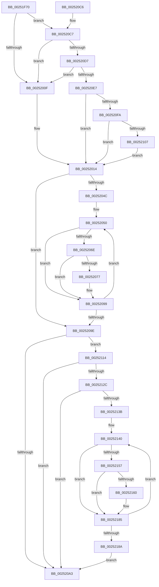

# EtwTraceReadyThread

- RVA: `0x00251F70`–`0x0025218F` (길이 `543` bytes)
- VA: `0x0000000140251F70`
- 실행 섹션: `.text`
- PDB 이름 있음: `예`; PDB Function 태그: `아니요`
- unwind 정보 RVA: `0x00063598`
- 디코드: `125`개 명령, `543/543` bytes 표시
- 미해석 바이트: `0` (있으면 어셈블리에 `.byte`로 보존)

> 이 문서는 커널 이미지의 기계어와 PDB 기호를 분석해 생성했습니다. 4번과 5번은 함수 원형과 자료형을 바이너리 사용 방식에서 추정한 C 해석이며 원본 소스 복구 결과는 아닙니다.

## 1. Dependencies

- 직접 호출 지점: **5**; 고유 호출 대상: **4**
- 직접 호출자로 확인된 함수: **4**
- RIP 상대 이미지 참조: **4**

### Outgoing calls
- `0x00252094` → [EtwpLogKernelEvent](EtwpLogKernelEvent_function_0025CC00.md) (function, `0x0025CC00`)
- `0x002520AB` → [_security_check_cookie](../6A/_security_check_cookie_function_006AC640.md) (function, `0x006AC640`)
- `0x0025210A` → [EtwpCoverageSamplerReadyThread](../65/EtwpCoverageSamplerReadyThread_function_006543E8.md) (function, `0x006543E8`)
- `0x00252117` → [PsGetServerSiloGlobals](../22/PsGetServerSiloGlobals_function_002250A0.md) (function, `0x002250A0`)
- `0x00252180` → [EtwpLogKernelEvent](EtwpLogKernelEvent_function_0025CC00.md) (function, `0x0025CC00`)

### Direct callers
- [KiDirectSwitchThread](../21/KiDirectSwitchThread_function_0021D770.md) at `0x0021D7EA`
- [KiProcessThreadWaitList](KiProcessThreadWaitList_function_00252CC0.md) at `0x00252D7D`
- [KiReadyOutSwappedThreads](../39/KiReadyOutSwappedThreads_function_00396E30.md) at `0x00396EB6`
- [KiFastReadyThread](../39/KiFastReadyThread_function_00398548.md) at `0x00398598`

### Static image references
- `0x00251F84` → RVA `0x00E0A740` (`.data`; read)
- `0x00252033` → RVA `0x00FC6AA8` (`ALMOSTRO`; read)
- `0x002520C7` → RVA `0x005C5E00` (`KeSwapProcessOrStack`; read)
- `0x002520D7` → RVA `0x009BE310` (`EtwpLogger`; read)

## 2. Other-region calls and transfers

- 다른 실행 섹션으로 향하는 call: **0**
- 별도 외부 분기/꼬리 이동을 확인하지 못했습니다.

## 3. Assembly (complete function range)

```asm
00251F70  48 89 5C 24 10                  mov qword ptr [rsp + 0x10], rbx
00251F75  48 89 6C 24 18                  mov qword ptr [rsp + 0x18], rbp
00251F7A  48 89 74 24 20                  mov qword ptr [rsp + 0x20], rsi
00251F7F  57                              push rdi
00251F80  48 83 EC 60                     sub rsp, 0x60
00251F84  48 8B 05 B5 87 BB 00            mov rax, qword ptr [rip + 0xbb87b5]
00251F8B  48 33 C4                        xor rax, rsp
00251F8E  48 89 44 24 50                  mov qword ptr [rsp + 0x50], rax
00251F93  8B 81 10 05 00 00               mov eax, dword ptr [rcx + 0x510]
00251F99  48 8B D9                        mov rbx, rcx
00251F9C  89 44 24 30                     mov dword ptr [rsp + 0x30], eax
00251FA0  BF 02 1A 60 00                  mov edi, 0x601a02
00251FA5  88 54 24 34                     mov byte ptr [rsp + 0x34], dl
00251FA9  44 88 44 24 35                  mov byte ptr [rsp + 0x35], r8b
00251FAE  C6 44 24 37 00                  mov byte ptr [rsp + 0x37], 0
00251FB3  65 8B 14 25 3C 3A 00 00         mov edx, dword ptr gs:[0x3a3c]
00251FBB  0F B6 41 7A                     movzx eax, byte ptr [rcx + 0x7a]
00251FBF  80 E2 01                        and dl, 1
00251FC2  F6 D0                           not al
00251FC4  24 02                           and al, 2
00251FC6  0A D0                           or dl, al
00251FC8  48 8B 81 B8 00 00 00            mov rax, qword ptr [rcx + 0xb8]
00251FCF  88 54 24 36                     mov byte ptr [rsp + 0x36], dl
00251FD3  8B 88 08 01 00 00               mov ecx, dword ptr [rax + 0x108]
00251FD9  80 E1 07                        and cl, 7
00251FDC  F6 D9                           neg cl
00251FDE  0F B6 4C 24 36                  movzx ecx, byte ptr [rsp + 0x36]
00251FE3  1A C0                           sbb al, al
00251FE5  80 E1 FB                        and cl, 0xfb
00251FE8  24 04                           and al, 4
00251FEA  0A C8                           or cl, al
00251FEC  41 0F B6 C1                     movzx eax, r9b
00251FF0  24 01                           and al, 1
00251FF2  80 E1 F7                        and cl, 0xf7
00251FF5  C0 E0 03                        shl al, 3
00251FF8  0A C8                           or cl, al
00251FFA  48 8B 83 60 05 00 00            mov rax, qword ptr [rbx + 0x560]
00252001  88 4C 24 36                     mov byte ptr [rsp + 0x36], cl
00252005  41 F6 C1 02                     test r9b, 2
00252009  0F 84 B8 00 00 00               je 0x1402520c7
0025200F  BF 02 0A 60 00                  mov edi, 0x600a02
00252014  48 8D 44 24 30                  lea rax, [rsp + 0x30]
00252019  48 C7 44 24 48 08 00 00 00      mov qword ptr [rsp + 0x48], 8
00252022  48 89 44 24 40                  mov qword ptr [rsp + 0x40], rax
00252027  BD 32 05 00 00                  mov ebp, 0x532
0025202C  48 8B 83 20 02 00 00            mov rax, qword ptr [rbx + 0x220]
00252033  48 8B 1D 6E 4A D7 00            mov rbx, qword ptr [rip + 0xd74a6e]
0025203A  48 8B B0 F0 05 00 00            mov rsi, qword ptr [rax + 0x5f0]
00252041  8B 9B A8 11 00 00               mov ebx, dword ptr [rbx + 0x11a8]
00252047  0F BC CB                        bsf ecx, ebx
0025204A  74 52                           je 0x14025209e
0025204C  0F 1F 40 00                     nop dword ptr [rax]
00252050  48 8B 15 51 4A D7 00            mov rdx, qword ptr [rip + 0xd74a51]
00252057  8D 43 FF                        lea eax, [rbx - 1]
0025205A  23 D8                           and ebx, eax
0025205C  48 8B C1                        mov rax, rcx
0025205F  48 C1 E0 05                     shl rax, 5
00252063  48 05 CC 11 00 00               add rax, 0x11cc
00252069  48 03 C2                        add rax, rdx
0025206C  74 2B                           je 0x140252099
0025206E  F7 40 04 00 02 00 00            test dword ptr [rax + 4], 0x200
00252075  74 22                           je 0x140252099
00252077  44 0F B6 84 4A 98 11 00 00      movzx r8d, byte ptr [rdx + rcx*2 + 0x1198]
00252080  41 B9 01 00 00 00               mov r9d, 1
00252086  48 8D 4C 24 40                  lea rcx, [rsp + 0x40]
0025208B  89 7C 24 28                     mov dword ptr [rsp + 0x28], edi
0025208F  66 89 6C 24 20                  mov word ptr [rsp + 0x20], bp
00252094  E8 67 AB 00 00                  call 0x14025cc00
00252099  0F BC CB                        bsf ecx, ebx
0025209C  75 B2                           jne 0x140252050
0025209E  48 85 F6                        test rsi, rsi
002520A1  75 71                           jne 0x140252114
002520A3  48 8B 4C 24 50                  mov rcx, qword ptr [rsp + 0x50]
002520A8  48 33 CC                        xor rcx, rsp
002520AB  E8 90 A5 45 00                  call 0x1406ac640
002520B0  4C 8D 5C 24 60                  lea r11, [rsp + 0x60]
002520B5  49 8B 5B 18                     mov rbx, qword ptr [r11 + 0x18]
002520B9  49 8B 6B 20                     mov rbp, qword ptr [r11 + 0x20]
002520BD  49 8B 73 28                     mov rsi, qword ptr [r11 + 0x28]
002520C1  49 8B E3                        mov rsp, r11
002520C4  5F                              pop rdi
002520C5  C3                              ret
002520C6  CC                              int3
002520C7  48 8D 0D 32 3D 37 00            lea rcx, [rip + 0x373d32]
002520CE  48 3B C1                        cmp rax, rcx
002520D1  0F 84 38 FF FF FF               je 0x14025200f
002520D7  48 8D 0D 32 C2 76 00            lea rcx, [rip + 0x76c232]
002520DE  48 3B C1                        cmp rax, rcx
002520E1  0F 84 28 FF FF FF               je 0x14025200f
002520E7  48 8B 05 BA 49 D7 00            mov rax, qword ptr [rip + 0xd749ba]
002520EE  48 05 EC 12 00 00               add rax, 0x12ec
002520F4  0F 84 1A FF FF FF               je 0x140252014
002520FA  F7 40 04 00 02 00 00            test dword ptr [rax + 4], 0x200
00252101  0F 84 0D FF FF FF               je 0x140252014
00252107  48 8B CB                        mov rcx, rbx
0025210A  E8 D9 22 40 00                  call 0x1406543e8
0025210F  E9 00 FF FF FF                  jmp 0x140252014
00252114  48 8B CE                        mov rcx, rsi
00252117  E8 84 2F FD FF                  call 0x1402250a0
0025211C  48 8B B0 40 03 00 00            mov rsi, qword ptr [rax + 0x340]
00252123  48 85 F6                        test rsi, rsi
00252126  0F 84 77 FF FF FF               je 0x1402520a3
0025212C  8B 9E A8 11 00 00               mov ebx, dword ptr [rsi + 0x11a8]
00252132  0F BC CB                        bsf ecx, ebx
00252135  0F 84 68 FF FF FF               je 0x1402520a3
0025213B  0F 1F 44 00 00                  nop dword ptr [rax + rax]
00252140  8D 43 FF                        lea eax, [rbx - 1]
00252143  23 D8                           and ebx, eax
00252145  48 8B C1                        mov rax, rcx
00252148  48 C1 E0 05                     shl rax, 5
0025214C  48 05 CC 11 00 00               add rax, 0x11cc
00252152  48 03 C6                        add rax, rsi
00252155  74 2E                           je 0x140252185
00252157  F7 40 04 00 02 00 00            test dword ptr [rax + 4], 0x200
0025215E  74 25                           je 0x140252185
00252160  44 0F B6 84 4E 98 11 00 00      movzx r8d, byte ptr [rsi + rcx*2 + 0x1198]
00252169  41 B9 01 00 00 00               mov r9d, 1
0025216F  48 8D 4C 24 40                  lea rcx, [rsp + 0x40]
00252174  89 7C 24 28                     mov dword ptr [rsp + 0x28], edi
00252178  48 8B D6                        mov rdx, rsi
0025217B  66 89 6C 24 20                  mov word ptr [rsp + 0x20], bp
00252180  E8 7B AA 00 00                  call 0x14025cc00
00252185  0F BC CB                        bsf ecx, ebx
00252188  75 B6                           jne 0x140252140
0025218A  E9 14 FF FF FF                  jmp 0x1402520a3
```

## 4. C-style interpretation (structured pseudocode)

```c
__int64 __fastcall EtwTraceReadyThread(__int64 a1, unsigned __int8 a2, unsigned __int8 a3, unsigned __int8 a4)
{
    __int64 result;
    __int64 v_rbx;
    __int64 v_rsp;
    unsigned __int64 v_stack_m18;
    unsigned __int64 v_stack_m20;
    unsigned __int64 v_stack_m28;
    unsigned __int8 v_stack_m31;
    unsigned __int8 v_stack_m32;
    unsigned __int8 v_stack_m33;
    unsigned __int8 v_stack_m34;
    unsigned int v_stack_m38;
    unsigned int v_stack_m40;
    unsigned __int16 v_stack_m48;
    unsigned __int64 v_stack_m8;
    unsigned __int64 v_stack_p10;
    unsigned __int64 v_stack_p18;
    unsigned __int64 v_stack_p20;

    v_stack_p10 = v_rbx;
    v_stack_p18 = v_rbp;
    v_stack_p20 = v_rsi;
    v_rsp = (v_rsp) - (96);
    result = (*(unsigned __int64 *)(v_rip + 12289973)) ^ (v_rsp);
    v_stack_m18 = result;
    v_stack_m38 = (unsigned int)((unsigned int)(*(unsigned int *)(a1 + 1296)));
    v_stack_m34 = a2;
    v_stack_m33 = a3;
    v_stack_m31 = 0;
    a2 = (unsigned __int8)(((unsigned int)(*(unsigned int *)(gs_base + (0 + 14908)))) & (1));
    result = (unsigned __int8)(~(*(unsigned __int8 *)(a1 + 122)));
    result = (unsigned __int8)((result) & (2));
    a2 = (unsigned __int8)((a2) | ((unsigned __int8)(result)));
    v_stack_m32 = a2;
    a1 = (unsigned __int8)(((unsigned int)(*(unsigned int *)(*(unsigned __int64 *)(a1 + 184) + 264))) & (7));
    a1 = (unsigned __int8)(-(a1));
    a1 = (unsigned __int8)((v_stack_m32) & (251));
    result = (unsigned __int8)((*(unsigned __int64 *)(a1 + 184)) & (4));
    a1 = (unsigned __int8)((a1) | ((unsigned __int8)(result)));
    result = (unsigned __int8)((a4) & (1));
    a1 = (unsigned __int8)((a1) & (247));
    result = (unsigned __int8)((result) << (3));
    a1 = (unsigned __int8)((a1) | ((unsigned __int8)(result)));
    v_stack_m32 = (unsigned __int8)(a1);
    if (((a4) & (2)) == 0) goto loc_002520C7;
loc_0025200F:
loc_00252014:
    v_stack_m20 = 8;
    v_stack_m28 = v_stack_m38;
    if (((a4) & (2)) == 0) goto loc_0025209E;
loc_00252050:
    v_rbx = (unsigned int)(((unsigned int)(*(unsigned int *)(*(unsigned __int64 *)(v_rip + 14109294) + 4520))) & ((unsigned int)((unsigned int)(*(unsigned int *)(*(unsigned __int64 *)(v_rip + 14109294) + 4520)) - 1)));
    result = (a1) << (5);
    result = (result) + (0x11CCULL);
    result = (result) + (*(unsigned __int64 *)(v_rip + 14109265));
    if (condition_is_equal) goto loc_00252099;
    if (((*(unsigned int *)(result + 4)) & (512)) != 0) {
        a3 = *(unsigned __int8 *)(*(unsigned __int64 *)(v_rip + 14109265) + a1 * 2 + 4504);
        a4 = 1;
        a1 = v_stack_m28;
        v_stack_m40 = (unsigned int)((unsigned int)(0x600A02ULL));
        v_stack_m48 = (unsigned __int16)((unsigned int)(0x532ULL));
        result = EtwpLogKernelEvent(a1, *(unsigned __int64 *)(v_rip + 14109265), a3, a4);
    }
    if (((*(unsigned int *)(result + 4)) & (512)) != 0) goto loc_00252050;
loc_0025209E:
    if (*(unsigned __int64 *)(*(unsigned __int64 *)(a1 + 544) + 1520) != 0) goto loc_00252114;
loc_002520A3:
    a1 = (v_stack_m18) ^ (v_rsp);
    result = _security_check_cookie(a1, *(unsigned __int64 *)(v_rip + 14109265), a3, a4);
    return result;
loc_002520C7:
    if (result == (v_rip + 3620146)) goto loc_0025200F;
    if (result == (v_rip + 7782962)) goto loc_0025200F;
    result = (*(unsigned __int64 *)(v_rip + 14109114)) + (0x12ECULL);
    if (condition_is_equal) goto loc_00252014;
    if (((*(unsigned int *)(result + 4)) & (512)) == 0) goto loc_00252014;
    result = EtwpCoverageSamplerReadyThread(*(unsigned __int64 *)(v_stack_m8 + 24), *(unsigned __int64 *)(v_rip + 14109265), a3, a4);
    goto loc_00252014;
loc_00252114:
    result = PsGetServerSiloGlobals(*(unsigned __int64 *)(v_stack_m8 + 40), *(unsigned __int64 *)(v_rip + 14109265), a3, a4);
    if (*(unsigned __int64 *)(result + 832) == 0) goto loc_002520A3;
    if (*(unsigned __int64 *)(result + 832) == 0) goto loc_002520A3;
loc_00252140:
    v_rbx = (unsigned int)(((unsigned int)(*(unsigned int *)(*(unsigned __int64 *)(result + 832) + 4520))) & ((unsigned int)((unsigned int)(*(unsigned int *)(*(unsigned __int64 *)(result + 832) + 4520)) - 1)));
    result = (*(unsigned __int64 *)(v_stack_m8 + 40)) << (5);
    result = (result) + (0x11CCULL);
    result = (result) + (*(unsigned __int64 *)(result + 832));
    if (condition_is_equal) goto loc_00252185;
    if (((*(unsigned int *)(result + 4)) & (512)) != 0) {
        a3 = *(unsigned __int8 *)(*(unsigned __int64 *)(result + 832) + *(unsigned __int64 *)(v_stack_m8 + 40) * 2 + 4504);
        a4 = 1;
        a1 = v_stack_m20;
        v_stack_m38 = (unsigned int)((unsigned int)(0x600A02ULL));
        a2 = *(unsigned __int64 *)(result + 832);
        v_stack_m40 = (unsigned __int16)(*(unsigned __int64 *)(v_stack_m8 + 32));
        result = EtwpLogKernelEvent(a1, a2, a3, a4);
    }
    if (((*(unsigned int *)(result + 4)) & (512)) != 0) goto loc_00252140;
    goto loc_002520A3;
}
```

## 5. (Beta) C Style

```c
int64_t EtwTraceReadyThread(void *Arg1, uint8_t Arg2, uint8_t Arg3, uint8_t Arg4)
{
    uint8_t *arg1 = (uint8_t *)Arg1;

    int64_t result;
    int64_t local_rbx;
    int64_t local_rsp;
    uint64_t v_stack_m18;
    uint64_t v_stack_m20;
    uint64_t v_stack_m28;
    uint8_t v_stack_m31;
    uint8_t v_stack_m32;
    uint8_t v_stack_m33;
    uint8_t v_stack_m34;
    uint32_t v_stack_m38;
    uint32_t v_stack_m40;
    uint16_t v_stack_m48;
    uint64_t v_stack_m8;
    uint64_t v_stack_p10;
    uint64_t v_stack_p18;
    uint64_t v_stack_p20;

    v_stack_p10 = local_rbx;
    v_stack_p18 = local_rbp;
    v_stack_p20 = local_rsi;
    local_rsp = (local_rsp) - (96);
    result = (*(uint64_t *)(v_rip + 0xBB87B5)) ^ (local_rsp);
    v_stack_m18 = result;
    v_stack_m38 = (uint32_t)((uint32_t)(*(uint32_t *)(arg1 + 0x510)));
    v_stack_m34 = Arg2;
    v_stack_m33 = Arg3;
    v_stack_m31 = 0;
    Arg2 = (uint8_t)(((uint32_t)(*(uint32_t *)(gs_base + (0 + 0x3A3C)))) & (1));
    result = (uint8_t)(~(*(uint8_t *)(arg1 + 0x7A)));
    result = (uint8_t)((result) & (2));
    Arg2 = (uint8_t)((Arg2) | ((uint8_t)(result)));
    v_stack_m32 = Arg2;
    Arg1 = (uint8_t)(((uint32_t)(*(uint32_t *)(*(uint64_t *)(arg1 + 0xB8) + 0x108))) & (7));
    Arg1 = (uint8_t)(-(Arg1));
    Arg1 = (uint8_t)((v_stack_m32) & (251));
    result = (uint8_t)((*(uint64_t *)(arg1 + 0xB8)) & (4));
    Arg1 = (uint8_t)((Arg1) | ((uint8_t)(result)));
    result = (uint8_t)((Arg4) & (1));
    Arg1 = (uint8_t)((Arg1) & (247));
    result = (uint8_t)((result) << (3));
    Arg1 = (uint8_t)((Arg1) | ((uint8_t)(result)));
    v_stack_m32 = (uint8_t)(Arg1);
    if (((Arg4) & (2)) == 0) goto loc_002520C7;
loc_0025200F:
loc_00252014:
    v_stack_m20 = 8;
    v_stack_m28 = v_stack_m38;
    if (((Arg4) & (2)) == 0) goto loc_0025209E;
loc_00252050:
    local_rbx = (uint32_t)(((uint32_t)(*(uint32_t *)(*(uint64_t *)(v_rip + 0xD74A6E) + 0x11A8))) & ((uint32_t)((uint32_t)(*(uint32_t *)(*(uint64_t *)(v_rip + 0xD74A6E) + 0x11A8)) - 1)));
    result = (Arg1) << (5);
    result = (result) + (0x11CCULL);
    result = (result) + (*(uint64_t *)(v_rip + 0xD74A51));
    if (condition_is_equal) goto loc_00252099;
    if (((*(uint32_t *)(result + 0x4)) & (512)) != 0) {
        Arg3 = *(uint8_t *)(*(uint64_t *)(v_rip + 0xD74A51) + arg1 * 2 + 0x1198);
        Arg4 = 1;
        Arg1 = v_stack_m28;
        v_stack_m40 = (uint32_t)((uint32_t)(0x600A02ULL));
        v_stack_m48 = (uint16_t)((uint32_t)(0x532ULL));
        result = EtwpLogKernelEvent(Arg1, *(uint64_t *)(v_rip + 0xD74A51), Arg3, Arg4);
    }
    if (((*(uint32_t *)(result + 0x4)) & (512)) != 0) goto loc_00252050;
loc_0025209E:
    if (*(uint64_t *)(*(uint64_t *)(arg1 + 0x220) + 0x5F0) != 0) goto loc_00252114;
loc_002520A3:
    Arg1 = (v_stack_m18) ^ (local_rsp);
    result = _security_check_cookie(Arg1, *(uint64_t *)(v_rip + 0xD74A51), Arg3, Arg4);
    return result;
loc_002520C7:
    if (result == (v_rip + 3620146)) goto loc_0025200F;
    if (result == (v_rip + 7782962)) goto loc_0025200F;
    result = (*(uint64_t *)(v_rip + 0xD749BA)) + (0x12ECULL);
    if (condition_is_equal) goto loc_00252014;
    if (((*(uint32_t *)(result + 0x4)) & (512)) == 0) goto loc_00252014;
    result = EtwpCoverageSamplerReadyThread(*(uint64_t *)(v_stack_m8 + 0x18), *(uint64_t *)(v_rip + 0xD74A51), Arg3, Arg4);
    goto loc_00252014;
loc_00252114:
    result = PsGetServerSiloGlobals(*(uint64_t *)(v_stack_m8 + 0x28), *(uint64_t *)(v_rip + 0xD74A51), Arg3, Arg4);
    if (*(uint64_t *)(result + 0x340) == 0) goto loc_002520A3;
    if (*(uint64_t *)(result + 0x340) == 0) goto loc_002520A3;
loc_00252140:
    local_rbx = (uint32_t)(((uint32_t)(*(uint32_t *)(*(uint64_t *)(result + 0x340) + 0x11A8))) & ((uint32_t)((uint32_t)(*(uint32_t *)(*(uint64_t *)(result + 0x340) + 0x11A8)) - 1)));
    result = (*(uint64_t *)(v_stack_m8 + 0x28)) << (5);
    result = (result) + (0x11CCULL);
    result = (result) + (*(uint64_t *)(result + 0x340));
    if (condition_is_equal) goto loc_00252185;
    if (((*(uint32_t *)(result + 0x4)) & (512)) != 0) {
        Arg3 = *(uint8_t *)(*(uint64_t *)(result + 0x340) + *(uint64_t *)(v_stack_m8 + 0x28) * 2 + 0x1198);
        Arg4 = 1;
        Arg1 = v_stack_m20;
        v_stack_m38 = (uint32_t)((uint32_t)(0x600A02ULL));
        Arg2 = *(uint64_t *)(result + 0x340);
        v_stack_m40 = (uint16_t)(*(uint64_t *)(v_stack_m8 + 0x20));
        result = EtwpLogKernelEvent(Arg1, Arg2, Arg3, Arg4);
    }
    if (((*(uint32_t *)(result + 0x4)) & (512)) != 0) goto loc_00252140;
    goto loc_002520A3;
}
```

### 관측된 메모리 오프셋

구조체 형식이 확인되지 않은 접근은 인자 기준의 오프셋으로만 기록했습니다.

| 기준 인자 | 오프셋 표현 | 폭 (bit) | 접근 |
|---|---:|---:|---|
| `Arg1` | `+ 0x7A` | `8` | `R` |
| `Arg1` | `+ 0xB8` | `64` | `R` |
| `Arg1` | `+ 0x220` | `64` | `R` |
| `Arg1` | `+ 0x510` | `32` | `R` |
| `Arg1` | `+ 0x560` | `64` | `R` |

## 6. Execution-region graph

[열기: 2D/3D 그래프와 함수 탐색 컨트롤 패널](../../../control-panel.html?section=text&rva=0x00251F70&view=graph)

- 2D 그래프는 위에서 아래로 흐르고, 3D 그래프는 빈 공간을 드래그해 회전합니다. Shift+드래그는 이동, 휠은 확대·축소, 함수 노드 선택은 대상 보고서 이동입니다.

### Static fallback


