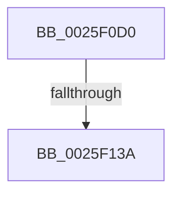

# EtwWriteEx

- RVA: `0x0025F0D0`–`0x0025F13E` (길이 `110` bytes)
- VA: `0x000000014025F0D0`
- 실행 섹션: `.text`
- PDB 이름 있음: `예`; PDB Function 태그: `아니요`
- unwind 정보 RVA: `0x00064174`
- 디코드: `28`개 명령, `110/110` bytes 표시
- 미해석 바이트: `0` (있으면 어셈블리에 `.byte`로 보존)

> 이 문서는 커널 이미지의 기계어와 PDB 기호를 분석해 생성했습니다. 4번과 5번은 함수 원형과 자료형을 바이너리 사용 방식에서 추정한 C 해석이며 원본 소스 복구 결과는 아닙니다.

## 1. Dependencies

- 직접 호출 지점: **0**; 고유 호출 대상: **0**
- 직접 호출자로 확인된 함수: **292**
- RIP 상대 이미지 참조: **1**

### Outgoing calls
- 직접 디코드된 call 명령이 없습니다.

### Direct callers
- [EtwpTraceFileIo](../22/EtwpTraceFileIo_function_00223BB0.md) at `0x00223D99`
- [EtwpTraceFileName](../22/EtwpTraceFileName_function_002251F0.md) at `0x00225370`
- [EtwpNetProvTraceNetwork](../23/EtwpNetProvTraceNetwork_function_00235778.md) at `0x002357E9`
- [KiSetNextClockTickDueTime](../23/KiSetNextClockTickDueTime_function_002363F0.md) at `0x002365EE`
- [EtwpLogKernelEvent](EtwpLogKernelEvent_function_0025CC00.md) at `0x0025CECB`
- [PopDiagTraceFxDevicePowerState](../26/PopDiagTraceFxDevicePowerState_function_0026DBC4.md) at `0x0026DC90`
- [PnpDiagnosticTrace](../26/PnpDiagnosticTrace_function_0026E384.md) at `0x0026E3D8`
- [PnpDiagnosticTraceObject](../26/PnpDiagnosticTraceObject_function_0026E834.md) at `0x0026E8D5`
- [PopDiagTraceIrpFinish](../26/PopDiagTraceIrpFinish_function_0026F2A8.md) at `0x0026F3E8`
- [PopDiagTraceFxDefaultPepWorkerStart](../2B/PopDiagTraceFxDefaultPepWorkerStart_function_002BD168.md) at `0x002BD23C`
- [sub_002BD6E6](../2B/Unknown_function_002BD6E6.md) at `0x002BD785`
- [PopDiagTraceFxComponentIdleState](../2B/PopDiagTraceFxComponentIdleState_function_002BE0C4.md) at `0x002BE258`
- [PopDiagTraceFxComponentLatency](../2B/PopDiagTraceFxComponentLatency_function_002BF5C4.md) at `0x002BF759`
- [PpmEventSoftParkRankListChanged](../2D/PpmEventSoftParkRankListChanged_function_002D58D8.md) at `0x002D598A`
- [KiIntSteerLogMask](../2D/KiIntSteerLogMask_function_002D71B8.md) at `0x002D72C8`
- [KiIntSteerLogProc](../2D/KiIntSteerLogProc_function_002D72D8.md) at `0x002D73EF`
- [PpmEventTraceProcessorLatencyLimitChange](../2D/PpmEventTraceProcessorLatencyLimitChange_function_002D974C.md) at `0x002D983E`
- [PpmEventTracePerfCheckStop](../2D/PpmEventTracePerfCheckStop_function_002DA34C.md) at `0x002DA402`
- [PpmEventMediaBufferingNotify](../2D/PpmEventMediaBufferingNotify_function_002DA730.md) at `0x002DA7CF`
- [TlgAggregateAbsorbEvent](../2F/TlgAggregateAbsorbEvent_function_002F1010.md) at `0x002F1099`
- [MiLogBadMapper](../2F/MiLogBadMapper_function_002F1140.md) at `0x002F1374`
- [EtwpTraceMessageVa](../2F/EtwpTraceMessageVa_function_002FB2B0.md) at `0x002FBC82`
- [EtwpTraceMessageVa](../2F/EtwpTraceMessageVa_function_002FB2B0.md) at `0x002FBDD0`
- [EtwpLogSystemEventUnsafe](../2F/EtwpLogSystemEventUnsafe_function_002FBF10.md) at `0x002FC4F4`
- [PoTraceSystemTimerResolutionKernel](../2F/PoTraceSystemTimerResolutionKernel_function_002FD154.md) at `0x002FD22B`
- [PopDiagTraceNonAttributedCpuReferences](../30/PopDiagTraceNonAttributedCpuReferences_function_003036EC.md) at `0x0030376C`
- [PpmEventPlatformVetoRequest](../30/PpmEventPlatformVetoRequest_function_00304B14.md) at `0x00304BD4`
- [PpmEventCoreParkingSoftParkedStateChange](../35/PpmEventCoreParkingSoftParkedStateChange_function_003525C4.md) at `0x003526AD`
- [PopDiagTraceDeviceAcquireIrp](../39/PopDiagTraceDeviceAcquireIrp_function_00390498.md) at `0x0039058F`
- [PopDiagTraceSetDeepSleepConstraint](../39/PopDiagTraceSetDeepSleepConstraint_function_003909A4.md) at `0x00390A24`
- [PopDiagTraceClearDeepSleepConstraint](../39/PopDiagTraceClearDeepSleepConstraint_function_00390A44.md) at `0x00390AC4`
- [PopDiagTraceFxDevicePowered](../39/PopDiagTraceFxDevicePowered_function_00390AE4.md) at `0x00390B86`
- [PoTraceSystemTimerResolutionUpdate](../39/PoTraceSystemTimerResolutionUpdate_function_003916DC.md) at `0x00391762`
- [PopDiagTraceFxDevicePowerRequirement](../39/PopDiagTraceFxDevicePowerRequirement_function_00391780.md) at `0x003918F8`
- [PoDeviceReleaseIrp](../39/PoDeviceReleaseIrp_function_00391B7C.md) at `0x00391C38`
- [PpmPerfArbitratorApplyProcessorState](../39/PpmPerfArbitratorApplyProcessorState_function_00391E00.md) at `0x003923B7`
- [EtwTraceThreadWorkOnBehalfUpdate](../39/EtwTraceThreadWorkOnBehalfUpdate_function_00393A50.md) at `0x00393B4B`
- [sub_00395271](../39/Unknown_function_00395271.md) at `0x003952FA`
- [sub_0039CA0B](../39/Unknown_function_0039CA0B.md) at `0x0039CDC4`
- [EtwpTiVadQueryEventWrite](../3B/EtwpTiVadQueryEventWrite_function_003B9360.md) at `0x003B9419`
- [EtwpLogMemNodeInfo](../3B/EtwpLogMemNodeInfo_function_003B991C.md) at `0x003B9A44`
- [EtwpLogMemInfo](../3B/EtwpLogMemInfo_function_003B9AC0.md) at `0x003B9BAA`
- [MiLogSlabEntryAllocateFailure](../3B/MiLogSlabEntryAllocateFailure_function_003BAA60.md) at `0x003BADD0`
- [PpmEventTraceLatencySensitivityHint](../3B/PpmEventTraceLatencySensitivityHint_function_003BEAFC.md) at `0x003BEB8F`
- [PpmEventTracePerfCheckStart](../3B/PpmEventTracePerfCheckStart_function_003BEEE4.md) at `0x003BEFCD`
- [PpmEventTraceFailedPerfCheckStart](../3B/PpmEventTraceFailedPerfCheckStart_function_003BF06C.md) at `0x003BF100`
- [PpmEventHgsHardwareTable](../3B/PpmEventHgsHardwareTable_function_003BF110.md) at `0x003BF309`
- [EtwpPsProvTracePriority](../3C/EtwpPsProvTracePriority_function_003C4270.md) at `0x003C4319`
- [EtwTraceMdlAllocationEvent](../3E/EtwTraceMdlAllocationEvent_function_003E95FC.md) at `0x003E96D8`
- [EtwTraceContAllocationEvent](../3E/EtwTraceContAllocationEvent_function_003EA680.md) at `0x003EA78D`
- [EtwpTraceLostEvent](../3F/EtwpTraceLostEvent_function_003F0D58.md) at `0x003F0FFF`
- [EtwTraceContFreeEvent](../3F/EtwTraceContFreeEvent_function_003F7C0C.md) at `0x003F7CAD`
- [sub_0040AB34](../40/Unknown_function_0040AB34.md) at `0x0040AC62`
- [PpmEventTraceHeteroResponse](../41/PpmEventTraceHeteroResponse_function_004133AC.md) at `0x00413557`
- [PpmEventTraceMultiClassHeteroResponse](../41/PpmEventTraceMultiClassHeteroResponse_function_004135AC.md) at `0x00413711`
- [PpmEventParkingCountSelection](../41/PpmEventParkingCountSelection_function_00414388.md) at `0x004144D4`
- [PpmEventHgsContainmentUnparkedCount](../41/PpmEventHgsContainmentUnparkedCount_function_00414808.md) at `0x004149EF`
- [EtwWrite](../41/EtwWrite_function_0041C720.md) at `0x0041C747`
- [EtwWriteTransfer](../41/EtwWriteTransfer_function_0041C830.md) at `0x0041C856`
- [McGenEventWrite_EtwWriteTransfer](../42/McGenEventWrite_EtwWriteTransfer_function_00424FC8.md) at `0x0042500D`
- [FsRtlpReleaseIrpsWaitingForRH](../42/FsRtlpReleaseIrpsWaitingForRH_function_00425CBC.md) at `0x00425DCE`
- [FsRtlpReleaseIrpsWaitingForRH](../42/FsRtlpReleaseIrpsWaitingForRH_function_00425CBC.md) at `0x00425F05`
- [tlgWriteTransfer_EtwWriteTransfer](../42/tlgWriteTransfer_EtwWriteTransfer_function_004260E0.md) at `0x00426185`
- [PopDiagTraceFxDeviceAccounting](../42/PopDiagTraceFxDeviceAccounting_function_00426614.md) at `0x00426744`
- [PpmEventTraceHeteroSets](../42/PpmEventTraceHeteroSets_function_00426DB4.md) at `0x0042719E`
- [PpmEventBiosCapChange](../42/PpmEventBiosCapChange_function_0042B5EC.md) at `0x0042B6D4`
- [PpmEventThermalCapChange](../42/PpmEventThermalCapChange_function_0042B6E4.md) at `0x0042B83D`
- [PpmEventPerfSelectProcessorState](../42/PpmEventPerfSelectProcessorState_function_0042CFA0.md) at `0x0042D0E0`
- [PpmEventTraceProcessorIdleAccounting](../43/PpmEventTraceProcessorIdleAccounting_function_0043A6D0.md) at `0x0043A907`
- [PpmEventTraceDeliveredPerfChange](../43/PpmEventTraceDeliveredPerfChange_function_0043B200.md) at `0x0043B359`
- [PopDiagTraceFxComponentLogicalCondition](../43/PopDiagTraceFxComponentLogicalCondition_function_0043D3A0.md) at `0x0043D4A3`
- [PopDiagTraceFxDefaultPepWorkerEnd](../44/PopDiagTraceFxDefaultPepWorkerEnd_function_004451E8.md) at `0x004453C5`
- [EtwTraceDpcProfilingStack](../44/EtwTraceDpcProfilingStack_function_0044F1CC.md) at `0x0044F23B`
- [EtwTraceDpcProfilingStackBegin](../44/EtwTraceDpcProfilingStackBegin_function_0044F25C.md) at `0x0044F30B`
- [PpmEventComputeEnergy](../45/PpmEventComputeEnergy_function_00452EC0.md) at `0x00452F9E`
- [SshpTracingWriteBlockerStateChange](../45/SshpTracingWriteBlockerStateChange_function_00453B5C.md) at `0x00453C6D`
- [PpmEventParkNodeRecordedStats](../45/PpmEventParkNodeRecordedStats_function_0045AD74.md) at `0x0045AEA0`
- [IopInitActivityIdIrp](../45/IopInitActivityIdIrp_function_0045B014.md) at `0x0045B1D9`
- [EtwTraceMemoryAcg](../45/EtwTraceMemoryAcg_function_0045B3A8.md) at `0x0045B469`
- [EtwpTiFillVadEventWrite](../46/EtwpTiFillVadEventWrite_function_00469484.md) at `0x0046951E`
- [PoFxSendSystemLatencyUpdate](../46/PoFxSendSystemLatencyUpdate_function_0046A008.md) at `0x0046A0D8`
- [PopDiagTraceIdleResiliencyStart](../46/PopDiagTraceIdleResiliencyStart_function_0046A264.md) at `0x0046A301`
- [PopDiagTraceIdleResiliencyEnd](../46/PopDiagTraceIdleResiliencyEnd_function_0046A324.md) at `0x0046A3C9`
- [SetFailureLocation](../46/SetFailureLocation_function_0046EF54.md) at `0x0046F07C`
- [PopDiagTracePowerRequestChange](../47/PopDiagTracePowerRequestChange_function_00477C9C.md) at `0x00477D92`
- [PopDiagTraceSystemLatencyUpdate](../47/PopDiagTraceSystemLatencyUpdate_function_0047A78C.md) at `0x0047A823`
- [PpmEventHeteroFavoredCoreRotationChange](../47/PpmEventHeteroFavoredCoreRotationChange_function_0047ACB0.md) at `0x0047AD4E`
- [PpmEventTraceExpectedUtility](../47/PpmEventTraceExpectedUtility_function_0047B280.md) at `0x0047B40C`
- [PpmEventDomainPerfStateChange](../47/PpmEventDomainPerfStateChange_function_0047B720.md) at `0x0047B956`
- [PopDiagTraceIrpStart](../47/PopDiagTraceIrpStart_function_0047CBBC.md) at `0x0047CD3E`
- [PpmEventTraceSoftCoreParkingSelection](../47/PpmEventTraceSoftCoreParkingSelection_function_0047D4EC.md) at `0x0047D704`
- [PopDiagTraceRegisterSystemState](../48/PopDiagTraceRegisterSystemState_function_0048280C.md) at `0x004828B2`
- [PopDiagTraceSetSystemState](../48/PopDiagTraceSetSystemState_function_00482AD4.md) at `0x00482B72`
- [WheapGenerateETWErrorRecord](../48/WheapGenerateETWErrorRecord_function_00484B2C.md) at `0x00484B8E`
- [PoTraceForceIdleStateChange](../48/PoTraceForceIdleStateChange_function_0048DCEC.md) at `0x0048DD8A`
- [PpmEventProcessorVetoRundown](../49/PpmEventProcessorVetoRundown_function_00490D88.md) at `0x00490F4D`
- [PpmEventTracePreVetoAccounting](../49/PpmEventTracePreVetoAccounting_function_00490F88.md) at `0x004910DD`
- [SshpTracingWriteBlockerStateRundown](../49/SshpTracingWriteBlockerStateRundown_function_00491A20.md) at `0x00491B8F`
- [PpmEventCoreParkingStateChangeEx](../49/PpmEventCoreParkingStateChangeEx_function_00496018.md) at `0x0049611B`
- [SshpWriteBlocker](../49/SshpWriteBlocker_function_00496300.md) at `0x00496471`
- [SshpWriteBlocker](../49/SshpWriteBlocker_function_00496300.md) at `0x0049666E`
- [PopDiagTraceEventNoPayload](../49/PopDiagTraceEventNoPayload_function_004982F8.md) at `0x00498344`
- [PpmEventCoreParkingStateChange](../49/PpmEventCoreParkingStateChange_function_004995D8.md) at `0x004996B2`
- [KsepLogEtwMessage](../49/KsepLogEtwMessage_function_00499AC8.md) at `0x00499BA3`
- [PpmEventTraceMakeupPerfCheck](../49/PpmEventTraceMakeupPerfCheck_function_0049F748.md) at `0x0049F79D`
- [PpmEventQosClassPerfSelection](../49/PpmEventQosClassPerfSelection_function_0049F7AC.md) at `0x0049F96A`
- [PopDiagTraceSleepStudyBlocker](../4A/PopDiagTraceSleepStudyBlocker_function_004A5930.md) at `0x004A5986`
- [PopDirectedDripsDiagTraceNotifyDevices](../4A/PopDirectedDripsDiagTraceNotifyDevices_function_004A70AC.md) at `0x004A71AC`
- [PnpDiagnosticTraceObjectWithStatus](../4A/PnpDiagnosticTraceObjectWithStatus_function_004A9F58.md) at `0x004AA031`
- [PopSqmAddToStream](../4A/PopSqmAddToStream_function_004AA044.md) at `0x004AA1BC`
- [tlgWriteEx_EtwWriteEx](../4A/tlgWriteEx_EtwWriteEx_function_004AA348.md) at `0x004AA3E5`
- [PopDiagTraceDeviceIdleCheck](../4A/PopDiagTraceDeviceIdleCheck_function_004AB30C.md) at `0x004AB4D7`
- [SSHSupportEtwWrite](../4A/SSHSupportEtwWrite_function_004ADF5C.md) at `0x004ADF87`
- [BapdWriteEtwEvents](../4A/BapdWriteEtwEvents_function_004AE884.md) at `0x004AEA01`
- [PopDiagTraceThermalZoneRundown](../4A/PopDiagTraceThermalZoneRundown_function_004AF240.md) at `0x004AF414`
- [MiLogPeriodicTelemetryForSlabAllocator](../4B/MiLogPeriodicTelemetryForSlabAllocator_function_004B4AC0.md) at `0x004B4E47`
- [PpmEventVetoReasonRundown](../4B/PpmEventVetoReasonRundown_function_004B686C.md) at `0x004B6939`
- [PopDiagTraceSessionDisplayStateChange](../4B/PopDiagTraceSessionDisplayStateChange_function_004B7C00.md) at `0x004B7CBA`
- [PoTraceSystemTimerResolutionIgnore](../4B/PoTraceSystemTimerResolutionIgnore_function_004B8A28.md) at `0x004B8ADB`
- [IoTransferActivityId](../4B/IoTransferActivityId_function_004BA0D0.md) at `0x004BA125`
- [PopDiagTraceDeepSleepConstraintRundown](../4B/PopDiagTraceDeepSleepConstraintRundown_function_004BCDDC.md) at `0x004BCECB`
- [PpmHeteroDispatchHgsInterrupt](../4B/PpmHeteroDispatchHgsInterrupt_function_004BE5E0.md) at `0x004BE657`
- [HalpIommuTraceFault](../4C/HalpIommuTraceFault_function_004C031C.md) at `0x004C044B`
- [PopDiagTraceFxPerfRequestComplete](../4C/PopDiagTraceFxPerfRequestComplete_function_004C1854.md) at `0x004C1912`
- [PopDiagTraceFxPerfRequestProgress](../4C/PopDiagTraceFxPerfRequestProgress_function_004C1B78.md) at `0x004C1C2F`
- [PopDiagTraceFxPerfRequest](../4C/PopDiagTraceFxPerfRequest_function_004C1CD8.md) at `0x004C1DB4`
- [PpmEventProcessorPerfStateChange](../4C/PpmEventProcessorPerfStateChange_function_004C2470.md) at `0x004C263C`
- [EtwpTraceLostSystemEvent](../4C/EtwpTraceLostSystemEvent_function_004C37E4.md) at `0x004C389A`
- [PopDiagTraceFxDeviceDirectedTransition](../4C/PopDiagTraceFxDeviceDirectedTransition_function_004C4130.md) at `0x004C41E6`
- [PpmEventTraceLPIState](../4C/PpmEventTraceLPIState_function_004C6494.md) at `0x004C653C`
- [PpmEventHgsNormalizedTable](../4C/PpmEventHgsNormalizedTable_function_004CC7BC.md) at `0x004CC945`
- [PpmEventHgsHardwareTableResonMapTable](../4C/PpmEventHgsHardwareTableResonMapTable_function_004CDEEC.md) at `0x004CDFD8`
- [PpmEventTraceMultiClassHeteroResponseUpdate](../4D/PpmEventTraceMultiClassHeteroResponseUpdate_function_004D0B1C.md) at `0x004D0C1C`
- [PnpDiagnosticTraceElamDecision](../4D/PnpDiagnosticTraceElamDecision_function_004D2258.md) at `0x004D2300`
- [PpmEventHgsContainmentHwUpdate](../4D/PpmEventHgsContainmentHwUpdate_function_004D5FFC.md) at `0x004D60B5`
- [PpmEventParkNodeClassRecordedStats](../4D/PpmEventParkNodeClassRecordedStats_function_004D66AC.md) at `0x004D67C7`
- [PpmEventHgsHardwareTableResonChanged](../4D/PpmEventHgsHardwareTableResonChanged_function_004D6D5C.md) at `0x004D6E91`
- [PopDiagTraceRtcWakeInfo](../4D/PopDiagTraceRtcWakeInfo_function_004DEA14.md) at `0x004DEE1F`
- [PpmEventTraceHeteroDistributeUtility](../4D/PpmEventTraceHeteroDistributeUtility_function_004DF094.md) at `0x004DF17A`
- [PopDiagTraceIrpPended](../4D/PopDiagTraceIrpPended_function_004DF56C.md) at `0x004DF5ED`
- [PopDiagTraceFxDeviceDirectedCompletion](../4E/PopDiagTraceFxDeviceDirectedCompletion_function_004E04AC.md) at `0x004E057C`
- [PoDiagTraceIRTimerSleepStudyRundown](../4E/PoDiagTraceIRTimerSleepStudyRundown_function_004E05A8.md) at `0x004E0674`
- [IopDumpTraceLoadCrashDumpDriverFailure](../4E/IopDumpTraceLoadCrashDumpDriverFailure_function_004E2C18.md) at `0x004E2C84`
- [PpmEventParkNodeParkHintChanged](../4E/PpmEventParkNodeParkHintChanged_function_004E2D74.md) at `0x004E2E27`
- [PopBatteryTraceSystemBatteryStatus](../4E/PopBatteryTraceSystemBatteryStatus_function_004E93D8.md) at `0x004E95FD`
- [PpmEventParkNodeRecordedStatsEx](../4E/PpmEventParkNodeRecordedStatsEx_function_004EF378.md) at `0x004EF5FB`
- [PpmEventTraceCoreParkingSelectionEx](../4F/PpmEventTraceCoreParkingSelectionEx_function_004F09D0.md) at `0x004F12FA`
- [PpmEventTraceHeteroResponseEx](../4F/PpmEventTraceHeteroResponseEx_function_004F1B6C.md) at `0x004F1E0E`
- [PpmEventTraceMultiClassHeteroResponseEx](../4F/PpmEventTraceMultiClassHeteroResponseEx_function_004F204C.md) at `0x004F227B`
- [PpmEventTraceSoftCoreParkingSelectionEx](../4F/PpmEventTraceSoftCoreParkingSelectionEx_function_004F2424.md) at `0x004F2D22`
- [PpmEventHgsCoresUnparkedCountEx](../4F/PpmEventHgsCoresUnparkedCountEx_function_004F2E48.md) at `0x004F2FE8`
- [PpmEventSoftParkLatencyUpdate](../4F/PpmEventSoftParkLatencyUpdate_function_004F3950.md) at `0x004F3A0D`
- [PpmEventParkNodeParkHintChangedEx](../4F/PpmEventParkNodeParkHintChangedEx_function_004F3A34.md) at `0x004F3B31`
- [PpmEventHgsActiveWorkloadClassEx](../4F/PpmEventHgsActiveWorkloadClassEx_function_004F3BB0.md) at `0x004F3DA0`
- [PpmEventTraceHeteroResponseExV1](../4F/PpmEventTraceHeteroResponseExV1_function_004F3DDC.md) at `0x004F40AA`
- [PpmEventParkingCountSelectionEx](../4F/PpmEventParkingCountSelectionEx_function_004F4188.md) at `0x004F42C8`
- [PpmEventHgsContainmentUnparkedCountEx](../4F/PpmEventHgsContainmentUnparkedCountEx_function_004F5010.md) at `0x004F5212`
- [PpmEventTraceMultiClassHeteroResponseUpdateEx](../4F/PpmEventTraceMultiClassHeteroResponseUpdateEx_function_004F57C0.md) at `0x004F5899`
- [PpmEventTraceHeteroDistributeUtilityEx](../4F/PpmEventTraceHeteroDistributeUtilityEx_function_004F9C24.md) at `0x004F9D2E`
- [HalpTscTraceProcessorDelta](../54/HalpTscTraceProcessorDelta_function_0054B184.md) at `0x0054B245`
- [HalpTscTraceProcessorSynchronization](../54/HalpTscTraceProcessorSynchronization_function_0054B268.md) at `0x0054B344`
- [HalpTscTraceStatus](../54/HalpTscTraceStatus_function_0054B368.md) at `0x0054B3E4`
- [HalpTscTraceSynchronizationSummary](../54/HalpTscTraceSynchronizationSummary_function_0054B404.md) at `0x0054B4D8`
- [HalpIommuLogEarlyFault](../55/HalpIommuLogEarlyFault_function_00555640.md) at `0x005556B3`
- [HalpIommuLogEarlyFault](../55/HalpIommuLogEarlyFault_function_00555640.md) at `0x00555770`
- [DbgkpLkmdSqmIncrementDword](../58/DbgkpLkmdSqmIncrementDword_function_005801D8.md) at `0x00580265`
- [HvlpWriteEventLog](../58/HvlpWriteEventLog_function_0058C9E4.md) at `0x0058CA15`
- [IopDumpTraceCrashDumpDisabled](../59/IopDumpTraceCrashDumpDisabled_function_00594C8C.md) at `0x00594CD6`
- [IopDumpTraceCrashDumpReconfiguration](../59/IopDumpTraceCrashDumpReconfiguration_function_00594D68.md) at `0x00594DD4`
- [IopDumpTraceDisableCrashDumpFailure](../59/IopDumpTraceDisableCrashDumpFailure_function_00594E78.md) at `0x00594EE4`
- [IopDumpTraceFreeDumpStackFailure](../59/IopDumpTraceFreeDumpStackFailure_function_00594F88.md) at `0x00594FF4`
- [IopDumpTraceInitializeCrashDumpFailure](../59/IopDumpTraceInitializeCrashDumpFailure_function_00595098.md) at `0x00595104`
- [IopDumpTraceInitializeDumpStackFailure](../59/IopDumpTraceInitializeDumpStackFailure_function_005951A8.md) at `0x00595214`
- [IopDumpTraceLoadDumpStackFailure](../59/IopDumpTraceLoadDumpStackFailure_function_005952B8.md) at `0x00595324`
- [IopLiveDumpTrace](../5A/IopLiveDumpTrace_function_005A4070.md) at `0x005A40A2`
- [IopLiveDumpTraceEventGeneric](../5A/IopLiveDumpTraceEventGeneric_function_005A41E4.md) at `0x005A42EA`
- [PnpDiagnosticTraceElamStatus](../5A/PnpDiagnosticTraceElamStatus_function_005A581C.md) at `0x005A5895`
- [KasaniSendReport](../5A/KasaniSendReport_function_005AB2E0.md) at `0x005ABD0D`
- [KasaniSendTelemetryDriver](../5A/KasaniSendTelemetryDriver_function_005ABD40.md) at `0x005ABE8F`
- [sub_005AF44B](../5A/Unknown_function_005AF44B.md) at `0x005AF573`
- [sub_005AFA55](../5A/Unknown_function_005AFA55.md) at `0x005B03E3`
- [KsepEvntLogFlagsApplied](../5C/KsepEvntLogFlagsApplied_function_005CBAD0.md) at `0x005CBBB7`
- [KsepEvntLogShimsApplied](../5C/KsepEvntLogShimsApplied_function_005CBBE4.md) at `0x005CBDD1`
- [KsepDsEventAddDevice](../5C/KsepDsEventAddDevice_function_005CC658.md) at `0x005CC75E`
- [KsepDsEventDataIrp](../5C/KsepDsEventDataIrp_function_005CC780.md) at `0x005CC857`
- [KsepDsEventDevicePowerCompleted](../5C/KsepDsEventDevicePowerCompleted_function_005CC878.md) at `0x005CC938`
- [KsepDsEventDevicePowerIrp](../5C/KsepDsEventDevicePowerIrp_function_005CC95C.md) at `0x005CCA51`
- [KsepDsEventDriverLoad](../5C/KsepDsEventDriverLoad_function_005CCA74.md) at `0x005CCB53`
- [KsepDsEventDriverStartIo](../5C/KsepDsEventDriverStartIo_function_005CCB7C.md) at `0x005CCC23`
- [KsepDsEventDriverUnload](../5C/KsepDsEventDriverUnload_function_005CCC44.md) at `0x005CCCE0`
- [KsepDsEventIoCreateDevice](../5C/KsepDsEventIoCreateDevice_function_005CCD00.md) at `0x005CCDED`
- [KsepDsEventPnpIrp](../5C/KsepDsEventPnpIrp_function_005CCE10.md) at `0x005CCEE7`
- [KsepDsEventPnpStartDevice](../5C/KsepDsEventPnpStartDevice_function_005CCF08.md) at `0x005CCFC8`
- [KsepDsEventPnpStopDevice](../5C/KsepDsEventPnpStopDevice_function_005CCFEC.md) at `0x005CD0AC`
- [KsepDsEventPoolAllocate](../5C/KsepDsEventPoolAllocate_function_005CD0D0.md) at `0x005CD1AA`
- [KsepDsEventPoolFree](../5C/KsepDsEventPoolFree_function_005CD1CC.md) at `0x005CD277`
- [KsepDsEventRequestPowerIrp](../5C/KsepDsEventRequestPowerIrp_function_005CD298.md) at `0x005CD37E`
- [KsepDsEventSystemPowerIrp](../5C/KsepDsEventSystemPowerIrp_function_005CD3A0.md) at `0x005CD495`
- [KsepSkipDriverUnloadEventDriverLoad](../5C/KsepSkipDriverUnloadEventDriverLoad_function_005CD63C.md) at `0x005CD71B`
- [KsepSkipDriverUnloadEventDriverUnload](../5C/KsepSkipDriverUnloadEventDriverUnload_function_005CD744.md) at `0x005CD7E0`
- [PopIrpWatchdogBugcheck](../5C/PopIrpWatchdogBugcheck_function_005CE868.md) at `0x005CE934`
- [PoTraceDynamicTickDisabled](../5D/PoTraceDynamicTickDisabled_function_005D5BB8.md) at `0x005D5C3B`
- [PoTraceForceIdleReset](../5D/PoTraceForceIdleReset_function_005D5C5C.md) at `0x005D5D61`
- [PopDiagTraceAbnormalReset](../5D/PopDiagTraceAbnormalReset_function_005D5D84.md) at `0x005D5E04`
- [PopDiagTraceCsDeepSleepWatchdog](../5D/PopDiagTraceCsDeepSleepWatchdog_function_005D5E24.md) at `0x005D5F15`
- [PopDiagTraceCsDripsDivergence](../5D/PopDiagTraceCsDripsDivergence_function_005D5F40.md) at `0x005D600B`
- [PopDiagTraceCsDripsWatchdog](../5D/PopDiagTraceCsDripsWatchdog_function_005D602C.md) at `0x005D61F8`
- [PopDiagTraceCsDripsWatchdogPerfTrack](../5D/PopDiagTraceCsDripsWatchdogPerfTrack_function_005D621C.md) at `0x005D633F`
- [PopDiagTraceCsFanPerfTrack](../5D/PopDiagTraceCsFanPerfTrack_function_005D6374.md) at `0x005D6412`
- [PopDiagTraceDebuggerTransitionRequirements](../5D/PopDiagTraceDebuggerTransitionRequirements_function_005D6430.md) at `0x005D64E4`
- [PopDiagTraceDeviceComplianceUpdate](../5D/PopDiagTraceDeviceComplianceUpdate_function_005D6510.md) at `0x005D65AE`
- [PopDiagTraceEsState](../5D/PopDiagTraceEsState_function_005D65CC.md) at `0x005D666A`
- [PopDiagTraceFxComponentIdleConstraints](../5D/PopDiagTraceFxComponentIdleConstraints_function_005D668C.md) at `0x005D6753`
- [PopDiagTraceFxComponentResidency](../5D/PopDiagTraceFxComponentResidency_function_005D677C.md) at `0x005D683C`
- [PopDiagTraceFxComponentWake](../5D/PopDiagTraceFxComponentWake_function_005D6860.md) at `0x005D6928`
- [PopDiagTraceFxDeviceIdleConstraints](../5D/PopDiagTraceFxDeviceIdleConstraints_function_005D6954.md) at `0x005D6A0B`
- [PopDiagTraceFxPerfNominalChange](../5D/PopDiagTraceFxPerfNominalChange_function_005D6A34.md) at `0x005D6B3E`
- [PopDiagTraceIllegalProcessorThrottle](../5D/PopDiagTraceIllegalProcessorThrottle_function_005D6B6C.md) at `0x005D6CBA`
- [PopDiagTraceIllegalProcessorThrottle](../5D/PopDiagTraceIllegalProcessorThrottle_function_005D6B6C.md) at `0x005D6CF2`
- [PopDiagTraceIoCoalescingDiskIdle](../5D/PopDiagTraceIoCoalescingDiskIdle_function_005D6D18.md) at `0x005D6D99`
- [PopDiagTraceProcessorThrottleDurationPerfTrack](../5D/PopDiagTraceProcessorThrottleDurationPerfTrack_function_005D6DB8.md) at `0x005D6EDC`
- [PopDiagTraceShutdownAction](../5D/PopDiagTraceShutdownAction_function_005D6F08.md) at `0x005D6FC3`
- [PopDiagTraceThermalStateChange](../5D/PopDiagTraceThermalStateChange_function_005D702C.md) at `0x005D711C`
- [PopDiagTraceThermalZoneEnumeration](../5D/PopDiagTraceThermalZoneEnumeration_function_005D7154.md) at `0x005D743B`
- [PopDiagTraceThermalZoneThrottleDurationPerfTrack](../5D/PopDiagTraceThermalZoneThrottleDurationPerfTrack_function_005D74F4.md) at `0x005D75EC`
- [PopDiagTraceThermalZoneThrottlePerfTrack](../5D/PopDiagTraceThermalZoneThrottlePerfTrack_function_005D7628.md) at `0x005D772B`
- [PpmEventAffinityMask](../5D/PpmEventAffinityMask_function_005DA500.md) at `0x005DA643`
- [PpmEventAutonomousModeChange](../5D/PpmEventAutonomousModeChange_function_005DA684.md) at `0x005DA72A`
- [PpmEventCoreParkingForceParkedStateChange](../5D/PpmEventCoreParkingForceParkedStateChange_function_005DA74C.md) at `0x005DA835`
- [PpmEventHgsContainmentGroupInfo](../5D/PpmEventHgsContainmentGroupInfo_function_005DA8DC.md) at `0x005DAA51`
- [PpmEventHgsContainmentPolicyChange](../5D/PpmEventHgsContainmentPolicyChange_function_005DAA94.md) at `0x005DABE5`
- [PpmEventHiddenProcessorBiosCapChange](../5D/PpmEventHiddenProcessorBiosCapChange_function_005DAC1C.md) at `0x005DACF3`
- [PpmEventHiddenProcessorThermalCapChange](../5D/PpmEventHiddenProcessorThermalCapChange_function_005DAD1C.md) at `0x005DADF3`
- [PpmEventLPICoreParking](../5D/PpmEventLPICoreParking_function_005DAE1C.md) at `0x005DAEBD`
- [PpmEventParkNodeCapChange](../5D/PpmEventParkNodeCapChange_function_005DAEDC.md) at `0x005DAFA7`
- [PpmEventParkNodePreference](../5D/PpmEventParkNodePreference_function_005DAFC8.md) at `0x005DB0C4`
- [PpmEventParkNodeRestriction](../5D/PpmEventParkNodeRestriction_function_005DB0E8.md) at `0x005DB216`
- [PpmEventProcessorVetoRequest](../5D/PpmEventProcessorVetoRequest_function_005DB244.md) at `0x005DB32C`
- [PpmEventVpQosChange](../5D/PpmEventVpQosChange_function_005DB35C.md) at `0x005DB4D8`
- [PopDirectedDripsDiagTraceDfxPowerStateFailure](../5D/PopDirectedDripsDiagTraceDfxPowerStateFailure_function_005DD2B4.md) at `0x005DD388`
- [PpmEventAffinityMaskEx](../5D/PpmEventAffinityMaskEx_function_005DE490.md) at `0x005DE551`
- [PpmEventParkNodeCapChangeEx](../5D/PpmEventParkNodeCapChangeEx_function_005DE580.md) at `0x005DE720`
- [PpmEventParkNodeClassRecordedStatsEx](../5D/PpmEventParkNodeClassRecordedStatsEx_function_005DE748.md) at `0x005DE8B2`
- [PpmEventParkNodePreferenceEx](../5D/PpmEventParkNodePreferenceEx_function_005DE8D8.md) at `0x005DEAD1`
- [PpmEventParkNodeRestrictionEx](../5D/PpmEventParkNodeRestrictionEx_function_005DEB00.md) at `0x005DEC6F`
- [SeReportLearningModeViolation](../60/SeReportLearningModeViolation_function_00608B50.md) at `0x00608C98`
- [SeReportLearningModeViolation](../60/SeReportLearningModeViolation_function_00608B50.md) at `0x00608DD6`
- [SmEtwLogRegionOp](../60/SmEtwLogRegionOp_function_0060F38C.md) at `0x0060F436`
- [SmEtwLogStoreCorruption](../60/SmEtwLogStoreCorruption_function_0060F458.md) at `0x0060F55E`
- [SmEtwLogStoreOp](../60/SmEtwLogStoreOp_function_0060F584.md) at `0x0060F62D`
- [SmEtwLogStoreStateChange](../60/SmEtwLogStoreStateChange_function_0060F650.md) at `0x0060F6B7`
- [SmKmStoreTerminateWorker](../60/SmKmStoreTerminateWorker_function_0060FB30.md) at `0x0060FDE3`
- [SmKmSqmAddToStream](../61/SmKmSqmAddToStream_function_00611B7C.md) at `0x00611CBF`
- [EtwTraceCpuPartitionAffinityViolation](../64/EtwTraceCpuPartitionAffinityViolation_function_0064F644.md) at `0x0064F7AE`
- [EtwTraceCpuPartitionDpcSchedulingViolation](../64/EtwTraceCpuPartitionDpcSchedulingViolation_function_0064F7E8.md) at `0x0064F886`
- [EtwTraceCpuPartitionGenericDpcViolation](../64/EtwTraceCpuPartitionGenericDpcViolation_function_0064F8A4.md) at `0x0064F921`
- [EtwTraceCumulativeDpcSoftTimeout](../64/EtwTraceCumulativeDpcSoftTimeout_function_0064F940.md) at `0x0064F9DA`
- [EtwTraceJobServerSiloMonitorCallback](../64/EtwTraceJobServerSiloMonitorCallback_function_0064FB68.md) at `0x0064FCB1`
- [EtwTraceMdlFreeEvent](../64/EtwTraceMdlFreeEvent_function_0064FD7C.md) at `0x0064FE0B`
- [EtwTraceProcessSetInPrivateMode](../64/EtwTraceProcessSetInPrivateMode_function_0064FF38.md) at `0x0064FFD4`
- [EtwTraceSingleDpcSoftTimeout](../65/EtwTraceSingleDpcSoftTimeout_function_00650218.md) at `0x0065030E`
- [EtwTraceWorkQueueHealthMetrics](../65/EtwTraceWorkQueueHealthMetrics_function_006504D8.md) at `0x006505EF`
- [EtwTraceWorkQueueHealthMetricsBucketUpperBounds](../65/EtwTraceWorkQueueHealthMetricsBucketUpperBounds_function_0065060C.md) at `0x006506EC`
- [SeEtwWriteKMCveEvent](../65/SeEtwWriteKMCveEvent_function_00651450.md) at `0x00651515`
- [EtwTimLogControlProtectionKernelModeReturnMismatch](../65/EtwTimLogControlProtectionKernelModeReturnMismatch_function_00651E84.md) at `0x00652181`
- [KitLogFeatureUsage](../65/KitLogFeatureUsage_function_0065C030.md) at `0x0065C19F`
- [WheaLogInternalEvent](../66/WheaLogInternalEvent_function_006605B0.md) at `0x00660763`
- [WheapGenerateETWErrorRecordLarge](../66/WheapGenerateETWErrorRecordLarge_function_006607D0.md) at `0x0066089D`
- [WheapLogProcessTerminateEvent](../66/WheapLogProcessTerminateEvent_function_006609EC.md) at `0x00660A68`
- [sub_006D81E4](../6D/Unknown_function_006D81E4.md) at `0x006D823D`
- [sub_006DDB2C](../6D/Unknown_function_006DDB2C.md) at `0x006DDBD7`
- [sub_006E7A84](../6E/Unknown_function_006E7A84.md) at `0x006E7AF5`
- [sub_006EC7EE](../6E/Unknown_function_006EC7EE.md) at `0x006EC903`
- [sub_006ED1B6](../6E/Unknown_function_006ED1B6.md) at `0x006ED291`
- [sub_006EE368](../6E/Unknown_function_006EE368.md) at `0x006EE3EF`
- [sub_006EFD18](../6E/Unknown_function_006EFD18.md) at `0x006EFE1D`
- [sub_006F033D](../6F/Unknown_function_006F033D.md) at `0x006F0A8A`
- [sub_006F3648](../6F/Unknown_function_006F3648.md) at `0x006F3B01`
- [sub_006F6FD2](../6F/Unknown_function_006F6FD2.md) at `0x006F7029`
- [sub_006F88AE](../6F/Unknown_function_006F88AE.md) at `0x006F8B23`
- [sub_006FAF68](../6F/Unknown_function_006FAF68.md) at `0x006FAFCE`
- [sub_006FCA3A](../6F/Unknown_function_006FCA3A.md) at `0x006FCADA`
- [SmKmEtwLogStoreChange](../../page/7A/SmKmEtwLogStoreChange_function_007A8194.md) at `0x007A8282`
- [SmKmEtwLogStoreStats](../../page/7A/SmKmEtwLogStoreStats_function_007A82AC.md) at `0x007A8379`
- [EtwTimLogBlockNonCetBinaries](../../page/7B/EtwTimLogBlockNonCetBinaries_function_007BA5B8.md) at `0x007BA820`
- [EtwTimLogProhibitLowILImageMap](../../page/7B/EtwTimLogProhibitLowILImageMap_function_007BB1F4.md) at `0x007BB403`
- [EtwTimLogProhibitNonMicrosoftBinaries](../../page/7B/EtwTimLogProhibitNonMicrosoftBinaries_function_007BB550.md) at `0x007BB7A5`
- [PerfLogImageLoad](../../page/8D/PerfLogImageLoad_function_008D6DE0.md) at `0x008D6FE8`
- [EtwpPsProvTraceImage](../../page/A1/EtwpPsProvTraceImage_function_00A167E8.md) at `0x00A168F0`
- [EtwpTimLogMitigationForProcess](../../page/A8/EtwpTimLogMitigationForProcess_function_00A81E6C.md) at `0x00A81FE2`
- [PopDiagTraceFirmwareS3Stats](../../pagelk/B7/PopDiagTraceFirmwareS3Stats_function_00B710B8.md) at `0x00B71219`
- [PopDiagTraceFirmwareS3Stats](../../pagelk/B7/PopDiagTraceFirmwareS3Stats_function_00B710B8.md) at `0x00B712DC`
- [sub_00C368E9](../../init/C3/Unknown_function_00C368E9.md) at `0x00C36A12`
- [PopDiagTraceAdaptiveBootOverride](../../init/C3/PopDiagTraceAdaptiveBootOverride_function_00C3F580.md) at `0x00C3F62B`
- [PopDiagTraceDirtyTransition](../../init/C3/PopDiagTraceDirtyTransition_function_00C3F6F0.md) at `0x00C3F975`
- [PopTriggerDiagTraceAoAcCapability](../../init/C4/PopTriggerDiagTraceAoAcCapability_function_00C404D4.md) at `0x00C40559`
- [EtwpTraceBootSystemTime](../../init/C4/EtwpTraceBootSystemTime_function_00C4E4C8.md) at `0x00C4E6EC`
- [EtwpTraceSystemInitialization](../../init/C4/EtwpTraceSystemInitialization_function_00C4E720.md) at `0x00C4EAA8`
- [EtwpTraceSystemInitialization](../../init/C4/EtwpTraceSystemInitialization_function_00C4E720.md) at `0x00C4EB14`
- [EtwpTraceSystemInitialization](../../init/C4/EtwpTraceSystemInitialization_function_00C4E720.md) at `0x00C4EBE9`
- [EtwpTraceSystemInitialization](../../init/C4/EtwpTraceSystemInitialization_function_00C4E720.md) at `0x00C4ECB5`
- [BapdpRecordIumStatus](../../init/C5/BapdpRecordIumStatus_function_00C50424.md) at `0x00C504F6`

### Static image references
- `0x0025F0E4` → RVA `0x00E0A740` (`.data`; read)

## 2. Other-region calls and transfers

- 다른 실행 섹션으로 향하는 call: **0**
- call이 아닌 외부 분기/꼬리 이동: **1**
  - `0x0025F134` → [sub_0025F1A8 + 0x23](Unknown_function_0025F1A8.md) (`tail-transfer`)

## 3. Assembly (complete function range)

```asm
0025F0D0  4C 8B DC                        mov r11, rsp
0025F0D3  53                              push rbx
0025F0D4  55                              push rbp
0025F0D5  56                              push rsi
0025F0D6  57                              push rdi
0025F0D7  41 54                           push r12
0025F0D9  41 56                           push r14
0025F0DB  41 57                           push r15
0025F0DD  48 81 EC D0 00 00 00            sub rsp, 0xd0
0025F0E4  48 8B 05 55 B6 BA 00            mov rax, qword ptr [rip + 0xbab655]
0025F0EB  48 33 C4                        xor rax, rsp
0025F0EE  48 89 84 24 B8 00 00 00         mov qword ptr [rsp + 0xb8], rax
0025F0F6  4C 8B B4 24 30 01 00 00         mov r14, qword ptr [rsp + 0x130]
0025F0FE  0F 57 C0                        xorps xmm0, xmm0
0025F101  4C 8B BC 24 38 01 00 00         mov r15, qword ptr [rsp + 0x138]
0025F109  49 8B F0                        mov rsi, r8
0025F10C  4C 8B A4 24 48 01 00 00         mov r12, qword ptr [rsp + 0x148]
0025F114  45 33 C0                        xor r8d, r8d
0025F117  4D 89 43 88                     mov qword ptr [r11 - 0x78], r8
0025F11B  41 8B E9                        mov ebp, r9d
0025F11E  48 8B FA                        mov rdi, rdx
0025F121  48 8B D9                        mov rbx, rcx
0025F124  45 8B C8                        mov r9d, r8d
0025F127  41 0F 11 43 90                  movups xmmword ptr [r11 - 0x70], xmm0
0025F12C  41 0F 11 43 A0                  movups xmmword ptr [r11 - 0x60], xmm0
0025F131  48 85 C9                        test rcx, rcx
0025F134  0F 84 91 00 00 00               je 0x14025f1cb
0025F13A  48 8B 41 70                     mov rax, qword ptr [rcx + 0x70]
```

## 4. C-style interpretation (structured pseudocode)

```c
__int64 __fastcall EtwWriteEx(__int64 a1, __int64 a2, __int64 a3, int a4, __int64 a5, __int64 a6, __int64 a7, __int64 a8)
{
    __int64 result;
    __int64 v_rsp;
    unsigned __int64 v_stack_m50;

    v_rsp = (v_rsp) - (208);
    result = (*(unsigned __int64 *)(v_rip + 12236373)) ^ (v_rsp);
    v_stack_m50 = result;
    a3 = 0;
    *(unsigned __int64 *)(v_rsp - 120) = 0;
    *(unsigned __int64 *)(v_rsp - 112) = v_xmm0;
    *(unsigned __int64 *)(v_rsp - 96) = v_xmm0;
    return *(unsigned __int64 *)(a1 + 112);
}
```

## 5. (Beta) C Style

```c
int64_t EtwWriteEx(int64_t Arg1, int64_t Arg2, int64_t Arg3, int32_t Arg4, int64_t Arg5, int64_t Arg6, uint64_t Arg7, int64_t Arg8)
{
    int64_t result;
    int64_t local_rsp;
    uint64_t v_stack_m50;

    local_rsp = (local_rsp) - (208);
    result = (*(uint64_t *)(v_rip + 0xBAB655)) ^ (local_rsp);
    v_stack_m50 = result;
    Arg3 = 0;
    *(uint64_t *)(local_rsp - 0x78) = 0;
    *(uint64_t *)(local_rsp - 0x70) = v_xmm0;
    *(uint64_t *)(local_rsp - 0x60) = v_xmm0;
    return *(uint64_t *)(Arg1 + 0x70);
}
```

## 6. Execution-region graph

[열기: 2D/3D 그래프와 함수 탐색 컨트롤 패널](../../../control-panel.html?section=text&rva=0x0025F0D0&view=graph)

- 2D 그래프는 위에서 아래로 흐르고, 3D 그래프는 빈 공간을 드래그해 회전합니다. Shift+드래그는 이동, 휠은 확대·축소, 함수 노드 선택은 대상 보고서 이동입니다.

### Static fallback


