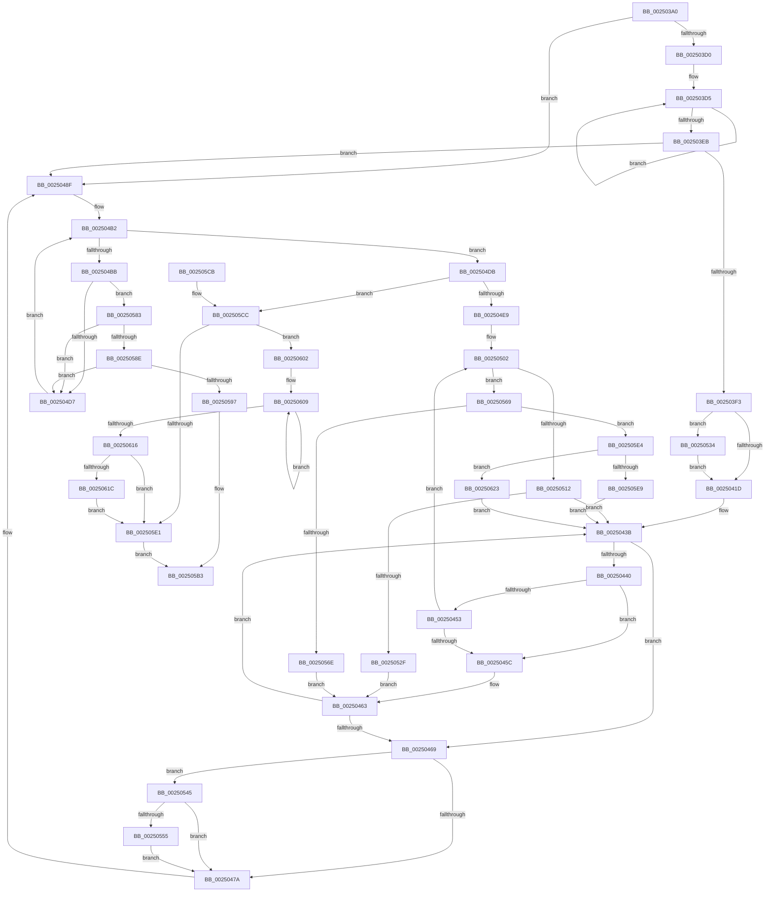

# ExReleaseFastMutexUnsafe

- RVA: `0x002503A0`–`0x0025063F` (길이 `671` bytes)
- VA: `0x00000001402503A0`
- 실행 섹션: `.text`
- PDB 이름 있음: `예`; PDB Function 태그: `아니요`
- unwind 정보 RVA: `0x000633F4`
- 디코드: `176`개 명령, `671/671` bytes 표시
- 미해석 바이트: `0` (있으면 어셈블리에 `.byte`로 보존)

> 이 문서는 커널 이미지의 기계어와 PDB 기호를 분석해 생성했습니다. 4번과 5번은 함수 원형과 자료형을 바이너리 사용 방식에서 추정한 C 해석이며 원본 소스 복구 결과는 아닙니다.

## 1. Dependencies

- 직접 호출 지점: **11**; 고유 호출 대상: **10**
- 직접 호출자로 확인된 함수: **101**
- RIP 상대 이미지 참조: **1**

### Outgoing calls
- `0x0025042A` → [KiAcquireKobjectLockSafe](KiAcquireKobjectLockSafe_function_00251C90.md) (function, `0x00251C90`)
- `0x0025048A` → [KiExitDispatcher](KiExitDispatcher_function_00251CF0.md) (function, `0x00251CF0`)
- `0x002504FC` → [KeBugCheckEx](../4F/KeBugCheckEx_function_004FD660.md) (function, `0x004FD660`)
- `0x00250522` → [KiTryUnwaitThread](../35/KiTryUnwaitThread_function_003506D0.md) (function, `0x003506D0`)
- `0x0025053B` → [KiRaiseIrqlProcessIrqlFlags](../4F/KiRaiseIrqlProcessIrqlFlags_function_004F56FC.md) (function, `0x004F56FC`)
- `0x0025055F` → [KeAbPreWakeupThread](../35/KeAbPreWakeupThread_function_0035034C.md) (function, `0x0035034C`)
- `0x00250579` → [KiInsertQueueInternal](../21/KiInsertQueueInternal_function_00219B30.md) (function, `0x00219B30`)
- `0x002505AE` → [KiAbEntryFreeAndEnableInterrupts](../26/KiAbEntryFreeAndEnableInterrupts_function_002622D0.md) (function, `0x002622D0`)
- `0x002505F8` → [KiTryUnwaitThread](../35/KiTryUnwaitThread_function_003506D0.md) (function, `0x003506D0`)
- `0x0025061C` → [KiRemoveSystemWorkPriorityKick](../26/KiRemoveSystemWorkPriorityKick_function_002631D0.md) (function, `0x002631D0`)
- `0x00250635` → [KeInsertQueueDpc](../20/KeInsertQueueDpc_function_00207C50.md) (function, `0x00207C50`)

### Direct callers
- [FsRtlpAcknowledgeOplockBreakByCacheFlags](../3F/FsRtlpAcknowledgeOplockBreakByCacheFlags_function_003F1988.md) at `0x003F2674`
- [FsRtlpOplockStoreKeyForDeleteOperation](../3F/FsRtlpOplockStoreKeyForDeleteOperation_function_003F2A90.md) at `0x003F2BA7`
- [FsRtlCheckOplockEx2](../3F/FsRtlCheckOplockEx2_function_003F2BC0.md) at `0x003F2CC5`
- [FsRtlCheckOplockEx2](../3F/FsRtlCheckOplockEx2_function_003F2BC0.md) at `0x003F2DA8`
- [FsRtlCheckOplockEx2](../3F/FsRtlCheckOplockEx2_function_003F2BC0.md) at `0x003F35C6`
- [FsRtlpRequestExclusiveOplock](../3F/FsRtlpRequestExclusiveOplock_function_003F3800.md) at `0x003F4049`
- [ExReleaseFastMutexUnsafeAndLeaveCriticalRegion](../46/ExReleaseFastMutexUnsafeAndLeaveCriticalRegion_function_00460A40.md) at `0x00460A44`
- [KeReleaseGuardedMutexUnsafe](../4A/KeReleaseGuardedMutexUnsafe_function_004A4F90.md) at `0x004A4F94`
- [FsRtlUninitializeOplock](../4E/FsRtlUninitializeOplock_function_004E42C0.md) at `0x004E4414`
- [FsRtlpRequestShareableOplock](../4E/FsRtlpRequestShareableOplock_function_004E6EC8.md) at `0x004E7966`
- [FsRtlpWaitOnIrp](../4E/FsRtlpWaitOnIrp_function_004E7998.md) at `0x004E7C85`
- [FsRtlpWaitOnIrp](../4E/FsRtlpWaitOnIrp_function_004E7998.md) at `0x004E7EC5`
- [FsRtlCancelNotify](../4E/FsRtlCancelNotify_function_004E7F90.md) at `0x004E8342`
- [FsRtlOplockBreakToNoneEx](../58/FsRtlOplockBreakToNoneEx_function_00581F40.md) at `0x00582099`
- [FsRtlOplockGetAnyBreakOwnerProcess](../58/FsRtlOplockGetAnyBreakOwnerProcess_function_005820D0.md) at `0x00582125`
- [FsRtlpAcknowledgeOplockBreak](../58/FsRtlpAcknowledgeOplockBreak_function_00582144.md) at `0x0058236C`
- [FsRtlpOplockAckTimeoutWorker](../58/FsRtlpOplockAckTimeoutWorker_function_00582950.md) at `0x00582A00`
- [DifExReleaseFastMutexUnsafeWrapper](../62/DifExReleaseFastMutexUnsafeWrapper_function_00622440.md) at `0x00622506`
- [DifKeReleaseGuardedMutexUnsafeWrapper](../63/DifKeReleaseGuardedMutexUnsafeWrapper_function_006310F0.md) at `0x006311B6`
- [FsRtlpAcknowledgeOplockBreakByCacheFlags$fin$0](../6D/FsRtlpAcknowledgeOplockBreakByCacheFlags_fin_0_function_006D2D80.md) at `0x006D2E57`
- [FsRtlpOplockStoreKeyForDeleteOperation$fin$0](../6D/FsRtlpOplockStoreKeyForDeleteOperation_fin_0_function_006D2E70.md) at `0x006D2E93`
- [FsRtlCheckOplockEx2$fin$0](../6D/FsRtlCheckOplockEx2_fin_0_function_006D2EB0.md) at `0x006D2EDF`
- [FsRtlpRequestExclusiveOplock$fin$0](../6D/FsRtlpRequestExclusiveOplock_fin_0_function_006D2EF5.md) at `0x006D2F09`
- [FsRtlOplockBreakToNoneEx$fin$0](../6D/FsRtlOplockBreakToNoneEx_fin_0_function_006D515C.md) at `0x006D517F`
- [FsRtlUninitializeOplock$fin$0](../6D/FsRtlUninitializeOplock_fin_0_function_006D5195.md) at `0x006D51A9`
- [FsRtlpAcknowledgeOplockBreak$fin$0](../6D/FsRtlpAcknowledgeOplockBreak_fin_0_function_006D51BC.md) at `0x006D51D0`
- [FsRtlpRequestShareableOplock$fin$0](../6D/FsRtlpRequestShareableOplock_fin_0_function_006D52F1.md) at `0x006D530D`
- [FsRtlpWaitOnIrp$fin$0](../6D/FsRtlpWaitOnIrp_fin_0_function_006D5320.md) at `0x006D5409`
- [FsRtlCancelNotify$fin$1](../6D/FsRtlCancelNotify_fin_1_function_006D54F9.md) at `0x006D5512`
- [FsRtlCheckUpperOplock](../../page/71/FsRtlCheckUpperOplock_function_007145F0.md) at `0x00714A9B`
- [FsRtlpOpBatchBreakClosePending](../../page/71/FsRtlpOpBatchBreakClosePending_function_00714CDC.md) at `0x00714DFE`
- [FsRtlpOplockBreakNotify](../../page/71/FsRtlpOplockBreakNotify_function_00714E10.md) at `0x00714F42`
- [FsRtlNotifyCleanupAll](../../page/71/FsRtlNotifyCleanupAll_function_00716D90.md) at `0x00716E11`
- [KeStartDynamicProcessor](../../page/74/KeStartDynamicProcessor_function_00746730.md) at `0x007467A9`
- [SeRegisterLogonSessionTerminatedRoutine](../../page/7A/SeRegisterLogonSessionTerminatedRoutine_function_007A1200.md) at `0x007A1276`
- [SeRegisterLogonSessionTerminatedRoutineEx](../../page/7A/SeRegisterLogonSessionTerminatedRoutineEx_function_007A12A0.md) at `0x007A1322`
- [SeUnregisterLogonSessionTerminatedRoutine](../../page/7A/SeUnregisterLogonSessionTerminatedRoutine_function_007A1350.md) at `0x007A13BB`
- [SeUnregisterLogonSessionTerminatedRoutine](../../page/7A/SeUnregisterLogonSessionTerminatedRoutine_function_007A1350.md) at `0x007A13E7`
- [SeUnregisterLogonSessionTerminatedRoutineEx](../../page/7A/SeUnregisterLogonSessionTerminatedRoutineEx_function_007A1410.md) at `0x007A1494`
- [SeUnregisterLogonSessionTerminatedRoutineEx](../../page/7A/SeUnregisterLogonSessionTerminatedRoutineEx_function_007A1410.md) at `0x007A14B1`
- [SepNotifyFileSystems](../../page/7A/SepNotifyFileSystems_function_007A1910.md) at `0x007A198A`
- [ExpSetBootEntry](../../page/7C/ExpSetBootEntry_function_007CBD2C.md) at `0x007CC36E`
- [ExpSetDriverEntry](../../page/7C/ExpSetDriverEntry_function_007CC424.md) at `0x007CC8FF`
- [ExpSetFirmwareEnvironmentVariable](../../page/7C/ExpSetFirmwareEnvironmentVariable_function_007CC9A8.md) at `0x007CCA3A`
- [NtDeleteBootEntry](../../page/7C/NtDeleteBootEntry_function_007CD2B0.md) at `0x007CD40B`
- [NtDeleteDriverEntry](../../page/7C/NtDeleteDriverEntry_function_007CD440.md) at `0x007CD59B`
- [NtEnumerateDriverEntries](../../page/7C/NtEnumerateDriverEntries_function_007CD5D0.md) at `0x007CD7B6`
- [NtEnumerateSystemEnvironmentValuesEx](../../page/7C/NtEnumerateSystemEnvironmentValuesEx_function_007CDA30.md) at `0x007CDB6D`
- [NtGetEnvironmentVariableEx](../../page/7C/NtGetEnvironmentVariableEx_function_007CDBC0.md) at `0x007CDC4A`
- [NtQueryDriverEntryOrder](../../page/7C/NtQueryDriverEntryOrder_function_007CDCE0.md) at `0x007CDE56`
- [NtQueryEnvironmentVariableInfoEx](../../page/7C/NtQueryEnvironmentVariableInfoEx_function_007CDF00.md) at `0x007CDF7E`
- [NtQuerySystemEnvironmentValue](../../page/7C/NtQuerySystemEnvironmentValue_function_007CDFB0.md) at `0x007CE1E3`
- [NtSetBootOptions](../../page/7C/NtSetBootOptions_function_007CE2B0.md) at `0x007CE45D`
- [NtSetDriverEntryOrder](../../page/7C/NtSetDriverEntryOrder_function_007CE490.md) at `0x007CE605`
- [NtSetSystemEnvironmentValue](../../page/7C/NtSetSystemEnvironmentValue_function_007CE650.md) at `0x007CE919`
- [CmObliterateRMTxArray](../../page/7E/CmObliterateRMTxArray_function_007EDF3C.md) at `0x007EDFC5`
- [CmpLazyCommitWorker](../../page/7E/CmpLazyCommitWorker_function_007EE030.md) at `0x007EE0C4`
- [CmpLazyCommitWorker](../../page/7E/CmpLazyCommitWorker_function_007EE030.md) at `0x007EE12A`
- [CmpLazyCommitWorker](../../page/7E/CmpLazyCommitWorker_function_007EE030.md) at `0x007EE19C`
- [CmpTransInitializeTransaction](../../page/84/CmpTransInitializeTransaction_function_008422C8.md) at `0x008423EB`
- [CmpTransInitializeTransaction](../../page/84/CmpTransInitializeTransaction_function_008422C8.md) at `0x00842434`
- [CmpCleanupTransactionState](../../page/84/CmpCleanupTransactionState_function_008428E0.md) at `0x0084296D`
- [CmpLogCheckpoint](../../page/84/CmpLogCheckpoint_function_00842F04.md) at `0x00842F96`
- [CmpLogCheckpoint](../../page/84/CmpLogCheckpoint_function_00842F04.md) at `0x00843150`
- [CmpPostNotify](../../page/86/CmpPostNotify_function_008645D8.md) at `0x00864681`
- [CmpPostNotify](../../page/86/CmpPostNotify_function_008645D8.md) at `0x00864969`
- [CmpTransSearchAddLightWeightTrans](../../page/87/CmpTransSearchAddLightWeightTrans_function_00873494.md) at `0x008735D0`
- [CmpTransSearchAddLightWeightTrans](../../page/87/CmpTransSearchAddLightWeightTrans_function_00873494.md) at `0x008735F0`
- [CmpTransSearchAddTrans](../../page/87/CmpTransSearchAddTrans_function_008743FC.md) at `0x008744BC`
- [CmpTransSearchAddTrans](../../page/87/CmpTransSearchAddTrans_function_008743FC.md) at `0x0087452D`
- [CmpTransSearchAddTrans](../../page/87/CmpTransSearchAddTrans_function_008743FC.md) at `0x00874584`
- [CmpTransSearchAddTrans](../../page/87/CmpTransSearchAddTrans_function_008743FC.md) at `0x008745BD`
- [CmpInitCmRM](../../page/87/CmpInitCmRM_function_0087C700.md) at `0x0087D10B`
- [CmpNotifyTriggerCheck](../../page/8C/CmpNotifyTriggerCheck_function_008C74A4.md) at `0x008C74E5`
- [CmpNotifyTriggerCheck](../../page/8C/CmpNotifyTriggerCheck_function_008C74A4.md) at `0x008C7564`
- [CmNotifyRunDown](../../page/90/CmNotifyRunDown_function_00906984.md) at `0x00906A2B`
- [NtQuerySystemEnvironmentValueEx](../../page/95/NtQuerySystemEnvironmentValueEx_function_00952180.md) at `0x009523EB`
- [ExpGetFirmwareEnvironmentVariable](../../page/95/ExpGetFirmwareEnvironmentVariable_function_009524DC.md) at `0x00952573`
- [CmSnapshotRMTxArray](../../page/9A/CmSnapshotRMTxArray_function_009AEC9C.md) at `0x009AECFB`
- [CmSnapshotRMTxArray](../../page/9A/CmSnapshotRMTxArray_function_009AEC9C.md) at `0x009AED4D`
- [CmpRunDownCmRM](../../page/9B/CmpRunDownCmRM_function_009B062C.md) at `0x009B0686`
- [CmpRunDownCmRM](../../page/9B/CmpRunDownCmRM_function_009B062C.md) at `0x009B074F`
- [CmpCommitPreparedLightWeightTransaction](../../page/9B/CmpCommitPreparedLightWeightTransaction_function_009B0B88.md) at `0x009B0C02`
- [CmpPrepareLightWeightTransaction](../../page/9B/CmpPrepareLightWeightTransaction_function_009B0D24.md) at `0x009B0DB7`
- [CmpCleanupLightWeightTransaction](../../page/9B/CmpCleanupLightWeightTransaction_function_009B1340.md) at `0x009B13C4`
- [CmpTransMgrRollback](../../page/9B/CmpTransMgrRollback_function_009B1400.md) at `0x009B145B`
- [CmpTransMgrPrepare](../../page/9B/CmpTransMgrPrepare_function_009B175C.md) at `0x009B17B3`
- [CmKtmNotification](../../page/9B/CmKtmNotification_function_009B1950.md) at `0x009B1A32`
- [CmKtmNotification](../../page/9B/CmKtmNotification_function_009B1950.md) at `0x009B1CAA`
- [CmKtmNotification](../../page/9B/CmKtmNotification_function_009B1950.md) at `0x009B1D11`
- [CmKtmNotification](../../page/9B/CmKtmNotification_function_009B1950.md) at `0x009B1D39`
- [CmpIsCmRm](../../page/9B/CmpIsCmRm_function_009B1E78.md) at `0x009B1ED8`
- [NtNotifyChangeMultipleKeys](../../page/9D/NtNotifyChangeMultipleKeys_function_009DC6B0.md) at `0x009DCC9A`
- [NtNotifyChangeMultipleKeys](../../page/9D/NtNotifyChangeMultipleKeys_function_009DC6B0.md) at `0x009DCE30`
- [NtNotifyChangeMultipleKeys](../../page/9D/NtNotifyChangeMultipleKeys_function_009DC6B0.md) at `0x009DD067`
- [NtNotifyChangeMultipleKeys](../../page/9D/NtNotifyChangeMultipleKeys_function_009DC6B0.md) at `0x009DD22B`
- [FsRtlpOplockFsctrlInternal](../../page/9F/FsRtlpOplockFsctrlInternal_function_009F1640.md) at `0x009F18D3`
- [FsRtlCheckOplockForFsFilterCallback](../../page/9F/FsRtlCheckOplockForFsFilterCallback_function_009F67A0.md) at `0x009F6A16`
- [FsRtlNotifyFilterReportChange](../../page/A1/FsRtlNotifyFilterReportChange_function_00A1E880.md) at `0x00A1F29E`
- [FsRtlNotifyFilterReportChangeLiteEx](../../page/A1/FsRtlNotifyFilterReportChangeLiteEx_function_00A1F2B0.md) at `0x00A1F92E`
- [NtEnumerateBootEntries](../../page/A2/NtEnumerateBootEntries_function_00A25040.md) at `0x00A251D6`
- [FsRtlNotifyCleanup](../../page/A3/FsRtlNotifyCleanup_function_00A32840.md) at `0x00A328A8`
- [FsRtlOplockBreakH2](../../page/A4/FsRtlOplockBreakH2_function_00A44550.md) at `0x00A4473B`
- [UNLOCK_TRANSACTION_LIST](../../page/A6/UNLOCK_TRANSACTION_LIST_function_00A61EB8.md) at `0x00A61EC3`
- [NtQueryBootEntryOrder](../../page/A9/NtQueryBootEntryOrder_function_00A91720.md) at `0x00A9189D`
- [NtSetBootEntryOrder](../../page/A9/NtSetBootEntryOrder_function_00A91930.md) at `0x00A919D9`
- [FsRtlNotifyFilterChangeDirectory](../../page/AA/FsRtlNotifyFilterChangeDirectory_function_00AAB9E0.md) at `0x00AABCE6`
- [NtQueryBootOptions](../../page/AA/NtQueryBootOptions_function_00AAFBC0.md) at `0x00AAFDF8`
- [CmRmFinalizeRecovery](../../page/AB/CmRmFinalizeRecovery_function_00ABEB68.md) at `0x00ABEBD5`
- [CmRmFinalizeRecovery](../../page/AB/CmRmFinalizeRecovery_function_00ABEB68.md) at `0x00ABEC5E`
- [FsRtlNotifyFilterChangeDirectoryLite](../../page/AD/FsRtlNotifyFilterChangeDirectoryLite_function_00ADC950.md) at `0x00ADCC2A`
- [FsRtlpOplockFsctrlInternal$fin$1](../../page/B1/FsRtlpOplockFsctrlInternal_fin_1_function_00B10D70.md) at `0x00B10DA5`
- [FsRtlCheckOplockForFsFilterCallback$fin$0](../../page/B1/FsRtlCheckOplockForFsFilterCallback_fin_0_function_00B10EF0.md) at `0x00B10F13`
- [FsRtlNotifyFilterReportChange$fin$1](../../page/B1/FsRtlNotifyFilterReportChange_fin_1_function_00B1120A.md) at `0x00B11225`
- [FsRtlNotifyFilterReportChangeLiteEx$fin$1](../../page/B1/FsRtlNotifyFilterReportChangeLiteEx_fin_1_function_00B1126B.md) at `0x00B11297`
- [FsRtlNotifyCleanup$fin$0](../../page/B1/FsRtlNotifyCleanup_fin_0_function_00B1150B.md) at `0x00B11524`
- [FsRtlOplockBreakH2$fin$0](../../page/B1/FsRtlOplockBreakH2_fin_0_function_00B115DC.md) at `0x00B115FF`
- [FsRtlNotifyFilterChangeDirectory$fin$0](../../page/B1/FsRtlNotifyFilterChangeDirectory_fin_0_function_00B138B7.md) at `0x00B138D3`
- [FsRtlCheckUpperOplock$fin$0](../../page/B1/FsRtlCheckUpperOplock_fin_0_function_00B13CE3.md) at `0x00B13D06`
- [FsRtlpOpBatchBreakClosePending$fin$0](../../page/B1/FsRtlpOpBatchBreakClosePending_fin_0_function_00B13D1C.md) at `0x00B13D30`
- [FsRtlpOplockBreakNotify$fin$0](../../page/B1/FsRtlpOplockBreakNotify_fin_0_function_00B13D43.md) at `0x00B13D60`
- [FsRtlNotifyCleanupAll$fin$0](../../page/B1/FsRtlNotifyCleanupAll_fin_0_function_00B13D73.md) at `0x00B13D8B`
- [FsRtlNotifyFilterChangeDirectoryLite$fin$0](../../page/B1/FsRtlNotifyFilterChangeDirectoryLite_fin_0_function_00B13D9E.md) at `0x00B13DC8`
- [sub_00B17700](../../page/B1/Unknown_function_00B17700.md) at `0x00B17733`
- [KeInitSystem](../../init/C7/KeInitSystem_function_00C71660.md) at `0x00C71C07`

### Static image references
- `0x00250411` → RVA `0x00FC6D20` (`ALMOSTRO`; read)

## 2. Other-region calls and transfers

- 다른 실행 섹션으로 향하는 call: **0**
- 별도 외부 분기/꼬리 이동을 확인하지 못했습니다.

## 3. Assembly (complete function range)

```asm
002503A0  48 89 5C 24 18                  mov qword ptr [rsp + 0x18], rbx
002503A5  55                              push rbp
002503A6  56                              push rsi
002503A7  57                              push rdi
002503A8  41 54                           push r12
002503AA  41 55                           push r13
002503AC  41 56                           push r14
002503AE  41 57                           push r15
002503B0  48 83 EC 30                     sub rsp, 0x30
002503B4  33 FF                           xor edi, edi
002503B6  48 8B D9                        mov rbx, rcx
002503B9  48 89 79 08                     mov qword ptr [rcx + 8], rdi
002503BD  33 C0                           xor eax, eax
002503BF  41 BD 01 00 00 00               mov r13d, 1
002503C5  F0 44 0F B1 29                  lock cmpxchg dword ptr [rcx], r13d
002503CA  0F 84 BF 00 00 00               je 0x14025048f
002503D0  48 89 7C 24 78                  mov qword ptr [rsp + 0x78], rdi
002503D5  8B D0                           mov edx, eax
002503D7  B9 FF FF FF FF                  mov ecx, 0xffffffff
002503DC  83 E2 02                        and edx, 2
002503DF  41 0F 45 CD                     cmovne ecx, r13d
002503E3  03 C8                           add ecx, eax
002503E5  F0 0F B1 0B                     lock cmpxchg dword ptr [rbx], ecx
002503E9  75 EA                           jne 0x1402503d5
002503EB  85 D2                           test edx, edx
002503ED  0F 85 9C 00 00 00               jne 0x14025048f
002503F3  65 48 8B 04 25 88 01 00 00      mov rax, qword ptr gs:[0x188]
002503FC  44 0F B6 A0 C3 00 00 00         movzx r12d, byte ptr [rax + 0xc3]
00250404  45 0F 20 C7                     mov r15, cr8
00250408  B8 02 00 00 00                  mov eax, 2
0025040D  44 0F 22 C0                     mov cr8, rax
00250411  39 3D 09 69 D7 00               cmp dword ptr [rip + 0xd76909], edi
00250417  0F 85 17 01 00 00               jne 0x140250534
0025041D  65 48 8B 2C 25 20 00 00 00      mov rbp, qword ptr gs:[0x20]
00250426  48 8D 4B 18                     lea rcx, [rbx + 0x18]
0025042A  E8 61 18 00 00                  call 0x140251c90
0025042F  48 8B 73 20                     mov rsi, qword ptr [rbx + 0x20]
00250433  4C 8D 73 20                     lea r14, [rbx + 0x20]
00250437  44 89 6B 1C                     mov dword ptr [rbx + 0x1c], r13d
0025043B  49 3B F6                        cmp rsi, r14
0025043E  74 29                           je 0x140250469
00250440  48 8B 16                        mov rdx, qword ptr [rsi]
00250443  48 8B C6                        mov rax, rsi
00250446  48 8B F2                        mov rsi, rdx
00250449  48 8B 48 08                     mov rcx, qword ptr [rax + 8]
0025044D  48 39 42 08                     cmp qword ptr [rdx + 8], rax
00250451  75 09                           jne 0x14025045c
00250453  48 39 01                        cmp qword ptr [rcx], rax
00250456  0F 84 A6 00 00 00               je 0x140250502
0025045C  B9 03 00 00 00                  mov ecx, 3
00250461  CD 29                           int 0x29
00250463  44 29 6B 1C                     sub dword ptr [rbx + 0x1c], r13d
00250467  75 D2                           jne 0x14025043b
00250469  F0 81 63 18 7F FF FF FF         lock and dword ptr [rbx + 0x18], 0xffffff7f
00250471  45 84 E4                        test r12b, r12b
00250474  0F 85 CB 00 00 00               jne 0x140250545
0025047A  45 8B CD                        mov r9d, r13d
0025047D  44 88 7C 24 20                  mov byte ptr [rsp + 0x20], r15b
00250482  45 8B C5                        mov r8d, r13d
00250485  33 D2                           xor edx, edx
00250487  48 8B CD                        mov rcx, rbp
0025048A  E8 61 18 00 00                  call 0x140251cf0
0025048F  65 4C 8B 14 25 88 01 00 00      mov r10, qword ptr gs:[0x188]
00250498  FA                              cli
00250499  4D 8B 82 70 04 00 00            mov r8, qword ptr [r10 + 0x470]
002504A0  4C 8B CB                        mov r9, rbx
002504A3  48 BE FC FF FF FF FF FF FF 7F   movabs rsi, 0x7ffffffffffffffc
002504AD  8B C7                           mov eax, edi
002504AF  4C 23 CE                        and r9, rsi
002504B2  41 0F B6 48 0C                  movzx ecx, byte ptr [r8 + 0xc]
002504B7  3B C1                           cmp eax, ecx
002504B9  73 20                           jae 0x1402504db
002504BB  8B C8                           mov ecx, eax
002504BD  4C 6B D9 58                     imul r11, rcx, 0x58
002504C1  4D 03 D8                        add r11, r8
002504C4  49 8B 53 10                     mov rdx, qword ptr [r11 + 0x10]
002504C8  48 8B CA                        mov rcx, rdx
002504CB  48 23 CE                        and rcx, rsi
002504CE  49 3B C9                        cmp rcx, r9
002504D1  0F 84 AC 00 00 00               je 0x140250583
002504D7  FF C0                           inc eax
002504D9  EB D7                           jmp 0x1402504b2
002504DB  41 8B 42 78                     mov eax, dword ptr [r10 + 0x78]
002504DF  0F BA E0 10                     bt eax, 0x10
002504E3  0F 82 E3 00 00 00               jb 0x1402505cc
002504E9  45 33 C9                        xor r9d, r9d
002504EC  48 89 7C 24 20                  mov qword ptr [rsp + 0x20], rdi
002504F1  4C 8B C3                        mov r8, rbx
002504F4  49 8B D2                        mov rdx, r10
002504F7  B9 62 01 00 00                  mov ecx, 0x162
002504FC  E8 5F D1 2A 00                  call 0x1404fd660
00250501  CC                              int3
00250502  48 89 11                        mov qword ptr [rcx], rdx
00250505  48 89 4A 08                     mov qword ptr [rdx + 8], rcx
00250509  0F B6 48 10                     movzx ecx, byte ptr [rax + 0x10]
0025050D  41 3A CD                        cmp cl, r13b
00250510  75 57                           jne 0x140250569
00250512  44 0F B7 40 12                  movzx r8d, word ptr [rax + 0x12]
00250517  4C 8D 4C 24 78                  lea r9, [rsp + 0x78]
0025051C  48 8B D0                        mov rdx, rax
0025051F  48 8B CD                        mov rcx, rbp
00250522  E8 A9 01 10 00                  call 0x1403506d0
00250527  84 C0                           test al, al
00250529  0F 84 0C FF FF FF               je 0x14025043b
0025052F  E9 2F FF FF FF                  jmp 0x140250463
00250534  0F B6 D0                        movzx edx, al
00250537  41 0F B6 CF                     movzx ecx, r15b
0025053B  E8 BC 51 2A 00                  call 0x1404f56fc
00250540  E9 D8 FE FF FF                  jmp 0x14025041d
00250545  48 8B 8D 08 2D 00 00            mov rcx, qword ptr [rbp + 0x2d08]
0025054C  48 85 C9                        test rcx, rcx
0025054F  0F 84 25 FF FF FF               je 0x14025047a
00250555  48 81 C1 28 FF FF FF            add rcx, -0xd8
0025055C  48 8B D3                        mov rdx, rbx
0025055F  E8 E8 FD 0F 00                  call 0x14035034c
00250564  E9 11 FF FF FF                  jmp 0x14025047a
00250569  80 F9 02                        cmp cl, 2
0025056C  75 76                           jne 0x1402505e4
0025056E  C6 40 11 05                     mov byte ptr [rax + 0x11], 5
00250572  48 8B D0                        mov rdx, rax
00250575  48 8B 48 18                     mov rcx, qword ptr [rax + 0x18]
00250579  E8 B2 95 FC FF                  call 0x140219b30
0025057E  E9 E0 FE FF FF                  jmp 0x140250463
00250583  41 80 7B 1A 00                  cmp byte ptr [r11 + 0x1a], 0
00250588  0F 84 49 FF FF FF               je 0x1402504d7
0025058E  41 84 D5                        test r13b, dl
00250591  0F 85 40 FF FF FF               jne 0x1402504d7
00250597  45 8B CD                        mov r9d, r13d
0025059A  41 C6 43 1A 00                  mov byte ptr [r11 + 0x1a], 0
0025059F  4C 8B C3                        mov r8, rbx
002505A2  48 89 7C 24 20                  mov qword ptr [rsp + 0x20], rdi
002505A7  49 8B D2                        mov rdx, r10
002505AA  49 8D 4B 10                     lea rcx, [r11 + 0x10]
002505AE  E8 1D 1D 01 00                  call 0x1402622d0
002505B3  48 8B 9C 24 80 00 00 00         mov rbx, qword ptr [rsp + 0x80]
002505BB  48 83 C4 30                     add rsp, 0x30
002505BF  41 5F                           pop r15
002505C1  41 5E                           pop r14
002505C3  41 5D                           pop r13
002505C5  41 5C                           pop r12
002505C7  5F                              pop rdi
002505C8  5E                              pop rsi
002505C9  5D                              pop rbp
002505CA  C3                              ret
002505CB  CC                              int3
002505CC  65 48 8B 0C 25 20 00 00 00      mov rcx, qword ptr gs:[0x20]
002505D5  4C 8B 81 B8 8E 00 00            mov r8, qword ptr [rcx + 0x8eb8]
002505DC  4D 85 C0                        test r8, r8
002505DF  75 21                           jne 0x140250602
002505E1  FB                              sti
002505E2  EB CF                           jmp 0x1402505b3
002505E4  80 F9 04                        cmp cl, 4
002505E7  74 3A                           je 0x140250623
002505E9  45 33 C9                        xor r9d, r9d
002505EC  41 B8 00 01 00 00               mov r8d, 0x100
002505F2  48 8B D0                        mov rdx, rax
002505F5  48 8B CD                        mov rcx, rbp
002505F8  E8 D3 00 10 00                  call 0x1403506d0
002505FD  E9 39 FE FF FF                  jmp 0x14025043b
00250602  41 0F 0D 08                     prefetchw byte ptr [r8]
00250606  41 8B 00                        mov eax, dword ptr [r8]
00250609  8B D0                           mov edx, eax
0025060B  0F BA F2 15                     btr edx, 0x15
0025060F  F0 41 0F B1 10                  lock cmpxchg dword ptr [r8], edx
00250614  75 F3                           jne 0x140250609
00250616  0F BA E0 15                     bt eax, 0x15
0025061A  73 C5                           jae 0x1402505e1
0025061C  E8 AF 2B 01 00                  call 0x1402631d0
00250621  EB BE                           jmp 0x1402505e1
00250623  C6 40 11 05                     mov byte ptr [rax + 0x11], 5
00250627  48 8D 53 18                     lea rdx, [rbx + 0x18]
0025062B  89 7B 1C                        mov dword ptr [rbx + 0x1c], edi
0025062E  4C 8B C0                        mov r8, rax
00250631  48 8B 48 18                     mov rcx, qword ptr [rax + 0x18]
00250635  E8 16 76 FB FF                  call 0x140207c50
0025063A  E9 FC FD FF FF                  jmp 0x14025043b
```

## 4. C-style interpretation (structured pseudocode)

```c
__int64 __fastcall ExReleaseFastMutexUnsafe(__int64 a1)
{
    __int64 result;
    __int64 v_r11;
    __int64 v_rdi;
    __int64 v_rsp;
    unsigned __int8 v_stack_m48;
    unsigned __int64 v_stack_p10;
    unsigned __int64 v_stack_p18;

    v_stack_p18 = v_rbx;
    v_rsp = (v_rsp) - (48);
    v_rdi = 0;
    *(unsigned __int64 *)(a1 + 8) = 0;
    result = 0;
    if (condition_is_equal) goto loc_0025048F;
    v_stack_p10 = 0;
loc_002503D5:
    a2 = (unsigned int)((0) & (2));
    a1 = (unsigned int)(0xFFFFFFFFULL);
    if (condition_is_not_equal) { a1 = 1; }
    a1 = (unsigned int)((a1) + (0));
    if (condition_is_not_equal) goto loc_002503D5;
    if ((unsigned int)(a2) != 0) goto loc_0025048F;
    if ((*(unsigned int *)(v_rip + 14117129)) != 0) goto loc_00250534;
loc_0025041D:
    result = KiAcquireKobjectLockSafe(a1 + 24, a2, a3, a4);
    *(unsigned int *)(a1 + 28) = 1;
loc_0025043B:
    if ((*(unsigned __int64 *)(a1 + 32)) == (a1 + 32)) goto loc_00250469;
    if ((*(unsigned __int64 *)(*(unsigned __int64 *)(*(unsigned __int64 *)(a1 + 32)) + 8)) != (*(unsigned __int64 *)(a1 + 32))) goto loc_0025045C;
    if ((*(unsigned __int64 *)(*(unsigned __int64 *)(*(unsigned __int64 *)(a1 + 32) + 8))) == (*(unsigned __int64 *)(a1 + 32))) goto loc_00250502;
loc_0025045C:
loc_00250463:
    if ((*(unsigned __int64 *)(*(unsigned __int64 *)(*(unsigned __int64 *)(a1 + 32) + 8))) != (*(unsigned __int64 *)(a1 + 32))) goto loc_0025043B;
loc_00250469:
    if ((unsigned __int8)(*(unsigned __int8 *)(*(unsigned __int64 *)(gs_base + (0 + 392)) + 195)) != 0) goto loc_00250545;
loc_0025047A:
    v_stack_m48 = (unsigned __int8)(v_cr8);
    a2 = 0;
    result = KiExitDispatcher(*(unsigned __int64 *)(gs_base + (0 + 32)), a2, 1, 1);
loc_0025048F:
    a4 = (a1) & (*(unsigned __int64 *)(*(unsigned __int64 *)(a1 + 32)));
loc_002504B2:
    if (0 >= ((unsigned int)(*(unsigned __int8 *)(*(unsigned __int64 *)(*(unsigned __int64 *)(gs_base + (0 + 392)) + 1136) + 12)))) goto loc_002504DB;
    v_r11 = (v_r11) * (0);
    v_r11 = (v_r11) + (*(unsigned __int64 *)(*(unsigned __int64 *)(gs_base + (0 + 392)) + 1136));
    a1 = (*(unsigned __int64 *)(v_r11 + 16)) & (*(unsigned __int64 *)(*(unsigned __int64 *)(a1 + 32)));
    if (a1 == a4) goto loc_00250583;
loc_002504D7:
    result = (unsigned int)((0) + 1);
    goto loc_002504B2;
loc_002504DB:
    if (a1 < a4) goto loc_002505CC;
    a4 = 0;
    v_stack_m48 = 0;
    result = KeBugCheckEx(354, *(unsigned __int64 *)(gs_base + (0 + 392)), a1, a4);
loc_00250502:
    *(unsigned __int64 *)(354) = *(unsigned __int64 *)(gs_base + (0 + 392));
    *(unsigned __int64 *)(*(unsigned __int64 *)(gs_base + (0 + 392)) + 8) = 354;
    if (((unsigned __int8)(*(unsigned __int8 *)(result + 16))) != 1) goto loc_00250569;
    result = KiTryUnwaitThread(*(unsigned __int64 *)(gs_base + (0 + 32)), result, *(unsigned __int16 *)(result + 18), v_stack_p10);
    if ((unsigned __int8)(result) == 0) goto loc_0025043B;
    goto loc_00250463;
loc_00250534:
    result = KiRaiseIrqlProcessIrqlFlags((unsigned __int8)(v_cr8), (unsigned __int8)(result), *(unsigned __int16 *)(result + 18), v_stack_p10);
    goto loc_0025041D;
loc_00250545:
    if (*(unsigned __int64 *)(*(unsigned __int64 *)(gs_base + (0 + 32)) + 11528) == 0) goto loc_0025047A;
    a1 = (*(unsigned __int64 *)(*(unsigned __int64 *)(gs_base + (0 + 32)) + 11528)) + (-216);
    result = KeAbPreWakeupThread(a1, a1, *(unsigned __int16 *)(result + 18), v_stack_p10);
    goto loc_0025047A;
loc_00250569:
    if (((unsigned __int8)(a1)) != 2) goto loc_002505E4;
    *(unsigned __int8 *)(result + 17) = 5;
    result = KiInsertQueueInternal(*(unsigned __int64 *)(result + 24), result, *(unsigned __int16 *)(result + 18), v_stack_p10);
    goto loc_00250463;
loc_00250583:
    if ((*(unsigned __int8 *)(v_r11 + 26)) == 0) goto loc_002504D7;
    if (((1) & ((unsigned __int8)(result))) != 0) goto loc_002504D7;
    *(unsigned __int8 *)(v_r11 + 26) = 0;
    v_stack_m48 = 0;
    result = KiAbEntryFreeAndEnableInterrupts(v_r11 + 16, *(unsigned __int64 *)(gs_base + (0 + 392)), a1, 1);
loc_002505B3:
    v_rsp = (v_rsp) + (48);
    return result;
loc_002505CC:
    if (*(unsigned __int64 *)(*(unsigned __int64 *)(gs_base + (0 + 32)) + 36536) != 0) goto loc_00250602;
loc_002505E1:
    goto loc_002505B3;
loc_002505E4:
    if (((unsigned __int8)(*(unsigned __int64 *)(gs_base + (0 + 32)))) == 4) goto loc_00250623;
    a4 = 0;
    result = KiTryUnwaitThread(*(unsigned __int64 *)(gs_base + (0 + 32)), result, 256, a4);
    goto loc_0025043B;
loc_00250602:
loc_00250609:
    if (condition_is_not_equal) goto loc_00250609;
    if (condition_is_above_or_equal) goto loc_002505E1;
    result = KiRemoveSystemWorkPriorityKick(*(unsigned __int64 *)(gs_base + (0 + 32)), (unsigned int)((unsigned int)((unsigned int)(*(unsigned int *)(256)))), 256, a4);
    goto loc_002505E1;
loc_00250623:
    *(unsigned __int8 *)(result + 17) = 5;
    *(unsigned int *)(v_stack_p18 + 28) = 0;
    result = KeInsertQueueDpc(*(unsigned __int64 *)(result + 24), v_stack_p18 + 24, result, a4);
    goto loc_0025043B;
}
```

## 5. (Beta) C Style

```c
int64_t ExReleaseFastMutexUnsafe(void *Arg1)
{
    uint8_t *arg1 = (uint8_t *)Arg1;

    int64_t result;
    int64_t local_r11;
    int64_t local_rdi;
    int64_t local_rsp;
    uint8_t v_stack_m48;
    uint64_t v_stack_p10;
    uint64_t v_stack_p18;

    v_stack_p18 = local_rbx;
    local_rsp = (local_rsp) - (48);
    local_rdi = 0;
    *(uint64_t *)(arg1 + 0x8) = 0;
    result = 0;
    if (condition_is_equal) goto loc_0025048F;
    v_stack_p10 = 0;
loc_002503D5:
    a2 = (uint32_t)((0) & (2));
    Arg1 = (uint32_t)(0xFFFFFFFFULL);
    if (condition_is_not_equal) { Arg1 = 1; }
    Arg1 = (uint32_t)((Arg1) + (0));
    if (condition_is_not_equal) goto loc_002503D5;
    if ((uint32_t)(a2) != 0) goto loc_0025048F;
    if ((*(uint32_t *)(v_rip + 0xD76909)) != 0) goto loc_00250534;
loc_0025041D:
    result = KiAcquireKobjectLockSafe(Arg1 + 24, a2, a3, a4);
    *(uint32_t *)(arg1 + 0x1C) = 1;
loc_0025043B:
    if ((*(uint64_t *)(arg1 + 0x20)) == (Arg1 + 32)) goto loc_00250469;
    if ((*(uint64_t *)(*(uint64_t *)(*(uint64_t *)(arg1 + 0x20)) + 0x8)) != (*(uint64_t *)(arg1 + 0x20))) goto loc_0025045C;
    if ((*(uint64_t *)(*(uint64_t *)(*(uint64_t *)(arg1 + 0x20) + 0x8))) == (*(uint64_t *)(arg1 + 0x20))) goto loc_00250502;
loc_0025045C:
loc_00250463:
    if ((*(uint64_t *)(*(uint64_t *)(*(uint64_t *)(arg1 + 0x20) + 0x8))) != (*(uint64_t *)(arg1 + 0x20))) goto loc_0025043B;
loc_00250469:
    if ((uint8_t)(*(uint8_t *)(*(uint64_t *)(gs_base + (0 + 0x188)) + 0xC3)) != 0) goto loc_00250545;
loc_0025047A:
    v_stack_m48 = (uint8_t)(v_cr8);
    a2 = 0;
    result = KiExitDispatcher(*(uint64_t *)(gs_base + (0 + 0x20)), a2, 1, 1);
loc_0025048F:
    a4 = (Arg1) & (*(uint64_t *)(*(uint64_t *)(arg1 + 0x20)));
loc_002504B2:
    if (0 >= ((uint32_t)(*(uint8_t *)(*(uint64_t *)(*(uint64_t *)(gs_base + (0 + 0x188)) + 0x470) + 0xC)))) goto loc_002504DB;
    local_r11 = (local_r11) * (0);
    local_r11 = (local_r11) + (*(uint64_t *)(*(uint64_t *)(gs_base + (0 + 0x188)) + 0x470));
    Arg1 = (*(uint64_t *)(local_r11 + 0x10)) & (*(uint64_t *)(*(uint64_t *)(arg1 + 0x20)));
    if (Arg1 == a4) goto loc_00250583;
loc_002504D7:
    result = (uint32_t)((0) + 1);
    goto loc_002504B2;
loc_002504DB:
    if (Arg1 < a4) goto loc_002505CC;
    a4 = 0;
    v_stack_m48 = 0;
    result = KeBugCheckEx(354, *(uint64_t *)(gs_base + (0 + 0x188)), Arg1, a4);
loc_00250502:
    *(uint64_t *)(354) = *(uint64_t *)(gs_base + (0 + 0x188));
    *(uint64_t *)(*(uint64_t *)(gs_base + (0 + 0x188)) + 0x8) = 354;
    if (((uint8_t)(*(uint8_t *)(result + 0x10))) != 1) goto loc_00250569;
    result = KiTryUnwaitThread(*(uint64_t *)(gs_base + (0 + 0x20)), result, *(uint16_t *)(result + 0x12), v_stack_p10);
    if ((uint8_t)(result) == 0) goto loc_0025043B;
    goto loc_00250463;
loc_00250534:
    result = KiRaiseIrqlProcessIrqlFlags((uint8_t)(v_cr8), (uint8_t)(result), *(uint16_t *)(result + 0x12), v_stack_p10);
    goto loc_0025041D;
loc_00250545:
    if (*(uint64_t *)(*(uint64_t *)(gs_base + (0 + 0x20)) + 0x2D08) == 0) goto loc_0025047A;
    Arg1 = (*(uint64_t *)(*(uint64_t *)(gs_base + (0 + 0x20)) + 0x2D08)) + (-216);
    result = KeAbPreWakeupThread(Arg1, Arg1, *(uint16_t *)(result + 0x12), v_stack_p10);
    goto loc_0025047A;
loc_00250569:
    if (((uint8_t)(Arg1)) != 2) goto loc_002505E4;
    *(uint8_t *)(result + 0x11) = 5;
    result = KiInsertQueueInternal(*(uint64_t *)(result + 0x18), result, *(uint16_t *)(result + 0x12), v_stack_p10);
    goto loc_00250463;
loc_00250583:
    if ((*(uint8_t *)(local_r11 + 0x1A)) == 0) goto loc_002504D7;
    if (((1) & ((uint8_t)(result))) != 0) goto loc_002504D7;
    *(uint8_t *)(local_r11 + 0x1A) = 0;
    v_stack_m48 = 0;
    result = KiAbEntryFreeAndEnableInterrupts(local_r11 + 16, *(uint64_t *)(gs_base + (0 + 0x188)), Arg1, 1);
loc_002505B3:
    local_rsp = (local_rsp) + (48);
    return result;
loc_002505CC:
    if (*(uint64_t *)(*(uint64_t *)(gs_base + (0 + 0x20)) + 0x8EB8) != 0) goto loc_00250602;
loc_002505E1:
    goto loc_002505B3;
loc_002505E4:
    if (((uint8_t)(*(uint64_t *)(gs_base + (0 + 0x20)))) == 4) goto loc_00250623;
    a4 = 0;
    result = KiTryUnwaitThread(*(uint64_t *)(gs_base + (0 + 0x20)), result, 256, a4);
    goto loc_0025043B;
loc_00250602:
loc_00250609:
    if (condition_is_not_equal) goto loc_00250609;
    if (condition_is_above_or_equal) goto loc_002505E1;
    result = KiRemoveSystemWorkPriorityKick(*(uint64_t *)(gs_base + (0 + 0x20)), (uint32_t)((uint32_t)((uint32_t)(*(uint32_t *)(256)))), 256, a4);
    goto loc_002505E1;
loc_00250623:
    *(uint8_t *)(result + 0x11) = 5;
    *(uint32_t *)(v_stack_p18 + 0x1C) = 0;
    result = KeInsertQueueDpc(*(uint64_t *)(result + 0x18), v_stack_p18 + 24, result, a4);
    goto loc_0025043B;
}
```

### 관측된 메모리 오프셋

구조체 형식이 확인되지 않은 접근은 인자 기준의 오프셋으로만 기록했습니다.

| 기준 인자 | 오프셋 표현 | 폭 (bit) | 접근 |
|---|---:|---:|---|
| `Arg1` | `+ 0x0` | `32` | `R` |
| `Arg1` | `+ 0x8` | `64` | `W` |
| `Arg1` | `+ 0x18` | `32` | `R/W` |
| `Arg1` | `+ 0x18` | `64` | `R` |
| `Arg1` | `+ 0x1C` | `32` | `R/W` |
| `Arg1` | `+ 0x1C` | `32` | `W` |
| `Arg1` | `+ 0x20` | `64` | `R` |

## 6. Execution-region graph

[열기: 2D/3D 그래프와 함수 탐색 컨트롤 패널](../../../control-panel.html?section=text&rva=0x002503A0&view=graph)

- 2D 그래프는 위에서 아래로 흐르고, 3D 그래프는 빈 공간을 드래그해 회전합니다. Shift+드래그는 이동, 휠은 확대·축소, 함수 노드 선택은 대상 보고서 이동입니다.

### Static fallback


