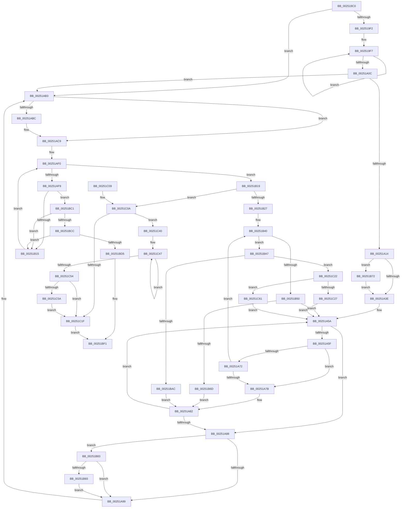

# ExReleaseFastMutex

- RVA: `0x002519C0`–`0x00251C7D` (길이 `701` bytes)
- VA: `0x00000001402519C0`
- 실행 섹션: `.text`
- PDB 이름 있음: `예`; PDB Function 태그: `아니요`
- unwind 정보 RVA: `0x000633F4`
- 디코드: `184`개 명령, `701/701` bytes 표시
- 미해석 바이트: `0` (있으면 어셈블리에 `.byte`로 보존)

> 이 문서는 커널 이미지의 기계어와 PDB 기호를 분석해 생성했습니다. 4번과 5번은 함수 원형과 자료형을 바이너리 사용 방식에서 추정한 C 해석이며 원본 소스 복구 결과는 아닙니다.

## 1. Dependencies

- 직접 호출 지점: **12**; 고유 호출 대상: **11**
- 직접 호출자로 확인된 함수: **236**
- RIP 상대 이미지 참조: **1**

### Outgoing calls
- `0x00251A4B` → [KiAcquireKobjectLockSafe](KiAcquireKobjectLockSafe_function_00251C90.md) (function, `0x00251C90`)
- `0x00251AAE` → [KiExitDispatcher](KiExitDispatcher_function_00251CF0.md) (function, `0x00251CF0`)
- `0x00251AC4` → [KiLowerIrqlProcessIrqlFlags](../4F/KiLowerIrqlProcessIrqlFlags_function_004F5698.md) (function, `0x004F5698`)
- `0x00251B3A` → [KeBugCheckEx](../4F/KeBugCheckEx_function_004FD660.md) (function, `0x004FD660`)
- `0x00251B60` → [KiTryUnwaitThread](../35/KiTryUnwaitThread_function_003506D0.md) (function, `0x003506D0`)
- `0x00251B79` → [KiRaiseIrqlProcessIrqlFlags](../4F/KiRaiseIrqlProcessIrqlFlags_function_004F56FC.md) (function, `0x004F56FC`)
- `0x00251B9D` → [KeAbPreWakeupThread](../35/KeAbPreWakeupThread_function_0035034C.md) (function, `0x0035034C`)
- `0x00251BB7` → [KiInsertQueueInternal](../21/KiInsertQueueInternal_function_00219B30.md) (function, `0x00219B30`)
- `0x00251BEC` → [KiAbEntryFreeAndEnableInterrupts](../26/KiAbEntryFreeAndEnableInterrupts_function_002622D0.md) (function, `0x002622D0`)
- `0x00251C36` → [KiTryUnwaitThread](../35/KiTryUnwaitThread_function_003506D0.md) (function, `0x003506D0`)
- `0x00251C5A` → [KiRemoveSystemWorkPriorityKick](../26/KiRemoveSystemWorkPriorityKick_function_002631D0.md) (function, `0x002631D0`)
- `0x00251C73` → [KeInsertQueueDpc](../20/KeInsertQueueDpc_function_00207C50.md) (function, `0x00207C50`)

### Direct callers
- [FsRtlLookupPerStreamContextInternal](../26/FsRtlLookupPerStreamContextInternal_function_00265020.md) at `0x00265122`
- [FsRtlInsertPerStreamContext](../26/FsRtlInsertPerStreamContext_function_00265F70.md) at `0x00266020`
- [FsRtlRemovePerStreamContext](../26/FsRtlRemovePerStreamContext_function_00267760.md) at `0x0026785A`
- [PopIrpWorker](../26/PopIrpWorker_function_0026D410.md) at `0x0026D4C5`
- [PopIrpWorker](../26/PopIrpWorker_function_0026D410.md) at `0x0026D581`
- [PopIrpWorker](../26/PopIrpWorker_function_0026D410.md) at `0x0026D689`
- [PopIrpWorker](../26/PopIrpWorker_function_0026D410.md) at `0x0026D72C`
- [PoRunDownDeviceObject](../26/PoRunDownDeviceObject_function_0026FFFC.md) at `0x00270091`
- [CcUnmapInactiveViewsInternal](../27/CcUnmapInactiveViewsInternal_function_0027174C.md) at `0x00271BEC`
- [CcGetVacbMiss](../27/CcGetVacbMiss_function_00272900.md) at `0x00272C6B`
- [CcGetVacbMiss](../27/CcGetVacbMiss_function_00272900.md) at `0x00272EDC`
- [CcReleaseBcbLockAndVacbLock](../2D/CcReleaseBcbLockAndVacbLock_function_002DFDF0.md) at `0x002DFE41`
- [CcPinFileData](../33/CcPinFileData_function_0033FB40.md) at `0x0033FE41`
- [CcPinFileData](../33/CcPinFileData_function_0033FB40.md) at `0x00340010`
- [CcPinFileData](../33/CcPinFileData_function_0033FB40.md) at `0x003401EE`
- [CcPinFileData](../33/CcPinFileData_function_0033FB40.md) at `0x0034032A`
- [CcPinFileData](../33/CcPinFileData_function_0033FB40.md) at `0x0034035C`
- [CcPinFileData](../33/CcPinFileData_function_0033FB40.md) at `0x003403B5`
- [CcPinFileData](../33/CcPinFileData_function_0033FB40.md) at `0x00340475`
- [CcPinFileData](../33/CcPinFileData_function_0033FB40.md) at `0x0034052B`
- [CcPinFileData](../33/CcPinFileData_function_0033FB40.md) at `0x003406D0`
- [CcPinFileData](../33/CcPinFileData_function_0033FB40.md) at `0x00340743`
- [CcPinFileData](../33/CcPinFileData_function_0033FB40.md) at `0x00340AE8`
- [sub_0034FCFA](../34/Unknown_function_0034FCFA.md) at `0x0034FE64`
- [CcWriteBehindPreProcess](../35/CcWriteBehindPreProcess_function_00357784.md) at `0x003579BB`
- [CcWriteBehindPostProcess](../35/CcWriteBehindPostProcess_function_00357BB4.md) at `0x00357C5F`
- [CcWriteBehindPostProcess](../35/CcWriteBehindPostProcess_function_00357BB4.md) at `0x00357DDE`
- [CcGetDirtyPagesHelper](../35/CcGetDirtyPagesHelper_function_00358D40.md) at `0x00358EF2`
- [CcGetDirtyPagesHelper](../35/CcGetDirtyPagesHelper_function_00358D40.md) at `0x00358FB3`
- [CcUnpinFileDataEx](../35/CcUnpinFileDataEx_function_00359DEC.md) at `0x00359FB7`
- [CcUnpinFileDataEx](../35/CcUnpinFileDataEx_function_00359DEC.md) at `0x0035A080`
- [CcSetDirtyPinnedData](../35/CcSetDirtyPinnedData_function_0035A120.md) at `0x0035A276`
- [FsRtlRemoveLargeMcbEntry](../38/FsRtlRemoveLargeMcbEntry_function_00386C40.md) at `0x00386C78`
- [FsRtlAddLargeMcbEntry](../38/FsRtlAddLargeMcbEntry_function_00386EB0.md) at `0x00386EF6`
- [CcDeleteMbcb](../38/CcDeleteMbcb_function_0038C088.md) at `0x0038C13D`
- [CcDeleteMbcb](../38/CcDeleteMbcb_function_0038C088.md) at `0x0038C19D`
- [FsRtlPrivateInitializeFileLock](../38/FsRtlPrivateInitializeFileLock_function_0038ED34.md) at `0x0038EDC0`
- [CcSetDirtyInMask](../3C/CcSetDirtyInMask_function_003CB688.md) at `0x003CB919`
- [CcSetDirtyInMask](../3C/CcSetDirtyInMask_function_003CB688.md) at `0x003CBAAD`
- [HalMatchAcpiOemId](../3F/HalMatchAcpiOemId_function_003F6A90.md) at `0x003F6AF7`
- [HalpAcpiGetTable](../3F/HalpAcpiGetTable_function_003F6BF8.md) at `0x003F6C47`
- [HalAcpiGetTableDispatch](../3F/HalAcpiGetTableDispatch_function_003F6C80.md) at `0x003F6CBC`
- [FsRtlTruncateLargeMcb](../3F/FsRtlTruncateLargeMcb_function_003FB420.md) at `0x003FB447`
- [CcAcquireByteRangeForWrite](../40/CcAcquireByteRangeForWrite_function_00401E74.md) at `0x00402134`
- [CcAcquireByteRangeForWrite](../40/CcAcquireByteRangeForWrite_function_00401E74.md) at `0x0040228E`
- [CcAcquireByteRangeForWrite](../40/CcAcquireByteRangeForWrite_function_00401E74.md) at `0x00402595`
- [CcAcquireByteRangeForWrite](../40/CcAcquireByteRangeForWrite_function_00401E74.md) at `0x0040278A`
- [CcGetFlushedValidData](../40/CcGetFlushedValidData_function_00402920.md) at `0x00402A9F`
- [FsRtlLookupLargeMcbEntry](../40/FsRtlLookupLargeMcbEntry_function_0040A540.md) at `0x0040A5A7`
- [FsRtlGetNextLargeMcbEntry](../40/FsRtlGetNextLargeMcbEntry_function_0040DBB0.md) at `0x0040DBF8`
- [sub_00415247](../41/Unknown_function_00415247.md) at `0x00415257`
- [CcZeroEndOfLastPage](../45/CcZeroEndOfLastPage_function_00453584.md) at `0x004535F1`
- [PnpUnregisterPlugPlayNotification](../47/PnpUnregisterPlugPlayNotification_function_0047AFAC.md) at `0x0047AFF5`
- [PnpUnregisterPlugPlayNotification](../47/PnpUnregisterPlugPlayNotification_function_0047AFAC.md) at `0x0047B059`
- [PnpUnregisterPlugPlayNotification](../47/PnpUnregisterPlugPlayNotification_function_0047AFAC.md) at `0x0047B119`
- [PnpUnregisterPlugPlayNotification](../47/PnpUnregisterPlugPlayNotification_function_0047AFAC.md) at `0x0047B141`
- [PopInitilizeAcDcSettings](../48/PopInitilizeAcDcSettings_function_004828D0.md) at `0x00482957`
- [FsRtlLookupLastLargeMcbEntryAndIndex](../48/FsRtlLookupLastLargeMcbEntryAndIndex_function_00485A80.md) at `0x00485AC6`
- [FsRtlNumberOfRunsInLargeMcb](../48/FsRtlNumberOfRunsInLargeMcb_function_00489620.md) at `0x0048963B`
- [RawCompletionRoutine](../48/RawCompletionRoutine_function_0048E660.md) at `0x0048E6CA`
- [RawInitiateDeleteVolume](../48/RawInitiateDeleteVolume_function_0048FDFC.md) at `0x0048FEF9`
- [RawInitiateDeleteVolume](../48/RawInitiateDeleteVolume_function_0048FDFC.md) at `0x0048FF09`
- [RawInitiateDeleteVolume](../48/RawInitiateDeleteVolume_function_0048FDFC.md) at `0x0049001B`
- [CcPrepareMdlWrite](../49/CcPrepareMdlWrite_function_004996D0.md) at `0x00499816`
- [CcPrepareMdlWrite](../49/CcPrepareMdlWrite_function_004996D0.md) at `0x004998E1`
- [PopGetPowerSettingValue](../49/PopGetPowerSettingValue_function_0049C6CC.md) at `0x0049C744`
- [PopRunMaximumIrpWorkers](../4A/PopRunMaximumIrpWorkers_function_004A1688.md) at `0x004A16DB`
- [FsRtlpCancelOplockRHIrp](../4A/FsRtlpCancelOplockRHIrp_function_004A55F0.md) at `0x004A5799`
- [CcRepinBcb](../4A/CcRepinBcb_function_004A7BF0.md) at `0x004A7C27`
- [PpDevNodeRemoveFromTree](../4A/PpDevNodeRemoveFromTree_function_004AD5A0.md) at `0x004AD6BB`
- [PnpReleasePowerRelationsQueueLock](../4B/PnpReleasePowerRelationsQueueLock_function_004BE70C.md) at `0x004BE717`
- [RawCheckForDeleteVolume](../4C/RawCheckForDeleteVolume_function_004C6FF4.md) at `0x004C7056`
- [IopInvalidateBusRelationsWorker](../4C/IopInvalidateBusRelationsWorker_function_004C8900.md) at `0x004C8A57`
- [FsRtlResetLargeMcb](../4C/FsRtlResetLargeMcb_function_004CC1E0.md) at `0x004CC207`
- [FsRtlpCancelWaitingIrp](../4E/FsRtlpCancelWaitingIrp_function_004E4698.md) at `0x004E48C0`
- [FsRtlpWaitOnIrp](../4E/FsRtlpWaitOnIrp_function_004E7998.md) at `0x004E7DA7`
- [FsRtlpCancelExclusiveIrp](../4F/FsRtlpCancelExclusiveIrp_function_004F96CC.md) at `0x004F97CB`
- [PopRunNormalIrpWorkers](../4F/PopRunNormalIrpWorkers_function_004FB768.md) at `0x004FB786`
- [HalpAcpiGetAllTables](../53/HalpAcpiGetAllTables_function_0053EEB0.md) at `0x0053EED1`
- [HalpAcpiGetFacsMapping](../53/HalpAcpiGetFacsMapping_function_0053F0F0.md) at `0x0053F190`
- [CcGetLsnForFileObject](../57/CcGetLsnForFileObject_function_0057D6F0.md) at `0x0057D78A`
- [FsRtlLookupLastLargeMcbEntry](../58/FsRtlLookupLastLargeMcbEntry_function_00581250.md) at `0x0058128B`
- [FsRtlSplitLargeMcb](../58/FsRtlSplitLargeMcb_function_00581560.md) at `0x0058159B`
- [FsRtlpCancelReadOnlyOplockIrp](../58/FsRtlpCancelReadOnlyOplockIrp_function_00582380.md) at `0x0058241B`
- [PnpDisableUserModeNotifications](../5A/PnpDisableUserModeNotifications_function_005A78F8.md) at `0x005A795A`
- [PnpDisableUserModeNotifications](../5A/PnpDisableUserModeNotifications_function_005A78F8.md) at `0x005A797C`
- [KeConfigureDynamicMemory](../5B/KeConfigureDynamicMemory_function_005B8C9C.md) at `0x005B8D79`
- [KeAllocateKernelHiberSwapShadowStacks](../5B/KeAllocateKernelHiberSwapShadowStacks_function_005BD658.md) at `0x005BD733`
- [KiOpPatchCode](../5C/KiOpPatchCode_function_005C6900.md) at `0x005C6A79`
- [PopIrpWorkerControl](../5D/PopIrpWorkerControl_function_005D93E0.md) at `0x005D942B`
- [RawVerifyVolume](../5E/RawVerifyVolume_function_005E5120.md) at `0x005E5197`
- [RawVerifyVolume](../5E/RawVerifyVolume_function_005E5120.md) at `0x005E51EF`
- [RtlpTraceDatabaseReleaseLock](../5E/RtlpTraceDatabaseReleaseLock_function_005EEC1C.md) at `0x005EEC3E`
- [DifExReleaseFastMutexWrapper](../62/DifExReleaseFastMutexWrapper_function_006225A0.md) at `0x00622666`
- [DifKeReleaseGuardedMutexWrapper](../63/DifKeReleaseGuardedMutexWrapper_function_00631250.md) at `0x00631316`
- [CcPinFileData$fin$0](../6D/CcPinFileData_fin_0_function_006D20B0.md) at `0x006D20CF`
- [FsRtlRemoveLargeMcbEntry$fin$0](../6D/FsRtlRemoveLargeMcbEntry_fin_0_function_006D22EF.md) at `0x006D22FF`
- [FsRtlAddLargeMcbEntry$fin$0](../6D/FsRtlAddLargeMcbEntry_fin_0_function_006D2312.md) at `0x006D2322`
- [FsRtlPrivateInitializeFileLock$fin$0](../6D/FsRtlPrivateInitializeFileLock_fin_0_function_006D242D.md) at `0x006D243D`
- [FsRtlLookupLargeMcbEntry$fin$0](../6D/FsRtlLookupLargeMcbEntry_fin_0_function_006D30D2.md) at `0x006D30E2`
- [FsRtlLookupLastLargeMcbEntryAndIndex$fin$0](../6D/FsRtlLookupLastLargeMcbEntryAndIndex_fin_0_function_006D3879.md) at `0x006D3889`
- [FsRtlpCancelOplockRHIrp$fin$0](../6D/FsRtlpCancelOplockRHIrp_fin_0_function_006D4423.md) at `0x006D4440`
- [FsRtlpCancelExclusiveIrp$fin$0](../6D/FsRtlpCancelExclusiveIrp_fin_0_function_006D505E.md) at `0x006D5078`
- [FsRtlLookupLastLargeMcbEntry$fin$0](../6D/FsRtlLookupLastLargeMcbEntry_fin_0_function_006D5139.md) at `0x006D5149`
- [FsRtlpCancelReadOnlyOplockIrp$fin$0](../6D/FsRtlpCancelReadOnlyOplockIrp_fin_0_function_006D51E3.md) at `0x006D51FD`
- [FsRtlpCancelWaitingIrp$fin$0](../6D/FsRtlpCancelWaitingIrp_fin_0_function_006D5210.md) at `0x006D522F`
- [sub_006DA07A](../6D/Unknown_function_006DA07A.md) at `0x006DA08B`
- [sub_006F6F06](../6F/Unknown_function_006F6F06.md) at `0x006F6F66`
- [sub_006F875C](../6F/Unknown_function_006F875C.md) at `0x006F8775`
- [HalpIrtAllocateDeviceAperture](../../page/70/HalpIrtAllocateDeviceAperture_function_0070A884.md) at `0x0070A91E`
- [HalpIrtAllocateDeviceAperture](../../page/70/HalpIrtAllocateDeviceAperture_function_0070A884.md) at `0x0070A995`
- [HalpIrtAllocateIndex](../../page/70/HalpIrtAllocateIndex_function_0070A9D4.md) at `0x0070AA99`
- [HalpIrtAllocateIndex](../../page/70/HalpIrtAllocateIndex_function_0070A9D4.md) at `0x0070AB5E`
- [HalpIrtAllocateIndex](../../page/70/HalpIrtAllocateIndex_function_0070A9D4.md) at `0x0070ABFC`
- [HalpIrtExtendApertureRange](../../page/70/HalpIrtExtendApertureRange_function_0070AC38.md) at `0x0070AD08`
- [HalpIrtExtendRemappingRange](../../page/70/HalpIrtExtendRemappingRange_function_0070AD40.md) at `0x0070ADFE`
- [HalpIrtFreeIndex](../../page/70/HalpIrtFreeIndex_function_0070AE30.md) at `0x0070AEA2`
- [HalpIrtReleaseDeviceAperture](../../page/70/HalpIrtReleaseDeviceAperture_function_0070AF00.md) at `0x0070AF8A`
- [NtSetInformationDebugObject](../../page/71/NtSetInformationDebugObject_function_007107B0.md) at `0x007108CD`
- [IopSetFileObjectIosbRange](../../page/71/IopSetFileObjectIosbRange_function_0071C1C8.md) at `0x0071C66F`
- [PnpNotifyHwProfileChange](../../page/72/PnpNotifyHwProfileChange_function_00729B04.md) at `0x00729B7B`
- [PnpNotifyHwProfileChange](../../page/72/PnpNotifyHwProfileChange_function_00729B04.md) at `0x00729C7B`
- [PnpNotifyHwProfileChange](../../page/72/PnpNotifyHwProfileChange_function_00729B04.md) at `0x00729CF5`
- [PnpRestartDeviceNode](../../page/72/PnpRestartDeviceNode_function_0072CD60.md) at `0x0072CE2C`
- [PnpProcessCompletedEject](../../page/72/PnpProcessCompletedEject_function_0072D090.md) at `0x0072D16F`
- [IopReleaseResources](../../page/72/IopReleaseResources_function_0072D964.md) at `0x0072D9BB`
- [PiDqObjectManagerMakeInconsistent](../../page/73/PiDqObjectManagerMakeInconsistent_function_00731A98.md) at `0x00731AF3`
- [PnpProfileUpdateHardwareProfile](../../page/73/PnpProfileUpdateHardwareProfile_function_0073773C.md) at `0x00737871`
- [PnpProfileUpdateHardwareProfile](../../page/73/PnpProfileUpdateHardwareProfile_function_0073773C.md) at `0x007378C5`
- [PpProfileCancelHardwareProfileTransition](../../page/73/PpProfileCancelHardwareProfileTransition_function_00737918.md) at `0x0073795B`
- [PpProfileCancelTransitioningDock](../../page/73/PpProfileCancelTransitioningDock_function_007379A0.md) at `0x007379D9`
- [PpProfileCommitTransitioningDock](../../page/73/PpProfileCommitTransitioningDock_function_00737A4C.md) at `0x00737AC4`
- [PpProfileIncludeInHardwareProfileTransition](../../page/73/PpProfileIncludeInHardwareProfileTransition_function_00737B9C.md) at `0x00737C0B`
- [PpProfileQueryHardwareProfileChange](../../page/73/PpProfileQueryHardwareProfileChange_function_00737C5C.md) at `0x00737CBE`
- [PnpRemoveEventFromQueue](../../page/73/PnpRemoveEventFromQueue_function_0073808C.md) at `0x007380F2`
- [PiRegisterKernelSoftRestartNotification](../../page/73/PiRegisterKernelSoftRestartNotification_function_0073E28C.md) at `0x0073E374`
- [PipKsrNotifyDrivers](../../page/73/PipKsrNotifyDrivers_function_0073E48C.md) at `0x0073E4F6`
- [PipKsrNotifyDrivers](../../page/73/PipKsrNotifyDrivers_function_0073E48C.md) at `0x0073E653`
- [PnpBuildCmResourceLists](../../page/73/PnpBuildCmResourceLists_function_0073E684.md) at `0x0073E716`
- [PnpBuildCmResourceLists](../../page/73/PnpBuildCmResourceLists_function_0073E684.md) at `0x0073E7F8`
- [PiUpdateDeviceResourceLists](../../page/74/PiUpdateDeviceResourceLists_function_007406BC.md) at `0x00740798`
- [KeRegisterProcessorChangeCallback](../../page/74/KeRegisterProcessorChangeCallback_function_00746520.md) at `0x007466F4`
- [PfTCleanup](../../page/75/PfTCleanup_function_00751208.md) at `0x00751330`
- [PfTInitialize](../../page/75/PfTInitialize_function_00751554.md) at `0x00751664`
- [PfTStart](../../page/75/PfTStart_function_007517AC.md) at `0x00751AC8`
- [PfSnTracingStateExWorkerRoutine](../../page/75/PfSnTracingStateExWorkerRoutine_function_007528B0.md) at `0x007528D9`
- [PfSnTracingStateExWorkerRoutine](../../page/75/PfSnTracingStateExWorkerRoutine_function_007528B0.md) at `0x00752936`
- [PoDisableSleepStates](../../page/75/PoDisableSleepStates_function_00757EE0.md) at `0x00757F6A`
- [PoReenableSleepStates](../../page/75/PoReenableSleepStates_function_00757FA0.md) at `0x00757FD5`
- [PoQueueShutdownWorkItem](../../page/75/PoQueueShutdownWorkItem_function_0075BE80.md) at `0x0075BEDA`
- [WheaCrashDumpInitializationComplete](../../page/7D/WheaCrashDumpInitializationComplete_function_007D877C.md) at `0x007D87B9`
- [WheapReportDeferredLiveDumps](../../page/7D/WheapReportDeferredLiveDumps_function_007D87E0.md) at `0x007D8841`
- [WheapReportDeferredLiveDumps](../../page/7D/WheapReportDeferredLiveDumps_function_007D87E0.md) at `0x007D88B9`
- [CmpGetMappingHiveForString](../../page/84/CmpGetMappingHiveForString_function_0084A5C8.md) at `0x0084A70B`
- [CmpAddToDelayedClose](../../page/84/CmpAddToDelayedClose_function_0084FBC0.md) at `0x0084FCC4`
- [CmpAddToDelayedClose](../../page/84/CmpAddToDelayedClose_function_0084FBC0.md) at `0x0084FCDF`
- [CmpPerformCompleteKcbCacheLookup](../../page/84/CmpPerformCompleteKcbCacheLookup_function_0084FD20.md) at `0x008506C6`
- [CmpPerformCompleteKcbCacheLookup](../../page/84/CmpPerformCompleteKcbCacheLookup_function_0084FD20.md) at `0x00850971`
- [CmpPerformCompleteKcbCacheLookup](../../page/84/CmpPerformCompleteKcbCacheLookup_function_0084FD20.md) at `0x00850AC1`
- [sub_008515D5](../../page/85/Unknown_function_008515D5.md) at `0x008518A5`
- [sub_00851B91](../../page/85/Unknown_function_00851B91.md) at `0x00851C6E`
- [sub_0085D455](../../page/85/Unknown_function_0085D455.md) at `0x0085D4A4`
- [CmpRemoveFromDelayedClose](../../page/86/CmpRemoveFromDelayedClose_function_00862350.md) at `0x00862426`
- [sub_00862E81](../../page/86/Unknown_function_00862E81.md) at `0x00862FFC`
- [sub_0086303A](../../page/86/Unknown_function_0086303A.md) at `0x00863188`
- [ExpUpdateDebugInfo](../../page/86/ExpUpdateDebugInfo_function_0086B174.md) at `0x0086B3E6`
- [DbgkpQueueMessage](../../page/8A/DbgkpQueueMessage_function_008A31C0.md) at `0x008A3348`
- [DbgkpQueueMessage](../../page/8A/DbgkpQueueMessage_function_008A31C0.md) at `0x008A3396`
- [PfSnEndTrace](../../page/8B/PfSnEndTrace_function_008B04A8.md) at `0x008B06BE`
- [PfSnEndTrace](../../page/8B/PfSnEndTrace_function_008B04A8.md) at `0x008B0798`
- [EtwpReleaseProviderTraitsReference](../../page/8C/EtwpReleaseProviderTraitsReference_function_008C11EC.md) at `0x008C1246`
- [PiDqObjectManagerUnregisterQuery](../../page/8D/PiDqObjectManagerUnregisterQuery_function_008DC820.md) at `0x008DC875`
- [PiDqObjectManagerEnumerateAndRegisterQuery](../../page/8D/PiDqObjectManagerEnumerateAndRegisterQuery_function_008DCF74.md) at `0x008DD27A`
- [PiDqObjectManagerServiceActionQueue](../../page/8D/PiDqObjectManagerServiceActionQueue_function_008DD640.md) at `0x008DD797`
- [PiDqObjectManagerServiceActionQueue](../../page/8D/PiDqObjectManagerServiceActionQueue_function_008DD640.md) at `0x008DD828`
- [sub_008E5659](../../page/8E/Unknown_function_008E5659.md) at `0x008E56E8`
- [PiUEventNotifyTargetDeviceChange](../../page/8E/PiUEventNotifyTargetDeviceChange_function_008E65B0.md) at `0x008E66DB`
- [PiUEventNotifyClient](../../page/8E/PiUEventNotifyClient_function_008E6BEC.md) at `0x008E6C37`
- [PiUEventNotifyClient](../../page/8E/PiUEventNotifyClient_function_008E6BEC.md) at `0x008E6CA2`
- [PnpDeviceObjectFromDeviceInstanceWithTag](../../page/8E/PnpDeviceObjectFromDeviceInstanceWithTag_function_008E7490.md) at `0x008E74FF`
- [PiGetRelatedDevice](../../page/8E/PiGetRelatedDevice_function_008E846C.md) at `0x008E852F`
- [PnpBusTypeGuidGet](../../page/8F/PnpBusTypeGuidGet_function_008FC720.md) at `0x008FC761`
- [PfGetCompletedTrace](../../page/90/PfGetCompletedTrace_function_00902950.md) at `0x00902B62`
- [PfGetCompletedTrace](../../page/90/PfGetCompletedTrace_function_00902950.md) at `0x00902D01`
- [PfGetCompletedTrace](../../page/90/PfGetCompletedTrace_function_00902950.md) at `0x00902E37`
- [PopLogDisabledSleepReason](../../page/91/PopLogDisabledSleepReason_function_00911730.md) at `0x0091177D`
- [PopFreeSessionState](../../page/91/PopFreeSessionState_function_00912D00.md) at `0x00912D8D`
- [PopGetSettingValue](../../page/91/PopGetSettingValue_function_00913310.md) at `0x00913382`
- [PopGetSettingValue](../../page/91/PopGetSettingValue_function_00913310.md) at `0x009133A1`
- [PopGetSettingNotificationName](../../page/91/PopGetSettingNotificationName_function_0091346C.md) at `0x00913540`
- [PopGetSettingNotificationName](../../page/91/PopGetSettingNotificationName_function_0091346C.md) at `0x009135A9`
- [PopSetPowerSettingValue](../../page/91/PopSetPowerSettingValue_function_00914E54.md) at `0x00914F64`
- [PopDispatchPowerSettingCallbacks](../../page/91/PopDispatchPowerSettingCallbacks_function_00916190.md) at `0x00916240`
- [PopCallPowerSettingCallback](../../page/91/PopCallPowerSettingCallback_function_009162CC.md) at `0x00916343`
- [sub_0091BE12](../../page/91/Unknown_function_0091BE12.md) at `0x0091BE3A`
- [DbgkpCloseObject](../../page/91/DbgkpCloseObject_function_0091D5F0.md) at `0x0091D635`
- [FsRtlFindInTunnelCacheEx](../../page/93/FsRtlFindInTunnelCacheEx_function_00937A50.md) at `0x00937B62`
- [FsRtlAddToTunnelCacheEx](../../page/93/FsRtlAddToTunnelCacheEx_function_00937C00.md) at `0x00937F31`
- [DbgkCopyProcessDebugPort](../../page/94/DbgkCopyProcessDebugPort_function_00947BE8.md) at `0x00947C8E`
- [PnpDeferNotification](../../page/95/PnpDeferNotification_function_00951888.md) at `0x00951929`
- [PnpDeferNotification](../../page/95/PnpDeferNotification_function_00951888.md) at `0x00951940`
- [PnpInsertEventInQueue](../../page/95/PnpInsertEventInQueue_function_00951B78.md) at `0x00951D07`
- [PnpInsertEventInQueue](../../page/95/PnpInsertEventInQueue_function_00951B78.md) at `0x00951D17`
- [IoRegisterPlugPlayNotification](../../page/95/IoRegisterPlugPlayNotification_function_009535A0.md) at `0x0095380B`
- [IoRegisterPlugPlayNotification](../../page/95/IoRegisterPlugPlayNotification_function_009535A0.md) at `0x00953928`
- [PnpNotifyDeviceClassChange](../../page/95/PnpNotifyDeviceClassChange_function_0095441C.md) at `0x00954517`
- [PnpNotifyDeviceClassChange](../../page/95/PnpNotifyDeviceClassChange_function_0095441C.md) at `0x00954575`
- [PnpProcessDeferredRegistrations](../../page/95/PnpProcessDeferredRegistrations_function_009545BC.md) at `0x00954630`
- [PnpProcessDeferredRegistrations](../../page/95/PnpProcessDeferredRegistrations_function_009545BC.md) at `0x009546E8`
- [PnpNotifyTargetDeviceChange](../../page/95/PnpNotifyTargetDeviceChange_function_00954790.md) at `0x00954881`
- [PnpNotifyTargetDeviceChange](../../page/95/PnpNotifyTargetDeviceChange_function_00954790.md) at `0x0095492B`
- [PiUEventNotifyUserMode](../../page/95/PiUEventNotifyUserMode_function_00954CB4.md) at `0x00954FA6`
- [PiUEventNotifyUserMode](../../page/95/PiUEventNotifyUserMode_function_00954CB4.md) at `0x009551F1`
- [PiUEventNotifyUserMode](../../page/95/PiUEventNotifyUserMode_function_00954CB4.md) at `0x0095524E`
- [PnpDeviceEventWorker](../../page/95/PnpDeviceEventWorker_function_009556B0.md) at `0x0095576F`
- [PnpDeviceEventWorker](../../page/95/PnpDeviceEventWorker_function_009556B0.md) at `0x0095583C`
- [PnpDeviceEventWorker](../../page/95/PnpDeviceEventWorker_function_009556B0.md) at `0x0095584C`
- [PnpDeviceEventWorker](../../page/95/PnpDeviceEventWorker_function_009556B0.md) at `0x00955923`
- [sub_0099FAAF](../../page/99/Unknown_function_0099FAAF.md) at `0x0099FAFE`
- [RawDispatch](../../page/9A/RawDispatch_function_009A3920.md) at `0x009A39F8`
- [RawDispatch](../../page/9A/RawDispatch_function_009A3920.md) at `0x009A3A41`
- [RawCleanup](../../page/9A/RawCleanup_function_009A3B38.md) at `0x009A3B9F`
- [RawClose](../../page/9A/RawClose_function_009A3CCC.md) at `0x009A3D23`
- [RawCreate](../../page/9A/RawCreate_function_009A3E5C.md) at `0x009A3F92`
- [RawUserFsCtrl](../../page/9A/RawUserFsCtrl_function_009A45F4.md) at `0x009A4756`
- [RawUserFsCtrl](../../page/9A/RawUserFsCtrl_function_009A45F4.md) at `0x009A4782`
- [RawUserFsCtrl](../../page/9A/RawUserFsCtrl_function_009A45F4.md) at `0x009A47E8`
- [RawMountVolume](../../page/9A/RawMountVolume_function_009A4844.md) at `0x009A4AE5`
- [RawScanDeletedList](../../page/9A/RawScanDeletedList_function_009A55F0.md) at `0x009A5637`
- [FsRtlTeardownPerStreamContexts](../../page/9A/FsRtlTeardownPerStreamContexts_function_009A5CD0.md) at `0x009A5DEF`
- [FsRtlTeardownPerStreamContexts](../../page/9A/FsRtlTeardownPerStreamContexts_function_009A5CD0.md) at `0x009A5E67`
- [NtQueryInformationProcess](../../page/9A/NtQueryInformationProcess_function_009AA250.md) at `0x009AD779`
- [CmpVERemoveHiveFromSIDMappingTable](../../page/9B/CmpVERemoveHiveFromSIDMappingTable_function_009B3244.md) at `0x009B32EA`
- [PiUEventHandleVetoEvent](../../page/9C/PiUEventHandleVetoEvent_function_009C2744.md) at `0x009C27DD`
- [PiUEventHandleVetoEvent](../../page/9C/PiUEventHandleVetoEvent_function_009C2744.md) at `0x009C2828`
- [PiUEventProcessEventWorker](../../page/9C/PiUEventProcessEventWorker_function_009C2870.md) at `0x009C28AB`
- [PiUEventProcessEventWorker](../../page/9C/PiUEventProcessEventWorker_function_009C2870.md) at `0x009C2945`
- [PiUEventHandleGetEvent](../../page/9C/PiUEventHandleGetEvent_function_009C2C30.md) at `0x009C2D5E`
- [PiUEventHandleGetEvent](../../page/9C/PiUEventHandleGetEvent_function_009C2C30.md) at `0x009C2E3B`
- [PiUEventDereferenceEventEntry](../../page/9C/PiUEventDereferenceEventEntry_function_009C3244.md) at `0x009C326A`
- [PiUEventHandleRegistration](../../page/9C/PiUEventHandleRegistration_function_009C3304.md) at `0x009C36D0`
- [PiUEventFreeClientRegistrationContext](../../page/9C/PiUEventFreeClientRegistrationContext_function_009C3A2C.md) at `0x009C3ABC`
- [PiUEventFreeClientRegistrationContext](../../page/9C/PiUEventFreeClientRegistrationContext_function_009C3A2C.md) at `0x009C3AC8`
- [PiUEventHandleUnregisterClient](../../page/9C/PiUEventHandleUnregisterClient_function_009C3BBC.md) at `0x009C3BE4`
- [PiUEventNotifyDeviceInstancePropertyChange](../../page/9C/PiUEventNotifyDeviceInstancePropertyChange_function_009C3C04.md) at `0x009C3C8B`
- [PiUEventNotifyDeviceInterfaceChange](../../page/9C/PiUEventNotifyDeviceInterfaceChange_function_009C3CF4.md) at `0x009C3DDD`
- [PiUEventNotifyDeviceInstanceChange](../../page/9C/PiUEventNotifyDeviceInstanceChange_function_009C3E2C.md) at `0x009C3EED`
- [PiUEventQueueBroadcastEventEntry](../../page/9C/PiUEventQueueBroadcastEventEntry_function_009C3F44.md) at `0x009C3FA7`
- [FsRtlAcquireToCreateMappedSection](../../page/9D/FsRtlAcquireToCreateMappedSection_function_009D8D48.md) at `0x009D8E09`
- [CmpDelayCloseWorker](../../page/9D/CmpDelayCloseWorker_function_009DB8E0.md) at `0x009DBA31`
- [IopCleanupFileObjectIosbRange](../../page/9E/IopCleanupFileObjectIosbRange_function_009E88A8.md) at `0x009E8984`
- [EtwpSetProviderTraitsCommon](../../page/9F/EtwpSetProviderTraitsCommon_function_009F36EC.md) at `0x009F3820`
- [EtwpSetProviderTraitsCommon](../../page/9F/EtwpSetProviderTraitsCommon_function_009F36EC.md) at `0x009F3903`
- [IopDestroyDeviceNode](../../page/A0/IopDestroyDeviceNode_function_00A06A3C.md) at `0x00A06B00`
- [IopLegacyResourceAllocation](../../page/A0/IopLegacyResourceAllocation_function_00A07224.md) at `0x00A073C1`
- [IopLegacyResourceAllocation](../../page/A0/IopLegacyResourceAllocation_function_00A07224.md) at `0x00A07400`
- [PnpFreeDeviceInstancePath](../../page/A0/PnpFreeDeviceInstancePath_function_00A074F0.md) at `0x00A07522`
- [PnpCleanupDeviceRegistryValues](../../page/A0/PnpCleanupDeviceRegistryValues_function_00A0797C.md) at `0x00A079B4`
- [DbgkClearProcessDebugObject](../../page/A1/DbgkClearProcessDebugObject_function_00A10110.md) at `0x00A1015B`
- [DbgkClearProcessDebugObject](../../page/A1/DbgkClearProcessDebugObject_function_00A10110.md) at `0x00A101E9`
- [NtDebugContinue](../../page/A1/NtDebugContinue_function_00A10280.md) at `0x00A1039D`
- [DbgkpSetProcessDebugObject](../../page/A1/DbgkpSetProcessDebugObject_function_00A10468.md) at `0x00A1057A`
- [DbgkpSetProcessDebugObject](../../page/A1/DbgkpSetProcessDebugObject_function_00A10468.md) at `0x00A1067D`
- [KeSynchronizeWithDynamicProcessors](../../page/A1/KeSynchronizeWithDynamicProcessors_function_00A17094.md) at `0x00A170C9`
- [PiUEventNotifyClientPendingEvent](../../page/A1/PiUEventNotifyClientPendingEvent_function_00A1E784.md) at `0x00A1E7A6`
- [PiUEventReferenceEventEntry](../../page/A2/PiUEventReferenceEventEntry_function_00A2143C.md) at `0x00A2145E`
- [PnpProcessAssignResources](../../page/A2/PnpProcessAssignResources_function_00A2A950.md) at `0x00A2AAF7`
- [PnpGetResourceRequirementsForAssignTable](../../page/A2/PnpGetResourceRequirementsForAssignTable_function_00A2ADBC.md) at `0x00A2AE43`
- [PnpBusTypeGuidGetIndex](../../page/A2/PnpBusTypeGuidGetIndex_function_00A2B088.md) at `0x00A2B0FC`
- [PopRundownPowerSettings](../../page/A3/PopRundownPowerSettings_function_00A39360.md) at `0x00A393C1`
- [PopDispatchNotificationsToList](../../page/A3/PopDispatchNotificationsToList_function_00A3ADA8.md) at `0x00A3AE36`
- [PopDispatchNotificationsToList](../../page/A3/PopDispatchNotificationsToList_function_00A3ADA8.md) at `0x00A3AEAC`
- [PiDqObjectManagerHandleObjectEvent](../../page/A4/PiDqObjectManagerHandleObjectEvent_function_00A4402C.md) at `0x00A440B8`
- [NtWaitForDebugEvent](../../page/A4/NtWaitForDebugEvent_function_00A464E0.md) at `0x00A46779`
- [PfSnGetCompletedTrace](../../page/A5/PfSnGetCompletedTrace_function_00A51C74.md) at `0x00A51CEF`
- [PfSnGetCompletedTrace](../../page/A5/PfSnGetCompletedTrace_function_00A51C74.md) at `0x00A51D3F`
- [FsRtlDeleteKeyFromTunnelCache](../../page/A5/FsRtlDeleteKeyFromTunnelCache_function_00A51E30.md) at `0x00A51E95`
- [PfTTraceListAdd](../../page/A6/PfTTraceListAdd_function_00A60E00.md) at `0x00A60F1F`
- [ExSwapinWorkerThreads](../../page/A6/ExSwapinWorkerThreads_function_00A68C40.md) at `0x00A68CC8`
- [PopRequestShutdownWait](../../page/A6/PopRequestShutdownWait_function_00A6AE34.md) at `0x00A6AEC8`
- [PiUEventBroadcastEventWorker](../../page/A7/PiUEventBroadcastEventWorker_function_00A764D0.md) at `0x00A76513`
- [PiUEventBroadcastEventWorker](../../page/A7/PiUEventBroadcastEventWorker_function_00A764D0.md) at `0x00A7656B`
- [PoRegisterPowerSettingCallback](../../page/A8/PoRegisterPowerSettingCallback_function_00A82150.md) at `0x00A8238A`
- [PoUnregisterPowerSettingCallback](../../page/A8/PoUnregisterPowerSettingCallback_function_00A8E940.md) at `0x00A8E999`
- [PnpMapDeviceObjectToDeviceInstance](../../page/A9/PnpMapDeviceObjectToDeviceInstance_function_00A9D884.md) at `0x00A9D8CC`
- [CmpAddStringToMapping](../../page/AA/CmpAddStringToMapping_function_00AA222C.md) at `0x00AA237F`
- [PnpOrphanNotification](../../page/AA/PnpOrphanNotification_function_00AAF78C.md) at `0x00AAF801`
- [CmpDelayFreeRMWorker](../../page/AB/CmpDelayFreeRMWorker_function_00AB65B0.md) at `0x00AB6613`
- [CmpDelayFreeRMWorker](../../page/AB/CmpDelayFreeRMWorker_function_00AB65B0.md) at `0x00AB666C`
- [CmpDelayFreeCmRm](../../page/AC/CmpDelayFreeCmRm_function_00AC71B8.md) at `0x00AC7234`
- [DbgkpMarkProcessPeb](../../page/AC/DbgkpMarkProcessPeb_function_00AC8D0C.md) at `0x00AC8DE7`
- [PoVolumeDevice](../../page/AC/PoVolumeDevice_function_00AC9290.md) at `0x00AC92EB`
- [PopQueryPowerSettingUlong](../../page/AC/PopQueryPowerSettingUlong_function_00ACCCC8.md) at `0x00ACCD3A`
- [FsRtlFindInTunnelCacheEx$fin$0](../../page/B0/FsRtlFindInTunnelCacheEx_fin_0_function_00B0FB2C.md) at `0x00B0FB39`
- [FsRtlTeardownPerStreamContexts$fin$0](../../page/B1/FsRtlTeardownPerStreamContexts_fin_0_function_00B10280.md) at `0x00B102C8`
- [sub_00B1D4A4](../../page/B1/Unknown_function_00B1D4A4.md) at `0x00B1D60A`
- [sub_00B1F43A](../../page/B1/Unknown_function_00B1F43A.md) at `0x00B1F50E`
- [sub_00B1FEC0](../../page/B1/Unknown_function_00B1FEC0.md) at `0x00B1FF34`
- [sub_00B21BBC](../../page/B2/Unknown_function_00B21BBC.md) at `0x00B21BC3`
- [sub_00B256F6](../../page/B2/Unknown_function_00B256F6.md) at `0x00B257A7`
- [sub_00B26560](../../page/B2/Unknown_function_00B26560.md) at `0x00B265C5`
- [sub_00B2D51A](../../page/B2/Unknown_function_00B2D51A.md) at `0x00B2D51D`
- [sub_00B2D5A6](../../page/B2/Unknown_function_00B2D5A6.md) at `0x00B2D5DA`
- [sub_00B2EDF4](../../page/B2/Unknown_function_00B2EDF4.md) at `0x00B2EF4D`
- [sub_00B36A42](../../page/B3/Unknown_function_00B36A42.md) at `0x00B36A98`
- [sub_00B39020](../../page/B3/Unknown_function_00B39020.md) at `0x00B39031`
- [sub_00B439C4](../../page/B4/Unknown_function_00B439C4.md) at `0x00B439CB`
- [sub_00B465F2](../../page/B4/Unknown_function_00B465F2.md) at `0x00B465F9`
- [PopGracefulShutdown](../../pagelk/B6/PopGracefulShutdown_function_00B6BEC8.md) at `0x00B6BF6E`
- [WheapCreateLiveDumpFromPreviousSession](../../pagelk/B7/WheapCreateLiveDumpFromPreviousSession_function_00B73698.md) at `0x00B736E9`
- [WheapSaveRecordForLiveDump](../../pagelk/B7/WheapSaveRecordForLiveDump_function_00B7372C.md) at `0x00B737CE`
- [PopFlushVolumeWorker](../../pagelk/B7/PopFlushVolumeWorker_function_00B7AEB0.md) at `0x00B7AFAD`
- [PopFlushVolumeWorker](../../pagelk/B7/PopFlushVolumeWorker_function_00B7AEB0.md) at `0x00B7B0B5`
- [PopFlushVolumes](../../pagelk/B7/PopFlushVolumes_function_00B7B938.md) at `0x00B7BA3B`
- [sub_00B80E6E](../../pagelk/B8/Unknown_function_00B80E6E.md) at `0x00B80FDB`

### Static image references
- `0x00251A32` → RVA `0x00FC6D20` (`ALMOSTRO`; read)

## 2. Other-region calls and transfers

- 다른 실행 섹션으로 향하는 call: **0**
- 별도 외부 분기/꼬리 이동을 확인하지 못했습니다.

## 3. Assembly (complete function range)

```asm
002519C0  48 89 5C 24 18                  mov qword ptr [rsp + 0x18], rbx
002519C5  55                              push rbp
002519C6  56                              push rsi
002519C7  57                              push rdi
002519C8  41 54                           push r12
002519CA  41 55                           push r13
002519CC  41 56                           push r14
002519CE  41 57                           push r15
002519D0  48 83 EC 30                     sub rsp, 0x30
002519D4  0F B6 69 30                     movzx ebp, byte ptr [rcx + 0x30]
002519D8  33 FF                           xor edi, edi
002519DA  48 89 79 08                     mov qword ptr [rcx + 8], rdi
002519DE  33 C0                           xor eax, eax
002519E0  48 8B D9                        mov rbx, rcx
002519E3  BE 01 00 00 00                  mov esi, 1
002519E8  F0 0F B1 31                     lock cmpxchg dword ptr [rcx], esi
002519EC  0F 84 C1 00 00 00               je 0x140251ab3
002519F2  48 89 7C 24 78                  mov qword ptr [rsp + 0x78], rdi
002519F7  8B D0                           mov edx, eax
002519F9  B9 FF FF FF FF                  mov ecx, 0xffffffff
002519FE  83 E2 02                        and edx, 2
00251A01  0F 45 CE                        cmovne ecx, esi
00251A04  03 C8                           add ecx, eax
00251A06  F0 0F B1 0B                     lock cmpxchg dword ptr [rbx], ecx
00251A0A  75 EB                           jne 0x1402519f7
00251A0C  85 D2                           test edx, edx
00251A0E  0F 85 9F 00 00 00               jne 0x140251ab3
00251A14  65 48 8B 04 25 88 01 00 00      mov rax, qword ptr gs:[0x188]
00251A1D  44 0F B6 A8 C3 00 00 00         movzx r13d, byte ptr [rax + 0xc3]
00251A25  45 0F 20 C4                     mov r12, cr8
00251A29  B8 02 00 00 00                  mov eax, 2
00251A2E  44 0F 22 C0                     mov cr8, rax
00251A32  39 3D E8 52 D7 00               cmp dword ptr [rip + 0xd752e8], edi
00251A38  0F 85 34 01 00 00               jne 0x140251b72
00251A3E  65 4C 8B 3C 25 20 00 00 00      mov r15, qword ptr gs:[0x20]
00251A47  48 8D 4B 18                     lea rcx, [rbx + 0x18]
00251A4B  E8 40 02 00 00                  call 0x140251c90
00251A50  4C 8D 73 20                     lea r14, [rbx + 0x20]
00251A54  89 73 1C                        mov dword ptr [rbx + 0x1c], esi
00251A57  49 8B 36                        mov rsi, qword ptr [r14]
00251A5A  49 3B F6                        cmp rsi, r14
00251A5D  74 29                           je 0x140251a88
00251A5F  48 8B 16                        mov rdx, qword ptr [rsi]
00251A62  48 8B C6                        mov rax, rsi
00251A65  48 8B F2                        mov rsi, rdx
00251A68  48 8B 48 08                     mov rcx, qword ptr [rax + 8]
00251A6C  48 39 42 08                     cmp qword ptr [rdx + 8], rax
00251A70  75 09                           jne 0x140251a7b
00251A72  48 39 01                        cmp qword ptr [rcx], rax
00251A75  0F 84 C5 00 00 00               je 0x140251b40
00251A7B  B9 03 00 00 00                  mov ecx, 3
00251A80  CD 29                           int 0x29
00251A82  83 6B 1C 01                     sub dword ptr [rbx + 0x1c], 1
00251A86  75 D2                           jne 0x140251a5a
00251A88  F0 81 63 18 7F FF FF FF         lock and dword ptr [rbx + 0x18], 0xffffff7f
00251A90  45 84 ED                        test r13b, r13b
00251A93  0F 85 EA 00 00 00               jne 0x140251b83
00251A99  BE 01 00 00 00                  mov esi, 1
00251A9E  44 88 64 24 20                  mov byte ptr [rsp + 0x20], r12b
00251AA3  44 8B CE                        mov r9d, esi
00251AA6  44 8B C6                        mov r8d, esi
00251AA9  33 D2                           xor edx, edx
00251AAB  49 8B CF                        mov rcx, r15
00251AAE  E8 3D 02 00 00                  call 0x140251cf0
00251AB3  83 3D 66 52 D7 00 00            cmp dword ptr [rip + 0xd75266], 0
00251ABA  74 0D                           je 0x140251ac9
00251ABC  44 0F 20 C1                     mov rcx, cr8
00251AC0  40 0F B6 D5                     movzx edx, bpl
00251AC4  E8 CF 3B 2A 00                  call 0x1404f5698
00251AC9  44 0F 22 C5                     mov cr8, rbp
00251ACD  65 4C 8B 14 25 88 01 00 00      mov r10, qword ptr gs:[0x188]
00251AD6  FA                              cli
00251AD7  4D 8B 82 70 04 00 00            mov r8, qword ptr [r10 + 0x470]
00251ADE  4C 8B CB                        mov r9, rbx
00251AE1  48 BD FC FF FF FF FF FF FF 7F   movabs rbp, 0x7ffffffffffffffc
00251AEB  8B C7                           mov eax, edi
00251AED  4C 23 CD                        and r9, rbp
00251AF0  41 0F B6 48 0C                  movzx ecx, byte ptr [r8 + 0xc]
00251AF5  3B C1                           cmp eax, ecx
00251AF7  73 20                           jae 0x140251b19
00251AF9  8B C8                           mov ecx, eax
00251AFB  4C 6B D9 58                     imul r11, rcx, 0x58
00251AFF  4D 03 D8                        add r11, r8
00251B02  49 8B 53 10                     mov rdx, qword ptr [r11 + 0x10]
00251B06  48 8B CA                        mov rcx, rdx
00251B09  48 23 CD                        and rcx, rbp
00251B0C  49 3B C9                        cmp rcx, r9
00251B0F  0F 84 AC 00 00 00               je 0x140251bc1
00251B15  FF C0                           inc eax
00251B17  EB D7                           jmp 0x140251af0
00251B19  41 8B 42 78                     mov eax, dword ptr [r10 + 0x78]
00251B1D  0F BA E0 10                     bt eax, 0x10
00251B21  0F 82 E3 00 00 00               jb 0x140251c0a
00251B27  45 33 C9                        xor r9d, r9d
00251B2A  48 89 7C 24 20                  mov qword ptr [rsp + 0x20], rdi
00251B2F  4C 8B C3                        mov r8, rbx
00251B32  49 8B D2                        mov rdx, r10
00251B35  B9 62 01 00 00                  mov ecx, 0x162
00251B3A  E8 21 BB 2A 00                  call 0x1404fd660
00251B3F  CC                              int3
00251B40  48 89 11                        mov qword ptr [rcx], rdx
00251B43  48 89 4A 08                     mov qword ptr [rdx + 8], rcx
00251B47  0F B6 48 10                     movzx ecx, byte ptr [rax + 0x10]
00251B4B  80 F9 01                        cmp cl, 1
00251B4E  75 57                           jne 0x140251ba7
00251B50  44 0F B7 40 12                  movzx r8d, word ptr [rax + 0x12]
00251B55  4C 8D 4C 24 78                  lea r9, [rsp + 0x78]
00251B5A  48 8B D0                        mov rdx, rax
00251B5D  49 8B CF                        mov rcx, r15
00251B60  E8 6B EB 0F 00                  call 0x1403506d0
00251B65  84 C0                           test al, al
00251B67  0F 84 ED FE FF FF               je 0x140251a5a
00251B6D  E9 10 FF FF FF                  jmp 0x140251a82
00251B72  0F B6 D0                        movzx edx, al
00251B75  41 0F B6 CC                     movzx ecx, r12b
00251B79  E8 7E 3B 2A 00                  call 0x1404f56fc
00251B7E  E9 BB FE FF FF                  jmp 0x140251a3e
00251B83  49 8B 8F 08 2D 00 00            mov rcx, qword ptr [r15 + 0x2d08]
00251B8A  48 85 C9                        test rcx, rcx
00251B8D  0F 84 06 FF FF FF               je 0x140251a99
00251B93  48 81 C1 28 FF FF FF            add rcx, -0xd8
00251B9A  48 8B D3                        mov rdx, rbx
00251B9D  E8 AA E7 0F 00                  call 0x14035034c
00251BA2  E9 F2 FE FF FF                  jmp 0x140251a99
00251BA7  80 F9 02                        cmp cl, 2
00251BAA  75 76                           jne 0x140251c22
00251BAC  C6 40 11 05                     mov byte ptr [rax + 0x11], 5
00251BB0  48 8B D0                        mov rdx, rax
00251BB3  48 8B 48 18                     mov rcx, qword ptr [rax + 0x18]
00251BB7  E8 74 7F FC FF                  call 0x140219b30
00251BBC  E9 C1 FE FF FF                  jmp 0x140251a82
00251BC1  41 80 7B 1A 00                  cmp byte ptr [r11 + 0x1a], 0
00251BC6  0F 84 49 FF FF FF               je 0x140251b15
00251BCC  F6 C2 01                        test dl, 1
00251BCF  0F 85 40 FF FF FF               jne 0x140251b15
00251BD5  44 8B CE                        mov r9d, esi
00251BD8  41 C6 43 1A 00                  mov byte ptr [r11 + 0x1a], 0
00251BDD  4C 8B C3                        mov r8, rbx
00251BE0  48 89 7C 24 20                  mov qword ptr [rsp + 0x20], rdi
00251BE5  49 8B D2                        mov rdx, r10
00251BE8  49 8D 4B 10                     lea rcx, [r11 + 0x10]
00251BEC  E8 DF 06 01 00                  call 0x1402622d0
00251BF1  48 8B 9C 24 80 00 00 00         mov rbx, qword ptr [rsp + 0x80]
00251BF9  48 83 C4 30                     add rsp, 0x30
00251BFD  41 5F                           pop r15
00251BFF  41 5E                           pop r14
00251C01  41 5D                           pop r13
00251C03  41 5C                           pop r12
00251C05  5F                              pop rdi
00251C06  5E                              pop rsi
00251C07  5D                              pop rbp
00251C08  C3                              ret
00251C09  CC                              int3
00251C0A  65 48 8B 0C 25 20 00 00 00      mov rcx, qword ptr gs:[0x20]
00251C13  4C 8B 81 B8 8E 00 00            mov r8, qword ptr [rcx + 0x8eb8]
00251C1A  4D 85 C0                        test r8, r8
00251C1D  75 21                           jne 0x140251c40
00251C1F  FB                              sti
00251C20  EB CF                           jmp 0x140251bf1
00251C22  80 F9 04                        cmp cl, 4
00251C25  74 3A                           je 0x140251c61
00251C27  45 33 C9                        xor r9d, r9d
00251C2A  41 B8 00 01 00 00               mov r8d, 0x100
00251C30  48 8B D0                        mov rdx, rax
00251C33  49 8B CF                        mov rcx, r15
00251C36  E8 95 EA 0F 00                  call 0x1403506d0
00251C3B  E9 1A FE FF FF                  jmp 0x140251a5a
00251C40  41 0F 0D 08                     prefetchw byte ptr [r8]
00251C44  41 8B 00                        mov eax, dword ptr [r8]
00251C47  8B D0                           mov edx, eax
00251C49  0F BA F2 15                     btr edx, 0x15
00251C4D  F0 41 0F B1 10                  lock cmpxchg dword ptr [r8], edx
00251C52  75 F3                           jne 0x140251c47
00251C54  0F BA E0 15                     bt eax, 0x15
00251C58  73 C5                           jae 0x140251c1f
00251C5A  E8 71 15 01 00                  call 0x1402631d0
00251C5F  EB BE                           jmp 0x140251c1f
00251C61  C6 40 11 05                     mov byte ptr [rax + 0x11], 5
00251C65  48 8D 53 18                     lea rdx, [rbx + 0x18]
00251C69  89 7B 1C                        mov dword ptr [rbx + 0x1c], edi
00251C6C  4C 8B C0                        mov r8, rax
00251C6F  48 8B 48 18                     mov rcx, qword ptr [rax + 0x18]
00251C73  E8 D8 5F FB FF                  call 0x140207c50
00251C78  E9 DD FD FF FF                  jmp 0x140251a5a
```

## 4. C-style interpretation (structured pseudocode)

```c
__int64 __fastcall ExReleaseFastMutex(__int64 a1)
{
    __int64 result;
    __int64 v_r11;
    __int64 v_rdi;
    __int64 v_rsp;
    unsigned __int8 v_stack_m48;
    unsigned __int64 v_stack_p10;
    unsigned __int64 v_stack_p18;

    v_stack_p18 = v_rbx;
    v_rsp = (v_rsp) - (48);
    v_rdi = 0;
    *(unsigned __int64 *)(a1 + 8) = 0;
    result = 0;
    if (condition_is_equal) goto loc_00251AB3;
    v_stack_p10 = 0;
loc_002519F7:
    a2 = (unsigned int)((0) & (2));
    a1 = (unsigned int)(0xFFFFFFFFULL);
    if (condition_is_not_equal) { a1 = 1; }
    a1 = (unsigned int)((a1) + (0));
    if (condition_is_not_equal) goto loc_002519F7;
    if ((unsigned int)(a2) != 0) goto loc_00251AB3;
    if ((*(unsigned int *)(v_rip + 14111464)) != 0) goto loc_00251B72;
loc_00251A3E:
    result = KiAcquireKobjectLockSafe(a1 + 24, a2, a3, a4);
    *(unsigned int *)(a1 + 28) = 1;
loc_00251A5A:
    if ((*(unsigned __int64 *)(a1 + 32)) == (a1 + 32)) goto loc_00251A88;
    if ((*(unsigned __int64 *)(*(unsigned __int64 *)(*(unsigned __int64 *)(a1 + 32)) + 8)) != (*(unsigned __int64 *)(a1 + 32))) goto loc_00251A7B;
    if ((*(unsigned __int64 *)(*(unsigned __int64 *)(*(unsigned __int64 *)(a1 + 32) + 8))) == (*(unsigned __int64 *)(a1 + 32))) goto loc_00251B40;
loc_00251A7B:
loc_00251A82:
    if ((*(unsigned __int64 *)(*(unsigned __int64 *)(*(unsigned __int64 *)(a1 + 32) + 8))) != (*(unsigned __int64 *)(a1 + 32))) goto loc_00251A5A;
loc_00251A88:
    if ((unsigned __int8)(*(unsigned __int8 *)(*(unsigned __int64 *)(gs_base + (0 + 392)) + 195)) != 0) goto loc_00251B83;
loc_00251A99:
    v_stack_m48 = (unsigned __int8)(v_cr8);
    a2 = 0;
    result = KiExitDispatcher(*(unsigned __int64 *)(gs_base + (0 + 32)), a2, 1, 1);
loc_00251AB3:
    if ((*(unsigned int *)(v_rip + 14111334)) != 0) {
        a1 = 2;
        a2 = (unsigned __int8)(*(unsigned __int8 *)(a1 + 48));
        result = KiLowerIrqlProcessIrqlFlags(a1, a2, 1, 1);
    }
    a4 = (a1) & (*(unsigned __int8 *)(a1 + 48));
loc_00251AF0:
    if (0 >= ((unsigned int)(*(unsigned __int8 *)(*(unsigned __int64 *)(*(unsigned __int64 *)(gs_base + (0 + 392)) + 1136) + 12)))) goto loc_00251B19;
    v_r11 = (v_r11) * (0);
    v_r11 = (v_r11) + (*(unsigned __int64 *)(*(unsigned __int64 *)(gs_base + (0 + 392)) + 1136));
    a1 = (*(unsigned __int64 *)(v_r11 + 16)) & (*(unsigned __int8 *)(a1 + 48));
    if (a1 == a4) goto loc_00251BC1;
loc_00251B15:
    result = (unsigned int)((0) + 1);
    goto loc_00251AF0;
loc_00251B19:
    if (a1 < a4) goto loc_00251C0A;
    a4 = 0;
    v_stack_m48 = 0;
    result = KeBugCheckEx(354, *(unsigned __int64 *)(gs_base + (0 + 392)), a1, a4);
loc_00251B40:
    *(unsigned __int64 *)(354) = *(unsigned __int64 *)(gs_base + (0 + 392));
    *(unsigned __int64 *)(*(unsigned __int64 *)(gs_base + (0 + 392)) + 8) = 354;
    if (((unsigned __int8)(*(unsigned __int8 *)(result + 16))) != 1) goto loc_00251BA7;
    result = KiTryUnwaitThread(*(unsigned __int64 *)(gs_base + (0 + 32)), result, *(unsigned __int16 *)(result + 18), v_stack_p10);
    if ((unsigned __int8)(result) == 0) goto loc_00251A5A;
    goto loc_00251A82;
loc_00251B72:
    result = KiRaiseIrqlProcessIrqlFlags((unsigned __int8)(v_cr8), (unsigned __int8)(result), *(unsigned __int16 *)(result + 18), v_stack_p10);
    goto loc_00251A3E;
loc_00251B83:
    if (*(unsigned __int64 *)(*(unsigned __int64 *)(gs_base + (0 + 32)) + 11528) == 0) goto loc_00251A99;
    a1 = (*(unsigned __int64 *)(*(unsigned __int64 *)(gs_base + (0 + 32)) + 11528)) + (-216);
    result = KeAbPreWakeupThread(a1, a1, *(unsigned __int16 *)(result + 18), v_stack_p10);
    goto loc_00251A99;
loc_00251BA7:
    if (((unsigned __int8)(a1)) != 2) goto loc_00251C22;
    *(unsigned __int8 *)(result + 17) = 5;
    result = KiInsertQueueInternal(*(unsigned __int64 *)(result + 24), result, *(unsigned __int16 *)(result + 18), v_stack_p10);
    goto loc_00251A82;
loc_00251BC1:
    if ((*(unsigned __int8 *)(v_r11 + 26)) == 0) goto loc_00251B15;
    if ((((unsigned __int8)(result)) & (1)) != 0) goto loc_00251B15;
    *(unsigned __int8 *)(v_r11 + 26) = 0;
    v_stack_m48 = 0;
    result = KiAbEntryFreeAndEnableInterrupts(v_r11 + 16, *(unsigned __int64 *)(gs_base + (0 + 392)), a1, 1);
loc_00251BF1:
    v_rsp = (v_rsp) + (48);
    return result;
loc_00251C0A:
    if (*(unsigned __int64 *)(*(unsigned __int64 *)(gs_base + (0 + 32)) + 36536) != 0) goto loc_00251C40;
loc_00251C1F:
    goto loc_00251BF1;
loc_00251C22:
    if (((unsigned __int8)(*(unsigned __int64 *)(gs_base + (0 + 32)))) == 4) goto loc_00251C61;
    a4 = 0;
    result = KiTryUnwaitThread(*(unsigned __int64 *)(gs_base + (0 + 32)), result, 256, a4);
    goto loc_00251A5A;
loc_00251C40:
loc_00251C47:
    if (condition_is_not_equal) goto loc_00251C47;
    if (condition_is_above_or_equal) goto loc_00251C1F;
    result = KiRemoveSystemWorkPriorityKick(*(unsigned __int64 *)(gs_base + (0 + 32)), (unsigned int)((unsigned int)((unsigned int)(*(unsigned int *)(256)))), 256, a4);
    goto loc_00251C1F;
loc_00251C61:
    *(unsigned __int8 *)(result + 17) = 5;
    *(unsigned int *)(v_stack_p18 + 28) = 0;
    result = KeInsertQueueDpc(*(unsigned __int64 *)(result + 24), v_stack_p18 + 24, result, a4);
    goto loc_00251A5A;
}
```

## 5. (Beta) C Style

```c
int64_t ExReleaseFastMutex(void *Arg1)
{
    uint8_t *arg1 = (uint8_t *)Arg1;

    int64_t result;
    int64_t local_r11;
    int64_t local_rdi;
    int64_t local_rsp;
    uint8_t v_stack_m48;
    uint64_t v_stack_p10;
    uint64_t v_stack_p18;

    v_stack_p18 = local_rbx;
    local_rsp = (local_rsp) - (48);
    local_rdi = 0;
    *(uint64_t *)(arg1 + 0x8) = 0;
    result = 0;
    if (condition_is_equal) goto loc_00251AB3;
    v_stack_p10 = 0;
loc_002519F7:
    a2 = (uint32_t)((0) & (2));
    Arg1 = (uint32_t)(0xFFFFFFFFULL);
    if (condition_is_not_equal) { Arg1 = 1; }
    Arg1 = (uint32_t)((Arg1) + (0));
    if (condition_is_not_equal) goto loc_002519F7;
    if ((uint32_t)(a2) != 0) goto loc_00251AB3;
    if ((*(uint32_t *)(v_rip + 0xD752E8)) != 0) goto loc_00251B72;
loc_00251A3E:
    result = KiAcquireKobjectLockSafe(Arg1 + 24, a2, a3, a4);
    *(uint32_t *)(arg1 + 0x1C) = 1;
loc_00251A5A:
    if ((*(uint64_t *)(arg1 + 0x20)) == (Arg1 + 32)) goto loc_00251A88;
    if ((*(uint64_t *)(*(uint64_t *)(*(uint64_t *)(arg1 + 0x20)) + 0x8)) != (*(uint64_t *)(arg1 + 0x20))) goto loc_00251A7B;
    if ((*(uint64_t *)(*(uint64_t *)(*(uint64_t *)(arg1 + 0x20) + 0x8))) == (*(uint64_t *)(arg1 + 0x20))) goto loc_00251B40;
loc_00251A7B:
loc_00251A82:
    if ((*(uint64_t *)(*(uint64_t *)(*(uint64_t *)(arg1 + 0x20) + 0x8))) != (*(uint64_t *)(arg1 + 0x20))) goto loc_00251A5A;
loc_00251A88:
    if ((uint8_t)(*(uint8_t *)(*(uint64_t *)(gs_base + (0 + 0x188)) + 0xC3)) != 0) goto loc_00251B83;
loc_00251A99:
    v_stack_m48 = (uint8_t)(v_cr8);
    a2 = 0;
    result = KiExitDispatcher(*(uint64_t *)(gs_base + (0 + 0x20)), a2, 1, 1);
loc_00251AB3:
    if ((*(uint32_t *)(v_rip + 0xD75266)) != 0) {
        Arg1 = 2;
        a2 = (uint8_t)(*(uint8_t *)(arg1 + 0x30));
        result = KiLowerIrqlProcessIrqlFlags(Arg1, a2, 1, 1);
    }
    a4 = (Arg1) & (*(uint8_t *)(arg1 + 0x30));
loc_00251AF0:
    if (0 >= ((uint32_t)(*(uint8_t *)(*(uint64_t *)(*(uint64_t *)(gs_base + (0 + 0x188)) + 0x470) + 0xC)))) goto loc_00251B19;
    local_r11 = (local_r11) * (0);
    local_r11 = (local_r11) + (*(uint64_t *)(*(uint64_t *)(gs_base + (0 + 0x188)) + 0x470));
    Arg1 = (*(uint64_t *)(local_r11 + 0x10)) & (*(uint8_t *)(arg1 + 0x30));
    if (Arg1 == a4) goto loc_00251BC1;
loc_00251B15:
    result = (uint32_t)((0) + 1);
    goto loc_00251AF0;
loc_00251B19:
    if (Arg1 < a4) goto loc_00251C0A;
    a4 = 0;
    v_stack_m48 = 0;
    result = KeBugCheckEx(354, *(uint64_t *)(gs_base + (0 + 0x188)), Arg1, a4);
loc_00251B40:
    *(uint64_t *)(354) = *(uint64_t *)(gs_base + (0 + 0x188));
    *(uint64_t *)(*(uint64_t *)(gs_base + (0 + 0x188)) + 0x8) = 354;
    if (((uint8_t)(*(uint8_t *)(result + 0x10))) != 1) goto loc_00251BA7;
    result = KiTryUnwaitThread(*(uint64_t *)(gs_base + (0 + 0x20)), result, *(uint16_t *)(result + 0x12), v_stack_p10);
    if ((uint8_t)(result) == 0) goto loc_00251A5A;
    goto loc_00251A82;
loc_00251B72:
    result = KiRaiseIrqlProcessIrqlFlags((uint8_t)(v_cr8), (uint8_t)(result), *(uint16_t *)(result + 0x12), v_stack_p10);
    goto loc_00251A3E;
loc_00251B83:
    if (*(uint64_t *)(*(uint64_t *)(gs_base + (0 + 0x20)) + 0x2D08) == 0) goto loc_00251A99;
    Arg1 = (*(uint64_t *)(*(uint64_t *)(gs_base + (0 + 0x20)) + 0x2D08)) + (-216);
    result = KeAbPreWakeupThread(Arg1, Arg1, *(uint16_t *)(result + 0x12), v_stack_p10);
    goto loc_00251A99;
loc_00251BA7:
    if (((uint8_t)(Arg1)) != 2) goto loc_00251C22;
    *(uint8_t *)(result + 0x11) = 5;
    result = KiInsertQueueInternal(*(uint64_t *)(result + 0x18), result, *(uint16_t *)(result + 0x12), v_stack_p10);
    goto loc_00251A82;
loc_00251BC1:
    if ((*(uint8_t *)(local_r11 + 0x1A)) == 0) goto loc_00251B15;
    if ((((uint8_t)(result)) & (1)) != 0) goto loc_00251B15;
    *(uint8_t *)(local_r11 + 0x1A) = 0;
    v_stack_m48 = 0;
    result = KiAbEntryFreeAndEnableInterrupts(local_r11 + 16, *(uint64_t *)(gs_base + (0 + 0x188)), Arg1, 1);
loc_00251BF1:
    local_rsp = (local_rsp) + (48);
    return result;
loc_00251C0A:
    if (*(uint64_t *)(*(uint64_t *)(gs_base + (0 + 0x20)) + 0x8EB8) != 0) goto loc_00251C40;
loc_00251C1F:
    goto loc_00251BF1;
loc_00251C22:
    if (((uint8_t)(*(uint64_t *)(gs_base + (0 + 0x20)))) == 4) goto loc_00251C61;
    a4 = 0;
    result = KiTryUnwaitThread(*(uint64_t *)(gs_base + (0 + 0x20)), result, 256, a4);
    goto loc_00251A5A;
loc_00251C40:
loc_00251C47:
    if (condition_is_not_equal) goto loc_00251C47;
    if (condition_is_above_or_equal) goto loc_00251C1F;
    result = KiRemoveSystemWorkPriorityKick(*(uint64_t *)(gs_base + (0 + 0x20)), (uint32_t)((uint32_t)((uint32_t)(*(uint32_t *)(256)))), 256, a4);
    goto loc_00251C1F;
loc_00251C61:
    *(uint8_t *)(result + 0x11) = 5;
    *(uint32_t *)(v_stack_p18 + 0x1C) = 0;
    result = KeInsertQueueDpc(*(uint64_t *)(result + 0x18), v_stack_p18 + 24, result, a4);
    goto loc_00251A5A;
}
```

### 관측된 메모리 오프셋

구조체 형식이 확인되지 않은 접근은 인자 기준의 오프셋으로만 기록했습니다.

| 기준 인자 | 오프셋 표현 | 폭 (bit) | 접근 |
|---|---:|---:|---|
| `Arg1` | `+ 0x0` | `32` | `R` |
| `Arg1` | `+ 0x0` | `64` | `R` |
| `Arg1` | `+ 0x8` | `64` | `W` |
| `Arg1` | `+ 0x18` | `32` | `R/W` |
| `Arg1` | `+ 0x18` | `64` | `R` |
| `Arg1` | `+ 0x1C` | `32` | `R/W` |
| `Arg1` | `+ 0x1C` | `32` | `W` |
| `Arg1` | `+ 0x20` | `64` | `R` |
| `Arg1` | `+ 0x30` | `8` | `R` |

## 6. Execution-region graph

[열기: 2D/3D 그래프와 함수 탐색 컨트롤 패널](../../../control-panel.html?section=text&rva=0x002519C0&view=graph)

- 2D 그래프는 위에서 아래로 흐르고, 3D 그래프는 빈 공간을 드래그해 회전합니다. Shift+드래그는 이동, 휠은 확대·축소, 함수 노드 선택은 대상 보고서 이동입니다.

### Static fallback


