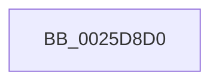

# ExReleaseResourceAndLeaveCriticalRegion

- RVA: `0x0025D8D0`–`0x0025D903` (길이 `51` bytes)
- VA: `0x000000014025D8D0`
- 실행 섹션: `.text`
- PDB 이름 있음: `예`; PDB Function 태그: `아니요`
- unwind 정보 RVA: `0x000640CC`
- 디코드: `15`개 명령, `51/51` bytes 표시
- 미해석 바이트: `0` (있으면 어셈블리에 `.byte`로 보존)

> 이 문서는 커널 이미지의 기계어와 PDB 기호를 분석해 생성했습니다. 4번과 5번은 함수 원형과 자료형을 바이너리 사용 방식에서 추정한 C 해석이며 원본 소스 복구 결과는 아닙니다.

## 1. Dependencies

- 직접 호출 지점: **0**; 고유 호출 대상: **0**
- 직접 호출자로 확인된 함수: **1**
- RIP 상대 이미지 참조: **1**

### Outgoing calls
- 직접 디코드된 call 명령이 없습니다.

### Direct callers
- [DifExReleaseResourceAndLeaveCriticalRegionWrapper](../62/DifExReleaseResourceAndLeaveCriticalRegionWrapper_function_00622B50.md) at `0x00622C16`

### Static image references
- `0x0025D8E1` → RVA `0x00E0A740` (`.data`; read)

## 2. Other-region calls and transfers

- 다른 실행 섹션으로 향하는 call: **0**
- call이 아닌 외부 분기/꼬리 이동: **1**
  - `0x0025D8FD` → [sub_0025EB42](Unknown_function_0025EB42.md) (`tail-transfer`)

## 3. Assembly (complete function range)

```asm
0025D8D0  4C 8B DC                        mov r11, rsp
0025D8D3  55                              push rbp
0025D8D4  56                              push rsi
0025D8D5  57                              push rdi
0025D8D6  49 8D 6B B8                     lea rbp, [r11 - 0x48]
0025D8DA  48 81 EC 30 01 00 00            sub rsp, 0x130
0025D8E1  48 8B 05 58 CE BA 00            mov rax, qword ptr [rip + 0xbace58]
0025D8E8  48 33 C4                        xor rax, rsp
0025D8EB  48 89 45 18                     mov qword ptr [rbp + 0x18], rax
0025D8EF  48 8B F9                        mov rdi, rcx
0025D8F2  0F B7 49 1A                     movzx ecx, word ptr [rcx + 0x1a]
0025D8F6  0F B6 C1                        movzx eax, cl
0025D8F9  24 41                           and al, 0x41
0025D8FB  3C 01                           cmp al, 1
0025D8FD  0F 84 3F 12 00 00               je 0x14025eb42
```

## 4. C-style interpretation (structured pseudocode)

```c
__int64 __fastcall ExReleaseResourceAndLeaveCriticalRegion(__int64 a1)
{
    __int64 result;
    __int64 v_rsp;

    v_rsp = (v_rsp) - (304);
    result = (*(unsigned __int64 *)(v_rip + 12242520)) ^ (v_rsp);
    *(unsigned __int64 *)(v_rsp - 72 + 24) = result;
    result = (unsigned __int8)(((unsigned __int8)(*(unsigned __int16 *)(a1 + 26))) & (65));
}
```

## 5. (Beta) C Style

```c
int64_t ExReleaseResourceAndLeaveCriticalRegion(void *Arg1)
{
    uint8_t *arg1 = (uint8_t *)Arg1;

    int64_t result;
    int64_t local_rsp;

    local_rsp = (local_rsp) - (304);
    result = (*(uint64_t *)(v_rip + 0xBACE58)) ^ (local_rsp);
    *(uint64_t *)(local_rsp - 0x48 + 0x18) = result;
    result = (uint8_t)(((uint8_t)(*(uint16_t *)(arg1 + 0x1A))) & (65));
}
```

### 관측된 메모리 오프셋

구조체 형식이 확인되지 않은 접근은 인자 기준의 오프셋으로만 기록했습니다.

| 기준 인자 | 오프셋 표현 | 폭 (bit) | 접근 |
|---|---:|---:|---|
| `Arg1` | `+ 0x1A` | `16` | `R` |

## 6. Execution-region graph

[열기: 2D/3D 그래프와 함수 탐색 컨트롤 패널](../../../control-panel.html?section=text&rva=0x0025D8D0&view=graph)

- 2D 그래프는 위에서 아래로 흐르고, 3D 그래프는 빈 공간을 드래그해 회전합니다. Shift+드래그는 이동, 휠은 확대·축소, 함수 노드 선택은 대상 보고서 이동입니다.

### Static fallback


