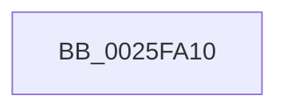

# ExReleaseResourceLite

- RVA: `0x0025FA10`–`0x0025FA43` (길이 `51` bytes)
- VA: `0x000000014025FA10`
- 실행 섹션: `.text`
- PDB 이름 있음: `예`; PDB Function 태그: `아니요`
- unwind 정보 RVA: `0x000642E0`
- 디코드: `15`개 명령, `51/51` bytes 표시
- 미해석 바이트: `0` (있으면 어셈블리에 `.byte`로 보존)

> 이 문서는 커널 이미지의 기계어와 PDB 기호를 분석해 생성했습니다. 4번과 5번은 함수 원형과 자료형을 바이너리 사용 방식에서 추정한 C 해석이며 원본 소스 복구 결과는 아닙니다.

## 1. Dependencies

- 직접 호출 지점: **0**; 고유 호출 대상: **0**
- 직접 호출자로 확인된 함수: **368**
- RIP 상대 이미지 참조: **1**

### Outgoing calls
- 직접 디코드된 call 명령이 없습니다.

### Direct callers
- [sub_002136F8](../21/Unknown_function_002136F8.md) at `0x002136FC`
- [SepRmCallLsa](../22/SepRmCallLsa_function_00223630.md) at `0x002236F3`
- [SepQueueWorkItem](../22/SepQueueWorkItem_function_00225844.md) at `0x002259C9`
- [sub_0025F532](Unknown_function_0025F532.md) at `0x0025F5DC`
- [FsRtlReleaseFileForModWrite](../29/FsRtlReleaseFileForModWrite_function_00299100.md) at `0x00299343`
- [FsRtlAcquireFileForModWriteEx](../29/FsRtlAcquireFileForModWriteEx_function_00299E5C.md) at `0x0029A199`
- [FsRtlAcquireFileForModWriteEx](../29/FsRtlAcquireFileForModWriteEx_function_00299E5C.md) at `0x0029A265`
- [MiReleaseLoadLock](../2A/MiReleaseLoadLock_function_002A3CD0.md) at `0x002A3CF2`
- [SepCanTokenMatchAllPackageSid](../2F/SepCanTokenMatchAllPackageSid_function_002FFE90.md) at `0x002FFF55`
- [SepGetProcUniqueLuidAndIndexFromTokenEx](../30/SepGetProcUniqueLuidAndIndexFromTokenEx_function_00300B40.md) at `0x00300BC0`
- [sub_00301D13](../30/Unknown_function_00301D13.md) at `0x00301D17`
- [CcUnpinFileDataEx](../35/CcUnpinFileDataEx_function_00359DEC.md) at `0x00359FAF`
- [IopCreateSecurityCheck](../3A/IopCreateSecurityCheck_function_003A5DA0.md) at `0x003A5ED9`
- [sub_003A7AB1](../3A/Unknown_function_003A7AB1.md) at `0x003A7B08`
- [SepInternalSetSecurityAttributesToken](../3A/SepInternalSetSecurityAttributesToken_function_003A9474.md) at `0x003A9532`
- [SepTrustLevelCheck](../3E/SepTrustLevelCheck_function_003ED7E0.md) at `0x003ED92D`
- [SeAccessCheckByType](../44/SeAccessCheckByType_function_00440BC8.md) at `0x004417B1`
- [SeAccessCheckByType](../44/SeAccessCheckByType_function_00440BC8.md) at `0x00441B83`
- [SeAccessCheckByType](../44/SeAccessCheckByType_function_00440BC8.md) at `0x0044216B`
- [SeAccessCheckByType](../44/SeAccessCheckByType_function_00440BC8.md) at `0x00442193`
- [SeAccessCheckByType](../44/SeAccessCheckByType_function_00440BC8.md) at `0x0044265E`
- [SeTokenGetNoChildProcessRestricted](../45/SeTokenGetNoChildProcessRestricted_function_004584DC.md) at `0x00458527`
- [SepDesktopAppxSubProcessToken](../45/SepDesktopAppxSubProcessToken_function_0045BD90.md) at `0x0045C0E1`
- [SepReleaseOrderedReadLocks](../45/SepReleaseOrderedReadLocks_function_0045C4C8.md) at `0x0045C4D5`
- [SepReleaseOrderedReadLocks](../45/SepReleaseOrderedReadLocks_function_0045C4C8.md) at `0x0045C4EC`
- [SepExamineGlobalSaclEx](../46/SepExamineGlobalSaclEx_function_0046B550.md) at `0x0046B5C8`
- [PnpUnregisterPlugPlayNotification](../47/PnpUnregisterPlugPlayNotification_function_0047AFAC.md) at `0x0047B032`
- [PnpUnregisterPlugPlayNotification](../47/PnpUnregisterPlugPlayNotification_function_0047AFAC.md) at `0x0047B08C`
- [IoCheckRedirectionTrustLevel](../48/IoCheckRedirectionTrustLevel_function_00485BB0.md) at `0x00485C54`
- [SeTokenGetRedirectionTrustPolicy](../49/SeTokenGetRedirectionTrustPolicy_function_00498C30.md) at `0x00498C74`
- [SeTokenSetRedirectionTrustPolicy](../4A/SeTokenSetRedirectionTrustPolicy_function_004A221C.md) at `0x004A228D`
- [SeTokenSetNoChildProcessRestricted](../4C/SeTokenSetNoChildProcessRestricted_function_004C4504.md) at `0x004C459A`
- [PiDmaGuardQueueRemoveEntry](../4C/PiDmaGuardQueueRemoveEntry_function_004C822C.md) at `0x004C829F`
- [IoCaptureLiveDump](../4E/IoCaptureLiveDump_function_004E085C.md) at `0x004E0D2E`
- [SepCreateAppContainerToken](../4F/SepCreateAppContainerToken_function_004F43AC.md) at `0x004F45EA`
- [SepCreateAppContainerToken](../4F/SepCreateAppContainerToken_function_004F43AC.md) at `0x004F47A1`
- [SepCreateAppContainerToken](../4F/SepCreateAppContainerToken_function_004F43AC.md) at `0x004F47BC`
- [SepCreateAppContainerToken](../4F/SepCreateAppContainerToken_function_004F43AC.md) at `0x004F4904`
- [SepCreateAppContainerToken](../4F/SepCreateAppContainerToken_function_004F43AC.md) at `0x004F492B`
- [SepCreateAppContainerToken](../4F/SepCreateAppContainerToken_function_004F43AC.md) at `0x004F4C13`
- [FsRtlpDedupChangeEventsControlCallbackV2](../58/FsRtlpDedupChangeEventsControlCallbackV2_function_00582C00.md) at `0x00582D22`
- [FsRtlpTieringHeatEventsControlCallbackV2](../58/FsRtlpTieringHeatEventsControlCallbackV2_function_00583110.md) at `0x0058321E`
- [IoConfigureCrashDump](../59/IoConfigureCrashDump_function_00591CB4.md) at `0x00591E1D`
- [IoConfigureCrashDump](../59/IoConfigureCrashDump_function_00591CB4.md) at `0x00591E57`
- [IoFillTriageDumpBuffer](../59/IoFillTriageDumpBuffer_function_005921CC.md) at `0x00592566`
- [IoUpdateDumpPhysicalRanges](../59/IoUpdateDumpPhysicalRanges_function_0059343C.md) at `0x00593497`
- [IoSetDeferredLiveDumpFileHandle](../59/IoSetDeferredLiveDumpFileHandle_function_00598C30.md) at `0x00598CAD`
- [PiSwIrpCancelStartCreate](../5A/PiSwIrpCancelStartCreate_function_005A9E60.md) at `0x005A9EB2`
- [PiDrvDbUnloadNodeWaitWorkerCallback](../5A/PiDrvDbUnloadNodeWaitWorkerCallback_function_005AA910.md) at `0x005AA98B`
- [RtlpAllocateHeap](../5E/RtlpAllocateHeap_function_005E8B1C.md) at `0x005E9140`
- [RtlpAllocateHeap](../5E/RtlpAllocateHeap_function_005E8B1C.md) at `0x005E9491`
- [RtlpFreeHeap](../5E/RtlpFreeHeap_function_005EABC0.md) at `0x005EB0A9`
- [RtlpFreeHeap](../5E/RtlpFreeHeap_function_005EABC0.md) at `0x005EB0E7`
- [RtlpSetupExtendedBlock](../5E/RtlpSetupExtendedBlock_function_005EB940.md) at `0x005EBAA6`
- [SeGetProcessAntiTamperIdentity](../60/SeGetProcessAntiTamperIdentity_function_00606740.md) at `0x006067A0`
- [SeGetProcessAntiTamperUIPolicy](../60/SeGetProcessAntiTamperUIPolicy_function_00606800.md) at `0x00606881`
- [SepMandatoryAccessCheck](../60/SepMandatoryAccessCheck_function_00608480.md) at `0x00608613`
- [SeSetTokenTamperProtection](../60/SeSetTokenTamperProtection_function_00609644.md) at `0x006099A1`
- [SeTokenIsNoChildProcessRestrictionEnforced](../60/SeTokenIsNoChildProcessRestrictionEnforced_function_00609A38.md) at `0x00609A6B`
- [SeSetSecurityAttributesTokenEx](../60/SeSetSecurityAttributesTokenEx_function_00609C00.md) at `0x00609D3C`
- [DifExReleaseResourceLiteWrapper](../62/DifExReleaseResourceLiteWrapper_function_00622F80.md) at `0x00623046`
- [ExReleaseResourceAndLeavePriorityRegion](../65/ExReleaseResourceAndLeavePriorityRegion_function_00658DA0.md) at `0x00658DA6`
- [RtlpAllocateHeap$fin$0](../6D/RtlpAllocateHeap_fin_0_function_006D5B26.md) at `0x006D5B43`
- [RtlpFreeHeap$fin$0](../6D/RtlpFreeHeap_fin_0_function_006D5B56.md) at `0x006D5BA7`
- [sub_006DA8C0](../6D/Unknown_function_006DA8C0.md) at `0x006DA8C4`
- [sub_006EEE7E](../6E/Unknown_function_006EEE7E.md) at `0x006EEF9F`
- [PopDripsWatchdogStopWatchdog](../../page/70/PopDripsWatchdogStopWatchdog_function_00705674.md) at `0x007056C8`
- [FsRtlMdlReadDev](../../page/71/FsRtlMdlReadDev_function_00713980.md) at `0x00713A9E`
- [FsRtlMdlReadDev](../../page/71/FsRtlMdlReadDev_function_00713980.md) at `0x00713B05`
- [FsRtlPrepareMdlWriteDev](../../page/71/FsRtlPrepareMdlWriteDev_function_00713BB0.md) at `0x00713D20`
- [FsRtlPrepareMdlWriteDev](../../page/71/FsRtlPrepareMdlWriteDev_function_00713BB0.md) at `0x00713E0E`
- [FsRtlPrepareMdlWriteDev](../../page/71/FsRtlPrepareMdlWriteDev_function_00713BB0.md) at `0x00713ECE`
- [FsRtlPrepareMdlWriteDev](../../page/71/FsRtlPrepareMdlWriteDev_function_00713BB0.md) at `0x00713F1D`
- [FsRtlPrepareMdlWriteDev](../../page/71/FsRtlPrepareMdlWriteDev_function_00713BB0.md) at `0x00713F30`
- [FsRtlPrepareMdlWriteDev](../../page/71/FsRtlPrepareMdlWriteDev_function_00713BB0.md) at `0x00713F44`
- [FsRtlDedupChangeUninit](../../page/71/FsRtlDedupChangeUninit_function_00715D40.md) at `0x00715DBE`
- [FsRtlpDedupChangeRegisterVolume](../../page/71/FsRtlpDedupChangeRegisterVolume_function_00715F70.md) at `0x007160BE`
- [FsRtlpHeatRegisterVolume](../../page/71/FsRtlpHeatRegisterVolume_function_0071696C.md) at `0x00716AA4`
- [FsRtlpHeatUnregisterVolume](../../page/71/FsRtlpHeatUnregisterVolume_function_00716B10.md) at `0x00716B85`
- [IoInitializeCrashDump](../../page/71/IoInitializeCrashDump_function_00719D88.md) at `0x00719E07`
- [IopBootLogToFile](../../page/71/IopBootLogToFile_function_0071AD54.md) at `0x0071AEF6`
- [IopCopyBootLogRegistryToFile](../../page/71/IopCopyBootLogRegistryToFile_function_0071B19C.md) at `0x0071B410`
- [IopInitializeBootLogging](../../page/71/IopInitializeBootLogging_function_0071B748.md) at `0x0071B8F5`
- [IoEnumerateRegisteredFiltersList](../../page/71/IoEnumerateRegisteredFiltersList_function_0071D450.md) at `0x0071D510`
- [IoRegisterFileSystem](../../page/71/IoRegisterFileSystem_function_0071D6C0.md) at `0x0071D83C`
- [IoRegisterFsRegistrationChangeMountAware](../../page/71/IoRegisterFsRegistrationChangeMountAware_function_0071D890.md) at `0x0071D97C`
- [IoRegisterFsRegistrationChangeMountAware](../../page/71/IoRegisterFsRegistrationChangeMountAware_function_0071D890.md) at `0x0071D9A5`
- [IoRegisterFsRegistrationChangeMountAware](../../page/71/IoRegisterFsRegistrationChangeMountAware_function_0071D890.md) at `0x0071D9F8`
- [IoRegisterFsRegistrationChangeMountAware](../../page/71/IoRegisterFsRegistrationChangeMountAware_function_0071D890.md) at `0x0071DA93`
- [IoUnregisterFileSystem](../../page/71/IoUnregisterFileSystem_function_0071E110.md) at `0x0071E19D`
- [IoUnregisterFsRegistrationChange](../../page/71/IoUnregisterFsRegistrationChange_function_0071E1D0.md) at `0x0071E24A`
- [PnpShutdownDevices](../../page/72/PnpShutdownDevices_function_00723F20.md) at `0x0072407C`
- [IoReportDetectedDevice](../../page/72/IoReportDetectedDevice_function_00725CD0.md) at `0x0072606F`
- [IoReportRootDevice](../../page/72/IoReportRootDevice_function_00726780.md) at `0x00726AE2`
- [PiGetDeviceRegistryProperty](../../page/72/PiGetDeviceRegistryProperty_function_007280A8.md) at `0x007281BD`
- [PnpNotifyHwProfileChange](../../page/72/PnpNotifyHwProfileChange_function_00729B04.md) at `0x00729BCF`
- [PnpNotifyHwProfileChange](../../page/72/PnpNotifyHwProfileChange_function_00729B04.md) at `0x00729CB7`
- [PnpNotifyHwProfileChange](../../page/72/PnpNotifyHwProfileChange_function_00729B04.md) at `0x00729D25`
- [PnpNotifyTargetDeviceChangeNotifyEntry](../../page/72/PnpNotifyTargetDeviceChangeNotifyEntry_function_00729D54.md) at `0x00729DEF`
- [PpReleaseBootDDB](../../page/72/PpReleaseBootDDB_function_0072E324.md) at `0x0072E3B7`
- [PiPnpRtlEnsureObjectCached](../../page/72/PiPnpRtlEnsureObjectCached_function_0072F928.md) at `0x0072F9E6`
- [PpDevCfgProcessDevices](../../page/73/PpDevCfgProcessDevices_function_007373C0.md) at `0x007374F1`
- [PiSwIrpCleanup](../../page/73/PiSwIrpCleanup_function_0073AC10.md) at `0x0073AD20`
- [PiSwIrpGetAttributes](../../page/73/PiSwIrpGetAttributes_function_0073AE04.md) at `0x0073AE6E`
- [PiSwIrpGetLifetime](../../page/73/PiSwIrpGetLifetime_function_0073AEA4.md) at `0x0073AF0E`
- [PiSwIrpSetAttributes](../../page/73/PiSwIrpSetAttributes_function_0073AF44.md) at `0x0073B01D`
- [PiSwIrpSetLifetime](../../page/73/PiSwIrpSetLifetime_function_0073B080.md) at `0x0073B151`
- [PiCMDeleteDeviceWorker](../../page/73/PiCMDeleteDeviceWorker_function_0073B420.md) at `0x0073B551`
- [PiCMDeleteDeviceWorker](../../page/73/PiCMDeleteDeviceWorker_function_0073B420.md) at `0x0073B612`
- [PiCMGenerateDeviceInstance](../../page/73/PiCMGenerateDeviceInstance_function_0073B69C.md) at `0x0073B8C7`
- [PiCMGenerateDeviceInstance](../../page/73/PiCMGenerateDeviceInstance_function_0073B69C.md) at `0x0073B98F`
- [PipKsrNotifyDrivers](../../page/73/PipKsrNotifyDrivers_function_0073E48C.md) at `0x0073E5E7`
- [PiInitializeDevice](../../page/73/PiInitializeDevice_function_0073EC5C.md) at `0x0073ED9A`
- [PiInitializeDevice](../../page/73/PiInitializeDevice_function_0073EC5C.md) at `0x0073EFE6`
- [PiDmaGuardQueueInsertEntry](../../page/74/PiDmaGuardQueueInsertEntry_function_007445F0.md) at `0x0074468B`
- [PopPowerAggregatorEngageModernStandby](../../page/76/PopPowerAggregatorEngageModernStandby_function_00764784.md) at `0x00764867`
- [PopDripsWatchdogCallbackWorker](../../page/76/PopDripsWatchdogCallbackWorker_function_0076C360.md) at `0x0076C49E`
- [PopDripsWatchdogCallbackWorker](../../page/76/PopDripsWatchdogCallbackWorker_function_0076C360.md) at `0x0076C50A`
- [PopDripsWatchdogDiagnosticWorker](../../page/76/PopDripsWatchdogDiagnosticWorker_function_0076C600.md) at `0x0076C754`
- [PopDripsWatchdogDiagnosticWorker](../../page/76/PopDripsWatchdogDiagnosticWorker_function_0076C600.md) at `0x0076C7CD`
- [TtmNotifyDeviceArrival](../../page/77/TtmNotifyDeviceArrival_function_007754F0.md) at `0x00775792`
- [TtmNotifyDeviceDeparture](../../page/77/TtmNotifyDeviceDeparture_function_007757F0.md) at `0x00775880`
- [TtmNotifyDeviceInput](../../page/77/TtmNotifyDeviceInput_function_007758B0.md) at `0x0077593F`
- [TtmpStartCallout](../../page/77/TtmpStartCallout_function_00776AA4.md) at `0x00776BCC`
- [TtmNotifySessionPowerRequestDeleted](../../page/77/TtmNotifySessionPowerRequestDeleted_function_00776E10.md) at `0x00776F62`
- [TtmiSessionsRundown](../../page/77/TtmiSessionsRundown_function_007771BC.md) at `0x0077725F`
- [TtmpInitiateModernStandbyTransition](../../page/77/TtmpInitiateModernStandbyTransition_function_00777A18.md) at `0x00777A4A`
- [TtmpInsertPowerRequestToSession](../../page/77/TtmpInsertPowerRequestToSession_function_00777A98.md) at `0x00777D5C`
- [TtmpSessionPowerControl](../../page/77/TtmpSessionPowerControl_function_00777ECC.md) at `0x00777F06`
- [TtmpSessionWorker](../../page/77/TtmpSessionWorker_function_00777F60.md) at `0x007780C8`
- [TtmpTerminal0PowerSettingCallback](../../page/77/TtmpTerminal0PowerSettingCallback_function_00778250.md) at `0x007782D9`
- [TtmpUpdatePowerRequestAttribute](../../page/77/TtmpUpdatePowerRequestAttribute_function_007783D4.md) at `0x0077846D`
- [TtmpAcquireSessionFromTerminalHandle](../../page/77/TtmpAcquireSessionFromTerminalHandle_function_00778544.md) at `0x0077862F`
- [TtmpDispatchAssignDevice](../../page/77/TtmpDispatchAssignDevice_function_00778670.md) at `0x007786E7`
- [TtmpDispatchCreateEventQueue](../../page/77/TtmpDispatchCreateEventQueue_function_00778718.md) at `0x0077881A`
- [TtmpDispatchCreateTerminal](../../page/77/TtmpDispatchCreateTerminal_function_00778858.md) at `0x00778915`
- [TtmpDispatchEvacuateDevices](../../page/77/TtmpDispatchEvacuateDevices_function_00778948.md) at `0x007789C6`
- [TtmpDispatchOpenTerminal](../../page/77/TtmpDispatchOpenTerminal_function_00778AB8.md) at `0x00778B31`
- [TtmpDispatchSetDefaultDeviceAssignment](../../page/77/TtmpDispatchSetDefaultDeviceAssignment_function_00778B54.md) at `0x00778BDB`
- [TtmpDispatchSetDisplayPowerRequest](../../page/77/TtmpDispatchSetDisplayPowerRequest_function_00778C10.md) at `0x00778C8B`
- [TtmpDispatchSetDisplayState](../../page/77/TtmpDispatchSetDisplayState_function_00778CBC.md) at `0x00778D3F`
- [TtmpDispatchSetDisplayTimeouts](../../page/77/TtmpDispatchSetDisplayTimeouts_function_00778D70.md) at `0x00778DFD`
- [TtmpDispatchSetInputWakeCapability](../../page/77/TtmpDispatchSetInputWakeCapability_function_00778E2C.md) at `0x00778EA7`
- [TtmiResetInactivityTimer](../../page/77/TtmiResetInactivityTimer_function_0077CCF0.md) at `0x0077CD7B`
- [TtmpCloseTerminalHandle](../../page/77/TtmpCloseTerminalHandle_function_0077D390.md) at `0x0077D3DA`
- [TtmpScheduledEvaluationWorker](../../page/77/TtmpScheduledEvaluationWorker_function_0077D560.md) at `0x0077D5A5`
- [TtmpWnfInactivityTimeoutCallback](../../page/77/TtmpWnfInactivityTimeoutCallback_function_0077D990.md) at `0x0077D9F3`
- [TtmpDeleteQueue](../../page/77/TtmpDeleteQueue_function_0077DFC0.md) at `0x0077DFF6`
- [TtmpReleaseQueueLock](../../page/77/TtmpReleaseQueueLock_function_0077E0C0.md) at `0x0077E0C8`
- [PsSwapProcessWorkingSet](../../page/78/PsSwapProcessWorkingSet_function_00781C24.md) at `0x00781CC4`
- [PspSetIoPriorityLimitJobTree](../../page/78/PspSetIoPriorityLimitJobTree_function_007854C4.md) at `0x00785525`
- [PspSetJobMemoryPartition](../../page/78/PspSetJobMemoryPartition_function_00785574.md) at `0x0078563F`
- [PspSetJobMemoryPartition](../../page/78/PspSetJobMemoryPartition_function_00785574.md) at `0x00785695`
- [PspSetJobMemoryPartition](../../page/78/PspSetJobMemoryPartition_function_00785574.md) at `0x007856B4`
- [PspSetPagePriorityLimitJobTree](../../page/78/PspSetPagePriorityLimitJobTree_function_00785C10.md) at `0x00785C64`
- [RtlZeroHeap](../../page/79/RtlZeroHeap_function_00790AD0.md) at `0x00790F74`
- [SeSetPrivateNameSpaceToken](../../page/79/SeSetPrivateNameSpaceToken_function_0079CED8.md) at `0x0079CF61`
- [SeSetSessionIdTokenWithLinked](../../page/79/SeSetSessionIdTokenWithLinked_function_0079CF90.md) at `0x0079D0C2`
- [SepSetServerSiloToken](../../page/79/SepSetServerSiloToken_function_0079D2A8.md) at `0x0079D36A`
- [SepGetMandatoryAccessControlList](../../page/79/SepGetMandatoryAccessControlList_function_0079D5EC.md) at `0x0079D71E`
- [SepGetMandatoryAccessControlList](../../page/79/SepGetMandatoryAccessControlList_function_0079D5EC.md) at `0x0079D731`
- [SepGetMandatoryAccessControlList](../../page/79/SepGetMandatoryAccessControlList_function_0079D5EC.md) at `0x0079D774`
- [SepGetMandatoryAccessControlList](../../page/79/SepGetMandatoryAccessControlList_function_0079D5EC.md) at `0x0079D7BF`
- [SepGetMandatoryAccessControlList](../../page/79/SepGetMandatoryAccessControlList_function_0079D5EC.md) at `0x0079D870`
- [SepGetMandatoryAccessControlList](../../page/79/SepGetMandatoryAccessControlList_function_0079D5EC.md) at `0x0079D90C`
- [SepIdAssignableAsGroup](../../page/7A/SepIdAssignableAsGroup_function_007A01A0.md) at `0x007A0219`
- [SeExchangePrimaryToken](../../page/7A/SeExchangePrimaryToken_function_007A07BC.md) at `0x007A085D`
- [SeExchangePrimaryToken](../../page/7A/SeExchangePrimaryToken_function_007A07BC.md) at `0x007A08A4`
- [SeExchangePrimaryToken](../../page/7A/SeExchangePrimaryToken_function_007A07BC.md) at `0x007A09A2`
- [SeExchangePrimaryToken](../../page/7A/SeExchangePrimaryToken_function_007A07BC.md) at `0x007A0AB3`
- [SeExchangePrimaryToken](../../page/7A/SeExchangePrimaryToken_function_007A07BC.md) at `0x007A0B04`
- [SepAddTokenLogonSession](../../page/7A/SepAddTokenLogonSession_function_007A14E0.md) at `0x007A15B7`
- [SepDeleteUnreferencedLogonSessionsInSilo](../../page/7A/SepDeleteUnreferencedLogonSessionsInSilo_function_007A15D8.md) at `0x007A1667`
- [SepDeleteUnreferencedLogonSessionsInSilo](../../page/7A/SepDeleteUnreferencedLogonSessionsInSilo_function_007A15D8.md) at `0x007A16AE`
- [SepMakeLogonSessionsSiblings](../../page/7A/SepMakeLogonSessionsSiblings_function_007A1774.md) at `0x007A18C1`
- [SepMakeLogonSessionsSiblings](../../page/7A/SepMakeLogonSessionsSiblings_function_007A1774.md) at `0x007A18D5`
- [SepRemoveTokenLogonSession](../../page/7A/SepRemoveTokenLogonSession_function_007A19C8.md) at `0x007A1A94`
- [SepRemoveTokenLogonSession](../../page/7A/SepRemoveTokenLogonSession_function_007A19C8.md) at `0x007A1AB4`
- [SepRmGlobalSaclSetWrkr](../../page/7A/SepRmGlobalSaclSetWrkr_function_007A2B60.md) at `0x007A2D17`
- [WmipFindSMBiosStructure](../../page/7B/WmipFindSMBiosStructure_function_007B2944.md) at `0x007B2A38`
- [WmipGetSMBiosEventlog](../../page/7B/WmipGetSMBiosEventlog_function_007B2B58.md) at `0x007B2BF3`
- [WmipGetSMBiosEventlog](../../page/7B/WmipGetSMBiosEventlog_function_007B2B58.md) at `0x007B2C7E`
- [WmipGetSMBiosEventlog](../../page/7B/WmipGetSMBiosEventlog_function_007B2B58.md) at `0x007B2D02`
- [WmipGetSysIds](../../page/7B/WmipGetSysIds_function_007B2DB0.md) at `0x007B2FEC`
- [ExpRegisterFirmwareTableInformationHandler](../../page/7C/ExpRegisterFirmwareTableInformationHandler_function_007C504C.md) at `0x007C51A8`
- [NtFlushInstallUILanguage](../../page/7D/NtFlushInstallUILanguage_function_007D4200.md) at `0x007D42D9`
- [NtMapCMFModule](../../page/7D/NtMapCMFModule_function_007D4310.md) at `0x007D45D4`
- [NtMapCMFModule](../../page/7D/NtMapCMFModule_function_007D4310.md) at `0x007D48C8`
- [NtMapCMFModule](../../page/7D/NtMapCMFModule_function_007D4310.md) at `0x007D4BFD`
- [CmpStartRMLog](../../page/7F/CmpStartRMLog_function_007F0AFC.md) at `0x007F0B94`
- [CmpStartRMLog](../../page/7F/CmpStartRMLog_function_007F0AFC.md) at `0x007F1039`
- [PnpCtxCloseMachine](../../page/82/PnpCtxCloseMachine_function_00828B10.md) at `0x00828B7B`
- [DrvDbSetDriverDatabaseMappedProperty](../../page/83/DrvDbSetDriverDatabaseMappedProperty_function_00834014.md) at `0x008345A5`
- [CmpStopRMLog](../../page/84/CmpStopRMLog_function_008427AC.md) at `0x008427D0`
- [CmpAccountForLogReservation](../../page/84/CmpAccountForLogReservation_function_00842850.md) at `0x008428B8`
- [CmpCleanupTransactionState](../../page/84/CmpCleanupTransactionState_function_008428E0.md) at `0x008429BC`
- [CmpTransWriteLog](../../page/84/CmpTransWriteLog_function_00842A7C.md) at `0x00842B1D`
- [ObpCreateHandle](../../page/86/ObpCreateHandle_function_0086B950.md) at `0x0086BC79`
- [ObpCreateHandle](../../page/86/ObpCreateHandle_function_0086B950.md) at `0x0086BC99`
- [ObpCreateHandle](../../page/86/ObpCreateHandle_function_0086B950.md) at `0x0086C712`
- [ObpCreateHandle](../../page/86/ObpCreateHandle_function_0086B950.md) at `0x0086C729`
- [sub_0086E95E](../../page/86/Unknown_function_0086E95E.md) at `0x0086E9DB`
- [ObpGrantAccess](../../page/86/ObpGrantAccess_function_0086F250.md) at `0x0086F499`
- [ObpGrantAccess](../../page/86/ObpGrantAccess_function_0086F250.md) at `0x0086F4B9`
- [sub_0086FA65](../../page/86/Unknown_function_0086FA65.md) at `0x0086FCB7`
- [sub_0086FA65](../../page/86/Unknown_function_0086FA65.md) at `0x0086FCD7`
- [CmpCheckOpenAccessOnKeyBody](../../page/87/CmpCheckOpenAccessOnKeyBody_function_00870000.md) at `0x008703B0`
- [CmpCheckOpenAccessOnKeyBody](../../page/87/CmpCheckOpenAccessOnKeyBody_function_00870000.md) at `0x008703D0`
- [ObCheckObjectAccess](../../page/87/ObCheckObjectAccess_function_00872260.md) at `0x008724A2`
- [ObCheckObjectAccess](../../page/87/ObCheckObjectAccess_function_00872260.md) at `0x008724C2`
- [IopGetSetSecurityObject](../../page/87/IopGetSetSecurityObject_function_00873A80.md) at `0x00873DCA`
- [IopGetSetSecurityObject](../../page/87/IopGetSetSecurityObject_function_00873A80.md) at `0x00873EAE`
- [IopGetSetSecurityObject](../../page/87/IopGetSetSecurityObject_function_00873A80.md) at `0x00873F31`
- [PspUnlockJobsAndProcessExclusive](../../page/87/PspUnlockJobsAndProcessExclusive_function_0087D750.md) at `0x0087D7D2`
- [PspGetMemoryPartitionFromJobList](../../page/87/PspGetMemoryPartitionFromJobList_function_0087D988.md) at `0x0087DA04`
- [PspUnlockJobChain](../../page/87/PspUnlockJobChain_function_0087DC78.md) at `0x0087DCAB`
- [PspUnlockJobChain](../../page/87/PspUnlockJobChain_function_0087DC78.md) at `0x0087DCD2`
- [PspUnlockJobChain](../../page/87/PspUnlockJobChain_function_0087DC78.md) at `0x0087DCDB`
- [PspUnlockJobChain](../../page/87/PspUnlockJobChain_function_0087DC78.md) at `0x0087DD2D`
- [PspApplyWorkingSetLimitsToProcess](../../page/87/PspApplyWorkingSetLimitsToProcess_function_0087DE9C.md) at `0x0087DF86`
- [AlpcpExposeTokenAttribute](../../page/89/AlpcpExposeTokenAttribute_function_00891390.md) at `0x008915B7`
- [IopParseDevice](../../page/89/IopParseDevice_function_0089E510.md) at `0x0089EB96`
- [IopParseDevice](../../page/89/IopParseDevice_function_0089E510.md) at `0x008A00B9`
- [EtwQueryProcessTelemetryInfo](../../page/8A/EtwQueryProcessTelemetryInfo_function_008A51A0.md) at `0x008A52C7`
- [SeQueryInformationToken](../../page/8B/SeQueryInformationToken_function_008B5090.md) at `0x008B5173`
- [SeQueryInformationToken](../../page/8B/SeQueryInformationToken_function_008B5090.md) at `0x008B519D`
- [SeQueryInformationToken](../../page/8B/SeQueryInformationToken_function_008B5090.md) at `0x008B5371`
- [SeQueryInformationToken](../../page/8B/SeQueryInformationToken_function_008B5090.md) at `0x008B53DB`
- [SeQueryInformationToken](../../page/8B/SeQueryInformationToken_function_008B5090.md) at `0x008B55A2`
- [SeQueryInformationToken](../../page/8B/SeQueryInformationToken_function_008B5090.md) at `0x008B570C`
- [SeQueryInformationToken](../../page/8B/SeQueryInformationToken_function_008B5090.md) at `0x008B58C0`
- [SeQueryInformationToken](../../page/8B/SeQueryInformationToken_function_008B5090.md) at `0x008B5C16`
- [SeQueryInformationToken](../../page/8B/SeQueryInformationToken_function_008B5090.md) at `0x008B5C6C`
- [SeQueryInformationToken](../../page/8B/SeQueryInformationToken_function_008B5090.md) at `0x008B5EB3`
- [SeQueryInformationToken](../../page/8B/SeQueryInformationToken_function_008B5090.md) at `0x008B626A`
- [NtDuplicateToken](../../page/8B/NtDuplicateToken_function_008B6DF0.md) at `0x008B710D`
- [SepDuplicateToken](../../page/8B/SepDuplicateToken_function_008B87EC.md) at `0x008B8C10`
- [SepDuplicateToken](../../page/8B/SepDuplicateToken_function_008B87EC.md) at `0x008B8F1D`
- [sub_008BBC01](../../page/8B/Unknown_function_008BBC01.md) at `0x008BBD36`
- [SeUnlockSubjectContext](../../page/8C/SeUnlockSubjectContext_function_008C6520.md) at `0x008C6531`
- [SeUnlockSubjectContext](../../page/8C/SeUnlockSubjectContext_function_008C6520.md) at `0x008C6550`
- [NtSetInformationThread](../../page/8C/NtSetInformationThread_function_008C9F60.md) at `0x008CB30E`
- [sub_008CC5C2](../../page/8C/Unknown_function_008CC5C2.md) at `0x008CC79E`
- [sub_008CC5C2](../../page/8C/Unknown_function_008CC5C2.md) at `0x008CC7B5`
- [PiSwFreePdoAssociationsList](../../page/8D/PiSwFreePdoAssociationsList_function_008DA5B8.md) at `0x008DA60C`
- [PiSwCompleteCreate](../../page/8D/PiSwCompleteCreate_function_008DAB90.md) at `0x008DAD6E`
- [PiSwIrpStartCreateWorker](../../page/8D/PiSwIrpStartCreateWorker_function_008DB398.md) at `0x008DB41C`
- [PiDqObjectManagerEnumerateAndRegisterQuery](../../page/8D/PiDqObjectManagerEnumerateAndRegisterQuery_function_008DCF74.md) at `0x008DD0B2`
- [PiDqObjectManagerServiceActionQueue](../../page/8D/PiDqObjectManagerServiceActionQueue_function_008DD640.md) at `0x008DD830`
- [sub_008DFC46](../../page/8D/Unknown_function_008DFC46.md) at `0x008DFC78`
- [PiPnpRtlGetCurrentOperation](../../page/8E/PiPnpRtlGetCurrentOperation_function_008E0460.md) at `0x008E04B9`
- [PiPnpRtlEndOperation](../../page/8E/PiPnpRtlEndOperation_function_008E0518.md) at `0x008E05DE`
- [PiPnpRtlOperationListReleaseLock](../../page/8E/PiPnpRtlOperationListReleaseLock_function_008E0630.md) at `0x008E063B`
- [sub_008E06CC](../../page/8E/Unknown_function_008E06CC.md) at `0x008E071E`
- [sub_008E078C](../../page/8E/Unknown_function_008E078C.md) at `0x008E09F3`
- [sub_008E2AB2](../../page/8E/Unknown_function_008E2AB2.md) at `0x008E2BFD`
- [sub_008E2EB2](../../page/8E/Unknown_function_008E2EB2.md) at `0x008E2F93`
- [PiDmEnumObjectsWithCallback](../../page/8E/PiDmEnumObjectsWithCallback_function_008E3920.md) at `0x008E3AC3`
- [sub_008E41B3](../../page/8E/Unknown_function_008E41B3.md) at `0x008E4375`
- [sub_008E4520](../../page/8E/Unknown_function_008E4520.md) at `0x008E4527`
- [sub_008E4A5E](../../page/8E/Unknown_function_008E4A5E.md) at `0x008E4BAC`
- [sub_008E4A5E](../../page/8E/Unknown_function_008E4A5E.md) at `0x008E4C71`
- [IopDeviceInterfaceFilterCallback](../../page/8E/IopDeviceInterfaceFilterCallback_function_008E5410.md) at `0x008E549A`
- [PiPnpRtlApplyMandatoryFilters](../../page/8E/PiPnpRtlApplyMandatoryFilters_function_008E5C80.md) at `0x008E5CE4`
- [PiPnpRtlApplyMandatoryDeviceFilters](../../page/8E/PiPnpRtlApplyMandatoryDeviceFilters_function_008E5E90.md) at `0x008E5F07`
- [PiCMMandatoryFilterCallback](../../page/8E/PiCMMandatoryFilterCallback_function_008E6490.md) at `0x008E64FD`
- [sub_008E6883](../../page/8E/Unknown_function_008E6883.md) at `0x008E68BF`
- [PiCMValidateDeviceInstance](../../page/8E/PiCMValidateDeviceInstance_function_008E799C.md) at `0x008E7AE6`
- [PiGetRelatedDevice](../../page/8E/PiGetRelatedDevice_function_008E846C.md) at `0x008E85EE`
- [PiGetRelatedDevice](../../page/8E/PiGetRelatedDevice_function_008E846C.md) at `0x008E862D`
- [IopGetDeviceInterfaces](../../page/8F/IopGetDeviceInterfaces_function_008F0120.md) at `0x008F0553`
- [IoGetDeviceInterfaceAlias](../../page/8F/IoGetDeviceInterfaceAlias_function_008F5570.md) at `0x008F58D1`
- [PiPnpRtlSetObjectProperty](../../page/8F/PiPnpRtlSetObjectProperty_function_008F62A0.md) at `0x008F664E`
- [PiSwIrpInterfacePropertySet](../../page/8F/PiSwIrpInterfacePropertySet_function_008F7900.md) at `0x008F7A46`
- [PipEnumerateCompleted](../../page/8F/PipEnumerateCompleted_function_008F7B1C.md) at `0x008F7B81`
- [PiPnpRtlObjectEventWorker](../../page/8F/PiPnpRtlObjectEventWorker_function_008F8630.md) at `0x008F86C1`
- [PiPnpRtlObjectEventWorker](../../page/8F/PiPnpRtlObjectEventWorker_function_008F8630.md) at `0x008F87E2`
- [PiPnpRtlObjectEventWorker](../../page/8F/PiPnpRtlObjectEventWorker_function_008F8630.md) at `0x008F89DF`
- [PipProcessDevNodeTree](../../page/8F/PipProcessDevNodeTree_function_008F9068.md) at `0x008F946A`
- [PipProcessDevNodeTree](../../page/8F/PipProcessDevNodeTree_function_008F9068.md) at `0x008F9476`
- [PiControlGetPropertyData](../../page/8F/PiControlGetPropertyData_function_008FA330.md) at `0x008FA475`
- [PpHotSwapGetDevnodeRemovalPolicy](../../page/8F/PpHotSwapGetDevnodeRemovalPolicy_function_008FB1B4.md) at `0x008FB224`
- [PiUpdateDevicePanel](../../page/8F/PiUpdateDevicePanel_function_008FBD4C.md) at `0x008FBDAD`
- [PiSwStopDestroy](../../page/8F/PiSwStopDestroy_function_008FCA68.md) at `0x008FCBD0`
- [PiSwProcessParentRemoveIrp](../../page/8F/PiSwProcessParentRemoveIrp_function_008FCD6C.md) at `0x008FCE46`
- [PiCreateDeviceInstanceKey](../../page/8F/PiCreateDeviceInstanceKey_function_008FFA0C.md) at `0x008FFA85`
- [IoGetLegacyVetoList](../../page/91/IoGetLegacyVetoList_function_00911300.md) at `0x0091139C`
- [PopFilterCapabilities](../../page/91/PopFilterCapabilities_function_0091141C.md) at `0x009114F1`
- [SeQueryServerSiloToken](../../page/91/SeQueryServerSiloToken_function_00912F30.md) at `0x00912F68`
- [TtmNotifyConsoleUserPresent](../../page/91/TtmNotifyConsoleUserPresent_function_0091327C.md) at `0x009132E3`
- [PopReleaseAdaptiveLock](../../page/91/PopReleaseAdaptiveLock_function_009137DC.md) at `0x00913815`
- [PspLockRootJobExclusive](../../page/91/PspLockRootJobExclusive_function_00917D0C.md) at `0x00917D3B`
- [PspAllocateAndQueryNotificationChannel](../../page/91/PspAllocateAndQueryNotificationChannel_function_00917EE4.md) at `0x00917FE0`
- [PspQueryJobHierarchyAccountingInformation](../../page/91/PspQueryJobHierarchyAccountingInformation_function_0091864C.md) at `0x00918931`
- [PspLockRootJobShared](../../page/91/PspLockRootJobShared_function_00918990.md) at `0x009189F7`
- [PspCallJobHierarchyCallbacks](../../page/91/PspCallJobHierarchyCallbacks_function_00918A34.md) at `0x00918AF6`
- [PspEnforceLimitsJobPostCallback](../../page/91/PspEnforceLimitsJobPostCallback_function_00919720.md) at `0x0091985B`
- [PspEnforceLimitsJobPostCallback](../../page/91/PspEnforceLimitsJobPostCallback_function_00919720.md) at `0x009199D4`
- [PspEnforceLimitsJobPostCallback](../../page/91/PspEnforceLimitsJobPostCallback_function_00919720.md) at `0x00919A06`
- [PspUnlockJob](../../page/91/PspUnlockJob_function_00919E00.md) at `0x00919E0D`
- [ExpGetProcessInformation](../../page/91/ExpGetProcessInformation_function_0091A878.md) at `0x0091B745`
- [RtlpNewSecurityObject](../../page/92/RtlpNewSecurityObject_function_0092AB50.md) at `0x0092AF46`
- [RtlpNewSecurityObject](../../page/92/RtlpNewSecurityObject_function_0092AB50.md) at `0x0092AF65`
- [RtlpNewSecurityObject](../../page/92/RtlpNewSecurityObject_function_0092AB50.md) at `0x0092B45B`
- [RtlpNewSecurityObject](../../page/92/RtlpNewSecurityObject_function_0092AB50.md) at `0x0092B47A`
- [DrvDbReleaseDatabaseNodeBaseKey](../../page/93/DrvDbReleaseDatabaseNodeBaseKey_function_00930D44.md) at `0x00930D90`
- [sub_00930E38](../../page/93/Unknown_function_00930E38.md) at `0x00930E63`
- [sub_00930F36](../../page/93/Unknown_function_00930F36.md) at `0x00930F3D`
- [sub_00930F5A](../../page/93/Unknown_function_00930F5A.md) at `0x00930F92`
- [sub_0093107C](../../page/93/Unknown_function_0093107C.md) at `0x00931175`
- [sub_0093107C](../../page/93/Unknown_function_0093107C.md) at `0x00931236`
- [sub_009312D7](../../page/93/Unknown_function_009312D7.md) at `0x0093130C`
- [sub_00931420](../../page/93/Unknown_function_00931420.md) at `0x00931427`
- [sub_00931420](../../page/93/Unknown_function_00931420.md) at `0x009315C5`
- [sub_00931420](../../page/93/Unknown_function_00931420.md) at `0x00931636`
- [PiDrvDbNodeActionCallback](../../page/93/PiDrvDbNodeActionCallback_function_00931980.md) at `0x00931A37`
- [PiDrvDbLoadNode](../../page/93/PiDrvDbLoadNode_function_00931AB0.md) at `0x00931B28`
- [PiSwIrpInterfaceSetState](../../page/94/PiSwIrpInterfaceSetState_function_0094DC24.md) at `0x0094DD3B`
- [PiSwPdoPnPDispatch](../../page/94/PiSwPdoPnPDispatch_function_0094DDF0.md) at `0x0094DF60`
- [PiSwPdoPnPDispatch](../../page/94/PiSwPdoPnPDispatch_function_0094DDF0.md) at `0x0094E023`
- [PiSwIrpPropertySet](../../page/94/PiSwIrpPropertySet_function_0094E97C.md) at `0x0094EACE`
- [IopDoDeferredSetInterfaceState](../../page/94/IopDoDeferredSetInterfaceState_function_0094EF68.md) at `0x0094EFF5`
- [PiSwIrpInterfaceRegister](../../page/94/PiSwIrpInterfaceRegister_function_0094F01C.md) at `0x0094F181`
- [PiSwIrpInterfaceRegister](../../page/94/PiSwIrpInterfaceRegister_function_0094F01C.md) at `0x0094F2DB`
- [PiSwIrpInterfaceRegister](../../page/94/PiSwIrpInterfaceRegister_function_0094F01C.md) at `0x0094F422`
- [IopRegisterDeviceInterface](../../page/95/IopRegisterDeviceInterface_function_009501B0.md) at `0x009504DA`
- [IoSetDeviceInterfaceState](../../page/95/IoSetDeviceInterfaceState_function_00950740.md) at `0x00950786`
- [PiDmObjectManagerReleaseLock](../../page/95/PiDmObjectManagerReleaseLock_function_0095111C.md) at `0x00951120`
- [IoRegisterPlugPlayNotification](../../page/95/IoRegisterPlugPlayNotification_function_009535A0.md) at `0x009538E0`
- [PnpNotifyDeviceClassChange](../../page/95/PnpNotifyDeviceClassChange_function_0095441C.md) at `0x009544CC`
- [PnpNotifyTargetDeviceChange](../../page/95/PnpNotifyTargetDeviceChange_function_00954790.md) at `0x009548DD`
- [PnpNotifyTargetDeviceChange](../../page/95/PnpNotifyTargetDeviceChange_function_00954790.md) at `0x0095496E`
- [PfSnCheckActionsNeeded](../../page/95/PfSnCheckActionsNeeded_function_0095F538.md) at `0x0095F772`
- [PfSnPrefetchCacheEntryUpdate](../../page/96/PfSnPrefetchCacheEntryUpdate_function_00961234.md) at `0x00961300`
- [PiPnpRtlSetDeviceRegProperty](../../page/96/PiPnpRtlSetDeviceRegProperty_function_0096360C.md) at `0x0096370A`
- [NtQuerySecurityAttributesToken](../../page/97/NtQuerySecurityAttributesToken_function_00972C80.md) at `0x00972EC2`
- [SeExamineGlobalSacl](../../page/97/SeExamineGlobalSacl_function_00973C98.md) at `0x00973CEC`
- [SepRmGlobalSaclFind](../../page/97/SepRmGlobalSaclFind_function_00973DD4.md) at `0x00973E82`
- [PnpDeleteDeviceInterfaces](../../page/97/PnpDeleteDeviceInterfaces_function_0097A08C.md) at `0x0097A2C4`
- [FsRtlReleaseFile](../../page/98/FsRtlReleaseFile_function_00985B70.md) at `0x00985D44`
- [TtmNotifyLowPowerStateExited](../../page/98/TtmNotifyLowPowerStateExited_function_0098A878.md) at `0x0098A8DA`
- [TtmNotifySessionPowerStateChange](../../page/98/TtmNotifySessionPowerStateChange_function_0098A8F4.md) at `0x0098A96C`
- [TtmNotifySessionTerminalInput](../../page/98/TtmNotifySessionTerminalInput_function_0098A984.md) at `0x0098A9FB`
- [TtmInitCurrentSession](../../page/98/TtmInitCurrentSession_function_0098AA18.md) at `0x0098AC3B`
- [TtmSessionMonitorControl](../../page/98/TtmSessionMonitorControl_function_0098B174.md) at `0x0098B1EC`
- [TtmNotifySessionDisplayBurst](../../page/98/TtmNotifySessionDisplayBurst_function_0098B300.md) at `0x0098B379`
- [TtmpAcquireSessionById](../../page/98/TtmpAcquireSessionById_function_0098B4F4.md) at `0x0098B573`
- [TtmNotifySessionDisplayRequiredChange](../../page/98/TtmNotifySessionDisplayRequiredChange_function_0098C6B4.md) at `0x0098C76A`
- [SeQueryUserSidToken](../../page/99/SeQueryUserSidToken_function_00990950.md) at `0x009909C1`
- [_CmGetDeviceSoftwareKeyPath](../../page/99/_CmGetDeviceSoftwareKeyPath_function_00991090.md) at `0x00991284`
- [IopLoadDriver](../../page/99/IopLoadDriver_function_00997B54.md) at `0x00997E65`
- [IopLoadDriver](../../page/99/IopLoadDriver_function_00997B54.md) at `0x00998138`
- [IopLoadDriver](../../page/99/IopLoadDriver_function_00997B54.md) at `0x0099833F`
- [IopLoadDriver](../../page/99/IopLoadDriver_function_00997B54.md) at `0x00998470`
- [IoOpenDeviceRegistryKey](../../page/99/IoOpenDeviceRegistryKey_function_00999250.md) at `0x0099932B`
- [PpCheckInDriverDatabase](../../page/99/PpCheckInDriverDatabase_function_0099A9E4.md) at `0x0099AA9E`
- [IopInvalidateVolumesForDevice](../../page/9A/IopInvalidateVolumesForDevice_function_009A5E74.md) at `0x009A60B5`
- [sub_009A8E57](../../page/9A/Unknown_function_009A8E57.md) at `0x009A8E68`
- [PspSetQuotaLimits](../../page/9B/PspSetQuotaLimits_function_009BA8A8.md) at `0x009BABAF`
- [NtAdjustGroupsToken](../../page/9C/NtAdjustGroupsToken_function_009C6640.md) at `0x009C68C7`
- [NtAdjustGroupsToken](../../page/9C/NtAdjustGroupsToken_function_009C6640.md) at `0x009C6925`
- [NtAdjustGroupsToken](../../page/9C/NtAdjustGroupsToken_function_009C6640.md) at `0x009C6994`
- [NtAdjustGroupsToken](../../page/9C/NtAdjustGroupsToken_function_009C6640.md) at `0x009C69FF`
- [SepFilterToken](../../page/9C/SepFilterToken_function_009C6B80.md) at `0x009C708A`
- [SepFilterToken](../../page/9C/SepFilterToken_function_009C6B80.md) at `0x009C7678`
- [SepFilterToken](../../page/9C/SepFilterToken_function_009C6B80.md) at `0x009C7685`
- [SepFilterToken](../../page/9C/SepFilterToken_function_009C6B80.md) at `0x009C7766`
- [NtAdjustPrivilegesToken](../../page/9C/NtAdjustPrivilegesToken_function_009C86C0.md) at `0x009C894F`
- [NtAdjustPrivilegesToken](../../page/9C/NtAdjustPrivilegesToken_function_009C86C0.md) at `0x009C89AB`
- [NtAdjustPrivilegesToken](../../page/9C/NtAdjustPrivilegesToken_function_009C86C0.md) at `0x009C8A18`
- [NtAdjustPrivilegesToken](../../page/9C/NtAdjustPrivilegesToken_function_009C86C0.md) at `0x009C8A5E`
- [PspChargeJobWakeCounter](../../page/9D/PspChargeJobWakeCounter_function_009D5D20.md) at `0x009D5E1C`
- [PspChargeJobWakeCounter](../../page/9D/PspChargeJobWakeCounter_function_009D5D20.md) at `0x009D5E70`
- [PspChargeJobWakeCounter](../../page/9D/PspChargeJobWakeCounter_function_009D5D20.md) at `0x009D5EFD`
- [PspChargeJobWakeCounter](../../page/9D/PspChargeJobWakeCounter_function_009D5D20.md) at `0x009D603B`
- [FsRtlReleaseFileForCcFlush](../../page/9D/FsRtlReleaseFileForCcFlush_function_009D75A0.md) at `0x009D779B`
- [FsRtlReleaseFileForCcFlush](../../page/9D/FsRtlReleaseFileForCcFlush_function_009D75A0.md) at `0x009D77A9`
- [SeGetTokenControlInformation](../../page/9E/SeGetTokenControlInformation_function_009E47E0.md) at `0x009E482E`
- [SeQuerySessionIdTokenEx](../../page/9E/SeQuerySessionIdTokenEx_function_009E7680.md) at `0x009E76C3`
- [NtGetMUIRegistryInfo](../../page/9E/NtGetMUIRegistryInfo_function_009EC780.md) at `0x009EC939`
- [PspInsertThread](../../page/9F/PspInsertThread_function_009F0314.md) at `0x009F059E`
- [PspInsertThread](../../page/9F/PspInsertThread_function_009F0314.md) at `0x009F0677`
- [PspSetProcessPriorityClass](../../page/9F/PspSetProcessPriorityClass_function_009F61E4.md) at `0x009F6249`
- [SeQuerySecurityAttributesToken](../../page/9F/SeQuerySecurityAttributesToken_function_009F6410.md) at `0x009F648A`
- [PspGetNextChildJob](../../page/9F/PspGetNextChildJob_function_009F66A4.md) at `0x009F6708`
- [PspSetJobIoRateControl](../../page/9F/PspSetJobIoRateControl_function_009F78EC.md) at `0x009F7A0C`
- [PspSetJobIoRateControl](../../page/9F/PspSetJobIoRateControl_function_009F78EC.md) at `0x009F7B3F`
- [NtSetInformationJobObject](../../page/9F/NtSetInformationJobObject_function_009F84C0.md) at `0x009F88C6`
- [NtSetInformationJobObject](../../page/9F/NtSetInformationJobObject_function_009F84C0.md) at `0x009F8A0F`
- [NtSetInformationJobObject](../../page/9F/NtSetInformationJobObject_function_009F84C0.md) at `0x009F8A1A`
- [NtSetInformationJobObject](../../page/9F/NtSetInformationJobObject_function_009F84C0.md) at `0x009F8AA1`
- [NtSetInformationJobObject](../../page/9F/NtSetInformationJobObject_function_009F84C0.md) at `0x009F952C`
- [NtSetInformationJobObject](../../page/9F/NtSetInformationJobObject_function_009F84C0.md) at `0x009F9A01`
- [NtSetInformationJobObject](../../page/9F/NtSetInformationJobObject_function_009F84C0.md) at `0x009FA151`
- [NtSetInformationJobObject](../../page/9F/NtSetInformationJobObject_function_009F84C0.md) at `0x009FA7E5`
- [NtSetInformationJobObject](../../page/9F/NtSetInformationJobObject_function_009F84C0.md) at `0x009FAB77`
- [NtSetInformationJobObject](../../page/9F/NtSetInformationJobObject_function_009F84C0.md) at `0x009FAF91`
- [PspFreezeJobTree](../../page/9F/PspFreezeJobTree_function_009FB074.md) at `0x009FB16B`
- [PspFreezeJobTree](../../page/9F/PspFreezeJobTree_function_009FB074.md) at `0x009FB2BC`
- [PspSetEnergyTrackingStateJobTree](../../page/9F/PspSetEnergyTrackingStateJobTree_function_009FE5AC.md) at `0x009FE61E`
- [NtCreateTimer](../../page/9F/NtCreateTimer_function_009FF010.md) at `0x009FF206`
- [SeQuerySessionIdToken](../../page/A0/SeQuerySessionIdToken_function_00A04490.md) at `0x00A044C5`
- [PnpChainDereferenceComplete](../../page/A0/PnpChainDereferenceComplete_function_00A047F4.md) at `0x00A0485E`
- [PnpChainDereferenceComplete](../../page/A0/PnpChainDereferenceComplete_function_00A047F4.md) at `0x00A048CA`
- [PnpProcessQueryRemoveAndEject](../../page/A0/PnpProcessQueryRemoveAndEject_function_00A05170.md) at `0x00A05238`
- [PnpProcessQueryRemoveAndEject](../../page/A0/PnpProcessQueryRemoveAndEject_function_00A05170.md) at `0x00A05244`
- [PnpProcessQueryRemoveAndEject](../../page/A0/PnpProcessQueryRemoveAndEject_function_00A05170.md) at `0x00A0536C`
- [PnpProcessQueryRemoveAndEject](../../page/A0/PnpProcessQueryRemoveAndEject_function_00A05170.md) at `0x00A05378`
- [PnpQueuePendingSurpriseRemoval](../../page/A0/PnpQueuePendingSurpriseRemoval_function_00A05FAC.md) at `0x00A06154`
- [PnpUnlinkDeviceRemovalRelations](../../page/A0/PnpUnlinkDeviceRemovalRelations_function_00A063D8.md) at `0x00A0642D`
- [PnpUnlinkDeviceRemovalRelations](../../page/A0/PnpUnlinkDeviceRemovalRelations_function_00A063D8.md) at `0x00A0651D`
- [PnpReleaseDependencyRelationsLock](../../page/A0/PnpReleaseDependencyRelationsLock_function_00A06E14.md) at `0x00A06E1F`
- [PnpReleaseDependencyRelationsLock](../../page/A0/PnpReleaseDependencyRelationsLock_function_00A06E14.md) at `0x00A06E2B`
- [PpDeviceRegistration](../../page/A0/PpDeviceRegistration_function_00A079D4.md) at `0x00A07A15`
- [IopReleaseDeviceResources](../../page/A0/IopReleaseDeviceResources_function_00A0867C.md) at `0x00A087FD`
- [PnpDisableDeviceInterfaces](../../page/A0/PnpDisableDeviceInterfaces_function_00A0885C.md) at `0x00A08A15`
- [PnpDelayedRemoveWorker](../../page/A0/PnpDelayedRemoveWorker_function_00A08AE0.md) at `0x00A08B86`
- [PnpDelayedRemoveWorker](../../page/A0/PnpDelayedRemoveWorker_function_00A08AE0.md) at `0x00A08BB3`
- [PnpDelayedRemoveWorker](../../page/A0/PnpDelayedRemoveWorker_function_00A08AE0.md) at `0x00A08BBF`
- [PpDevNodeLockTree](../../page/A1/PpDevNodeLockTree_function_00A19310.md) at `0x00A19396`
- [SepAccessCheckAndAuditAlarm](../../page/A1/SepAccessCheckAndAuditAlarm_function_00A1AF4C.md) at `0x00A1CF50`
- [AlpcpQuerySidToken](../../page/A2/AlpcpQuerySidToken_function_00A20FE0.md) at `0x00A21061`
- [PpDevNodeUnlockTree](../../page/A2/PpDevNodeUnlockTree_function_00A21290.md) at `0x00A2129F`
- [PpDevNodeUnlockTree](../../page/A2/PpDevNodeUnlockTree_function_00A21290.md) at `0x00A212BB`
- [AlpcpCheckConnectionSecurity](../../page/A2/AlpcpCheckConnectionSecurity_function_00A227A0.md) at `0x00A229B6`
- [IopQueryInterfaceRecurseUp](../../page/A2/IopQueryInterfaceRecurseUp_function_00A283C8.md) at `0x00A284AC`
- [PiProcessNewDeviceNode](../../page/A2/PiProcessNewDeviceNode_function_00A28F20.md) at `0x00A298AC`
- [PiProcessNewDeviceNode](../../page/A2/PiProcessNewDeviceNode_function_00A28F20.md) at `0x00A29B51`
- [PiProcessNewDeviceNode](../../page/A2/PiProcessNewDeviceNode_function_00A28F20.md) at `0x00A29DF6`
- [PiProcessNewDeviceNode](../../page/A2/PiProcessNewDeviceNode_function_00A28F20.md) at `0x00A29E3E`
- [PiProcessNewDeviceNode](../../page/A2/PiProcessNewDeviceNode_function_00A28F20.md) at `0x00A2A024`
- [PiProcessNewDeviceNode](../../page/A2/PiProcessNewDeviceNode_function_00A28F20.md) at `0x00A2A2CB`
- [SepCreateLogonSessionTrack](../../page/A2/SepCreateLogonSessionTrack_function_00A2CD3C.md) at `0x00A2CE39`
- [SepCreateLogonSessionTrack](../../page/A2/SepCreateLogonSessionTrack_function_00A2CD3C.md) at `0x00A2CE72`
- [FsRtlCopyRead](../../page/A3/FsRtlCopyRead_function_00A305D0.md) at `0x00A3070C`
- [FsRtlCopyRead](../../page/A3/FsRtlCopyRead_function_00A305D0.md) at `0x00A307AA`
- [PopDripsWatchdogStartWatchdog](../../page/A3/PopDripsWatchdogStartWatchdog_function_00A32148.md) at `0x00A3222E`
- [IopMountVolume](../../page/A3/IopMountVolume_function_00A329D0.md) at `0x00A32C70`
- [IopMountVolume](../../page/A3/IopMountVolume_function_00A329D0.md) at `0x00A32D45`
- [IopMountVolume](../../page/A3/IopMountVolume_function_00A329D0.md) at `0x00A33041`
- [SepValidOwnerSubjectContext](../../page/A3/SepValidOwnerSubjectContext_function_00A37568.md) at `0x00A3761A`
- [ExpGetSystemFirmwareTableInformation](../../page/A3/ExpGetSystemFirmwareTableInformation_function_00A38A2C.md) at `0x00A38ADE`
- [SeIsTokenAssignableToProcess](../../page/A3/SeIsTokenAssignableToProcess_function_00A3B2C0.md) at `0x00A3B35C`
- [SeIsTokenAssignableToProcess](../../page/A3/SeIsTokenAssignableToProcess_function_00A3B2C0.md) at `0x00A3B3B8`
- [SepReferenceLogonSessionSilo](../../page/A3/SepReferenceLogonSessionSilo_function_00A3B784.md) at `0x00A3B837`
- [SepReferenceLogonSessionSilo](../../page/A3/SepReferenceLogonSessionSilo_function_00A3B784.md) at `0x00A3B865`
- [PspUnlockJobConditionally](../../page/A4/PspUnlockJobConditionally_function_00A454A4.md) at `0x00A454C0`
- [PspSendProcessNotificationToJobChain](../../page/A4/PspSendProcessNotificationToJobChain_function_00A45ADC.md) at `0x00A45B28`
- [FsRtlCopyWrite](../../page/A4/FsRtlCopyWrite_function_00A48210.md) at `0x00A48499`
- [FsRtlCopyWrite](../../page/A4/FsRtlCopyWrite_function_00A48210.md) at `0x00A4858E`
- [FsRtlCopyWrite](../../page/A4/FsRtlCopyWrite_function_00A48210.md) at `0x00A485FF`
- [FsRtlCopyWrite](../../page/A4/FsRtlCopyWrite_function_00A48210.md) at `0x00A4862A`
- [FsRtlCopyWrite](../../page/A4/FsRtlCopyWrite_function_00A48210.md) at `0x00A4865E`
- [FsRtlCopyWrite](../../page/A4/FsRtlCopyWrite_function_00A48210.md) at `0x00A48684`
- [PiQueryDeviceRelations](../../page/A4/PiQueryDeviceRelations_function_00A4BE8C.md) at `0x00A4BFD5`
- [WmipGetSMBiosTableData](../../page/A4/WmipGetSMBiosTableData_function_00A4F078.md) at `0x00A4F0D6`
- [PnpDiagRundownRegisterCallback](../../page/A5/PnpDiagRundownRegisterCallback_function_00A516A0.md) at `0x00A51754`
- [PnpDiagRundownRegisterCallback](../../page/A5/PnpDiagRundownRegisterCallback_function_00A516A0.md) at `0x00A51794`
- [PnpDiagRundownRegisterCallback](../../page/A5/PnpDiagRundownRegisterCallback_function_00A516A0.md) at `0x00A517D7`
- [PipForDeviceNodeSubtree](../../page/A5/PipForDeviceNodeSubtree_function_00A51920.md) at `0x00A51980`
- [SepGetLogonSessionAccountInfo](../../page/A5/SepGetLogonSessionAccountInfo_function_00A56F18.md) at `0x00A5705A`
- [PiGetDeviceDepth](../../page/A5/PiGetDeviceDepth_function_00A5EBA0.md) at `0x00A5EC1C`
- [SeSetMandatoryPolicyToken](../../page/A5/SeSetMandatoryPolicyToken_function_00A5EDCC.md) at `0x00A5EE36`
- [PspSetProcessAffinitySafe](../../page/A6/PspSetProcessAffinitySafe_function_00A60904.md) at `0x00A60A0D`
- [SepUpdateLogonSessionTrack](../../page/A6/SepUpdateLogonSessionTrack_function_00A60AA4.md) at `0x00A60BE8`
- [PipMakeGloballyUniqueId](../../page/A6/PipMakeGloballyUniqueId_function_00A6F428.md) at `0x00A6F630`
- [PspSetBackgroundJobTree](../../page/A6/PspSetBackgroundJobTree_function_00A6FCF0.md) at `0x00A6FD36`
- [PspSetBackgroundJobTree](../../page/A6/PspSetBackgroundJobTree_function_00A6FCF0.md) at `0x00A6FD8A`
- [IopSetDeviceSecurityDescriptor](../../page/A7/IopSetDeviceSecurityDescriptor_function_00A7199C.md) at `0x00A71A1C`
- [IopSetDeviceSecurityDescriptor](../../page/A7/IopSetDeviceSecurityDescriptor_function_00A7199C.md) at `0x00A71B04`
- [IopSetDeviceSecurityDescriptor](../../page/A7/IopSetDeviceSecurityDescriptor_function_00A7199C.md) at `0x00A71B18`
- [IopGetRootDevices](../../page/A7/IopGetRootDevices_function_00A7A4BC.md) at `0x00A7A630`
- [SeMaximumAuditMaskFromGlobalSacl](../../page/A8/SeMaximumAuditMaskFromGlobalSacl_function_00A832DC.md) at `0x00A8331E`
- [PspValidateJobAffinityState](../../page/A8/PspValidateJobAffinityState_function_00A85298.md) at `0x00A852DA`
- [PipGenerateContainerID](../../page/A8/PipGenerateContainerID_function_00A87694.md) at `0x00A877E8`
- [AdtpBuildAccessesString](../../page/A8/AdtpBuildAccessesString_function_00A8898C.md) at `0x00A88BCA`
- [WmiReleaseSmbiosLockExclusive](../../page/A9/WmiReleaseSmbiosLockExclusive_function_00A946F8.md) at `0x00A94703`
- [PnpSurpriseFailUnsafeDmaDevices](../../page/A9/PnpSurpriseFailUnsafeDmaDevices_function_00A95B90.md) at `0x00A95C5F`
- [PnpSurpriseFailUnsafeDmaDevices](../../page/A9/PnpSurpriseFailUnsafeDmaDevices_function_00A95B90.md) at `0x00A95C6B`
- [PiSwProcessParentStartIrp](../../page/A9/PiSwProcessParentStartIrp_function_00A97FC0.md) at `0x00A97FF5`
- [SepDeleteLogonSessionTrack](../../page/AA/SepDeleteLogonSessionTrack_function_00AA04E0.md) at `0x00AA0578`
- [SepDeleteLogonSessionTrack](../../page/AA/SepDeleteLogonSessionTrack_function_00AA04E0.md) at `0x00AA05B6`
- [SepDeleteLogonSessionTrack](../../page/AA/SepDeleteLogonSessionTrack_function_00AA04E0.md) at `0x00AA05FB`
- [DrvDbOpenDriverDatabaseRegKey](../../page/AA/DrvDbOpenDriverDatabaseRegKey_function_00AA0FB8.md) at `0x00AA10AD`
- [SeSetVirtualizationToken](../../page/AA/SeSetVirtualizationToken_function_00AA28B4.md) at `0x00AA291D`
- [PiQueryPowerRelations](../../page/AA/PiQueryPowerRelations_function_00AA3F9C.md) at `0x00AA44F1`
- [IopWriteAllocatedResourcesToRegistry](../../page/AA/IopWriteAllocatedResourcesToRegistry_function_00AA54E4.md) at `0x00AA55AF`
- [PiDrvDbUnloadNodeWorkerCallback](../../page/AA/PiDrvDbUnloadNodeWorkerCallback_function_00AAE570.md) at `0x00AAE5B0`
- [PnpDriverLoadingFailed](../../page/AB/PnpDriverLoadingFailed_function_00AB8928.md) at `0x00AB8B77`
- [PnpDriverLoadingFailed](../../page/AB/PnpDriverLoadingFailed_function_00AB8928.md) at `0x00AB8D7A`
- [IoLockUnlockPnpDeviceTree](../../page/AB/IoLockUnlockPnpDeviceTree_function_00AB953C.md) at `0x00AB9569`
- [NtCreateLowBoxToken](../../page/AB/NtCreateLowBoxToken_function_00AB9880.md) at `0x00ABA001`
- [NtCreateLowBoxToken](../../page/AB/NtCreateLowBoxToken_function_00AB9880.md) at `0x00ABA01F`
- [NtCreateLowBoxToken](../../page/AB/NtCreateLowBoxToken_function_00AB9880.md) at `0x00ABA2A4`
- [NtCreateLowBoxToken](../../page/AB/NtCreateLowBoxToken_function_00AB9880.md) at `0x00ABA369`
- [PiDmaGuardQueueFlush](../../page/AB/PiDmaGuardQueueFlush_function_00ABA480.md) at `0x00ABA4FC`
- [SeMarkLogonSessionForTerminationNotificationEx](../../page/AB/SeMarkLogonSessionForTerminationNotificationEx_function_00ABFD10.md) at `0x00ABFD99`
- [TtmCleanupCurrentSession](../../page/AC/TtmCleanupCurrentSession_function_00AC54DC.md) at `0x00AC551E`
- [TtmCleanupCurrentSession](../../page/AC/TtmCleanupCurrentSession_function_00AC54DC.md) at `0x00AC556E`
- [IoOpenDeviceInterfaceRegistryKey](../../page/AC/IoOpenDeviceInterfaceRegistryKey_function_00AC5C60.md) at `0x00AC5D1F`
- [PiCMCreateDevice](../../page/AC/PiCMCreateDevice_function_00ACB824.md) at `0x00ACBB3B`
- [PiCMCreateDevice](../../page/AC/PiCMCreateDevice_function_00ACB824.md) at `0x00ACBC2F`
- [PiCMCreateDevice](../../page/AC/PiCMCreateDevice_function_00ACB824.md) at `0x00ACBE18`
- [SepBlockAccessForLogonSession](../../page/AD/SepBlockAccessForLogonSession_function_00AD4848.md) at `0x00AD48D5`
- [PnpGetDeviceInstanceRegistryValue](../../page/AD/PnpGetDeviceInstanceRegistryValue_function_00AD5A90.md) at `0x00AD5B39`
- [PiCMUnregisterDeviceInterface](../../page/AD/PiCMUnregisterDeviceInterface_function_00AD9758.md) at `0x00AD98BF`
- [NtQueryInformationToken](../../page/AE/NtQueryInformationToken_function_00AECDD0.md) at `0x00AECFE5`
- [NtQueryInformationToken](../../page/AE/NtQueryInformationToken_function_00AECDD0.md) at `0x00AED011`
- [NtQueryInformationToken](../../page/AE/NtQueryInformationToken_function_00AECDD0.md) at `0x00AED0FD`
- [NtQueryInformationToken](../../page/AE/NtQueryInformationToken_function_00AECDD0.md) at `0x00AED129`
- [NtQueryInformationToken](../../page/AE/NtQueryInformationToken_function_00AECDD0.md) at `0x00AED205`
- [NtQueryInformationToken](../../page/AE/NtQueryInformationToken_function_00AECDD0.md) at `0x00AED231`
- [NtQueryInformationToken](../../page/AE/NtQueryInformationToken_function_00AECDD0.md) at `0x00AED371`
- [NtQueryInformationToken](../../page/AE/NtQueryInformationToken_function_00AECDD0.md) at `0x00AED39D`
- [NtQueryInformationToken](../../page/AE/NtQueryInformationToken_function_00AECDD0.md) at `0x00AED44B`
- [NtQueryInformationToken](../../page/AE/NtQueryInformationToken_function_00AECDD0.md) at `0x00AED4A5`
- [NtQueryInformationToken](../../page/AE/NtQueryInformationToken_function_00AECDD0.md) at `0x00AED4D1`
- [NtQueryInformationToken](../../page/AE/NtQueryInformationToken_function_00AECDD0.md) at `0x00AED4FD`
- [NtQueryInformationToken](../../page/AE/NtQueryInformationToken_function_00AECDD0.md) at `0x00AED8A0`
- [NtQueryInformationToken](../../page/AE/NtQueryInformationToken_function_00AECDD0.md) at `0x00AED8DC`
- [NtQueryInformationToken](../../page/AE/NtQueryInformationToken_function_00AECDD0.md) at `0x00AED8FC`
- [NtQueryInformationToken](../../page/AE/NtQueryInformationToken_function_00AECDD0.md) at `0x00AED928`
- [NtQueryInformationToken](../../page/AE/NtQueryInformationToken_function_00AECDD0.md) at `0x00AEDA30`
- [NtQueryInformationToken](../../page/AE/NtQueryInformationToken_function_00AECDD0.md) at `0x00AEDA91`
- [NtQueryInformationToken](../../page/AE/NtQueryInformationToken_function_00AECDD0.md) at `0x00AEDAB1`
- [NtQueryInformationToken](../../page/AE/NtQueryInformationToken_function_00AECDD0.md) at `0x00AEDADD`
- [NtQueryInformationToken](../../page/AE/NtQueryInformationToken_function_00AECDD0.md) at `0x00AEDC29`
- [NtQueryInformationToken](../../page/AE/NtQueryInformationToken_function_00AECDD0.md) at `0x00AEE194`
- [NtQueryInformationToken](../../page/AE/NtQueryInformationToken_function_00AECDD0.md) at `0x00AEE481`
- [NtQueryInformationToken](../../page/AE/NtQueryInformationToken_function_00AECDD0.md) at `0x00AEE4AD`
- [NtQueryInformationToken](../../page/AE/NtQueryInformationToken_function_00AECDD0.md) at `0x00AEE7C9`
- [NtQueryInformationToken](../../page/AE/NtQueryInformationToken_function_00AECDD0.md) at `0x00AEE842`
- [NtQueryInformationToken](../../page/AE/NtQueryInformationToken_function_00AECDD0.md) at `0x00AEECC8`
- [NtQueryInformationToken](../../page/AE/NtQueryInformationToken_function_00AECDD0.md) at `0x00AEECF4`
- [NtQueryInformationToken](../../page/AE/NtQueryInformationToken_function_00AECDD0.md) at `0x00AEEE45`
- [NtQueryInformationToken](../../page/AE/NtQueryInformationToken_function_00AECDD0.md) at `0x00AEEF6A`
- [NtQueryInformationToken](../../page/AE/NtQueryInformationToken_function_00AECDD0.md) at `0x00AEEF96`
- [NtQueryInformationToken](../../page/AE/NtQueryInformationToken_function_00AECDD0.md) at `0x00AEF11A`
- [NtQueryInformationToken](../../page/AE/NtQueryInformationToken_function_00AECDD0.md) at `0x00AEF146`
- [NtQueryInformationToken](../../page/AE/NtQueryInformationToken_function_00AECDD0.md) at `0x00AEF20F`
- [NtQueryInformationToken](../../page/AE/NtQueryInformationToken_function_00AECDD0.md) at `0x00AEF2BC`
- [NtQueryInformationToken](../../page/AE/NtQueryInformationToken_function_00AECDD0.md) at `0x00AEF2E8`
- [NtQueryInformationToken](../../page/AE/NtQueryInformationToken_function_00AECDD0.md) at `0x00AEF472`
- [NtQueryInformationToken](../../page/AE/NtQueryInformationToken_function_00AECDD0.md) at `0x00AEF49E`
- [NtQueryInformationToken](../../page/AE/NtQueryInformationToken_function_00AECDD0.md) at `0x00AEF5E4`
- [NtQueryInformationToken](../../page/AE/NtQueryInformationToken_function_00AECDD0.md) at `0x00AEF610`
- [NtQueryInformationToken](../../page/AE/NtQueryInformationToken_function_00AECDD0.md) at `0x00AEF76F`
- [NtQueryInformationToken](../../page/AE/NtQueryInformationToken_function_00AECDD0.md) at `0x00AEF79B`
- [NtQueryInformationToken](../../page/AE/NtQueryInformationToken_function_00AECDD0.md) at `0x00AEF909`
- [NtQueryInformationToken](../../page/AE/NtQueryInformationToken_function_00AECDD0.md) at `0x00AEF929`
- [NtQueryInformationToken](../../page/AE/NtQueryInformationToken_function_00AECDD0.md) at `0x00AEF955`
- [NtQueryInformationToken](../../page/AE/NtQueryInformationToken_function_00AECDD0.md) at `0x00AEFA02`
- [NtQueryInformationToken](../../page/AE/NtQueryInformationToken_function_00AECDD0.md) at `0x00AEFB5A`
- [NtQueryInformationToken](../../page/AE/NtQueryInformationToken_function_00AECDD0.md) at `0x00AEFB74`
- [NtQueryInformationToken](../../page/AE/NtQueryInformationToken_function_00AECDD0.md) at `0x00AEFBA0`
- [NtQueryInformationToken](../../page/AE/NtQueryInformationToken_function_00AECDD0.md) at `0x00AEFC5B`
- [NtQueryInformationToken](../../page/AE/NtQueryInformationToken_function_00AECDD0.md) at `0x00AEFC7B`
- [NtQueryInformationToken](../../page/AE/NtQueryInformationToken_function_00AECDD0.md) at `0x00AEFD7B`
- [NtQueryInformationToken](../../page/AE/NtQueryInformationToken_function_00AECDD0.md) at `0x00AEFDA7`
- [NtQueryInformationToken](../../page/AE/NtQueryInformationToken_function_00AECDD0.md) at `0x00AEFF36`
- [NtQueryInformationToken](../../page/AE/NtQueryInformationToken_function_00AECDD0.md) at `0x00AEFF62`
- [NtQueryInformationToken](../../page/AE/NtQueryInformationToken_function_00AECDD0.md) at `0x00AF005C`
- [NtQueryInformationToken](../../page/AE/NtQueryInformationToken_function_00AECDD0.md) at `0x00AF0088`
- [NtQueryInformationToken](../../page/AE/NtQueryInformationToken_function_00AECDD0.md) at `0x00AF00D8`
- [NtQueryInformationToken](../../page/AE/NtQueryInformationToken_function_00AECDD0.md) at `0x00AF0104`
- [NtQueryInformationToken](../../page/AE/NtQueryInformationToken_function_00AECDD0.md) at `0x00AF0211`
- [NtQueryInformationToken](../../page/AE/NtQueryInformationToken_function_00AECDD0.md) at `0x00AF023D`
- [NtQueryInformationToken](../../page/AE/NtQueryInformationToken_function_00AECDD0.md) at `0x00AF0339`
- [NtQueryInformationToken](../../page/AE/NtQueryInformationToken_function_00AECDD0.md) at `0x00AF034E`
- [NtQueryInformationToken](../../page/AE/NtQueryInformationToken_function_00AECDD0.md) at `0x00AF037A`
- [NtQueryInformationToken](../../page/AE/NtQueryInformationToken_function_00AECDD0.md) at `0x00AF039C`
- [NtSetInformationToken](../../page/AF/NtSetInformationToken_function_00AF0530.md) at `0x00AF07D6`
- [NtSetInformationToken](../../page/AF/NtSetInformationToken_function_00AF0530.md) at `0x00AF081E`
- [NtSetInformationToken](../../page/AF/NtSetInformationToken_function_00AF0530.md) at `0x00AF08EC`
- [NtSetInformationToken](../../page/AF/NtSetInformationToken_function_00AF0530.md) at `0x00AF0A02`
- [NtSetInformationToken](../../page/AF/NtSetInformationToken_function_00AF0530.md) at `0x00AF0A2F`
- [NtSetInformationToken](../../page/AF/NtSetInformationToken_function_00AF0530.md) at `0x00AF0A7F`
- [NtSetInformationToken](../../page/AF/NtSetInformationToken_function_00AF0530.md) at `0x00AF0BD4`
- [NtSetInformationToken](../../page/AF/NtSetInformationToken_function_00AF0530.md) at `0x00AF0C4D`
- [NtSetInformationToken](../../page/AF/NtSetInformationToken_function_00AF0530.md) at `0x00AF0C82`
- [NtSetInformationToken](../../page/AF/NtSetInformationToken_function_00AF0530.md) at `0x00AF0D96`
- [NtSetInformationToken](../../page/AF/NtSetInformationToken_function_00AF0530.md) at `0x00AF0E7E`
- [NtSetInformationToken](../../page/AF/NtSetInformationToken_function_00AF0530.md) at `0x00AF0FD6`
- [NtSetInformationToken](../../page/AF/NtSetInformationToken_function_00AF0530.md) at `0x00AF103E`
- [NtSetInformationToken](../../page/AF/NtSetInformationToken_function_00AF0530.md) at `0x00AF10FB`
- [NtSetInformationToken](../../page/AF/NtSetInformationToken_function_00AF0530.md) at `0x00AF1340`
- [NtSetInformationToken](../../page/AF/NtSetInformationToken_function_00AF0530.md) at `0x00AF14AE`
- [NtSetInformationToken](../../page/AF/NtSetInformationToken_function_00AF0530.md) at `0x00AF162E`
- [NtSetInformationToken](../../page/AF/NtSetInformationToken_function_00AF0530.md) at `0x00AF18C5`
- [NtSetInformationToken](../../page/AF/NtSetInformationToken_function_00AF0530.md) at `0x00AF1B63`
- [NtSetInformationToken](../../page/AF/NtSetInformationToken_function_00AF0530.md) at `0x00AF1B84`
- [NtSetInformationToken](../../page/AF/NtSetInformationToken_function_00AF0530.md) at `0x00AF1E9B`
- [SeSetSessionIdToken](../../page/AF/SeSetSessionIdToken_function_00AF1F0C.md) at `0x00AF20E5`
- [SepDeReferenceLogonSession](../../page/AF/SepDeReferenceLogonSession_function_00AF25EC.md) at `0x00AF26AC`
- [SepDeReferenceLogonSession](../../page/AF/SepDeReferenceLogonSession_function_00AF25EC.md) at `0x00AF26FC`
- [SepDeReferenceLogonSession](../../page/AF/SepDeReferenceLogonSession_function_00AF25EC.md) at `0x00AF285F`
- [SepDeReferenceLogonSession](../../page/AF/SepDeReferenceLogonSession_function_00AF25EC.md) at `0x00AF287E`
- [RtlZeroHeap$fin$1](../../page/B1/RtlZeroHeap_fin_1_function_00B14609.md) at `0x00B14651`
- [NtMapCMFModule$fin$0](../../page/B1/NtMapCMFModule_fin_0_function_00B15569.md) at `0x00B15579`
- [NtMapCMFModule$fin$1](../../page/B1/NtMapCMFModule_fin_1_function_00B1558B.md) at `0x00B1559B`
- [sub_00B1F154](../../page/B1/Unknown_function_00B1F154.md) at `0x00B1F201`
- [sub_00B1F622](../../page/B1/Unknown_function_00B1F622.md) at `0x00B1F881`
- [sub_00B1F622](../../page/B1/Unknown_function_00B1F622.md) at `0x00B1F952`
- [sub_00B1FD92](../../page/B1/Unknown_function_00B1FD92.md) at `0x00B1FE0A`
- [sub_00B1FEC0](../../page/B1/Unknown_function_00B1FEC0.md) at `0x00B1FF57`
- [sub_00B240D8](../../page/B2/Unknown_function_00B240D8.md) at `0x00B24146`
- [sub_00B24164](../../page/B2/Unknown_function_00B24164.md) at `0x00B2419A`
- [sub_00B26560](../../page/B2/Unknown_function_00B26560.md) at `0x00B26612`
- [sub_00B266CA](../../page/B2/Unknown_function_00B266CA.md) at `0x00B26942`
- [sub_00B3F12C](../../page/B3/Unknown_function_00B3F12C.md) at `0x00B3F1C7`
- [sub_00B3F12C](../../page/B3/Unknown_function_00B3F12C.md) at `0x00B3F222`
- [sub_00B46996](../../page/B4/Unknown_function_00B46996.md) at `0x00B46B0F`
- [PopReleasePolicyLock](../../pagelk/B7/PopReleasePolicyLock_function_00B78410.md) at `0x00B78423`
- [CmpUnlockRegistry](../../pagecmrc/BC/CmpUnlockRegistry_function_00BC9A84.md) at `0x00BC9AC0`
- [IopInitCrashDumpRegCallback](../../init/C2/IopInitCrashDumpRegCallback_function_00C2CC80.md) at `0x00C2CDA5`
- [PipResetMatchingFilteredDevices](../../init/C3/PipResetMatchingFilteredDevices_function_00C32260.md) at `0x00C324FA`
- [ExpPrmInitialization](../../init/C5/ExpPrmInitialization_function_00C517F8.md) at `0x00C51876`
- [VslRegisterBootDrivers](../../init/C7/VslRegisterBootDrivers_function_00C7453C.md) at `0x00C7463C`

### Static image references
- `0x0025FA21` → RVA `0x00E0A740` (`.data`; read)

## 2. Other-region calls and transfers

- 다른 실행 섹션으로 향하는 call: **0**
- call이 아닌 외부 분기/꼬리 이동: **1**
  - `0x0025FA3D` → [sub_00260D3F](../26/Unknown_function_00260D3F.md) (`tail-transfer`)

## 3. Assembly (complete function range)

```asm
0025FA10  4C 8B DC                        mov r11, rsp
0025FA13  55                              push rbp
0025FA14  53                              push rbx
0025FA15  56                              push rsi
0025FA16  49 8D 6B B8                     lea rbp, [r11 - 0x48]
0025FA1A  48 81 EC 30 01 00 00            sub rsp, 0x130
0025FA21  48 8B 05 18 AD BA 00            mov rax, qword ptr [rip + 0xbaad18]
0025FA28  48 33 C4                        xor rax, rsp
0025FA2B  48 89 45 18                     mov qword ptr [rbp + 0x18], rax
0025FA2F  48 8B D9                        mov rbx, rcx
0025FA32  0F B7 49 1A                     movzx ecx, word ptr [rcx + 0x1a]
0025FA36  0F B6 C1                        movzx eax, cl
0025FA39  24 41                           and al, 0x41
0025FA3B  3C 01                           cmp al, 1
0025FA3D  0F 84 FC 12 00 00               je 0x140260d3f
```

## 4. C-style interpretation (structured pseudocode)

```c
__int64 __fastcall ExReleaseResourceLite(__int64 a1)
{
    __int64 result;
    __int64 v_rsp;

    v_rsp = (v_rsp) - (304);
    result = (*(unsigned __int64 *)(v_rip + 12234008)) ^ (v_rsp);
    *(unsigned __int64 *)(v_rsp - 72 + 24) = result;
    result = (unsigned __int8)(((unsigned __int8)(*(unsigned __int16 *)(a1 + 26))) & (65));
}
```

## 5. (Beta) C Style

```c
int64_t ExReleaseResourceLite(void *Arg1)
{
    uint8_t *arg1 = (uint8_t *)Arg1;

    int64_t result;
    int64_t local_rsp;

    local_rsp = (local_rsp) - (304);
    result = (*(uint64_t *)(v_rip + 0xBAAD18)) ^ (local_rsp);
    *(uint64_t *)(local_rsp - 0x48 + 0x18) = result;
    result = (uint8_t)(((uint8_t)(*(uint16_t *)(arg1 + 0x1A))) & (65));
}
```

### 관측된 메모리 오프셋

구조체 형식이 확인되지 않은 접근은 인자 기준의 오프셋으로만 기록했습니다.

| 기준 인자 | 오프셋 표현 | 폭 (bit) | 접근 |
|---|---:|---:|---|
| `Arg1` | `+ 0x1A` | `16` | `R` |

## 6. Execution-region graph

[열기: 2D/3D 그래프와 함수 탐색 컨트롤 패널](../../../control-panel.html?section=text&rva=0x0025FA10&view=graph)

- 2D 그래프는 위에서 아래로 흐르고, 3D 그래프는 빈 공간을 드래그해 회전합니다. Shift+드래그는 이동, 휠은 확대·축소, 함수 노드 선택은 대상 보고서 이동입니다.

### Static fallback


