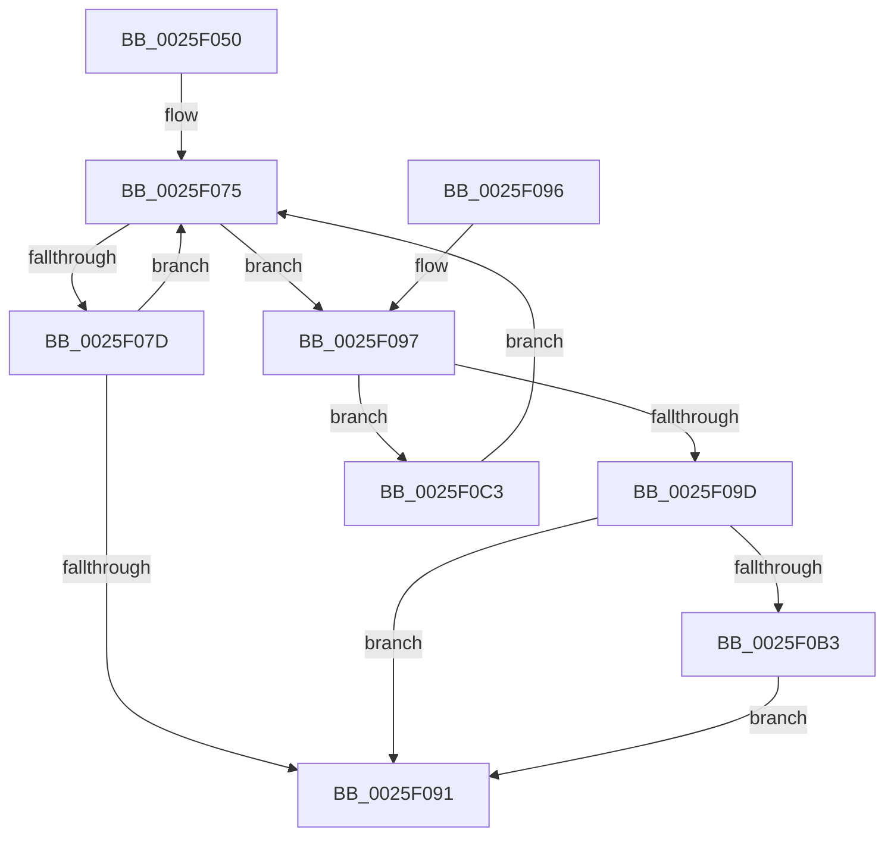

# ExReleaseRundownProtectionCacheAwareEx

- RVA: `0x0025F050`–`0x0025F0C8` (길이 `120` bytes)
- VA: `0x000000014025F050`
- 실행 섹션: `.text`
- PDB 이름 있음: `예`; PDB Function 태그: `아니요`
- unwind 정보 RVA: `0x0005CEF4`
- 디코드: `38`개 명령, `120/120` bytes 표시
- 미해석 바이트: `0` (있으면 어셈블리에 `.byte`로 보존)

> 이 문서는 커널 이미지의 기계어와 PDB 기호를 분석해 생성했습니다. 4번과 5번은 함수 원형과 자료형을 바이너리 사용 방식에서 추정한 C 해석이며 원본 소스 복구 결과는 아닙니다.

## 1. Dependencies

- 직접 호출 지점: **1**; 고유 호출 대상: **1**
- 직접 호출자로 확인된 함수: **38**
- RIP 상대 이미지 참조: **0**

### Outgoing calls
- `0x0025F0BC` → [KeSetEvent](../33/KeSetEvent_function_0033F310.md) (function, `0x0033F310`)

### Direct callers
- [EtwpQueueApc](../20/EtwpQueueApc_function_00203B7C.md) at `0x00203DDC`
- [EtwpEventWriteFull](../22/EtwpEventWriteFull_function_00225C10.md) at `0x0022621F`
- [EtwpEventWriteFull](../22/EtwpEventWriteFull_function_00225C10.md) at `0x0022683C`
- [EtwpEventWriteFull](../22/EtwpEventWriteFull_function_00225C10.md) at `0x00226A0F`
- [EtwpEventWriteFull](../22/EtwpEventWriteFull_function_00225C10.md) at `0x00227710`
- [EtwpLogKernelEvent](EtwpLogKernelEvent_function_0025CC00.md) at `0x0025CEE6`
- [EtwpOpenLogger](../2F/EtwpOpenLogger_function_002F77F0.md) at `0x002F789E`
- [EtwpApcPoolThunk](../2F/EtwpApcPoolThunk_function_002FA090.md) at `0x002FA232`
- [EtwpTraceMessageVa](../2F/EtwpTraceMessageVa_function_002FB2B0.md) at `0x002FBAA4`
- [EtwpTraceMessageVa](../2F/EtwpTraceMessageVa_function_002FB2B0.md) at `0x002FBCA8`
- [EtwpLogSystemEventUnsafe](../2F/EtwpLogSystemEventUnsafe_function_002FBF10.md) at `0x002FC388`
- [EtwTraceEvent](../2F/EtwTraceEvent_function_002FD290.md) at `0x002FD7C3`
- [EtwpFailLogging](../3F/EtwpFailLogging_function_003F0A50.md) at `0x003F0B20`
- [EtwpFailLogging](../3F/EtwpFailLogging_function_003F0A50.md) at `0x003F0CC5`
- [EtwpCloseLogger](../41/EtwpCloseLogger_function_00418060.md) at `0x0041807B`
- [EtwpFinalizePendingApc](../44/EtwpFinalizePendingApc_function_004486A4.md) at `0x004486DE`
- [RawEndOperation](../48/RawEndOperation_function_0048E70C.md) at `0x0048E728`
- [EtwpApcPoolDpc](../4A/EtwpApcPoolDpc_function_004A2700.md) at `0x004A2790`
- [EtwpQueueApcPoolDpc](../4D/EtwpQueueApcPoolDpc_function_004DA1A4.md) at `0x004DA282`
- [EtwpCompressionProc](../65/EtwpCompressionProc_function_00653300.md) at `0x006533C6`
- [EtwInitialize](../../page/7B/EtwInitialize_function_007B4D40.md) at `0x007B4E8E`
- [EtwpQueryTrace](../../page/8B/EtwpQueryTrace_function_008BF8B0.md) at `0x008BF958`
- [EtwpUpdateEnableMask](../../page/8C/EtwpUpdateEnableMask_function_008C0948.md) at `0x008C0A25`
- [EtwpUpdateEnableMask](../../page/8C/EtwpUpdateEnableMask_function_008C0948.md) at `0x008C0A79`
- [sub_008C28B0](../../page/8C/Unknown_function_008C28B0.md) at `0x008C2C54`
- [sub_008C28B0](../../page/8C/Unknown_function_008C28B0.md) at `0x008C2C9B`
- [EtwpAcquireLoggerContext](../../page/93/EtwpAcquireLoggerContext_function_009326AC.md) at `0x009327D0`
- [EtwpAcquireLoggerContextByLoggerName](../../page/93/EtwpAcquireLoggerContextByLoggerName_function_0093283C.md) at `0x009328B7`
- [sub_0093299F](../../page/93/Unknown_function_0093299F.md) at `0x009329C8`
- [EtwpStopTrace](../../page/9B/EtwpStopTrace_function_009BCE84.md) at `0x009BCF8B`
- [EtwpStopTrace](../../page/9B/EtwpStopTrace_function_009BCE84.md) at `0x009BCFE8`
- [EtwpStopTrace](../../page/9B/EtwpStopTrace_function_009BCE84.md) at `0x009BD076`
- [EtwpStopTrace](../../page/9B/EtwpStopTrace_function_009BCE84.md) at `0x009BD0DC`
- [EtwpFreeLoggerContext](../../page/9C/EtwpFreeLoggerContext_function_009C1688.md) at `0x009C16E6`
- [EtwpCheckLoggerAccessAndDoRundown](../../page/9E/EtwpCheckLoggerAccessAndDoRundown_function_009E3EFC.md) at `0x009E3FCE`
- [sub_009E8C24](../../page/9E/Unknown_function_009E8C24.md) at `0x009E922B`
- [EtwpUpdateDisallowList](../../page/9E/EtwpUpdateDisallowList_function_009EA880.md) at `0x009EA8D4`
- [EtwpReleaseLoggerContext](../../page/A0/EtwpReleaseLoggerContext_function_00A04160.md) at `0x00A04195`
- [EtwpEventTracingCounterSetCallback](../../page/A0/EtwpEventTracingCounterSetCallback_function_00A0E0C0.md) at `0x00A0E32F`
- [EtwSetPerformanceTraceInformation](../../page/A5/EtwSetPerformanceTraceInformation_function_00A53928.md) at `0x00A53AA4`
- [WdipSemGetLoggerIds](../../page/A5/WdipSemGetLoggerIds_function_00A5CBB4.md) at `0x00A5CCC6`
- [WdipSemGetLoggerIds](../../page/A5/WdipSemGetLoggerIds_function_00A5CBB4.md) at `0x00A5CCF9`
- [EtwpLookupLoggerIdByName](../../page/A6/EtwpLookupLoggerIdByName_function_00A60FF8.md) at `0x00A6106A`
- [EtwpRealtimeConnect](../../page/A6/EtwpRealtimeConnect_function_00A65C88.md) at `0x00A660A3`
- [EtwpRealtimeConnect](../../page/A6/EtwpRealtimeConnect_function_00A65C88.md) at `0x00A660EC`
- [AddDecodeGuidToSessions](../../page/A7/AddDecodeGuidToSessions_function_00A79A7C.md) at `0x00A79B11`
- [EtwpGetDisallowList](../../page/A7/EtwpGetDisallowList_function_00A7DE80.md) at `0x00A7DF59`
- [EtwpStartLogger](../../page/A9/EtwpStartLogger_function_00A99D80.md) at `0x00A9A809`
- [EtwpStartLogger](../../page/A9/EtwpStartLogger_function_00A99D80.md) at `0x00A9ACDD`
- [EtwQueryTraceHandleByLoggerName](../../page/AA/EtwQueryTraceHandleByLoggerName_function_00AA2578.md) at `0x00AA25F7`
- [EtwpWriteUserEvent](../../page/AF/EtwpWriteUserEvent_function_00AF2FEC.md) at `0x00AF3434`
- [EtwpWriteUserEvent](../../page/AF/EtwpWriteUserEvent_function_00AF2FEC.md) at `0x00AF3855`
- [EtwpWriteUserEvent](../../page/AF/EtwpWriteUserEvent_function_00AF2FEC.md) at `0x00AF394E`
- [EtwpWriteUserEvent](../../page/AF/EtwpWriteUserEvent_function_00AF2FEC.md) at `0x00AF39EC`
- [EtwpWriteUserEvent](../../page/AF/EtwpWriteUserEvent_function_00AF2FEC.md) at `0x00AF3BC7`
- [EtwpWriteUserEvent](../../page/AF/EtwpWriteUserEvent_function_00AF2FEC.md) at `0x00AF46A0`
- [EtwpWriteUserEvent](../../page/AF/EtwpWriteUserEvent_function_00AF2FEC.md) at `0x00AF46FC`

### Static image references
- 디코드된 RIP-relative 메모리 참조가 없습니다.

## 2. Other-region calls and transfers

- 다른 실행 섹션으로 향하는 call: **0**
- 별도 외부 분기/꼬리 이동을 확인하지 못했습니다.

## 3. Assembly (complete function range)

```asm
0025F050  48 83 EC 28                     sub rsp, 0x28
0025F054  65 8B 04 25 A4 01 00 00         mov eax, dword ptr gs:[0x1a4]
0025F05C  4C 8B D9                        mov r11, rcx
0025F05F  44 8B D2                        mov r10d, edx
0025F062  33 D2                           xor edx, edx
0025F064  F7 71 14                        div dword ptr [rcx + 0x14]
0025F067  0F AF 51 10                     imul edx, dword ptr [rcx + 0x10]
0025F06B  44 8B CA                        mov r9d, edx
0025F06E  4C 03 09                        add r9, qword ptr [rcx]
0025F071  41 0F 0D 09                     prefetchw byte ptr [r9]
0025F075  49 8B 09                        mov rcx, qword ptr [r9]
0025F078  F6 C1 01                        test cl, 1
0025F07B  75 1A                           jne 0x14025f097
0025F07D  43 8D 14 12                     lea edx, [r10 + r10]
0025F081  4C 8B C1                        mov r8, rcx
0025F084  4C 2B C2                        sub r8, rdx
0025F087  48 8B C1                        mov rax, rcx
0025F08A  F0 4D 0F B1 01                  lock cmpxchg qword ptr [r9], r8
0025F08F  75 E4                           jne 0x14025f075
0025F091  48 83 C4 28                     add rsp, 0x28
0025F095  C3                              ret
0025F096  CC                              int3
0025F097  48 83 F9 01                     cmp rcx, 1
0025F09B  74 26                           je 0x14025f0c3
0025F09D  48 83 E1 FE                     and rcx, 0xfffffffffffffffe
0025F0A1  41 8B C2                        mov eax, r10d
0025F0A4  F7 D8                           neg eax
0025F0A6  48 63 D0                        movsxd rdx, eax
0025F0A9  F0 48 0F C1 11                  lock xadd qword ptr [rcx], rdx
0025F0AE  49 3B D2                        cmp rdx, r10
0025F0B1  75 DE                           jne 0x14025f091
0025F0B3  48 83 C1 08                     add rcx, 8
0025F0B7  45 33 C0                        xor r8d, r8d
0025F0BA  33 D2                           xor edx, edx
0025F0BC  E8 4F 02 0E 00                  call 0x14033f310
0025F0C1  EB CE                           jmp 0x14025f091
0025F0C3  4D 8B 0B                        mov r9, qword ptr [r11]
0025F0C6  EB AD                           jmp 0x14025f075
```

## 4. C-style interpretation (structured pseudocode)

```c
__int64 __fastcall ExReleaseRundownProtectionCacheAwareEx(__int64 a1, int a2)
{
    __int64 result;
    __int64 v_rsp;

    v_rsp = (v_rsp) - (40);
    a2 = 0;
    a2 = (unsigned int)((a2) * (*(unsigned int *)(a1 + 16)));
    a4 = ((unsigned int)(a2)) + (*(unsigned __int64 *)(a1));
loc_0025F075:
    if ((((unsigned __int8)(*(unsigned __int64 *)(a4))) & (1)) != 0) goto loc_0025F097;
    a3 = (*(unsigned __int64 *)(a4)) - ((unsigned int)(a2) + (unsigned int)(a2) * 1);
    if (condition_is_not_equal) goto loc_0025F075;
loc_0025F091:
    v_rsp = (v_rsp) + (40);
    return *(unsigned __int64 *)(a4);
loc_0025F097:
    if ((*(unsigned __int64 *)(a4)) == 1) goto loc_0025F0C3;
    a1 = (*(unsigned __int64 *)(a4)) & (-2);
    result = (unsigned int)(-((unsigned int)((unsigned int)((unsigned int)(a2)))));
    if (((int)((unsigned int)(result))) != ((unsigned int)(a2))) goto loc_0025F091;
    a1 = (a1) + (8);
    a3 = 0;
    a2 = 0;
    result = KeSetEvent(a1, a2, a3, a4);
    goto loc_0025F091;
loc_0025F0C3:
    goto loc_0025F075;
}
```

## 5. (Beta) C Style

```c
int64_t ExReleaseRundownProtectionCacheAwareEx(void *Arg1, void *Arg2)
{
    uint8_t *arg1 = (uint8_t *)Arg1;
    uint8_t *arg2 = (uint8_t *)Arg2;

    int64_t result;
    int64_t local_rsp;

    local_rsp = (local_rsp) - (40);
    Arg2 = 0;
    Arg2 = (uint32_t)((Arg2) * (*(uint32_t *)(arg1 + 0x10)));
    a4 = ((uint32_t)(Arg2)) + (*(uint64_t *)(arg1));
loc_0025F075:
    if ((((uint8_t)(*(uint64_t *)(a4))) & (1)) != 0) goto loc_0025F097;
    a3 = (*(uint64_t *)(a4)) - ((uint32_t)(Arg2) + (uint32_t)(Arg2) * 1);
    if (condition_is_not_equal) goto loc_0025F075;
loc_0025F091:
    local_rsp = (local_rsp) + (40);
    return *(uint64_t *)(a4);
loc_0025F097:
    if ((*(uint64_t *)(a4)) == 1) goto loc_0025F0C3;
    Arg1 = (*(uint64_t *)(a4)) & (-2);
    result = (uint32_t)(-((uint32_t)((uint32_t)((uint32_t)(Arg2)))));
    if (((int32_t)((uint32_t)(result))) != ((uint32_t)(Arg2))) goto loc_0025F091;
    Arg1 = (Arg1) + (8);
    a3 = 0;
    Arg2 = 0;
    result = KeSetEvent(Arg1, Arg2, a3, a4);
    goto loc_0025F091;
loc_0025F0C3:
    goto loc_0025F075;
}
```

### 관측된 메모리 오프셋

구조체 형식이 확인되지 않은 접근은 인자 기준의 오프셋으로만 기록했습니다.

| 기준 인자 | 오프셋 표현 | 폭 (bit) | 접근 |
|---|---:|---:|---|
| `Arg1` | `+ 0x0` | `64` | `R` |
| `Arg1` | `+ 0x10` | `32` | `R` |
| `Arg1` | `+ 0x14` | `32` | `R` |
| `Arg2` | `+ 0x0 + r10*1` | `32` | `R` |

## 6. Execution-region graph

[열기: 2D/3D 그래프와 함수 탐색 컨트롤 패널](../../../control-panel.html?section=text&rva=0x0025F050&view=graph)

- 2D 그래프는 위에서 아래로 흐르고, 3D 그래프는 빈 공간을 드래그해 회전합니다. Shift+드래그는 이동, 휠은 확대·축소, 함수 노드 선택은 대상 보고서 이동입니다.

### Static fallback


