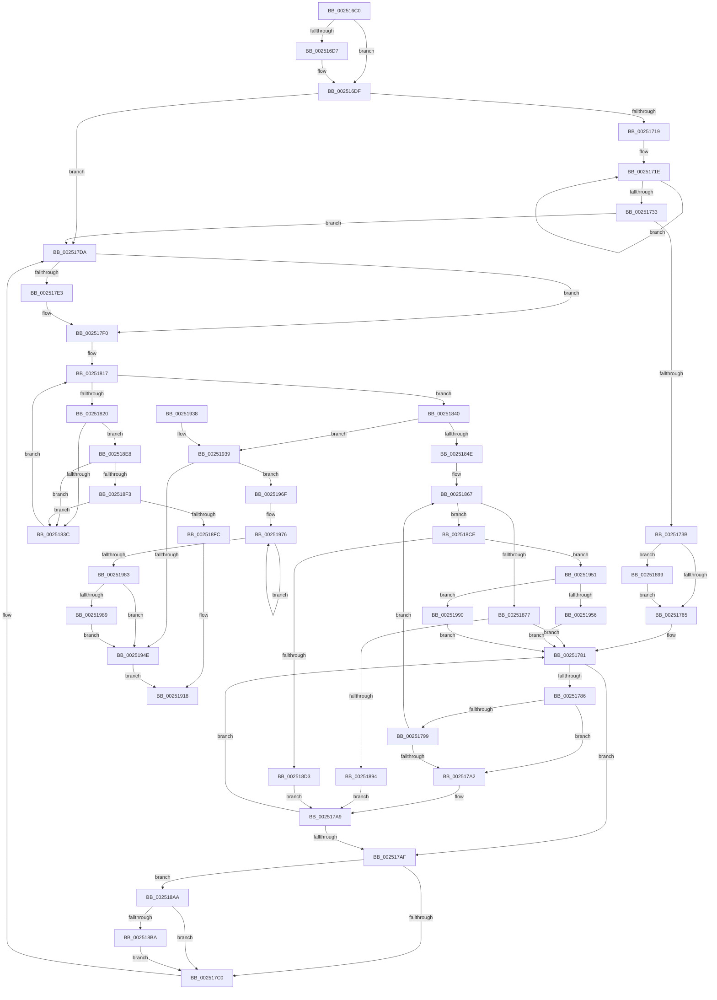

# FsRtlReleaseHeaderMutex

- RVA: `0x002516C0`–`0x002519AC` (길이 `748` bytes)
- VA: `0x00000001402516C0`
- 실행 섹션: `.text`
- PDB 이름 있음: `예`; PDB Function 태그: `아니요`
- unwind 정보 RVA: `0x00063500`
- 디코드: `191`개 명령, `748/748` bytes 표시
- 미해석 바이트: `0` (있으면 어셈블리에 `.byte`로 보존)

> 이 문서는 커널 이미지의 기계어와 PDB 기호를 분석해 생성했습니다. 4번과 5번은 함수 원형과 자료형을 바이너리 사용 방식에서 추정한 C 해석이며 원본 소스 복구 결과는 아닙니다.

## 1. Dependencies

- 직접 호출 지점: **12**; 고유 호출 대상: **11**
- 직접 호출자로 확인된 함수: **2**
- RIP 상대 이미지 참조: **1**

### Outgoing calls
- `0x00251772` → [KiAcquireKobjectLockSafe](KiAcquireKobjectLockSafe_function_00251C90.md) (function, `0x00251C90`)
- `0x002517D5` → [KiExitDispatcher](KiExitDispatcher_function_00251CF0.md) (function, `0x00251CF0`)
- `0x002517EB` → [KiLowerIrqlProcessIrqlFlags](../4F/KiLowerIrqlProcessIrqlFlags_function_004F5698.md) (function, `0x004F5698`)
- `0x00251861` → [KeBugCheckEx](../4F/KeBugCheckEx_function_004FD660.md) (function, `0x004FD660`)
- `0x00251887` → [KiTryUnwaitThread](../35/KiTryUnwaitThread_function_003506D0.md) (function, `0x003506D0`)
- `0x002518A0` → [KiRaiseIrqlProcessIrqlFlags](../4F/KiRaiseIrqlProcessIrqlFlags_function_004F56FC.md) (function, `0x004F56FC`)
- `0x002518C4` → [KeAbPreWakeupThread](../35/KeAbPreWakeupThread_function_0035034C.md) (function, `0x0035034C`)
- `0x002518DE` → [KiInsertQueueInternal](../21/KiInsertQueueInternal_function_00219B30.md) (function, `0x00219B30`)
- `0x00251913` → [KiAbEntryFreeAndEnableInterrupts](../26/KiAbEntryFreeAndEnableInterrupts_function_002622D0.md) (function, `0x002622D0`)
- `0x00251965` → [KiTryUnwaitThread](../35/KiTryUnwaitThread_function_003506D0.md) (function, `0x003506D0`)
- `0x00251989` → [KiRemoveSystemWorkPriorityKick](../26/KiRemoveSystemWorkPriorityKick_function_002631D0.md) (function, `0x002631D0`)
- `0x002519A2` → [KeInsertQueueDpc](../20/KeInsertQueueDpc_function_00207C50.md) (function, `0x00207C50`)

### Direct callers
- [sub_0034FEB1](../34/Unknown_function_0034FEB1.md) at `0x0034FEBC`
- [FsRtlpWaitForIoAtEof](../41/FsRtlpWaitForIoAtEof_function_00415298.md) at `0x004153ED`

### Static image references
- `0x00251759` → RVA `0x00FC6D20` (`ALMOSTRO`; read)

## 2. Other-region calls and transfers

- 다른 실행 섹션으로 향하는 call: **0**
- 별도 외부 분기/꼬리 이동을 확인하지 못했습니다.

## 3. Assembly (complete function range)

```asm
002516C0  48 89 54 24 10                  mov qword ptr [rsp + 0x10], rdx
002516C5  53                              push rbx
002516C6  55                              push rbp
002516C7  56                              push rsi
002516C8  57                              push rdi
002516C9  48 83 EC 48                     sub rsp, 0x48
002516CD  48 8B 44 24 78                  mov rax, qword ptr [rsp + 0x78]
002516D2  48 85 C0                        test rax, rax
002516D5  74 08                           je 0x1402516df
002516D7  48 8B 44 24 78                  mov rax, qword ptr [rsp + 0x78]
002516DC  F0 FF 00                        lock inc dword ptr [rax]
002516DF  48 8B 41 18                     mov rax, qword ptr [rcx + 0x18]
002516E3  33 FF                           xor edi, edi
002516E5  4C 89 A4 24 80 00 00 00         mov qword ptr [rsp + 0x80], r12
002516ED  BE 01 00 00 00                  mov esi, 1
002516F2  4C 89 6C 24 40                  mov qword ptr [rsp + 0x40], r13
002516F7  4C 89 74 24 38                  mov qword ptr [rsp + 0x38], r14
002516FC  48 8B 58 30                     mov rbx, qword ptr [rax + 0x30]
00251700  33 C0                           xor eax, eax
00251702  4C 89 7C 24 30                  mov qword ptr [rsp + 0x30], r15
00251707  0F B6 6B 30                     movzx ebp, byte ptr [rbx + 0x30]
0025170B  48 89 7B 08                     mov qword ptr [rbx + 8], rdi
0025170F  F0 0F B1 33                     lock cmpxchg dword ptr [rbx], esi
00251713  0F 84 C1 00 00 00               je 0x1402517da
00251719  48 89 7C 24 70                  mov qword ptr [rsp + 0x70], rdi
0025171E  8B D0                           mov edx, eax
00251720  B9 FF FF FF FF                  mov ecx, 0xffffffff
00251725  83 E2 02                        and edx, 2
00251728  0F 45 CE                        cmovne ecx, esi
0025172B  03 C8                           add ecx, eax
0025172D  F0 0F B1 0B                     lock cmpxchg dword ptr [rbx], ecx
00251731  75 EB                           jne 0x14025171e
00251733  85 D2                           test edx, edx
00251735  0F 85 9F 00 00 00               jne 0x1402517da
0025173B  65 48 8B 04 25 88 01 00 00      mov rax, qword ptr gs:[0x188]
00251744  44 0F B6 A8 C3 00 00 00         movzx r13d, byte ptr [rax + 0xc3]
0025174C  45 0F 20 C4                     mov r12, cr8
00251750  B8 02 00 00 00                  mov eax, 2
00251755  44 0F 22 C0                     mov cr8, rax
00251759  39 3D C1 55 D7 00               cmp dword ptr [rip + 0xd755c1], edi
0025175F  0F 85 34 01 00 00               jne 0x140251899
00251765  65 4C 8B 3C 25 20 00 00 00      mov r15, qword ptr gs:[0x20]
0025176E  48 8D 4B 18                     lea rcx, [rbx + 0x18]
00251772  E8 19 05 00 00                  call 0x140251c90
00251777  4C 8D 73 20                     lea r14, [rbx + 0x20]
0025177B  89 73 1C                        mov dword ptr [rbx + 0x1c], esi
0025177E  49 8B 36                        mov rsi, qword ptr [r14]
00251781  49 3B F6                        cmp rsi, r14
00251784  74 29                           je 0x1402517af
00251786  48 8B 16                        mov rdx, qword ptr [rsi]
00251789  48 8B C6                        mov rax, rsi
0025178C  48 8B F2                        mov rsi, rdx
0025178F  48 8B 48 08                     mov rcx, qword ptr [rax + 8]
00251793  48 39 42 08                     cmp qword ptr [rdx + 8], rax
00251797  75 09                           jne 0x1402517a2
00251799  48 39 01                        cmp qword ptr [rcx], rax
0025179C  0F 84 C5 00 00 00               je 0x140251867
002517A2  B9 03 00 00 00                  mov ecx, 3
002517A7  CD 29                           int 0x29
002517A9  83 6B 1C 01                     sub dword ptr [rbx + 0x1c], 1
002517AD  75 D2                           jne 0x140251781
002517AF  F0 81 63 18 7F FF FF FF         lock and dword ptr [rbx + 0x18], 0xffffff7f
002517B7  45 84 ED                        test r13b, r13b
002517BA  0F 85 EA 00 00 00               jne 0x1402518aa
002517C0  BE 01 00 00 00                  mov esi, 1
002517C5  44 88 64 24 20                  mov byte ptr [rsp + 0x20], r12b
002517CA  44 8B CE                        mov r9d, esi
002517CD  44 8B C6                        mov r8d, esi
002517D0  33 D2                           xor edx, edx
002517D2  49 8B CF                        mov rcx, r15
002517D5  E8 16 05 00 00                  call 0x140251cf0
002517DA  83 3D 3F 55 D7 00 00            cmp dword ptr [rip + 0xd7553f], 0
002517E1  74 0D                           je 0x1402517f0
002517E3  44 0F 20 C1                     mov rcx, cr8
002517E7  40 0F B6 D5                     movzx edx, bpl
002517EB  E8 A8 3E 2A 00                  call 0x1404f5698
002517F0  44 0F 22 C5                     mov cr8, rbp
002517F4  65 4C 8B 14 25 88 01 00 00      mov r10, qword ptr gs:[0x188]
002517FD  FA                              cli
002517FE  4D 8B 82 70 04 00 00            mov r8, qword ptr [r10 + 0x470]
00251805  4C 8B CB                        mov r9, rbx
00251808  48 BD FC FF FF FF FF FF FF 7F   movabs rbp, 0x7ffffffffffffffc
00251812  8B C7                           mov eax, edi
00251814  4C 23 CD                        and r9, rbp
00251817  41 0F B6 48 0C                  movzx ecx, byte ptr [r8 + 0xc]
0025181C  3B C1                           cmp eax, ecx
0025181E  73 20                           jae 0x140251840
00251820  8B C8                           mov ecx, eax
00251822  4C 6B D9 58                     imul r11, rcx, 0x58
00251826  4D 03 D8                        add r11, r8
00251829  49 8B 53 10                     mov rdx, qword ptr [r11 + 0x10]
0025182D  48 8B CA                        mov rcx, rdx
00251830  48 23 CD                        and rcx, rbp
00251833  49 3B C9                        cmp rcx, r9
00251836  0F 84 AC 00 00 00               je 0x1402518e8
0025183C  FF C0                           inc eax
0025183E  EB D7                           jmp 0x140251817
00251840  41 8B 42 78                     mov eax, dword ptr [r10 + 0x78]
00251844  0F BA E0 10                     bt eax, 0x10
00251848  0F 82 EB 00 00 00               jb 0x140251939
0025184E  45 33 C9                        xor r9d, r9d
00251851  48 89 7C 24 20                  mov qword ptr [rsp + 0x20], rdi
00251856  4C 8B C3                        mov r8, rbx
00251859  49 8B D2                        mov rdx, r10
0025185C  B9 62 01 00 00                  mov ecx, 0x162
00251861  E8 FA BD 2A 00                  call 0x1404fd660
00251866  CC                              int3
00251867  48 89 11                        mov qword ptr [rcx], rdx
0025186A  48 89 4A 08                     mov qword ptr [rdx + 8], rcx
0025186E  0F B6 48 10                     movzx ecx, byte ptr [rax + 0x10]
00251872  80 F9 01                        cmp cl, 1
00251875  75 57                           jne 0x1402518ce
00251877  44 0F B7 40 12                  movzx r8d, word ptr [rax + 0x12]
0025187C  4C 8D 4C 24 70                  lea r9, [rsp + 0x70]
00251881  48 8B D0                        mov rdx, rax
00251884  49 8B CF                        mov rcx, r15
00251887  E8 44 EE 0F 00                  call 0x1403506d0
0025188C  84 C0                           test al, al
0025188E  0F 84 ED FE FF FF               je 0x140251781
00251894  E9 10 FF FF FF                  jmp 0x1402517a9
00251899  0F B6 D0                        movzx edx, al
0025189C  41 0F B6 CC                     movzx ecx, r12b
002518A0  E8 57 3E 2A 00                  call 0x1404f56fc
002518A5  E9 BB FE FF FF                  jmp 0x140251765
002518AA  49 8B 8F 08 2D 00 00            mov rcx, qword ptr [r15 + 0x2d08]
002518B1  48 85 C9                        test rcx, rcx
002518B4  0F 84 06 FF FF FF               je 0x1402517c0
002518BA  48 81 C1 28 FF FF FF            add rcx, -0xd8
002518C1  48 8B D3                        mov rdx, rbx
002518C4  E8 83 EA 0F 00                  call 0x14035034c
002518C9  E9 F2 FE FF FF                  jmp 0x1402517c0
002518CE  80 F9 02                        cmp cl, 2
002518D1  75 7E                           jne 0x140251951
002518D3  C6 40 11 05                     mov byte ptr [rax + 0x11], 5
002518D7  48 8B D0                        mov rdx, rax
002518DA  48 8B 48 18                     mov rcx, qword ptr [rax + 0x18]
002518DE  E8 4D 82 FC FF                  call 0x140219b30
002518E3  E9 C1 FE FF FF                  jmp 0x1402517a9
002518E8  41 80 7B 1A 00                  cmp byte ptr [r11 + 0x1a], 0
002518ED  0F 84 49 FF FF FF               je 0x14025183c
002518F3  F6 C2 01                        test dl, 1
002518F6  0F 85 40 FF FF FF               jne 0x14025183c
002518FC  44 8B CE                        mov r9d, esi
002518FF  41 C6 43 1A 00                  mov byte ptr [r11 + 0x1a], 0
00251904  4C 8B C3                        mov r8, rbx
00251907  48 89 7C 24 20                  mov qword ptr [rsp + 0x20], rdi
0025190C  49 8B D2                        mov rdx, r10
0025190F  49 8D 4B 10                     lea rcx, [r11 + 0x10]
00251913  E8 B8 09 01 00                  call 0x1402622d0
00251918  4C 8B 7C 24 30                  mov r15, qword ptr [rsp + 0x30]
0025191D  4C 8B 74 24 38                  mov r14, qword ptr [rsp + 0x38]
00251922  4C 8B 6C 24 40                  mov r13, qword ptr [rsp + 0x40]
00251927  4C 8B A4 24 80 00 00 00         mov r12, qword ptr [rsp + 0x80]
0025192F  48 83 C4 48                     add rsp, 0x48
00251933  5F                              pop rdi
00251934  5E                              pop rsi
00251935  5D                              pop rbp
00251936  5B                              pop rbx
00251937  C3                              ret
00251938  CC                              int3
00251939  65 48 8B 0C 25 20 00 00 00      mov rcx, qword ptr gs:[0x20]
00251942  4C 8B 81 B8 8E 00 00            mov r8, qword ptr [rcx + 0x8eb8]
00251949  4D 85 C0                        test r8, r8
0025194C  75 21                           jne 0x14025196f
0025194E  FB                              sti
0025194F  EB C7                           jmp 0x140251918
00251951  80 F9 04                        cmp cl, 4
00251954  74 3A                           je 0x140251990
00251956  45 33 C9                        xor r9d, r9d
00251959  41 B8 00 01 00 00               mov r8d, 0x100
0025195F  48 8B D0                        mov rdx, rax
00251962  49 8B CF                        mov rcx, r15
00251965  E8 66 ED 0F 00                  call 0x1403506d0
0025196A  E9 12 FE FF FF                  jmp 0x140251781
0025196F  41 0F 0D 08                     prefetchw byte ptr [r8]
00251973  41 8B 00                        mov eax, dword ptr [r8]
00251976  8B D0                           mov edx, eax
00251978  0F BA F2 15                     btr edx, 0x15
0025197C  F0 41 0F B1 10                  lock cmpxchg dword ptr [r8], edx
00251981  75 F3                           jne 0x140251976
00251983  0F BA E0 15                     bt eax, 0x15
00251987  73 C5                           jae 0x14025194e
00251989  E8 42 18 01 00                  call 0x1402631d0
0025198E  EB BE                           jmp 0x14025194e
00251990  C6 40 11 05                     mov byte ptr [rax + 0x11], 5
00251994  48 8D 53 18                     lea rdx, [rbx + 0x18]
00251998  89 7B 1C                        mov dword ptr [rbx + 0x1c], edi
0025199B  4C 8B C0                        mov r8, rax
0025199E  48 8B 48 18                     mov rcx, qword ptr [rax + 0x18]
002519A2  E8 A9 62 FB FF                  call 0x140207c50
002519A7  E9 D5 FD FF FF                  jmp 0x140251781
```

## 4. C-style interpretation (structured pseudocode)

```c
__int64 __fastcall FsRtlReleaseHeaderMutex(__int64 a1, __int64 a2)
{
    __int64 result;
    __int64 v_r11;
    __int64 v_rdi;
    __int64 v_rsp;
    unsigned __int64 v_stack_m28;
    unsigned __int64 v_stack_m30;
    unsigned __int64 v_stack_m38;
    unsigned __int8 v_stack_m48;
    unsigned __int64 v_stack_p10;
    unsigned __int64 v_stack_p18;
    unsigned __int64 v_stack_p8;

    v_stack_p10 = a2;
    v_rsp = (v_rsp) - (72);
    result = v_stack_p10;
    if (v_stack_p10 != 0) {
        result = v_stack_p10;
    }
    v_rdi = 0;
    v_stack_p18 = v_r12;
    v_stack_m28 = v_r13;
    v_stack_m30 = v_r14;
    result = 0;
    v_stack_m38 = v_r15;
    *(unsigned __int64 *)(*(unsigned __int64 *)(*(unsigned __int64 *)(a1 + 24) + 48) + 8) = 0;
    if (condition_is_equal) goto loc_002517DA;
    v_stack_p8 = 0;
loc_0025171E:
    a2 = (unsigned int)((0) & (2));
    a1 = (unsigned int)(0xFFFFFFFFULL);
    if (condition_is_not_equal) { a1 = 1; }
    a1 = (unsigned int)((a1) + (0));
    if (condition_is_not_equal) goto loc_0025171E;
    if ((unsigned int)(a2) != 0) goto loc_002517DA;
    if ((*(unsigned int *)(v_rip + 14112193)) != 0) goto loc_00251899;
loc_00251765:
    result = KiAcquireKobjectLockSafe(*(unsigned __int64 *)(*(unsigned __int64 *)(a1 + 24) + 48) + 24, a2, a3, a4);
    *(unsigned int *)(*(unsigned __int64 *)(*(unsigned __int64 *)(a1 + 24) + 48) + 28) = 1;
loc_00251781:
    if ((*(unsigned __int64 *)(*(unsigned __int64 *)(*(unsigned __int64 *)(a1 + 24) + 48) + 32)) == (*(unsigned __int64 *)(*(unsigned __int64 *)(a1 + 24) + 48) + 32)) goto loc_002517AF;
    if ((*(unsigned __int64 *)(*(unsigned __int64 *)(*(unsigned __int64 *)(*(unsigned __int64 *)(*(unsigned __int64 *)(a1 + 24) + 48) + 32)) + 8)) != (*(unsigned __int64 *)(*(unsigned __int64 *)(*(unsigned __int64 *)(a1 + 24) + 48) + 32))) goto loc_002517A2;
    if ((*(unsigned __int64 *)(*(unsigned __int64 *)(*(unsigned __int64 *)(*(unsigned __int64 *)(*(unsigned __int64 *)(a1 + 24) + 48) + 32) + 8))) == (*(unsigned __int64 *)(*(unsigned __int64 *)(*(unsigned __int64 *)(a1 + 24) + 48) + 32))) goto loc_00251867;
loc_002517A2:
loc_002517A9:
    if ((*(unsigned __int64 *)(*(unsigned __int64 *)(*(unsigned __int64 *)(*(unsigned __int64 *)(*(unsigned __int64 *)(a1 + 24) + 48) + 32) + 8))) != (*(unsigned __int64 *)(*(unsigned __int64 *)(*(unsigned __int64 *)(a1 + 24) + 48) + 32))) goto loc_00251781;
loc_002517AF:
    if ((unsigned __int8)(*(unsigned __int8 *)(*(unsigned __int64 *)(gs_base + (0 + 392)) + 195)) != 0) goto loc_002518AA;
loc_002517C0:
    v_stack_m48 = (unsigned __int8)(v_cr8);
    a2 = 0;
    result = KiExitDispatcher(*(unsigned __int64 *)(gs_base + (0 + 32)), a2, 1, 1);
loc_002517DA:
    if ((*(unsigned int *)(v_rip + 14112063)) != 0) {
        a1 = 2;
        a2 = (unsigned __int8)(*(unsigned __int8 *)(*(unsigned __int64 *)(*(unsigned __int64 *)(a1 + 24) + 48) + 48));
        result = KiLowerIrqlProcessIrqlFlags(a1, a2, 1, 1);
    }
    a4 = (*(unsigned __int64 *)(*(unsigned __int64 *)(a1 + 24) + 48)) & (*(unsigned __int8 *)(*(unsigned __int64 *)(*(unsigned __int64 *)(a1 + 24) + 48) + 48));
loc_00251817:
    if (0 >= ((unsigned int)(*(unsigned __int8 *)(*(unsigned __int64 *)(*(unsigned __int64 *)(gs_base + (0 + 392)) + 1136) + 12)))) goto loc_00251840;
    v_r11 = (v_r11) * (0);
    v_r11 = (v_r11) + (*(unsigned __int64 *)(*(unsigned __int64 *)(gs_base + (0 + 392)) + 1136));
    a1 = (*(unsigned __int64 *)(v_r11 + 16)) & (*(unsigned __int8 *)(*(unsigned __int64 *)(*(unsigned __int64 *)(a1 + 24) + 48) + 48));
    if (a1 == a4) goto loc_002518E8;
loc_0025183C:
    result = (unsigned int)((0) + 1);
    goto loc_00251817;
loc_00251840:
    if (a1 < a4) goto loc_00251939;
    a4 = 0;
    v_stack_m48 = 0;
    result = KeBugCheckEx(354, *(unsigned __int64 *)(gs_base + (0 + 392)), *(unsigned __int64 *)(*(unsigned __int64 *)(a1 + 24) + 48), a4);
loc_00251867:
    *(unsigned __int64 *)(354) = *(unsigned __int64 *)(gs_base + (0 + 392));
    *(unsigned __int64 *)(*(unsigned __int64 *)(gs_base + (0 + 392)) + 8) = 354;
    if (((unsigned __int8)(*(unsigned __int8 *)(result + 16))) != 1) goto loc_002518CE;
    result = KiTryUnwaitThread(*(unsigned __int64 *)(gs_base + (0 + 32)), result, *(unsigned __int16 *)(result + 18), v_stack_p8);
    if ((unsigned __int8)(result) == 0) goto loc_00251781;
    goto loc_002517A9;
loc_00251899:
    result = KiRaiseIrqlProcessIrqlFlags((unsigned __int8)(v_cr8), (unsigned __int8)(result), *(unsigned __int16 *)(result + 18), v_stack_p8);
    goto loc_00251765;
loc_002518AA:
    if (*(unsigned __int64 *)(*(unsigned __int64 *)(gs_base + (0 + 32)) + 11528) == 0) goto loc_002517C0;
    a1 = (*(unsigned __int64 *)(*(unsigned __int64 *)(gs_base + (0 + 32)) + 11528)) + (-216);
    result = KeAbPreWakeupThread(a1, *(unsigned __int64 *)(*(unsigned __int64 *)(a1 + 24) + 48), *(unsigned __int16 *)(result + 18), v_stack_p8);
    goto loc_002517C0;
loc_002518CE:
    if (((unsigned __int8)(a1)) != 2) goto loc_00251951;
    *(unsigned __int8 *)(result + 17) = 5;
    result = KiInsertQueueInternal(*(unsigned __int64 *)(result + 24), result, *(unsigned __int16 *)(result + 18), v_stack_p8);
    goto loc_002517A9;
loc_002518E8:
    if ((*(unsigned __int8 *)(v_r11 + 26)) == 0) goto loc_0025183C;
    if ((((unsigned __int8)(result)) & (1)) != 0) goto loc_0025183C;
    *(unsigned __int8 *)(v_r11 + 26) = 0;
    v_stack_m48 = 0;
    result = KiAbEntryFreeAndEnableInterrupts(v_r11 + 16, *(unsigned __int64 *)(gs_base + (0 + 392)), *(unsigned __int64 *)(*(unsigned __int64 *)(a1 + 24) + 48), 1);
loc_00251918:
    v_rsp = (v_rsp) + (72);
    return result;
loc_00251939:
    if (*(unsigned __int64 *)(*(unsigned __int64 *)(gs_base + (0 + 32)) + 36536) != 0) goto loc_0025196F;
loc_0025194E:
    goto loc_00251918;
loc_00251951:
    if (((unsigned __int8)(*(unsigned __int64 *)(gs_base + (0 + 32)))) == 4) goto loc_00251990;
    a4 = 0;
    result = KiTryUnwaitThread(v_stack_m38, result, 256, a4);
    goto loc_00251781;
loc_0025196F:
loc_00251976:
    if (condition_is_not_equal) goto loc_00251976;
    if (condition_is_above_or_equal) goto loc_0025194E;
    result = KiRemoveSystemWorkPriorityKick(v_stack_m38, (unsigned int)((unsigned int)((unsigned int)(*(unsigned int *)(256)))), 256, a4);
    goto loc_0025194E;
loc_00251990:
    *(unsigned __int8 *)(result + 17) = 5;
    *(unsigned int *)(*(unsigned __int64 *)(*(unsigned __int64 *)(a1 + 24) + 48) + 28) = 0;
    result = KeInsertQueueDpc(*(unsigned __int64 *)(result + 24), *(unsigned __int64 *)(*(unsigned __int64 *)(a1 + 24) + 48) + 24, result, a4);
    goto loc_00251781;
}
```

## 5. (Beta) C Style

```c
int64_t FsRtlReleaseHeaderMutex(void *Arg1, int64_t Arg2)
{
    uint8_t *arg1 = (uint8_t *)Arg1;

    int64_t result;
    int64_t local_r11;
    int64_t local_rdi;
    int64_t local_rsp;
    uint64_t v_stack_m28;
    uint64_t v_stack_m30;
    uint64_t v_stack_m38;
    uint8_t v_stack_m48;
    uint64_t v_stack_p10;
    uint64_t v_stack_p18;
    uint64_t v_stack_p8;

    v_stack_p10 = Arg2;
    local_rsp = (local_rsp) - (72);
    result = v_stack_p10;
    if (v_stack_p10 != 0) {
        result = v_stack_p10;
    }
    local_rdi = 0;
    v_stack_p18 = local_r12;
    v_stack_m28 = local_r13;
    v_stack_m30 = local_r14;
    result = 0;
    v_stack_m38 = local_r15;
    *(uint64_t *)(*(uint64_t *)(*(uint64_t *)(arg1 + 0x18) + 0x30) + 0x8) = 0;
    if (condition_is_equal) goto loc_002517DA;
    v_stack_p8 = 0;
loc_0025171E:
    Arg2 = (uint32_t)((0) & (2));
    Arg1 = (uint32_t)(0xFFFFFFFFULL);
    if (condition_is_not_equal) { Arg1 = 1; }
    Arg1 = (uint32_t)((Arg1) + (0));
    if (condition_is_not_equal) goto loc_0025171E;
    if ((uint32_t)(Arg2) != 0) goto loc_002517DA;
    if ((*(uint32_t *)(v_rip + 0xD755C1)) != 0) goto loc_00251899;
loc_00251765:
    result = KiAcquireKobjectLockSafe(*(uint64_t *)(*(uint64_t *)(arg1 + 0x18) + 0x30) + 24, Arg2, a3, a4);
    *(uint32_t *)(*(uint64_t *)(*(uint64_t *)(arg1 + 0x18) + 0x30) + 0x1C) = 1;
loc_00251781:
    if ((*(uint64_t *)(*(uint64_t *)(*(uint64_t *)(arg1 + 0x18) + 0x30) + 0x20)) == (*(uint64_t *)(*(uint64_t *)(arg1 + 0x18) + 0x30) + 32)) goto loc_002517AF;
    if ((*(uint64_t *)(*(uint64_t *)(*(uint64_t *)(*(uint64_t *)(*(uint64_t *)(arg1 + 0x18) + 0x30) + 0x20)) + 0x8)) != (*(uint64_t *)(*(uint64_t *)(*(uint64_t *)(arg1 + 0x18) + 0x30) + 0x20))) goto loc_002517A2;
    if ((*(uint64_t *)(*(uint64_t *)(*(uint64_t *)(*(uint64_t *)(*(uint64_t *)(arg1 + 0x18) + 0x30) + 0x20) + 0x8))) == (*(uint64_t *)(*(uint64_t *)(*(uint64_t *)(arg1 + 0x18) + 0x30) + 0x20))) goto loc_00251867;
loc_002517A2:
loc_002517A9:
    if ((*(uint64_t *)(*(uint64_t *)(*(uint64_t *)(*(uint64_t *)(*(uint64_t *)(arg1 + 0x18) + 0x30) + 0x20) + 0x8))) != (*(uint64_t *)(*(uint64_t *)(*(uint64_t *)(arg1 + 0x18) + 0x30) + 0x20))) goto loc_00251781;
loc_002517AF:
    if ((uint8_t)(*(uint8_t *)(*(uint64_t *)(gs_base + (0 + 0x188)) + 0xC3)) != 0) goto loc_002518AA;
loc_002517C0:
    v_stack_m48 = (uint8_t)(v_cr8);
    Arg2 = 0;
    result = KiExitDispatcher(*(uint64_t *)(gs_base + (0 + 0x20)), Arg2, 1, 1);
loc_002517DA:
    if ((*(uint32_t *)(v_rip + 0xD7553F)) != 0) {
        Arg1 = 2;
        Arg2 = (uint8_t)(*(uint8_t *)(*(uint64_t *)(*(uint64_t *)(arg1 + 0x18) + 0x30) + 0x30));
        result = KiLowerIrqlProcessIrqlFlags(Arg1, Arg2, 1, 1);
    }
    a4 = (*(uint64_t *)(*(uint64_t *)(arg1 + 0x18) + 0x30)) & (*(uint8_t *)(*(uint64_t *)(*(uint64_t *)(arg1 + 0x18) + 0x30) + 0x30));
loc_00251817:
    if (0 >= ((uint32_t)(*(uint8_t *)(*(uint64_t *)(*(uint64_t *)(gs_base + (0 + 0x188)) + 0x470) + 0xC)))) goto loc_00251840;
    local_r11 = (local_r11) * (0);
    local_r11 = (local_r11) + (*(uint64_t *)(*(uint64_t *)(gs_base + (0 + 0x188)) + 0x470));
    Arg1 = (*(uint64_t *)(local_r11 + 0x10)) & (*(uint8_t *)(*(uint64_t *)(*(uint64_t *)(arg1 + 0x18) + 0x30) + 0x30));
    if (Arg1 == a4) goto loc_002518E8;
loc_0025183C:
    result = (uint32_t)((0) + 1);
    goto loc_00251817;
loc_00251840:
    if (Arg1 < a4) goto loc_00251939;
    a4 = 0;
    v_stack_m48 = 0;
    result = KeBugCheckEx(354, *(uint64_t *)(gs_base + (0 + 0x188)), *(uint64_t *)(*(uint64_t *)(arg1 + 0x18) + 0x30), a4);
loc_00251867:
    *(uint64_t *)(354) = *(uint64_t *)(gs_base + (0 + 0x188));
    *(uint64_t *)(*(uint64_t *)(gs_base + (0 + 0x188)) + 0x8) = 354;
    if (((uint8_t)(*(uint8_t *)(result + 0x10))) != 1) goto loc_002518CE;
    result = KiTryUnwaitThread(*(uint64_t *)(gs_base + (0 + 0x20)), result, *(uint16_t *)(result + 0x12), v_stack_p8);
    if ((uint8_t)(result) == 0) goto loc_00251781;
    goto loc_002517A9;
loc_00251899:
    result = KiRaiseIrqlProcessIrqlFlags((uint8_t)(v_cr8), (uint8_t)(result), *(uint16_t *)(result + 0x12), v_stack_p8);
    goto loc_00251765;
loc_002518AA:
    if (*(uint64_t *)(*(uint64_t *)(gs_base + (0 + 0x20)) + 0x2D08) == 0) goto loc_002517C0;
    Arg1 = (*(uint64_t *)(*(uint64_t *)(gs_base + (0 + 0x20)) + 0x2D08)) + (-216);
    result = KeAbPreWakeupThread(Arg1, *(uint64_t *)(*(uint64_t *)(arg1 + 0x18) + 0x30), *(uint16_t *)(result + 0x12), v_stack_p8);
    goto loc_002517C0;
loc_002518CE:
    if (((uint8_t)(Arg1)) != 2) goto loc_00251951;
    *(uint8_t *)(result + 0x11) = 5;
    result = KiInsertQueueInternal(*(uint64_t *)(result + 0x18), result, *(uint16_t *)(result + 0x12), v_stack_p8);
    goto loc_002517A9;
loc_002518E8:
    if ((*(uint8_t *)(local_r11 + 0x1A)) == 0) goto loc_0025183C;
    if ((((uint8_t)(result)) & (1)) != 0) goto loc_0025183C;
    *(uint8_t *)(local_r11 + 0x1A) = 0;
    v_stack_m48 = 0;
    result = KiAbEntryFreeAndEnableInterrupts(local_r11 + 16, *(uint64_t *)(gs_base + (0 + 0x188)), *(uint64_t *)(*(uint64_t *)(arg1 + 0x18) + 0x30), 1);
loc_00251918:
    local_rsp = (local_rsp) + (72);
    return result;
loc_00251939:
    if (*(uint64_t *)(*(uint64_t *)(gs_base + (0 + 0x20)) + 0x8EB8) != 0) goto loc_0025196F;
loc_0025194E:
    goto loc_00251918;
loc_00251951:
    if (((uint8_t)(*(uint64_t *)(gs_base + (0 + 0x20)))) == 4) goto loc_00251990;
    a4 = 0;
    result = KiTryUnwaitThread(v_stack_m38, result, 256, a4);
    goto loc_00251781;
loc_0025196F:
loc_00251976:
    if (condition_is_not_equal) goto loc_00251976;
    if (condition_is_above_or_equal) goto loc_0025194E;
    result = KiRemoveSystemWorkPriorityKick(v_stack_m38, (uint32_t)((uint32_t)((uint32_t)(*(uint32_t *)(256)))), 256, a4);
    goto loc_0025194E;
loc_00251990:
    *(uint8_t *)(result + 0x11) = 5;
    *(uint32_t *)(*(uint64_t *)(*(uint64_t *)(arg1 + 0x18) + 0x30) + 0x1C) = 0;
    result = KeInsertQueueDpc(*(uint64_t *)(result + 0x18), *(uint64_t *)(*(uint64_t *)(arg1 + 0x18) + 0x30) + 24, result, a4);
    goto loc_00251781;
}
```

### 관측된 메모리 오프셋

구조체 형식이 확인되지 않은 접근은 인자 기준의 오프셋으로만 기록했습니다.

| 기준 인자 | 오프셋 표현 | 폭 (bit) | 접근 |
|---|---:|---:|---|
| `Arg1` | `+ 0x18` | `64` | `R` |

## 6. Execution-region graph

[열기: 2D/3D 그래프와 함수 탐색 컨트롤 패널](../../../control-panel.html?section=text&rva=0x002516C0&view=graph)

- 2D 그래프는 위에서 아래로 흐르고, 3D 그래프는 빈 공간을 드래그해 회전합니다. Shift+드래그는 이동, 휠은 확대·축소, 함수 노드 선택은 대상 보고서 이동입니다.

### Static fallback


